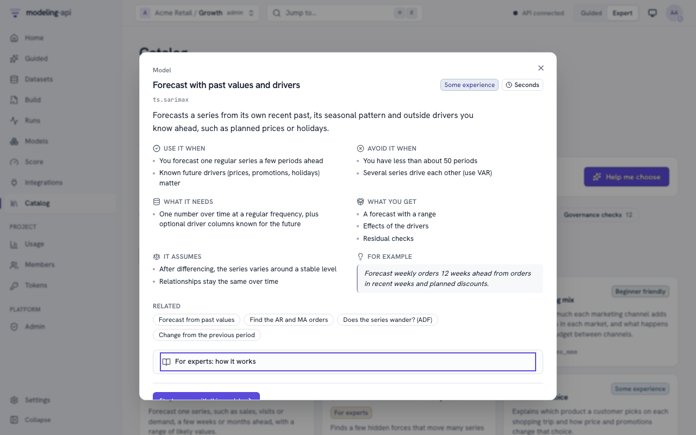
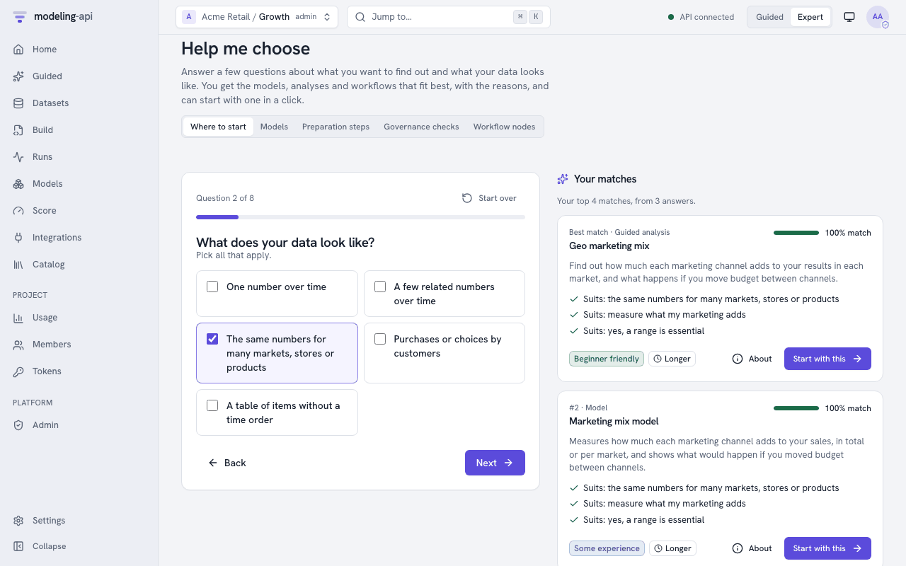

# About cards and choosing <span class="mapi-badge">v0.5</span>

!!! tip "Just want to pick a model?"
    [Choosing a model](../guides/choosing-a-model.md) shows Help me choose in the web app,
    the terminal (`mapi choose`) and Python (`api.catalog.recommend`). It also compares the
    model families.

Many persons who are not statisticians must select a model, a preprocessing step or a
workflow. Thus each item that they can select from a catalog has an **About card** in plain
language. The **Help me choose** chooser asks some questions about their goal and their data.
Then it gives a ranked list with the reasons.

## The About card

```json
{
  "title": "Weekly totals",
  "summary_plain": "Adds up daily numbers into one number per week (or month), so that every row covers the same length of time.",
  "use_when": ["Your data is daily but you want to plan or report by week"],
  "avoid_when": ["Your data already has one row per week"],
  "data_needs": ["A date column"],
  "assumptions": ["Numbers can be added up (spend, sales); averages are averaged"],
  "outputs": ["The same columns, one row per week"],
  "difficulty": "beginner",
  "typical_runtime": "instant",
  "example": "Daily TV spend of 100 each day becomes 700 for the week.",
  "related": ["core.calendar"],
  "fits": {"goal": ["check_data"]}
}
```

| Field | What it holds |
|---|---|
| `title` | A name for persons |
| `summary_plain` | One or two sentences without jargon. They tell what the item does for you. |
| `use_when` / `avoid_when` | When the item fits, and when to select a different item |
| `data_needs` | The data that the item needs |
| `assumptions` | What the item accepts as true |
| `outputs` | What you get from the item |
| `difficulty` | `beginner`, `intermediate` or `expert` |
| `typical_runtime` | `instant`, `seconds`, `minutes` or `long` |
| `example` | A small example of how the item works |
| `related` | Ids of related catalog items |
| `expert_notes`, `references` | The maths and the sources, in a separate place |
| `fits` | Chooser tags: the answers that agree with this item |

These items have cards:

- model manifests and catalog entries (`ModelManifest.about`, `StepCatalogEntry.about`)
- guided templates (`GuidedTemplate.about`)
- workflow templates, node kinds and node implementations
- plot recipes (`PlotCatalogEntry.about`)
- governance checks.

Your own specs, pipelines and workflows can also have a card, in `metadata.about`. Then
colleagues know when to use them again. `GET /v1/catalog/abouts` lists the cards of all items
that a user can select (filter with `kind`). These items are the installed models,
preprocessing steps and plot recipes, the splits, guided templates, workflow templates,
workflow node kinds and nodes, and the governance checks.

Datasets have a `DatasetAbout`. It contains the description from the owner and a summary.
The platform makes the summary from the schema and the coordinate summary. For example:
*"Weekly data from 2023-01-01 to 2024-12-29 (104 weeks) for 10 geos and 3 channels, with 3
measures: revenue (the result you want to explain), spend (marketing spend), price."*

### Complete cards are enforced

`mapi_spec.about.about_issues` is the editorial rule. A card must agree with these
conditions:

- All necessary fields have a value.
- The summary is one or two sentences without jargon words (for example "posterior",
  "stationarity" or "autoregressive").
- The chooser tags name real questions and answers.
- The `related` ids exist.

The catalog rule (`Catalog.about_issues`, problem code `ABOUT_INCOMPLETE` with a JSON pointer)
and the contract kit (`mapi_sdk.testing.check_about`) apply this rule. Thus a plugin without
a complete card fails its checks. The built-in cards are in `mapi_spec.abouts`.

## Help me choose

`GET /v1/catalog/chooser` returns the questions (`ChooserQuestionnaire`):

| Question | Answers |
|---|---|
| `goal` - What do you want to do? | measure what marketing adds, plan a budget, forecast, understand drivers, predict per item, understand choices, find regimes, compare series, check data, validate a model, make a map or an image from measurements (`map_fields`), fit a physical model to measurements (`fit_physics`) |
| `data_shape` - What does your data look like? | one series, a few related series, a panel (markets, stores), choices, a table, a map, an image or values on a regular grid (`grid`) |
| `frequency` | daily, weekly, monthly, not over time |
| `history` | less than a year, one to three years, more |
| `drivers` - Other columns that could explain the result? | yes, no |
| `uncertainty` - Do you need a range? | essential, nice to have, no |
| `experience` | new to statistics, the basics, expert |
| `speed` | within seconds, within minutes, can wait |

`GET /v1/catalog/recommendations?goal=forecast&data_shape=one_series&experience=beginner&kind=model`
returns a `ChooserResult`. The result has the candidates ranked from the best. Each candidate
has a score between 0 and 1, the reasons that it fits ("Suits: forecast the future") and
cautions ("Needs expert-level statistics knowledge", "Usually takes long"). To give more than
one answer to a question, put commas between the answers.

The ranking (`mapi_spec.about.recommend`) is deterministic. It uses these rules:

- An answer that agrees adds the weight of the question. The goal has the most weight.
- An answer that does not agree subtracts the weight.
- If an item does not use a question, that question has no effect on the item.
- An item loses points if it is more difficult than your experience, or slower than your
  answer for speed.
- At the same score, an item for more of your answers comes first. An item that says
  nothing about a question ranks below an item that says it fits.
- If some items agree with your goal, the chooser does not show the other items.

Without `kind`, the candidates are the start points for a user: models, guided templates and
workflow templates. `kind=step`, `kind=node` or `kind=check` ranks one kind of building
block. If the chooser does not know a question or an answer, it returns `422
CHOOSER_ANSWER_INVALID`.

The goals `map_fields` and `fit_physics` and the data shape `grid` are for the science models
(`sci.*`). For example, `goal=map_fields&data_shape=grid` ranks `sci.heat_plate`,
`sci.cmb_field`, `sci.lgcp_grid` and the other map, image and field models first, together with
the `sci_image_model_check` and `sci_calibrate_then_design` workflow templates. The chooser
shows a model only when the catalog has its plugin. For a comparison of the science models,
see [Choosing a model](../guides/choosing-a-model.md#science-models-compared).

## In the web app

**About cards everywhere.** Each place where you select an item shows its card, with plain
language first. The **Browse** tab of the catalog lists all items that a user can select.
You can filter by kind, by difficulty or by text. The kinds are Guided analyses, models,
workflow templates, preparation steps, splits, plots, governance checks, workflow nodes and
node kinds. A card shows the uses, limits, data needs, assumptions, outputs, an example and related
items. The maths and the references are under *For experts: how it works*, which is
collapsed.

The same cards show in these locations:

- on the Guided template cards (**About**)
- in the spec editor: an **About** tab for the model, and an About button on each pipeline
  step
- in the Model Explorer (*About this kind of model*).

Datasets show their About (the description from the owner and the generated summary) on the
dataset page and in the [Data Explorer](../guides/data-explorer.md).

{ .mapi-shot }

**Help me choose** is at `/choose`. It is also in the "Not sure where to start?" panel on
Home and at the top of Guided mode. It asks the questions one at a time. Each question has a
set of large choices that you can use with the keyboard. You can skip each question. The
chooser ranks the matches while you answer. It shows the reasons ("Suits: forecast the
future") and cautions ("Needs expert-level statistics knowledge").

**Start with this** opens the selected item:

- For a guided template, it opens a new Guided analysis.
- For a model, it opens a new spec in the editor with that model, and its About as comments.
- For a workflow template, it opens a recipe run on your data (Guided mode), or the "use this
  template" wizard (Expert mode).
- For a governance check, it opens the check in the governance check catalog.

In Guided mode, a model starts the guided template that uses the model. For example, *Demand
by store and week* opens the store demand analysis. *Marketing mix model* opens the geo
marketing mix analysis. If a model has no guided template, the app tells you. It shows **Set
up in Expert mode**. The app changes to Expert mode only when you click it. In a project that
is locked to Guided mode, the app shows *Needs Expert mode* and gives no action.

The answers are in the address, so you can share a suggestion. The switch at the top ranks
models, preparation steps, governance checks or workflow nodes, not start points.

{ .mapi-shot }
