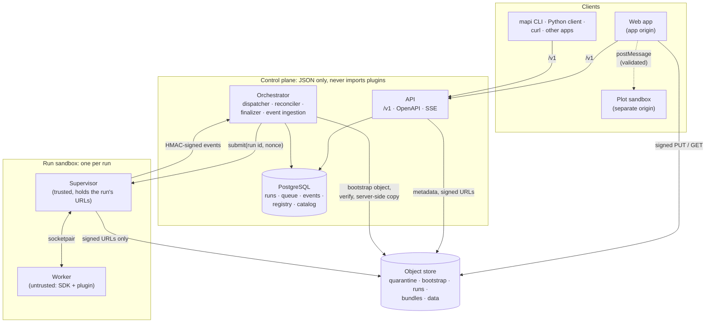
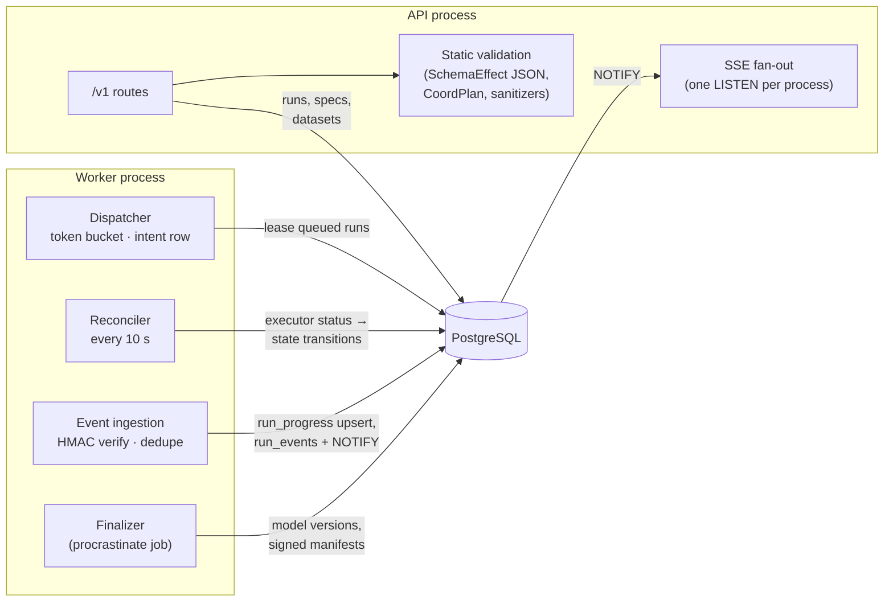
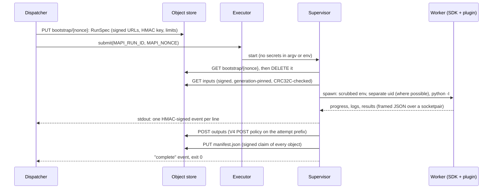
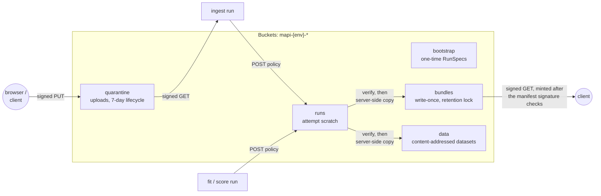
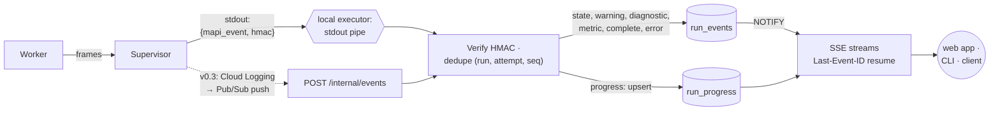
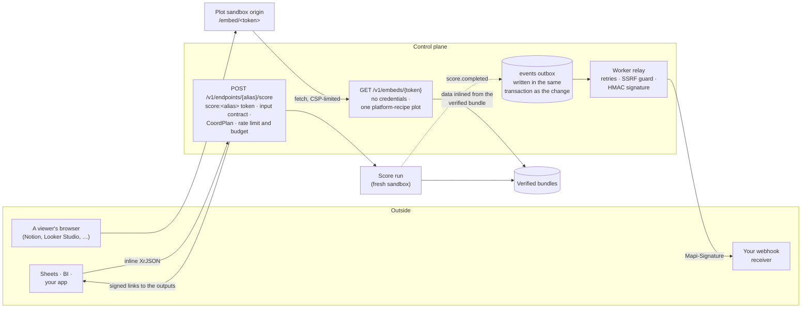

# Architecture overview v0.4

modeling-api has three layers. The project made them in this sequence:

1. A typed runtime for models: the SDK, the steps and the model plugins.
2. A job platform around it: the API, the queue, the executors and the runner.
3. From v0.3, a hosted platform for many tenants.

The rules that keep the last layer safe also apply to the first layers. The control plane never
imports plugin code and never decodes your arrays. Each run occurs in a sandbox. The platform
compares each output with the values that the storage calculated.

## The pieces

| Component | Package | What it does | What it never does |
|---|---|---|---|
| **API** | `mapi-server` (`mapi-server api`) | The `/v1` HTTP API: datasets, specs and their static validation, runs, models, scores and plots. Server-sent events. Signed URLs | Import `mapi_sdk`, a plugin, numpy or xarray. An import-linter contract prevents this, also in the server image |
| **Orchestrator** | `mapi-server` (`mapi-server worker`) | The dispatcher, the reconciler, event ingestion and the finalizer. They use a procrastinate queue in the same PostgreSQL | Decode a dataset or a bundle. It reads only object *metadata* and JSON sidecars with a size limit |
| **Executor** | `mapi_server.executors` | Starts a runner for a run: `local-process` (a subprocess), `docker` / `docker-gvisor` (a container), and Cloud Run Jobs in v0.3 | Send data other than the run id and a nonce |
| **Runner** | `mapi-runner` | A trusted *supervisor*. It gets the instructions of the run, starts an untrusted *worker*, uploads outputs and signs events | Let the worker use credentials, the network of the store or its stdout |
| **SDK and plugins** | `mapi-sdk`, `mapi-steps`, `mapi-pymc`, `mapi-sklearn`, `mapi-plugin-*` | The runtime for models: pipelines with fitted state, models, coord plans, summaries and bundles | Run in a location other than the worker (on the platform) or your own process (as a library) |
| **Contracts** | `mapi-spec` | All the shapes that the two sides agree on: specs, schemas, DTOs, the run protocol and error codes | Import numpy, xarray or pandas |
| **Object store** | `mapi-gcs-shim` locally, Cloud Storage later | Buckets with object generations, CRC32C and MD5 that the server calculates, signed URLs and POST policies, and permissions for each principal | — |
| **Web app**, **plot sandbox** | `apps/web`, `apps/plot-sandbox` | The Guided and Expert UI and the Integrations hub. The plot sandbox is the only location where Vega-Lite and Plotly specs render, also for shared embed pages | Render a plot on the origin of the app |

## The control plane

The API and the orchestrator use the same PostgreSQL database. The API writes runs in state
`created`. Then it sets `queued` or `rejected` from static checks. The orchestrator owns all
the subsequent states.

- **Static validation** runs in the API, synchronously, and uses only JSON. It uses the
  exported *schema effect* of each step, and the settings schema and schema template of each
  model, from the catalog. A sandboxed `describe` run of the real runner makes the catalog.
  The platform keeps the catalog in a cache for each image digest. Thus, the API validates
  against exactly the code that the runner will run.
- **The dispatcher** leases queued runs through a token bucket. It writes an *intent row*
  (run, attempt, nonce) and then calls the executor. Thus, the platform can recover from a
  crash between the two operations.
- **The reconciler** is level-triggered. Every 10 seconds, it compares each active run with
  the status from the executor. This status is the source of truth for liveness. If a run
  sends no events, the reconciler only marks it `stalled`. If an execution disappears, the
  reconciler tries it again as a new attempt (in a cost window). The reconciler adopts orphaned
  executions by their nonce.
- **The finalizer** changes a finished execution into a model version (see
  [Storage and integrity](#storage-and-integrity)).
- **Events**: the orchestrator verifies them and removes duplicates on `(run, attempt, seq)`.
  It keeps one `run_progress` row for each run. It also keeps `run_events` for state changes,
  warnings, diagnostics and metrics. A PostgreSQL `NOTIFY` starts the SSE streams of each API
  process again.

The [Run protocol](../reference/run-protocol.md#run-states) gives the state machine, all the
transitions and the owner of each transition.

## The run sandbox

Each run gets a new pair of processes: a trusted supervisor and an untrusted worker. This
applies to all types of run (`ingest`, `describe`, `validate`, `fit`, `score`).

- **No credentials in the environment.** The executor sends only `MAPI_RUN_ID` and
  `MAPI_NONCE`. The signed URLs of the run and its event HMAC key are in a one-time
  *bootstrap* object. The supervisor reads and deletes this object before model code starts.
- **The worker is untrusted.** It runs the SDK harness and the plugin with an allow-listed
  environment (with all `MAPI_*` removed), in its own session. When the supervisor runs as
  root (containers, Cloud Run), the worker runs under uid 10001 with `no_new_privs`. It
  communicates only with the supervisor, through length-prefixed JSON frames. Each frame must
  agree with its schema.
- **Only the supervisor writes events.** Its stdout has one JSON event on each line. Each event
  has a sequence number and an HMAC. All text that the worker prints becomes a `log` event. The
  `log` event has a size limit and has no control characters.
- **Limits everywhere.** There are limits for log lines (4 KB) and total logs (20 MB), event
  size, output objects and bytes, and a scratch budget for each resource class. If a run goes
  above a limit, the result is `SANDBOX_VIOLATION` or `RESOURCE_EXHAUSTED`. The platform never
  cuts results silently.
- **Checkpoints.** On SIGTERM or near the deadline, a PyMC fit writes its last segment, and
  the supervisor uploads a `partial` manifest. The run can continue from that point.

On a laptop, the worker cannot change the user, so runs report `DEV_MODE_ISOLATION`. The
process split, the scrubbed environment, the event signatures and the output verification
continue to apply. But the worker runs as you. See the [security model](security.md).

## Storage and integrity

| Bucket | Who writes | Who reads |
|---|---|---|
| `quarantine` | Browsers and clients, through a signed PUT for one object | Ingest runs, through a signed GET |
| `bootstrap` | The dispatcher | The supervisor, with a principal that can only *get and delete* there (no list) |
| `runs` | Runs, through a POST policy with a limit to their attempt prefix and a size range | The finalizer (metadata) |
| `bundles` | Only the finalizer, with a server-side copy. Write-once under a retention lock | Clients and runs, through signed GETs that the platform makes after verification |
| `data` | The finalizer, with a server-side copy of ingest outputs | Runs, through signed GETs |

**Outputs are claims.** When a run ends, the finalizer lists the attempt prefix. It reads the
metadata of each object: the size, CRC32C, MD5 and *generation* that the store calculated. It
compares these values with the signed manifest of the run. It refuses missing, changed or
unexpected objects (`INTEGRITY_FAILURE`). It validates the small JSON sidecars under size
limits and sanitizes the plots. Then it copies the verified generations into the bundles
bucket.

Then the finalizer signs a **bundle manifest**. The manifest binds the tenant, the run, the
spec hash, the data hash, the catalog digest and each destination generation. Locally, an EC
P-256 key replaces Cloud KMS. The platform makes each subsequent download link only after it
checks that signature. Thus, it can never serve an object that was replaced. Bundles are zarr
zips and JSON. The platform does not use pickle.

## The event path

Locally, the executor reads events directly from the stdout of the supervisor. In the cloud,
the same lines go through Cloud Logging and Pub/Sub to `POST /internal/events`. The
verification is the same. The platform combines progress into one event every two or three
seconds and keeps it as one row. Thus, a long fit does not write thousands of rows. The
platform keeps only state changes, warnings, diagnostics, checkpoints, metrics and terminal
events. It sends these events again to a client that connects again.

## The integration paths (v0.4)

Three paths send the results of a model out of the platform. No path gives more data to the
outside world than it needs. An endpoint call runs in a sandbox, as all scores do. A webhook
sends only ids and states. An embed link shows one chart.

- **Endpoints** freeze the input contract of the model version at promotion. Thus, the
  platform checks a call statically (dims, coordinates, future covariates) before it starts a
  run. The platform keeps the payload as a run input and decodes it only in the sandbox.
  Promotion goes through the [scorecard gate](integrations.md#promotion-gate).
- **Webhooks**: the platform writes them to an outbox in the same transaction as the change
  that they report (a finished run, a model version that is ready, a promotion). Then the
  worker delivers them through the [SSRF guard](integrations.md#ssrf-protection). The worker
  signs, retries and logs each delivery.
- **Embeds**: the platform serves them to a page on the origin of the plot sandbox. This page
  can get only the public embed view. The API puts the data of the plot from the verified
  bundle into the page, and does not decode it
  ([Sharing plots](../guides/sharing-plots.md#the-embed-page)).

## Where to read more

- [Run protocol](../reference/run-protocol.md): states, bootstrap, the wire format of events,
  exit codes, manifests and the storage layout.
- [Runner](../reference/runner.md): the guarantees of the supervisor.
- [GCS shim](../reference/gcs-shim.md): the local object store, its buckets and principals.
- [Security model](security.md): the controls on a laptop, and the controls that production
  adds.
- [HTTP API](../reference/http-api.md) and the [OpenAPI explorer](../reference/openapi.md).
