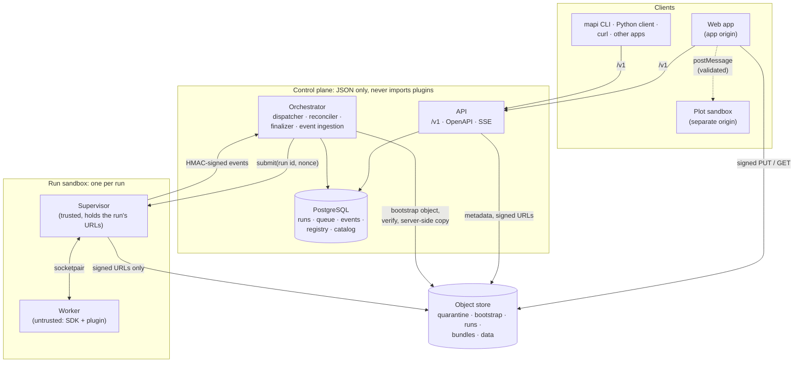
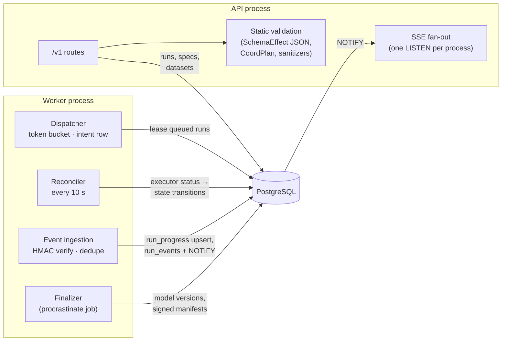
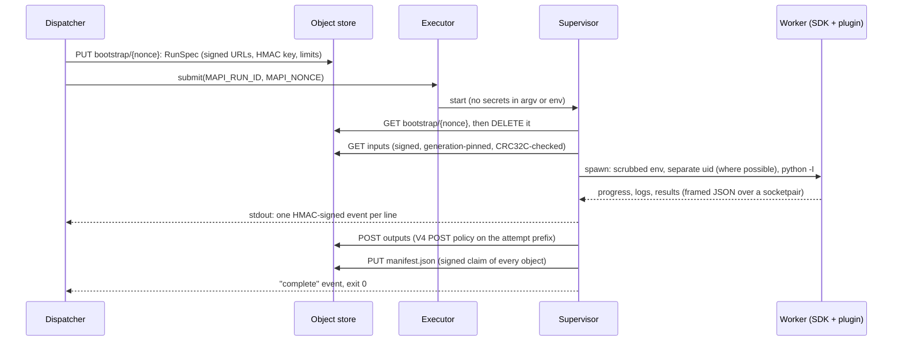
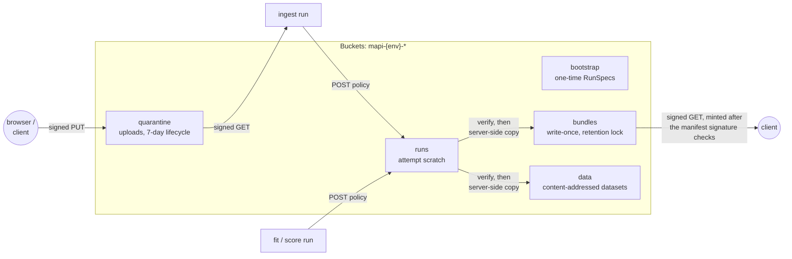
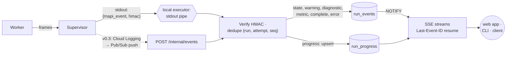

# Architecture overview v0.2

modeling-api is three layers, built in this order: a typed modelling runtime (the SDK, the
steps and the model plugins), a job platform around it (the API, the queue, the executors and
the runner), and, from v0.3, a hosted multi-tenant platform. The rules that make the last one
safe hold from the first: the control plane never imports plugin code and never decodes your
arrays, every run happens in a sandbox, and every output is checked against what the storage
itself computed.

## The pieces

| Component | Package | What it does | What it never does |
|---|---|---|---|
| **API** | `mapi-server` (`mapi-server api`) | The `/v1` HTTP API: datasets, specs and their static validation, runs, models, scoring, plots; server-sent events; signed URLs | Import `mapi_sdk`, a plugin, numpy or xarray (an import-linter contract, also enforced inside the server image) |
| **Orchestrator** | `mapi-server` (`mapi-server worker`) | Dispatcher, reconciler, event ingestion and the finalizer, over a procrastinate queue in the same PostgreSQL | Decode a dataset or a bundle: it reads object *metadata* and size-capped JSON sidecars only |
| **Executor** | `mapi_server.executors` | Starts a runner for a run: `local-process` (a subprocess), `docker` / `docker-gvisor` (a container); Cloud Run Jobs in v0.3 | Pass anything but the run id and a nonce |
| **Runner** | `mapi-runner` | A trusted *supervisor* that fetches the run's instructions, starts an untrusted *worker*, uploads outputs and signs events | Let the worker touch credentials, the network of the store or its stdout |
| **SDK and plugins** | `mapi-sdk`, `mapi-steps`, `mapi-pymc`, `mapi-sklearn`, `mapi-plugin-*` | The modelling runtime: pipelines with fitted state, models, coord plans, summaries, bundles | Run anywhere but in the worker (on the platform) or your own process (as a library) |
| **Contracts** | `mapi-spec` | Every shape both sides agree on: specs, schemas, DTOs, the run protocol, error codes | Import numpy, xarray or pandas |
| **Object store** | `mapi-gcs-shim` locally, Cloud Storage later | Buckets with object generations, server-computed CRC32C and MD5, signed URLs and POST policies, per-principal permissions | — |
| **Web app**, **plot sandbox** | `apps/web`, `apps/plot-sandbox` | The Expert UI, and the only place Vega-Lite and Plotly specs render | Render a plot on the app's own origin |

## The control plane

The API and the orchestrator share one PostgreSQL database. The API writes runs in state
`created` and decides `queued` or `rejected` from static checks; everything after that
belongs to the orchestrator.

- **Static validation** runs in the API, synchronously, from JSON only: each step's exported
  *schema effect* and each model's settings schema and schema template, taken from the
  catalog. The catalog is produced by a sandboxed `describe` run of the real runner and cached
  per image digest, so the API validates against exactly what the runner will execute.
- **The dispatcher** leases queued runs through a token bucket, writes an *intent row*
  (run, attempt, nonce) and then calls the executor, so a crash between the two can be
  recovered.
- **The reconciler** is level-triggered: every 10 seconds it compares each active run with the
  executor's own status, which is the source of truth for liveness. Silence only marks a run
  `stalled`; an execution that vanished is retried as a new attempt (within a cost window),
  and orphaned executions are adopted by their nonce.
- **The finalizer** turns a finished execution into a model version (see
  [Storage and integrity](#storage-and-integrity)).
- **Events** are verified, deduplicated on `(run, attempt, seq)`, and stored as one
  `run_progress` row per run plus `run_events` for state changes, warnings, diagnostics and
  metrics. A PostgreSQL `NOTIFY` wakes the SSE streams of every API process.

The state machine, every transition and who owns it are in the
[Run protocol](../reference/run-protocol.md#run-states).

## The run sandbox

Every run, whatever its kind (`ingest`, `describe`, `validate`, `fit`, `score`), gets a fresh
pair of processes: a trusted supervisor and an untrusted worker.

- **No credentials in the environment.** The executor passes only `MAPI_RUN_ID` and
  `MAPI_NONCE`. The run's signed URLs and its event HMAC key are in a one-time *bootstrap*
  object that the supervisor reads and deletes before any model code starts.
- **The worker is untrusted.** It runs the SDK harness and the plugin with an allow-listed
  environment (every `MAPI_*` removed), in its own session, under uid 10001 with
  `no_new_privs` when the supervisor runs as root (containers, Cloud Run). It talks only to
  the supervisor, through length-prefixed JSON frames that must match their schemas.
- **Only the supervisor writes events.** Its stdout carries one JSON event per line, each
  with a sequence number and an HMAC; anything the worker prints becomes a capped,
  control-character-stripped `log` event.
- **Caps everywhere.** Log lines (4 KB) and total logs (20 MB), event size, output objects and
  bytes, and a scratch budget per resource class. Breaking one is a `SANDBOX_VIOLATION` or
  `RESOURCE_EXHAUSTED`, never a silent truncation of results.
- **Checkpoints.** On SIGTERM or near the deadline, a PyMC fit flushes its last segment and the
  supervisor uploads a `partial` manifest; the run can be resumed from there.

On a laptop the worker cannot change user, so runs report `DEV_MODE_ISOLATION`: the process
split, the scrubbed environment, the event signing and the output verification all still
apply, but the worker runs as you. See the [security model](security.md).

## Storage and integrity

| Bucket | Who writes | Who reads |
|---|---|---|
| `quarantine` | Browsers and clients, through a signed PUT for one object | Ingest runs, through a signed GET |
| `bootstrap` | The dispatcher | The supervisor, with a principal that may *get and delete* there and nothing else (no list) |
| `runs` | Runs, through a POST policy limited to their attempt prefix and a size range | The finalizer (metadata) |
| `bundles` | The finalizer only, by server-side copy; write-once under a retention lock | Clients and runs, through signed GETs minted after verification |
| `data` | The finalizer, by server-side copy of ingest outputs | Runs, through signed GETs |

**Outputs are claims.** When a run ends, the finalizer lists the attempt prefix and reads each
object's metadata: the size, CRC32C, MD5 and *generation* the store computed. It compares
them with the run's signed manifest and refuses missing, changed or unexpected objects
(`INTEGRITY_FAILURE`). It validates the small JSON sidecars under size caps, sanitizes the
plots, copies the verified generations into the bundles bucket, and signs a
**bundle manifest** that binds the tenant, run, spec hash, data hash, catalog digest and every
destination generation (an EC P-256 key locally, standing in for Cloud KMS). Every later
download link is minted only after that signature checks, so a swapped object can never be
served. Bundles themselves are zarr zips plus JSON: nothing is pickled.

## The event path

Locally the executor reads events straight from the supervisor's stdout. In the cloud the
same lines travel through Cloud Logging and Pub/Sub to `POST /internal/events`; the
verification is the same. Progress is coalesced to one event every couple of seconds and kept
as a single row, so a long fit does not write thousands of rows; only state changes,
warnings, diagnostics, checkpoints, metrics and terminal events are persisted and replayed to
a reconnecting client.

## Where to read more

- [Run protocol](../reference/run-protocol.md): states, bootstrap, event wire format, exit
  codes, manifests, storage layout.
- [Runner](../reference/runner.md): what the supervisor guarantees.
- [GCS shim](../reference/gcs-shim.md): the local object store, its buckets and principals.
- [Security model](security.md): what is enforced on a laptop and what production adds.
- [HTTP API](../reference/http-api.md) and the [OpenAPI explorer](../reference/openapi.md).
