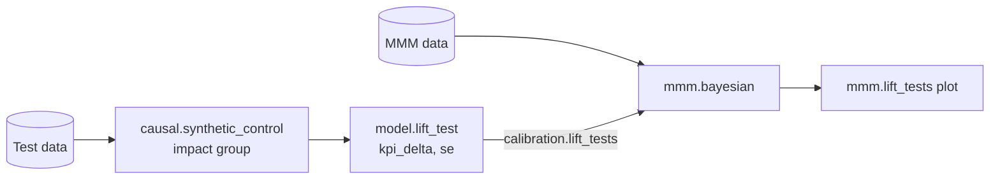

# Measure the effect of a change <span class="mapi-badge">v0.13</span>

A causal model answers the question "what did this change add?". The change can be a
campaign, a launch, a price change or a test in some markets. The model cannot observe the
values without the change. Thus it predicts them from data that the change did not touch.
The effect is the difference between the actual values and that prediction:

```text
effect = actual - counterfactual
```

The prediction of the values without the change is the **counterfactual**. Each causal model
gets it from a different comparison. The comparison sets what you must assume about the data.

## Three designs

| Model | The comparison | The data | You must assume |
|---|---|---|---|
| `causal.impact` | The series before the change, and control series that the change did not touch | One series, optional control series, the start of the change | The relation between the series and its controls does not change at the start. Without controls, the series continues as before (an interrupted time series). |
| `causal.synthetic_control` | A weighted mix of the other markets (the donors). Before the test, the mix follows each test market. | The same number for many markets, the test markets and the test dates | The mix that followed a test market before the test continues to follow it. The campaign did not touch the donors. |
| `causal.did` | Units that never got the change | The same number for many units, and a 0/1 treatment column | Without the change, the treated units and the other units move together (parallel trends) |

All three models are Bayesian and sample with NUTS (package `mapi-plugin-causal`). Thus the
effect has a full distribution, not only an estimate and an interval. `causal.impact` uses
the Bayesian structural time series `ts.bsts` (package `mapi-plugin-ts`) as its core. The
models run in the runner image `mapi/base-forecast`.

The guide [Measure the effect of a change](../guides/causal.md) gives the procedures. The
page [Causal models and Bayesian structural time series](../models/causal.md) gives the
settings and the math of each model.

## The effect, in one bundle group

The three models write the effect to the bundle group `impact`. Plots, the workflow node
`model.lift_test`, the run tracking and the web app read only this group. Thus they work in
the same way for the three models. The group has these variables:

| Variable | What it is |
|---|---|
| `actual` | The observed value |
| `counterfactual` | Draws of the value without the change, with the observation noise |
| `effect` | `actual - counterfactual` |
| `cumulative_effect` | The running (cumulative) sum of `effect` along time over the effect window. It is NaN outside the window. The summary gives the total as `effect_total` |
| `post` | True in the effect window |

All values are in the units of the target. The time dim is always `time`. The models with
more than one unit add the dim `unit` (the treated units only). The `sample` dim has a
maximum of 500 draws. For the full layout, see
[The effect, in one bundle group](../models/causal.md#the-effect-in-one-bundle-group).

Before the start, `counterfactual` is the fit of the model. Thus the plot `causal.pre_fit`
shows how well the model follows the data before the change. Look at this plot before you
use the effect. If the model does not follow the data before the change, the effect is not
reliable.

## An effect is a difference, not a level { #differences }

A pipeline can transform the target, for example with a log. The inverse transform of a
level is correct. The inverse transform of a difference is not: `exp(a - b)` is not
`exp(a) - exp(b)`. Thus a score output can declare that it is a difference. The model sets
the attr `difference_of` on the scored array. The attr names the reference output, for
example `y_hat`. With `output.units: original`, the harness changes the level and the
reference to the units of the output. Then it subtracts them. The `effect` output of
`causal.impact` uses this rule. Thus it is in the units of the data also when the pipeline
transforms the target.

The noise of the counterfactual draws comes from the seed of the fit (common random numbers,
see [Representations](representations.md#counterfactuals-share-their-noise)). Two fits with
the same seed and the same data give the same noise.

## From a test to the marketing mix model

A geo-lift test measures the effect of a channel directly. A marketing mix model estimates
the effect of each channel from the history of the spend. The two estimates can disagree.
The platform can give the result of the test to `mmm.bayesian` as a **lift test**: "this
extra spend on this channel in these weeks added this quantity of the KPI". The model then
agrees with the test ([Guided mode](guided-mode.md#3-business-priors-and-lift-tests)).



The total effect over the test is the `kpi_delta` of the lift test. Its sd is the `se`. You
can make the lift test in three ways:

- The Guided report of the `geo_lift` template has a card that makes the YAML entry. Copy the
  entry into `calibration.lift_tests` of the MMM spec.
- The workflow node `model.lift_test` makes a `LiftTest` from the `impact` group of any
  causal model version ([Workflows](workflows.md#bayesian-models-in-a-workflow)).
- The workflow template `geo_lift_mmm` fits the test, makes the lift test, fits
  `mmm.bayesian` with it and draws the plot `mmm.lift_tests`.

A lift test from one test market has the geo of that market. A lift test from two or more
test markets is national (`geo: null`).

## What a causal fit logs

Each causal fit logs the total effect with its interval, the relative effect, the
probability that the effect is more than zero and the error before the change. Thus you can
search and compare tests in the runs table, for example
`metric.p_effect_positive > 0.95`. See
[What a causal fit logs](../guides/tracking.md#what-a-causal-fit-logs) and
[Run tracking](run-tracking.md).

## Known gaps

- `causal.impact` fits the periods before the change only.
- `causal.synthetic_control` has no placebo tests. It does not design a test (the choice of
  the markets, the power).
- A lift test from two or more test markets is national.
- The time effects of `causal.did` are fixed. Thus the model does not forecast. When the
  units got the change at different times, the estimates can be wrong (the warning
  `STAGGERED_ADOPTION`).
- The lift-test card of the Guided report does not write into the MMM spec. Copy the entry.

Next: [Capabilities and manifests](capabilities.md).
