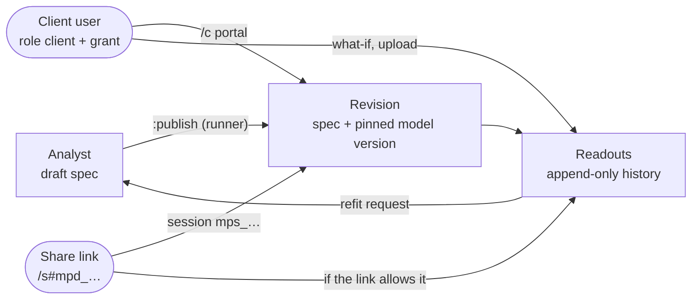

# Client dashboards <span class="mapi-badge">v0.16</span>

A **client dashboard** shows the results of one model to persons outside the team. An
analyst makes it. Two kinds of persons see it:

- **Client users**: signed-in users with the `client` role in the project. They see only the
  published dashboards that an editor or an admin gave them.
- **Holders of a share link**: anonymous persons with a link that you can revoke. The link
  has an expiry and an optional passcode.

The contracts are in `mapi_spec.dashboards` and `mapi_spec.dashboard_tools`. The routes are in
[HTTP API: client dashboards](../reference/http-api.md#v016). The practical side is in
[Build a client dashboard](../guides/client-dashboards.md).



## Drafts and revisions

A dashboard has one editable **draft** (`DashboardSpec`) and immutable **revisions**
(`DashboardRevision`). `:publish` validates the draft and pins the model version. For an
endpoint, it pins the current version and the endpoint revision. Then it adds a revision.
Clients and share links read only the published revision. Thus, a change in the draft never
shows before you publish it.

The spec has a fixed planner layout (`layout_version: 1`):

| Part | Values |
|---|---|
| `source` | `model_version` (a model and a version) or `endpoint` (an alias) |
| `kpi` | The output variable, its label, `unit` (`count`, `currency`, `ratio`, `percent`), the currency and `value_per_unit` |
| `channels` | Up to 40 media channels, with the range of their what-if slider (`min_mult`, `max_mult`, `step`) |
| `tiles` | Up to 4 of `expected`, `vs_expected`, `return_on_media`, `in_range_spend`, `accuracy`, `index` |
| `tabs` | `this_period`, `trends`, `scenarios`, `update`, `history` |
| `whatif`, `actuals`, `refresh`, `limits` | The inputs (see below) |
| `show_technical`, `note`, `summary` | A "Show technical notes" toggle, and plain text for the client |

All text that a client sees is plain text. The spec refuses HTML tags, entities and control
characters. A spec is a maximum of 64 KiB.

Publishing needs the `runner` role. The person who publishes becomes the **run-as owner**
(`run_as`). All the compute of the dashboard (exact what-ifs, uploads and refreshes) runs as
that person, on the quotas of the tenant. The server does a check of the owner before each
run. If the owner lost the `runner` role, the live inputs stop (`live_inputs: paused`,
`DASHBOARD_LIVE_PAUSED`). The readouts that exist stay visible. Model versions that ran
uploaded code cannot be published.

## The client role

`client` is the lowest project role. Two gates apply to it:

1. The permission matrix (`mapi_spec.tenancy.PERMISSIONS`) gives a client only `read` and
   `run` on `dashboard`.
2. The allow-list `mapi_spec.api.CLIENT_OPERATIONS` names each operation that a client can
   call: the dashboard read and input routes, `get_me` and the session routes. The server
   answers `404` for all other operations. The denial is audited.

```python
--8<-- "concepts_dashboards.py:client"
```

A client also sees a dashboard only if it is published and a **grant** names the client.
Viewers and higher roles see all dashboards of the project. Drafts need the `editor` role.
Editors and admins give and remove grants. Only admins invite new clients. A client
membership is always for one project.

## Share links and sessions

A share link token is `mpd_` + 40 Crockford base32 characters (200 random bits). The server
keeps only an HMAC of it. It shows the token one time, when you make the link.

The link is `https://<app>/s#mpd_…`. The page:

1. reads the token from the fragment and removes it from the address bar,
2. sends it (and the passcode) one time in a POST to `/v1/share-sessions`,
3. keeps the session (`mps_…`, 30 minutes) in memory and sends it as `X-Mapi-Share`.

Each share request looks up the link again. Thus, a revoked or expired link stops on the
next request. Share routes never use cookies. [Share dashboards
securely](../guides/sharing-dashboards-securely.md) gives the full security model.

## Inputs

No input refits the model.

| Input | What it does | Cost |
|---|---|---|
| What-if (grid) | The browser calculates the result of a spend plan on the response grid of the pinned version (`ui/grids/response_curves.json`). `whatif:evaluate` does the same on the server | Free. No run |
| Save scenario | Keeps a plan as a private readout | Free on the grid |
| Exact result | A score run of the plan as the run-as owner (`whatif.exact`) | One score run |
| Update numbers | An upload of new actuals. The server validates it against the actuals template and starts a score run | One score run |
| Refresh | A readout from a linked workflow run, an endpoint promotion or **Refresh now** | Free for a workflow run. One score run for the other two |

The response grid holds totals over the fit window (`periods` periods). A readout shows one
period: the channel spend and contribution of the scorecard, the what-if result and its
sentence are the grid totals divided by `periods` (the average period of the window). Return
and marginal return are ratios, so they are the same for one period and for the window.

The mode of an upload is `compared` or `conditioned`. Marketing-mix models predict over the
uploaded periods and compare the prediction with the uploaded KPI (`compared`). Models that
declare `conditions_on_actuals` (statsmodels) use the actuals in the forecast
(`conditioned`). In both modes, the model state does not change.

The server calculates the accuracy of an upload with `metrics_of`, and the zone of each
channel with `zone_of`:

```python
--8<-- "concepts_dashboards.py:zones"
```

## Readouts { #readouts }

A **readout** is a capped JSON snapshot (a maximum of 256 KiB) of the tiles, the channel
scorecard and a few series. The readouts of a dashboard are an append-only history, with a
sequence number (`seq`) each.

| `kind` | Made by |
|---|---|
| `baseline` | Publishing |
| `refresh` | A workflow run, an endpoint promotion or **Refresh now** |
| `scenario` | A saved scenario or an exact what-if |
| `actuals` | An upload of new numbers |

The `visibility` tells who sees a readout:

| `visibility` | Who sees it |
|---|---|
| `published` | Everybody with access. These readouts are the client history |
| `private` | The person or share link that made it, and the analysts. Kept for 30 days |
| `pending_review` | The uploader and the analysts, until an editor publishes or hides it |
| `hidden` | The analysts only. Kept for audit |

A readout goes through `queued`, `running`, `materialising` and `ready` (or `failed`). When
its run ends, the worker builds the snapshot from the score summary, the tracking metrics and
the scorecard. Raw arrays and plots are never copied. A ready readout never changes. Each
readout records the model version, the endpoint revision and the spec hash, so the
**Trends** tab can mark a model change.

When a readout becomes ready and published, the server sends the webhook event
`dashboard.readout.published`.

## Refresh

There is no new scheduler. `spec.refresh` links the dashboard to:

- a **workflow** (`workflow_id`) with a `model.score` or `model.forecast` node. Each
  successful run adds a `refresh` readout from the run of that node. No new run starts.
  Schedule the workflow on its **Automation** tab, or start it from a dataset trigger.
- the **endpoint** (`follow_endpoint`), for a dashboard on an endpoint. A promotion publishes
  a new revision on the new version and queues a readout. Without `follow_endpoint`, the
  dashboard only shows "new version available" to the analyst.

Two refreshes of one dashboard are a minimum of 60 seconds apart.

## Refit requests

An upload can also **ask for a refit**. This is possible only when the analyst set
`actuals.refit_workflow_id` and `actuals.allow_refit_requests`. A request
(`DashboardRefitRequest`) has the status `open`, `approved`, `rejected`, `superseded` or
`failed`. A dashboard has a maximum of one `open` request. A newer request supersedes the
older one.

A client never starts compute through a request. An editor with the `runner` role approves
it. The approval:

1. publishes the readout of the upload,
2. adds the uploaded numbers as a new version of the dataset of the dashboard (the server
   validates them again),
3. starts the refit workflow as the approver, through the usual governance, approval and
   cost checks.

When the workflow run succeeds, the refresh path adds a new readout.

## Cost limits

| Limit | Default | Error |
|---|---|---|
| Exact results, uploads and manual refreshes for each dashboard in 24 h (`limits.exact_runs_per_day`) | 20 | `429 DASHBOARD_RUN_LIMIT` |
| Exact results for each share link in each hour (`MAPI_SHARE_RUN_RATE_PER_HOUR`) | 6 | `429 DASHBOARD_RUN_LIMIT` |
| Exact results for each client user and dashboard in each hour (`MAPI_CLIENT_RUN_RATE_PER_HOUR`) | 12 | `429 DASHBOARD_RUN_LIMIT` |

A result cache returns a ready readout for the same scenario or the same actuals for 24 hours
(`MAPI_DASHBOARD_CACHE_TTL_S`), in place of a new run. Quotas and kill switches of the
tenant also apply.

## The tool surface { #tools }

`mapi_spec.dashboard_tools.DASHBOARD_TOOLS` declares what an assistant can ask of one
dashboard. All tools are read-only. No tool starts a run or writes a row.

| Tool | What it gives |
|---|---|
| `get_dashboard` | The dashboard: title, KPI, channels, tabs, inputs and latest readout (`ClientDashboard`) |
| `get_latest_readout` | The latest published readout (`Readout`) |
| `list_readouts` | Readouts, newest first, by kind, with paging (`ReadoutList`) |
| `get_readout` | One readout by `seq` |
| `compare_readouts` | The change of each tile and channel between two readouts |
| `get_channel` | One channel over the last published readouts |
| `explain_metric` | A plain explanation of a word of the dashboard (from `GLOSSARY`) |
| `evaluate_whatif` | The result of a spend plan on the response grid. No run |

The member, client and share read routes call these same functions. `tools_json_schema()`
exports the declarations as JSON Schemas, the shape that Gemini function declarations and
MCP tools use. v0.17 adds a chat and an MCP server on these tools
([roadmap](../roadmap/expert-plugins.md#planned-for-v017)).

```python
--8<-- "concepts_dashboards.py:tools"
```
