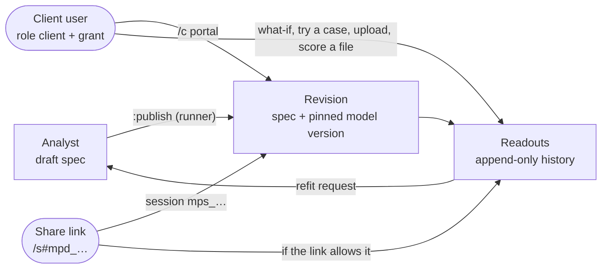

# Client dashboards <span class="mapi-badge">v0.16</span> <span class="mapi-badge">v0.17</span>

A **client dashboard** shows the results of one model to persons outside the team. From
v0.17, the model can be of any type: a marketing-mix model, a forecast, a classifier, a
regression, a model of a change, a science model with a map or an image model. An analyst
makes the dashboard. Two kinds of persons see it:

- **Client users**: signed-in users with the `client` role in the project. They see only the
  published dashboards that an editor or an admin gave them.
- **Holders of a share link**: anonymous persons with a link that you can revoke. The link
  has an expiry and an optional passcode.

The contracts are in `mapi_spec.dashboards` (layout 1 and the shared DTOs),
`mapi_spec.dashboard_v2` (layout 2), `mapi_spec.dashboard_presets`,
`mapi_spec.dashboard_inputs`, `mapi_spec.dashboard_metrics` and `mapi_spec.dashboard_tools`.
The routes are in [HTTP API: client dashboards](../reference/http-api.md#v016). The practical side is in
[Build a client dashboard](../guides/client-dashboards.md).



## Drafts and revisions

A dashboard has one editable **draft** and immutable **revisions** (`DashboardRevision`). `:publish` validates the draft and pins the model version. For an
endpoint, it pins the current version and the endpoint revision. Then it adds a revision.
Clients and share links read only the published revision. Thus, a change in the draft never
shows before you publish it.

A spec has one of two layouts. `parse_dashboard_spec` reads both. A spec without
`layout_version` is layout 1:

| Layout | Class | For |
|---|---|---|
| 1 (v0.16) | `DashboardSpec` | The fixed media planner. Stored layout 1 revisions and readouts stay as they are |
| 2 (v0.17) | `DashboardSpecV2` (`layout_version: 2`) | Any model type: a preset and a list of panels. All new dashboards |

```python
--8<-- "concepts_dashboards.py:layouts"
```

A layout 1 spec has a fixed planner layout:

| Part | Values |
|---|---|
| `source` | `model_version` (a model and a version) or `endpoint` (an alias) |
| `kpi` | The output variable, its label, `unit` (`count`, `currency`, `ratio`, `percent`), the currency and `value_per_unit` |
| `channels` | Up to 40 media channels, with the range of their what-if slider (`min_mult`, `max_mult`, `step`) |
| `tiles` | Up to 4 of `expected`, `vs_expected`, `return_on_media`, `in_range_spend`, `accuracy`, `index` |
| `tabs` | `this_period`, `trends`, `scenarios`, `update`, `history` |
| `whatif`, `actuals`, `refresh`, `limits` | The inputs (see below) |
| `show_technical`, `note`, `summary` | A "Show technical notes" toggle, and plain text for the client |

A layout 2 spec has a `preset`, a `subject` (the main output, its label, its unit and, for a
classifier, the class to report), up to 24 `panels`, the inputs (`scenario_rows`,
`actuals`, `batch`, and `mmm` for the media planner), `refresh` and `limits`. See
[Presets](#presets) and [Panels](#panels).

All text that a client sees is plain text. The spec refuses HTML tags, entities and control
characters. A spec is a maximum of 64 KiB.

Publishing needs the `runner` role. The person who publishes becomes the **run-as owner**
(`run_as`). All the compute of the dashboard (exact what-ifs, uploads and refreshes) runs as
that person, on the quotas of the tenant. The server does a check of the owner before each
run. If the owner lost the `runner` role, the live inputs stop (`live_inputs: paused`,
`DASHBOARD_LIVE_PAUSED`). The readouts that exist stay visible. Model versions that ran
uploaded code cannot be published.

## Presets <span class="mapi-badge">v0.17</span> { #presets }

A **preset** is a starting layout for one model family. `GET /v1/dashboards:presets` looks
at the model version (its manifest, outputs and score modes) and returns the presets that
fit, best first, each with plain reasons and the inputs that it cannot offer. It also
returns the compiled spec of the first preset as a starting draft. Nothing is saved until
you save the draft.

| `preset` | Detected when | Baseline readout | Default panels | Client inputs | Accuracy |
|---|---|---|---|---|---|
| `mmm_planner` | The model makes decisions (a marketing-mix model) | As layout 1 | The v0.16 tiles, scorecard, trends and scenarios | What-ifs, actuals, refit requests | `metrics_of` |
| `image` | The model takes an image collection | None | Accuracy and AUC from the fit, plots of the model version | None in v0.17 | Fit metrics |
| `field_map` | An output has a grid or areas, or a `sci` model | A predict run | Key numbers with a range, a map, area bars | Periods ahead (some models) | When a target exists |
| `causal_impact` | A `causal` model | causal impact: a predict run. Others: none | Total effect, effect in percent, chance of an effect | Actuals (impact: the updated effect; others: a refit request) | Effect |
| `classifier` | An output of class probabilities | One predict on the default case | "Chance of …", holdout accuracy and AUC, the probability of each class | Scenario rows, actuals by case, batch | Classification |
| `forecast` | A time series model with a forecast mode | A forecast run (`refresh.horizon`, default 6) | The next period, typical error, the forecast fan, the accuracy history | Periods ahead, actuals by date | Error |
| `regression` | An output with a row dim | One predict on the default case | The predicted value with its range, holdout errors, fit against actual | Scenario rows, actuals by case, batch | Error |
| `generic` | All other models | A predict run if possible | One key number and one chart | As the model allows | Error, if a target exists |

The server writes the sentence at the top of each readout (the **lead**) from the numbers
only. Outside `mmm_planner`, the leads and labels use no media words.

## Panels <span class="mapi-badge">v0.17</span> { #panels }

The analyst can add, remove and move panels. Each preset allows some panel kinds and chart
intents. The server checks each panel against the **source catalog** of the model version
(`GET …/sources`): the real names of the outputs, their dims, the metrics of the fit, the
scorecard checks, the plots and the inputs.

| `kind` | What it shows |
|---|---|
| `kpi` | One key number: the centre or a bound of an output, a metric of the fit, a scorecard check or an accuracy value. A maximum of 8 |
| `chart` | A chart drawn in the page: `fan`, `line`, `bars`, `range`, `diverging`, `scatter`, `residuals`, `calibration`, `confusion`, `probability_bars`, `field`, `area_bars`, `effect`, `accuracy_history`, `decomposition` or `state_sequence` |
| `table` | A small table of an output (a maximum of 50 rows) |
| `note` | Plain text from the analyst |
| `recipe` | A platform plot. Some recipes are drawn as a chart. All other recipes are a **picture**: a PNG of the plot of the model version, made one time at publish |
| `mmm` | A part of the media planner (`mmm_planner` only) |

Rules that keep the numbers correct:

- A sum or a mean over a dim is calculated from the draws, so the range is the range of the
  total. A sum of point values is allowed and marked **Approximate**. A sum of quantiles or
  intervals is refused at validate (`BINDING_INVALID`). The server never adds the bounds of
  ranges.
- `band: "outcome"` (the default for outcome numbers) shows the **predictive** range: where
  one new result will probably be. `band: "mean"` shows where the average will probably be.
  The predictive range is wider. Class probabilities always use the mean.
- If a source is missing when the readout is built, that panel shows "unavailable" with a
  plain reason. One panel never stops a readout.

Clients and share links see the charts as plain SVG drawn in the page. They never load a
plot library or a frame. Pictures come from the same origin, through the session of the
client or the link.

## The client role

`client` is the lowest project role. Two gates apply to it:

1. The permission matrix (`mapi_spec.tenancy.PERMISSIONS`) gives a client only `read` and
   `run` on `dashboard`.
2. The allow-list `mapi_spec.api.CLIENT_OPERATIONS` names each operation that a client can
   call: the dashboard read and input routes, `get_me` and the session routes. The server
   answers `404` for all other operations. The denial is audited.

```python
--8<-- "concepts_dashboards.py:client"
```

A client also sees a dashboard only if it is published and a **grant** names the client.
Viewers and higher roles see all dashboards of the project. Drafts need the `editor` role.
Editors and admins give and remove grants. Only admins invite new clients. A client
membership is always for one project.

## Share links and sessions

A share link token is `mpd_` + 40 Crockford base32 characters (200 random bits). The server
keeps only an HMAC of it. It shows the token one time, when you make the link.

The link is `https://<app>/s#mpd_…`. The page:

1. reads the token from the fragment and removes it from the address bar,
2. sends it (and the passcode) one time in a POST to `/v1/share-sessions`,
3. keeps the session (`mps_…`, 30 minutes) in memory and sends it as `X-Mapi-Share`.

Each share request looks up the link again. Thus, a revoked or expired link stops on the
next request. Share routes never use cookies. [Share dashboards
securely](../guides/sharing-dashboards-securely.md) gives the full security model.

## Inputs

No input refits the model.

| Input | What it does | Cost |
|---|---|---|
| Try a case (scenario rows, v0.17) | A client changes the values that the analyst exposed and gets the prediction with its range. See [Scenario rows](#scenario-rows) | One score run |
| Score a file (batch, v0.17) | A CSV file of new cases. See [Batch scoring](#batch) | One score run |
| What-if (grid) | The browser calculates the result of a spend plan on the response grid of the pinned version (`ui/grids/response_curves.json`). `whatif:evaluate` does the same on the server | Free. No run |
| Save scenario | Keeps a plan as a private readout | Free on the grid |
| Exact result | A score run of the plan as the run-as owner (`whatif.exact`) | One score run |
| Update numbers | An upload of new actuals. The server validates it against the actuals template and starts a score run | One score run |
| Refresh | A readout from a linked workflow run, an endpoint promotion or **Refresh now** | Free for a workflow run. One score run for the other two |

The response grid holds totals over the fit window (`periods` periods). A readout shows one
period: the channel spend and contribution of the scorecard, the what-if result and its
sentence are the grid totals divided by `periods` (the average period of the window). Return
and marginal return are ratios, so they are the same for one period and for the window.

The mode of an upload is `compared` or `conditioned`. Marketing-mix models predict over the
uploaded periods and compare the prediction with the uploaded KPI (`compared`). Models that
declare `conditions_on_actuals` (statsmodels) use the actuals in the forecast
(`conditioned`). In both modes, the model state does not change.

The server calculates the accuracy of an upload with `metrics_of`, and the zone of each
channel with `zone_of`:

```python
--8<-- "concepts_dashboards.py:zones"
```

### Scenario rows <span class="mapi-badge">v0.17</span> { #scenario-rows }

`spec.scenario_rows` names the outputs to predict and the inputs that a client can change
(a maximum of 16). Each input has a type (`number`, `integer`, `choice`, `date` or
`toggle`), a range or choices, and a default. `fixed` values go with each row and the client
never sees them. A forecast can also let the client choose how many periods ahead
(`horizon`).

`POST …/predictions` takes up to 20 rows. The server checks each value against the
**published** revision: unknown names, numbers that are not finite, values out of range or
off the step, choices that are not in the list and dates out of range. A value that is not
correct is refused with a pointer (`DASHBOARD_INPUT_INVALID`, `/rows/0/tenure`). The server
never clips a value.

```python
--8<-- "concepts_dashboards.py:rows"
```

The result is a private `prediction` readout. The client can **Keep** it
(`POST …/readouts/{seq}:keep`): then it does not expire, and an editor decides if it goes
into the history.

### Actuals for any model type <span class="mapi-badge">v0.17</span> { #accuracy }

`spec.actuals.match` tells how the uploaded numbers join the predictions:

- `time` (forecasts and the media planner): one row for each period, as in v0.16.
- `row` (regressions and classifiers): one row for each case, with an id column, the
  driver columns and the actual outcome. A maximum of 5000 rows. The server removes the
  outcome before it scores the rows, and joins it again by id.

The server calculates the accuracy for the family, in pure Python
(`mapi_spec.dashboard_metrics`). The values are equal to `mapi_sdk.metrics.compute_metrics`.

| Family | Values |
|---|---|
| Error (forecast, regression) | `mae`, `rmse`, `mape`, `wape`, `smape`, `bias`, `r2`, `band_hit_rate` |
| Classification | `accuracy`, `auc`, `brier`, `log_score`, calibration bins and the confusion counts. The analyst sets the `threshold` (0.05 to 0.95). Clients cannot change it |
| Effect (causal impact) | The updated effect over the new periods: the sum of the actuals minus the forecast without the change, with the range `[Σa − high, Σa − low]` |

```python
--8<-- "concepts_dashboards.py:accuracy"
```

The accuracy history uses only the **published** actuals readouts (the last 104). Private
uploads never go into it. For synthetic-control and difference-in-differences models, the
upload makes a comparison and offers a refit request: the effect changes after the
analyst refits.

### Batch scoring <span class="mapi-badge">v0.17</span> { #batch }

`spec.batch` lets a client score a file of new cases. `GET …/batch/template` gives the
columns (the id and the drivers with their ranges), an example CSV and the row cap.
`POST …/batch` takes the file as inline XrJSON (the browser reads the CSV), a maximum of
`batch.max_rows` rows (at most 5000). With `enforce_ranges`, the server checks each cell as
a scenario row. A file that would make too large a result is refused before a run
(`409 DASHBOARD_BATCH_TOO_LARGE`).

The result is a private `batch` readout with a summary: the spread of the predictions and,
for a classifier, the share of positive cases. `GET …/readouts/{seq}/predictions.csv` gives
the predictions. The server makes the CSV when you ask for it. It has the id, the inputs
and, for each output, the centre, the low and the high value (and the most likely class).
A cell that starts with `=`, `+`, `-`, `@`, a tab or a carriage return gets a `'` in front of
it, so that a spreadsheet does not run it. Only the person or the link that sent the file,
and the editors, can download it. Each download is charged as egress and audited. After the
private readout expires, the download answers `410 DASHBOARD_DOWNLOAD_GONE`.

Image dashboards do not offer batch scoring to clients or share links in v0.17.

## Readouts { #readouts }

A **readout** is a capped JSON snapshot of the tiles, the channel scorecard and a few
series (layout 1, a maximum of 256 KiB), or of the blocks of the panels (layout 2,
`schema_version: 2`, a maximum of 384 KiB). The readouts of a dashboard are an append-only history, with a
sequence number (`seq`) each.

| `kind` | Made by |
|---|---|
| `baseline` | Publishing |
| `refresh` | A workflow run, an endpoint promotion or **Refresh now** |
| `scenario` | A saved scenario or an exact what-if |
| `actuals` | An upload of new numbers |
| `prediction` | A tried case (v0.17). Private |
| `batch` | A scored file (v0.17). Private |

The `visibility` tells who sees a readout:

| `visibility` | Who sees it |
|---|---|
| `published` | Everybody with access. These readouts are the client history |
| `private` | The person or share link that made it, and the analysts. Kept for 30 days |
| `pending_review` | The uploader and the analysts, until an editor publishes or hides it |
| `hidden` | The analysts only. Kept for audit |

A readout goes through `queued`, `running`, `materialising` and `ready` (or `failed`). When
its run ends, the worker builds the snapshot from the score summary, the tracking metrics and
the scorecard. Raw arrays and plots are never copied. A ready readout never changes. Each
readout records the model version, the endpoint revision and the spec hash, so the
**Trends** tab can mark a model change.

When a readout becomes ready and published, the server sends the webhook event
`dashboard.readout.published`.

## The automatic upgrade <span class="mapi-badge">v0.17</span> { #upgrade }

On release of v0.17, each layout 1 dashboard moves to layout 2 by itself. The worker does
one pass when it starts, under a Postgres advisory lock, so two workers never move a
dashboard twice. `MAPI_DASHBOARD_AUTO_UPGRADE=false` turns it off.

For each dashboard that is not archived and whose published spec is layout 1:

1. `upgrade_v1` compiles the spec to layout 2: a marketing-mix dashboard becomes
   `mmm_planner`, a forecast with a placeholder channel becomes `forecast`.
2. If there is no blocking issue, the server adds a published revision with the layout 2
   spec, on the **same** model version and endpoint revision, with the **same** run-as
   owner. The actor is `system`, and the audit event is `DASHBOARD_UPGRADED`. A new
   baseline readout starts.
3. A layout 1 draft becomes a layout 2 draft (its etag changes).

The server never rewrites a stored row. Old revisions and old readouts stay layout 1, and
**History** shows them with the layout 1 renderer. If the upgrade has blocking issues, the
dashboard stays on layout 1 with `problem: "upgrade_needs_review"`. An editor finishes it
with `POST …:upgrade` (the **Use the new layout** banner), which saves a layout 2 draft
to publish.

Clients see the note "This dashboard has a new layout. The numbers come from the same
model." one time. Upgraded outcome panels show the predictive range, so the ranges can be
wider than in v0.16. The middle values stay the same.

## Refresh

There is no new scheduler. `spec.refresh` links the dashboard to:

- a **workflow** (`workflow_id`) with a `model.score` or `model.forecast` node. Each
  successful run adds a `refresh` readout from the run of that node. No new run starts.
  Schedule the workflow on its **Automation** tab, or start it from a dataset trigger.
- the **endpoint** (`follow_endpoint`), for a dashboard on an endpoint. A promotion publishes
  a new revision on the new version and queues a readout. Without `follow_endpoint`, the
  dashboard only shows "new version available" to the analyst.

Two refreshes of one dashboard are a minimum of 60 seconds apart.

## Refit requests

An upload can also **ask for a refit**. This is possible only when the analyst set
`actuals.refit_workflow_id` and `actuals.allow_refit_requests`. A request
(`DashboardRefitRequest`) has the status `open`, `approved`, `rejected`, `superseded` or
`failed`. A dashboard has a maximum of one `open` request. A newer request supersedes the
older one.

A client never starts compute through a request. An editor with the `runner` role approves
it. The approval:

1. publishes the readout of the upload,
2. adds the uploaded numbers as a new version of the dataset of the dashboard (the server
   validates them again),
3. starts the refit workflow as the approver, through the usual governance, approval and
   cost checks.

When the workflow run succeeds, the refresh path adds a new readout.

## Cost limits

| Limit | Default | Error |
|---|---|---|
| Exact results, uploads and manual refreshes for each dashboard in 24 h (`limits.exact_runs_per_day`) | 20 | `429 DASHBOARD_RUN_LIMIT` |
| Exact results for each share link in each hour (`MAPI_SHARE_RUN_RATE_PER_HOUR`) | 6 | `429 DASHBOARD_RUN_LIMIT` |
| Exact results for each client user and dashboard in each hour (`MAPI_CLIENT_RUN_RATE_PER_HOUR`) | 12 | `429 DASHBOARD_RUN_LIMIT` |
| Scored files for each dashboard in 24 h (`limits.batch_runs_per_day`, also counted in `exact_runs_per_day`) | 3 | `429 DASHBOARD_RUN_LIMIT` |
| Scored files for each share link in 24 h (`MAPI_SHARE_BATCH_PER_DAY`) | 2 | `429 DASHBOARD_RUN_LIMIT` |
| Scored files for each client user and dashboard in 24 h (`MAPI_CLIENT_BATCH_PER_DAY`) | 4 | `429 DASHBOARD_RUN_LIMIT` |
| Rows of scored files for each dashboard in 24 h (`MAPI_BATCH_ROWS_PER_DAY`) | 20 000 | `429 DASHBOARD_RUN_LIMIT` |

A result cache returns a ready readout for the same scenario or the same actuals for 24 hours
(`MAPI_DASHBOARD_CACHE_TTL_S`), in place of a new run. Quotas and kill switches of the
tenant also apply.

## The tool surface { #tools }

`mapi_spec.dashboard_tools.DASHBOARD_TOOLS` declares what an assistant can ask of one
dashboard. All tools are read-only. No tool starts a run or writes a row.

| Tool | What it gives |
|---|---|
| `get_dashboard` | The dashboard: title, KPI, channels, tabs, inputs and latest readout (`ClientDashboard`) |
| `get_latest_readout` | The latest published readout (`Readout`) |
| `list_readouts` | Readouts, newest first, by kind, with paging (`ReadoutList`) |
| `get_readout` | One readout by `seq` |
| `compare_readouts` | The change of each tile and channel between two readouts |
| `get_channel` | One channel over the last published readouts |
| `explain_metric` | A plain explanation of a word of the dashboard (from `GLOSSARY`) |
| `evaluate_whatif` | The result of a spend plan on the response grid. No run |
| `list_panels` (v0.17) | The panels of a layout 2 dashboard and their kinds |
| `get_panel` (v0.17) | One panel block of a readout |
| `get_accuracy` (v0.17) | The accuracy detail and its history |
| `list_inputs` (v0.17) | The scenario inputs, their ranges and the caps |
| `get_prediction` (v0.17) | A tried case of the caller only |
| `get_batch_summary` (v0.17) | The summary of a scored file (never the CSV or a link) |

On a dashboard that is not a media planner, `get_channel` and `evaluate_whatif` answer
`DASHBOARD_INPUT_DISABLED`. `compare_readouts` also gives `panel_deltas`: the change of each
key number between two readouts.

The member, client and share read routes call these same functions. `tools_json_schema()`
exports the declarations as JSON Schemas, the shape that Gemini function declarations and
MCP tools use. A later release adds a chat and an MCP server on these tools
([roadmap](../roadmap/expert-plugins.md)).

```python
--8<-- "concepts_dashboards.py:tools"
```
