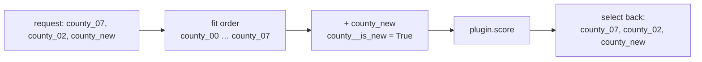

# Coord plans and typed errors

Before a score request goes to a model, the platform compares its coordinates with the fit
coordinates of the model. These checks are the **CoordPlan**. Almost all of them need only
metadata: the fitted coordinates of each stage (in the bundle) and the request. Thus, the API
can reject a bad request in milliseconds, and it does not start a sandbox.

## The checks

| Code | HTTP | Raised when | What to do |
|---|---|---|---|
| `UNSEEN_LEVELS` | 422 | A label of a `fixed` dim (or of a `new_levels` dim with strategy `error`) was not in the fit | Remove the label. Or declare the dim `new_levels` with a strategy, and fit again |
| `COORD_NOT_ALLOWED` | 422 | An `extend` dim starts before the fitted range, or a label cannot exist | Send labels in the fitted range or immediately after it |
| `NON_CONTIGUOUS_EXTENSION` | 422 | New time labels leave a gap after the fitted range | Send the missing periods (context tails need them) |
| `HORIZON_EXCEEDS_FIT` | **409** | The forecast goes past `max_extension` | Fit again with a larger `max_extension` |
| `MISSING_FUTURE_COVARIATE` | 422 | A `future_required` variable is missing in the horizon | Put it in the payload |
| `CAPABILITY_UNSUPPORTED` | 422 | The output asks for a thing that the representation cannot give (the sum of quantiles, draws from a point model, an HDI from quantiles) | Ask for a valid summary, or use a model with joint draws |
| `RECURSIVE_UNSUPPORTED` | 422 | A target lag is shorter than the horizon | Use longer lags, or use a model that owns recursion |
| `MODE_NOT_SUPPORTED` | 422 | The model does not declare the requested mode | Look at the capabilities of the model |
| `SIDE_TABLE_COVERAGE` | 422 | A side table does not cover the periods that a step needs | Supply a table that covers them |
| `ACTUALS_NOT_SUPPORTED` | 422 | A forecast payload has target values (actuals) and the model cannot condition on them | Fit again with the new data, or leave the target empty. See [Forecasts with actuals](forecasting-with-actuals.md) |
| `ACTUALS_INVALID` | 422 | Actuals leave a gap after the fit, or actuals after the fit do not have their drivers | Fill the gap, or send the drivers |

`HORIZON_EXCEEDS_FIT` is a 409, not a 422. The request is correct, but the *model* is not ready
for it. To correct the problem, fit the model again. Do not change the request.

## Metadata only: what the API checks

```python
--8<-- "quickstart.py:static_score"
```

The API reports all problems at the same time. Each problem has a JSON pointer into the
request. The metadata is a few kilobytes of JSON for each model version. The API does not
decode arrays and does not import plugin code.

## In the runtime: the same checks, then canonicalisation

`score_bundle` does the same checks on the real payload, so it can also see which values are
present. It raises the most specific error. It keeps the other notices in the `issues`
attribute of the output (for example "1 new level of `store` will use strategy `pooled`").

```python
--8<-- "quickstart.py:errors"
```

Then it **canonicalises** the data at the model stage. Thus, a plugin does not have to
know about the request order or new labels:

1. **Reorder** each `fixed` and `new_levels` dim to the fit order. Posterior arrays use
   position as the index, so `county_03` must have the same position as at fit time.
2. **Pad** requested subsets to the full fitted set (masked), so that the shapes are the
   same as in the fit.
3. **Append new levels** after the fitted levels. A boolean coordinate `<dim>__is_new` flags
   them. `<dim>__requested` marks the real labels (not the padding).
4. Call `plugin.score(...)`.
5. **Select** the requested labels again, in the request order, and remove the helper
   coordinates.



In a plugin, `mapi_sdk.new_level_mask(ds, "county")` gives the `__is_new` flags.
`ScoreContext.strategy("county")` gives the new-level strategy that applies. PyMC models get
all of this automatically through `ctx.hier_effect(...)`. See
[Bring a PyMC model](../guides/pymc.md).

## Errors are values, not strings

Each error is a `MapiError` with:

- A stable `code` (an `ErrorCode`) and an HTTP status.
- A `detail` that the platform writes, and the list of `issues` that cause it. Each issue
  can have a `suggested_action`.
- A JSON `pointer` to the field that has the problem.
- `untrusted_text`: all text from a dataset or a plugin. The platform keeps it separate from
  the message. Thus, a UI can show it as plain text, and an agent can use it as data, never
  as instructions.

On HTTP, an error is an RFC 7807 problem document. For the full list, see
[Error codes](../reference/generated/error-codes.md).

Next: [Capabilities and manifests](capabilities.md).
