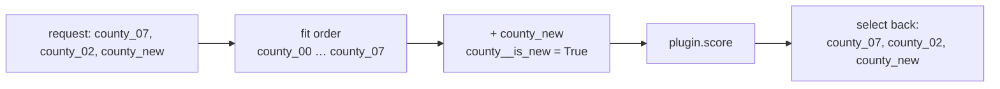

# Coord plans and typed errors

Before a score request touches a model, its coordinates are checked against what the model was
fitted on. The checks are called the **CoordPlan**, and almost all of them need only metadata:
the fitted coordinates of every stage (stored in the bundle) and the request itself. That is
why the API can reject a bad request in milliseconds, without starting a sandbox.

## The checks

| Code | HTTP | Raised when | What to do |
|---|---|---|---|
| `UNSEEN_LEVELS` | 422 | A label of a `fixed` dim (or a `new_levels` dim with strategy `error`) was not in the fit | Drop it, or declare the dim `new_levels` with a strategy and refit |
| `COORD_NOT_ALLOWED` | 422 | An `extend` dim starts before the fitted range, or a label cannot exist | Send labels inside or right after the fit |
| `NON_CONTIGUOUS_EXTENSION` | 422 | New time labels leave a gap after the fitted range | Send the missing periods (context tails need them) |
| `HORIZON_EXCEEDS_FIT` | **409** | The forecast reaches past `max_extension` | Refit with a larger `max_extension` |
| `MISSING_FUTURE_COVARIATE` | 422 | A `future_required` variable is missing over the horizon | Supply it in the payload |
| `CAPABILITY_UNSUPPORTED` | 422 | The output asks for something the representation cannot give (summing quantiles, draws from a point model, an HDI from quantiles) | Ask for a valid summary, or use a model with joint draws |
| `RECURSIVE_UNSUPPORTED` | 422 | A target lag shorter than the horizon | Use longer lags or a model that owns recursion |
| `MODE_NOT_SUPPORTED` | 422 | The model does not declare the requested mode | See the model's capabilities |
| `SIDE_TABLE_COVERAGE` | 422 | A side table does not cover the periods a step needs | Supply a table that covers them |

`HORIZON_EXCEEDS_FIT` is a 409, not a 422: the request is fine, the *model* is not ready for it.
The fix is a refit, not a different request.

## Metadata only: what the API checks

```python
--8<-- "quickstart.py:static_score"
```

Every problem is reported at once, each with a JSON pointer into the request. The metadata is a
few kilobytes of JSON per model version; no arrays are decoded and no plugin code is imported.

## In the runtime: the same checks, then canonicalisation

`score_bundle` runs the same checks against the real payload (so it can also see which values
are present), raises the most specific error, and keeps the remaining notices (for example "1
new level of `store` will use strategy `pooled`") in the output's `issues` attribute.

```python
--8<-- "quickstart.py:errors"
```

Then it **canonicalises** the model-stage data, so a plugin never has to reason about request
order or new labels:

1. **Reorder** every `fixed` and `new_levels` dim to the fit order. Posterior arrays are indexed
   by position, so `county_03` must sit where it sat at fit time.
2. **Pad** requested subsets out to the full fitted set (masked), so shapes match the fit.
3. **Append new levels** after the fitted ones, flagged by a boolean coordinate
   `<dim>__is_new`; `<dim>__requested` marks real (non-padding) labels.
4. Call `plugin.score(...)`.
5. **Select** the requested labels back, in request order, and drop the helper coordinates.



Inside a plugin, `mapi_sdk.new_level_mask(ds, "county")` returns the `__is_new` flags and
`ScoreContext.strategy("county")` the effective new-level strategy. PyMC models get all of this
for free through `ctx.hier_effect(...)`; see [Bring a PyMC model](../guides/pymc.md).

## Errors are values, not strings

Every error is a `MapiError` with:

- a stable `code` (an `ErrorCode`) and an HTTP status;
- a platform-written `detail`, and the list of `issues` behind it, each of which can carry a
  `suggested_action`;
- a JSON `pointer` to the offending field;
- `untrusted_text`: anything a dataset or plugin said, kept apart from the message so a UI can
  render it as plain text and an agent can treat it as data, never as instructions.

Over HTTP an error is an RFC 7807 problem document. The full list is in
[Error codes](../reference/generated/error-codes.md).

Next: [Capabilities and manifests](capabilities.md).
