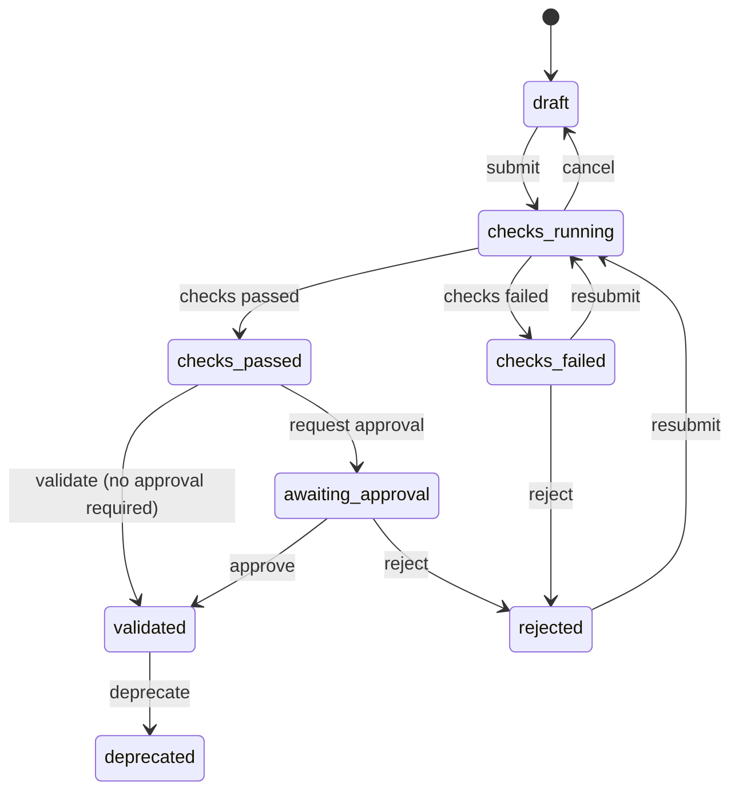

# Governance <span class="mapi-badge">v0.5</span>

A model that helps people make decisions must show that it learned a real effect.
**Governance policies** give the checks that a model must pass before it is **validated**.
For example, the model must do better than on shuffled data, give no effect to fake drivers
and do better than a naive forecast. Its errors must look like noise, and there are more
checks. The checks run in the sandbox as a governance workflow and keep their **evidence**.
A policy can make approval by a reviewer necessary, and an endpoint can refuse a model that
is not validated.

!!! info "Status"
    The contracts are in `mapi_spec.governance`. The `NOT_VALIDATED` rule of the promotion
    gate is in `mapi_spec.scorecard`. The server and the sandbox do all the checks.
    [Validate models with governance policies](../guides/governance.md) gives the procedure,
    the meaning of each check in plain language and the default policies. The
    [HTTP API reference](../reference/http-api.md#m35) gives all the operations.

## Policies

```json
{
  "name": "Forecast models",
  "applies_to": {"families": ["ts"]},
  "checks": [
    {"check": "baseline.beats_naive", "severity": "blocking"},
    {"check": "null.permutation_target", "params": {"n_permutations": 20}},
    {"check": "residuals.whiteness", "severity": "warning"},
    {"check": "holdout.accuracy", "thresholds": {"warn": 0.1, "fail": 0.2}}
  ],
  "require_approval": true,
  "require_validated_for_promotion": true
}
```

- **Scope.** A policy belongs to a project, or to the full tenant
  (`/v1/tenants/{tenant_id}/governance/policies`). Policies for the full tenant are a
  minimum. All projects get them. The policy of a project can add checks or make thresholds
  stricter, but it cannot make them less strict. `effective_checks` keeps the stricter
  severity and thresholds.

    Check parameters merge with the same rule:

    - The stricter number applies. For `max_missing`, the lower number applies. For
      `min_history_periods`, `n_permutations`, `n_noise`, `n_sims` and `lags`, the higher
      number applies.
    - The lists merge (`methods`, `shifts`, `params`, `scales`).
    - The expected signs merge. If they conflict, the sign of the tenant applies.
    - Other parameters that the tenant sets (for example, a metric or a block length) keep
      the value of the tenant. A project can only add the parameters that the tenant did not
      set.

- **Matching.** `applies_to` limits a policy to model families (`mmm`, `ts`, `tabular`,
  `choice`, ...), model ids or guided templates. Empty lists match all models. A family
  matches the family that a model declares, or the namespace of its id. (The statsmodels
  forecasters declare `forecast`, `ts_multivariate` or `regime`.) Thus, `families: [ts]`
  covers all `ts.*` models.
- **Versions.** When you edit a policy, the platform saves a new version. Each validation
  records the policy versions that it used.
- **Severity.** If a `blocking` check fails or cannot calculate, validation stops. The
  reviewer sees a `warning`. An `info` check gives only evidence.

## The check catalog

| Check | What it asks | Measured as (pass / warn / fail) |
|---|---|---|
| `null.permutation_target` | Is the model better than fits again on the same data with the result **shuffled**? | p-value: the share of shuffled fits that are equally good or better (≤ 0.05 / ≤ 0.10 / more) |
| `null.noise_regressors` | Do **fake drivers made of noise** get no effect (or almost no effect)? | The largest share of the effect of the real drivers that goes to a fake driver (≤ 2% / ≤ 5% / more) |
| `null.placebo_time_shift` | Do the effects **stop when you move the drivers** by some months? | Placebo effect / real effect (≤ 0.25 / ≤ 0.5 / more) |
| `baseline.beats_naive` | Is the forecast better than "the same as last week/year"? | Relative skill compared with the strongest benchmark (≥ 5% / ≥ 0 / below) |
| `residuals.whiteness` | Do the errors look like random noise in time? | Ljung-Box p-value (≥ 0.05 / ≥ 0.01 / below) |
| `stability.rolling_params` | Are the important estimates stable across rolling windows? | Variation across windows (≤ 25% / ≤ 50% / more) |
| `plausibility.signs` | Do the effects go in the expected direction (ads help, prices hurt)? | The share on the wrong side (≤ 10% / ≤ 25% / more) |
| `sensitivity.prior` | Do the answers stay the same with wider and narrower priors? (Bayesian) | The largest relative change (≤ 20% / ≤ 50% / more) |
| `recovery.simulated` | Does the model find known answers in simulated data? | 90% interval coverage, target 90% (±10 / ±25 points) |
| `convergence` | Did the fit stop at a stable answer? | Maximum R-hat (≤ 1.01 / ≤ 1.05 / more) |
| `holdout.accuracy` | Is the error on unseen periods acceptable? | The selected metric, for example MAPE (≤ 15% / ≤ 30% / more) |
| `data.quality` | Is the data sufficiently good to trust the model? | The number of data problems found (0 / ≤ 2 / more) |

Each check has an [About card](about-and-choosing.md), a parameter schema and the types of
models that it applies to (`requires`: Bayesian, a holdout, a time series...). If a check does
not apply, the platform records it as `skipped`, with the reason. The results are
`CheckResult`s. Each has the measured value, the threshold, a plain message and
`EvidenceItem`s (numbers, small tables, plots, stored artifacts). For a permutation test, the
evidence shows the real score and the shuffled scores together.

### Null tests in plain words

The three `null.*` checks answer the question "Can noise give this result?":

- **Shuffled result.** If the model does well after you shuffle the result column, it fits
  noise. A real model must be better than all shuffled fits (or almost all of them).
- **Fake drivers.** Add channels of pure noise to a marketing mix model. They must get an
  effect near zero. If they get a large share, the shares of the real channels are also
  doubtful.
- **Shifted drivers.** Move the spend by half a year from the time when it occurred. This
  must stop its effect. If the effect stays, the model finds patterns in time, not the effect
  of the advertising.

## Validation status



`mapi_spec.governance.transition` is the full state machine as a pure function. All other
changes of status give `409 VALIDATION_TRANSITION_INVALID`. The platform records each
transition in the audit log (`model.validation_transition`). It also sends each transition to
webhooks (`model.validation.checks_passed`, `model.validated`, `model.rejected`, ...).

### Approval

With `require_approval`, a version that passed its checks waits for a **reviewer**. A
reviewer is a member with the `reviewer` capability (project admins have it automatically).
The reviewer must **not** be the person who submitted the version
(`403 SELF_APPROVAL_FORBIDDEN`). A rejection needs a comment. No API token can approve, with
any scopes. Approval is a decision for a person.

### Promotion

If a policy has `require_validated_for_promotion`, the promotion gate of the endpoint refuses
a version that is not `validated`. The result is `409 NOT_VALIDATED`, and the decision of the
gate gives the reason `NOT_VALIDATED`. An override by an administrator does not pass this
gate. This is different from a warning on the scorecard.

## Evidence pack

`POST /v1/validations/{validation_id}/evidence-pack` exports all the data that an auditor
needs in one document (`EvidencePack`, as JSON or as static HTML). The document has:

- The validation, with each check result and its evidence.
- The approvals and the full history of the status.
- The policies, with their versions.
- The lineage and the scorecard of the model.
- A digest of the content.
