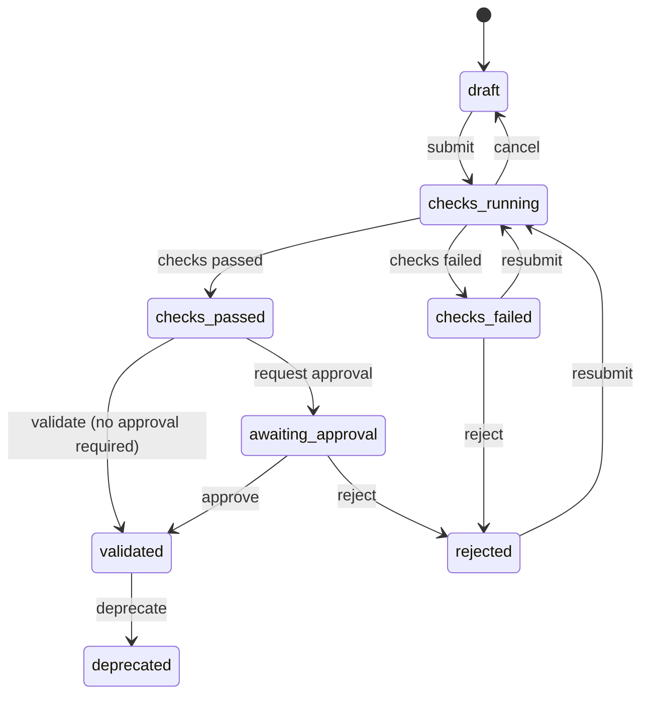

# Governance <span class="mapi-badge">v0.5</span>

A model that informs decisions should prove it has learned something real. **Governance
policies** say which checks a model must pass before it counts as **validated**: that it
does better than on shuffled data, that it gives fake drivers no effect, that it beats a
naive forecast, that its errors look like noise, and more. Checks run in the sandbox as a
governance workflow and store their **evidence**; a reviewer can be required to approve; and
an endpoint can refuse to serve a model that is not validated.

!!! info "Status"
    The contracts are in `mapi_spec.governance` (and the `NOT_VALIDATED` rule of the
    promotion gate in `mapi_spec.scorecard`); the server and the sandbox implement every
    check. The step-by-step guide, the plain-language meaning of each check and the default
    policies are in [Validate models with governance policies](../guides/governance.md);
    every operation is in the [HTTP API reference](../reference/http-api.md#m35).

## Policies

```json
{
  "name": "Forecast models",
  "applies_to": {"families": ["ts"]},
  "checks": [
    {"check": "baseline.beats_naive", "severity": "blocking"},
    {"check": "null.permutation_target", "params": {"n_permutations": 20}},
    {"check": "residuals.whiteness", "severity": "warning"},
    {"check": "holdout.accuracy", "thresholds": {"warn": 0.1, "fail": 0.2}}
  ],
  "require_approval": true,
  "require_validated_for_promotion": true
}
```

- **Scope.** A policy belongs to a project, or to the whole tenant
  (`/v1/tenants/{tenant_id}/governance/policies`). Tenant-wide policies are a floor: every
  project inherits them, and a project's own policy can add checks or tighten thresholds but
  never loosen them (`effective_checks` keeps the stricter severity and thresholds).
- **Matching.** `applies_to` narrows a policy to model families (`mmm`, `ts`, `tabular`,
  `choice`, ...), model ids or guided templates; empty lists match everything.
- **Versions.** Editing a policy saves a new version; validations record the versions they
  were judged by.
- **Severity.** A `blocking` check that fails (or cannot be computed) stops validation; a
  `warning` is shown to the reviewer; `info` is evidence only.

## The check catalog

| Check | What it asks | Measured as (pass / warn / fail) |
|---|---|---|
| `null.permutation_target` | Does the model beat refits on the same data with the result **shuffled**? | p-value: share of shuffled fits at least as good (≤ 0.05 / ≤ 0.10 / more) |
| `null.noise_regressors` | Do **fake drivers made of noise** get (almost) no effect? | largest share given to a fake driver (≤ 2% / ≤ 5% / more) |
| `null.placebo_time_shift` | Do effects **vanish when the drivers are moved** months away? | placebo effect / real effect (≤ 0.25 / ≤ 0.5 / more) |
| `baseline.beats_naive` | Is the forecast better than "same as last week/year"? | relative skill vs the strongest benchmark (≥ 5% / ≥ 0 / below) |
| `residuals.whiteness` | Do the errors look like random noise over time? | Ljung-Box p-value (≥ 0.05 / ≥ 0.01 / below) |
| `stability.rolling_params` | Are key estimates stable across rolling windows? | variation across windows (≤ 25% / ≤ 50% / more) |
| `plausibility.signs` | Do effects point the expected way (ads help, prices hurt)? | share on the wrong side (≤ 10% / ≤ 25% / more) |
| `sensitivity.prior` | Do the answers survive wider and narrower priors? (Bayesian) | largest relative change (≤ 20% / ≤ 50% / more) |
| `recovery.simulated` | Does the model recover known answers from simulated data? | 90% interval coverage, target 90% (±10 / ±25 points) |
| `convergence` | Did the fit settle on a stable answer? | max R-hat (≤ 1.01 / ≤ 1.05 / more) |
| `holdout.accuracy` | Is the error on unseen periods acceptable? | the chosen metric, e.g. MAPE (≤ 15% / ≤ 30% / more) |
| `data.quality` | Is the data good enough to trust the model? | number of data problems found (0 / ≤ 2 / more) |

Each check has an [About card](about-and-choosing.md), a parameter schema and the kinds of
models it applies to (`requires`: Bayesian, a holdout, a time series...); a check that does
not apply is recorded as `skipped` with the reason. Results are `CheckResult`s with the
measured value, the threshold, a plain message and `EvidenceItem`s (numbers, small tables,
plots, stored artifacts) - for a permutation test, the real score next to the shuffled ones.

### Null tests in plain words

The three `null.*` checks answer the question "could noise have produced this?":

- **Shuffled result.** If the model still does well after the result column is shuffled, it is
  fitting noise. A real model must beat (almost) every shuffled refit.
- **Fake drivers.** Pure-noise channels added to a marketing mix model should get close to
  zero; if they get a sizeable share, the real channels' shares are suspect too.
- **Shifted drivers.** Moving spend half a year away from when it happened should kill its
  effect; if it does not, the model is picking up timing patterns, not advertising.

## Validation status



`mapi_spec.governance.transition` is the whole state machine as a pure function; any other
move is `409 VALIDATION_TRANSITION_INVALID`. Every transition is audited
(`model.validation_transition`) and sent to webhooks (`model.validation.checks_passed`,
`model.validated`, `model.rejected`, ...).

### Approval

With `require_approval`, a version that passed its checks waits for a **reviewer**: a member
with the `reviewer` capability (project admins hold it implicitly) who is **not** the person
who submitted it (`403 SELF_APPROVAL_FORBIDDEN`). Rejections need a comment. No API token can
approve, whatever its scopes - approval is a human decision.

### Promotion

A policy with `require_validated_for_promotion` makes the endpoint promotion gate refuse a
version that is not `validated` (`409 NOT_VALIDATED`, reason `NOT_VALIDATED` in the gate's
decision). Unlike a warning on the scorecard, an administrator override does not pass it.

## Evidence pack

`POST /v1/validations/{validation_id}/evidence-pack` exports everything an auditor needs in
one document (`EvidencePack`, JSON or a static HTML rendering): the validation with every
check result and its evidence, the approvals and the full status history, the policies (with
their versions), the model's lineage and scorecard, and a digest of the content.
