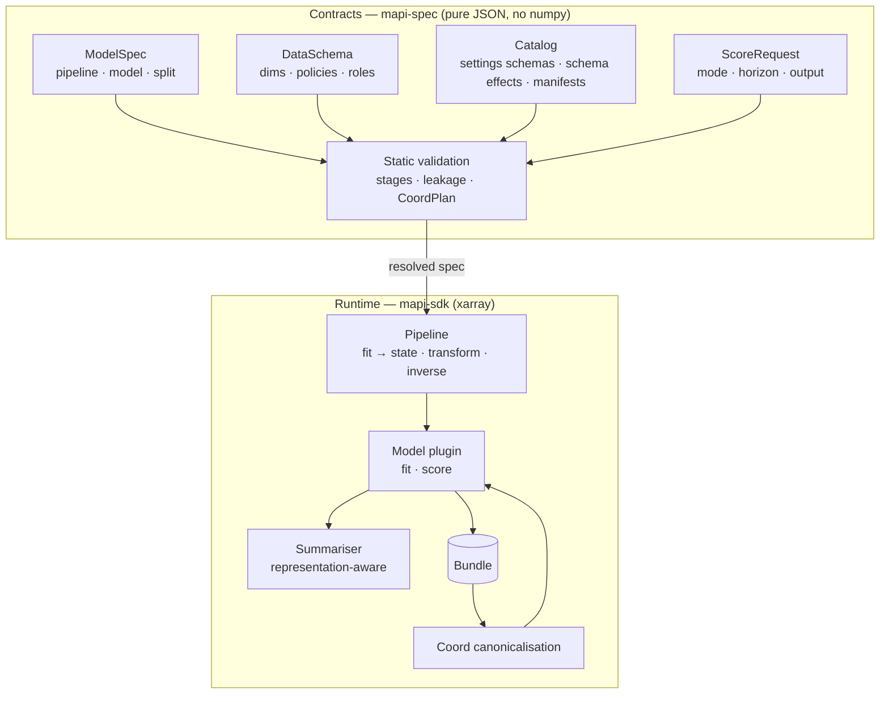

# Concepts

modeling-api uses a small set of ideas that fit together. Each page in this section tells
about one idea and gives code that you can run.

The split between the two halves is important. The **contracts** accept JSON and give JSON.
The API of the platform uses only the contracts. Thus, it can validate all specs and score
requests, and it does not import your code or decode your arrays. The **runtime** works on
arrays and runs plugins in notebooks and in the sandboxed runner. The
[Architecture overview](architecture.md) tells how the platform connects the two halves. The
[Security model](security.md) tells how the platform keeps them safe.

## The ideas

-   **[Labelled data](labelled-data.md)**

    Data is an `xr.Dataset`. A `DataSchema` gives each dim a policy (`fixed`, `extend`,
    `new_levels`). It gives each variable a role, units and rules for missing values. Bindings
    map your names to the canonical names of a model, and back. A dataset can also be a tree
    of groups (v0.8). A spec selects the nodes of the tree that it reads.

-   **[Pipelines and stages](pipelines.md)**

    Steps learn state on the train data and use it again when you score. The split occurs at
    a named stage. Look-back steps keep a context tail for each group. Inverse transforms stop
    at the last reshape and record the output space.

-   **[Representations and summaries](representations.md)**

    Draws, quantiles, intervals, points and moments. The representation sets which summaries
    exist and which aggregations are correct. The summaries of an angle are on the circle.

-   **[Bundles](bundles.md)**

    The fitted artifact is one zarr zip and JSON sidecars. Each file has a hash. Bundles do
    not use pickle.

-   **[Coord plans and typed errors](coord-plans.md)**

    The platform compares score requests with the fitted coordinates before it calculates.
    It finds unseen levels, horizons, gaps, missing future covariates and impossible
    summaries.

-   **[Forecasts with actuals](forecasting-with-actuals.md)**

    Send the actuals that came after the fit, and the dates to forecast. The model updates
    with fixed parameters and forecasts from the last actual. Or it refuses the request. It
    never ignores the actuals.

-   **[Capabilities and manifests](capabilities.md)**

    The static data that a model declares about itself: representation, score modes,
    outputs, derived quantities and the preprocessing that it owns. An output can be a field
    on a grid or an angle on a circle. The default plots of a score run follow the shape of
    each output (v0.10).

-   **[Run tracking and experiments](run-tracking.md)** v0.11

    Each run keeps its metrics, params, tags, notes, log lines and (v0.14) images and
    tables. Search runs by their results. Group them in experiments, save views of the runs
    table and compare 2 to 10 runs.

-   **[Image data and collections](image-collections.md)** v0.14

    An image folder becomes one `uint8` array. An image collection (v0.15) keeps up to
    1 000 000 images in shared packs, uploads only new images and gives batches to the
    networks.

-   **[Measure the effect of a change](causal-effects.md)** v0.13

    Actual values against a prediction of the values without the change. Three causal
    designs, the `impact` group and the path from a geo-lift test to a calibrated marketing
    mix model.

-   **[Tenancy and authentication](tenancy-and-auth.md)** v0.3

    Tenants, projects and roles. API tokens and their scopes. Sign-in from the browser. How
    the platform authorizes each request.

-   **[Quotas and cost](quotas-and-cost.md)** v0.3

    Quotas in vCPU-seconds for each token, each tenant and the full platform. Priority for
    interactive and batch runs. The exact cost of each run, from a versioned price table.
    The resource classes, with the `GPU` class of v0.15.

-   **[Guided mode](guided-mode.md)** v0.4

    Templates, and questions in plain language that find the role of each column. Business
    priors and lift tests. The sanity scorecard. What-if sliders that show results
    immediately, from a response grid for each draw.

-   **[Integrations](integrations.md)** v0.4

    Endpoints and aliases, with gates on promotion. Code snippets, signed webhooks, and
    rendered and embedded plots. The trust lifecycle from sign-up to deletion.

-   **[Workflows](workflows.md)** v0.5

    Versioned DAGs of statistical tests, transforms, branches, train/test plans, searches,
    fits, comparisons, governance and reports. Bayesian checks, stacking weights, scores and
    plots are nodes too. Workflows have typed ports, a safe condition language, a cache,
    schedules and triggers.

-   **[Governance](governance.md)** v0.5

    Policies of checks: null tests with shuffled targets and fake drivers, benchmarks,
    residuals and stability. A validation state machine and approval by a second person.
    Evidence packs, and a promotion that needs validation.

-   **[About cards and choosing](about-and-choosing.md)** v0.5

    A card in plain language on each model, step, node, check and template. The
    deterministic *Help me choose* ranking.

## Vocabulary

| Term | Meaning |
|---|---|
| **Canonical name** | The name that a step or a model uses (`geo`, `time`, `y`). `data.bind` maps it to the name in your dataset (`market`, `date`, `revenue`). |
| **Stage** | The dataset after a named step. `raw` is the bound input. Splits, context and the entry points of scenarios (`inputs_stage`) all refer to stages. |
| **Step state** | The data that a step learned at fit time: JSON and labelled arrays (for example `scale(geo, channel)`). Look-back steps also keep a context tail. The platform never writes the step state into the spec. |
| **Score** | The general term for "predict with the same preprocessing as the fit". Modes: `predict`, `forecast`, `counterfactual`, `simulate`, `filter`, `evaluate`. |
| **Representation** | How a model shows uncertainty: `draws`, `quantiles`, `interval`, `point` or `moments`. |
| **Output space** | The space of the output values after the inverse transforms, for example `raw` or `weekly`. |
| **Bundle** | The verified result of a fit: states, model groups, native artifacts, manifest and hashes. |
| **Run** | A unit of work (`fit`, `score`, …) that the platform sends to an executor as JSON. |
| **Metric, param, tag** | The tracking data of a run (v0.11). A metric is a series of points with a key and labels. A param does not change. A tag can change. |
| **Experiment** | A named group of runs in a project (v0.14). A run is in one experiment or in no experiment. |
| **Media** | The images, figures and small tables that a run logs (v0.14) |
| **Resource class** | The size of the machine of a run: `S`, `M`, `L`, `XL` or, from v0.15, `GPU` |
| **Image collection** | A dataset version with the layout `collection` (v0.15): a manifest of images and packs of image files, shared in the tenant |
| **Counterfactual** | The values without a change, which a model predicts. The effect of the change is the actual value minus the counterfactual. Also the score mode that scores a scenario against a baseline. |
| **Workflow** | A versioned graph of nodes (tests, transforms, splits, searches, fits, summaries, scores, checks, plots, reports). A workflow run is a parent run. Its nodes run in the orchestrator, as sandboxed `workflow_node` runs or as child fits. |
| **Policy** | The governance checks that a model must pass, with thresholds and severities, for each model family. A policy applies to a full tenant or to one project. Each policy has versions. |
| **Validation** | The measurement of one model version against the current policies. It has results, evidence, approvals and a status (`draft` … `validated`). |
| **About card** | The description in plain language that each catalog item has, if you can select the item. |
