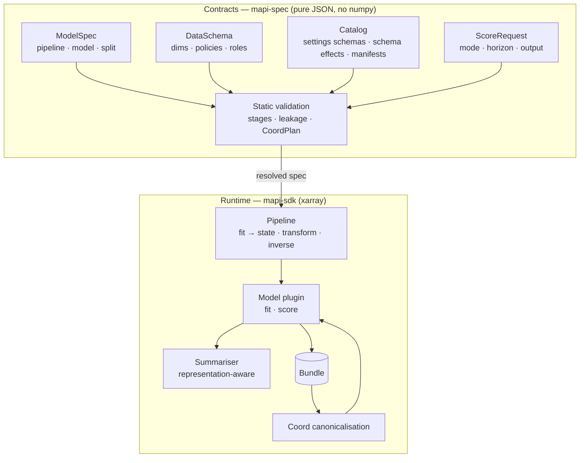

# Concepts

modeling-api is built from a few ideas that fit together. Each page in this section explains
one of them with code you can run.

The split between the two halves matters. The **contracts** are JSON in, JSON out; the
platform's API depends only on them, so it can validate any spec and any score request without
importing your code or decoding your arrays. The **runtime** touches arrays and runs plugins;
it lives in notebooks and in the sandboxed runner. How the platform puts the two halves
together is in the [Architecture overview](architecture.md), and what keeps it safe in the
[Security model](security.md).

## The ideas

-   **[Labelled data](labelled-data.md)**

    Data is an `xr.Dataset`. A `DataSchema` gives each dim a policy (`fixed`, `extend`,
    `new_levels`) and each variable a role, units and missingness rules. Bindings map your
    names to a model's canonical names and back.

-   **[Pipelines and stages](pipelines.md)**

    Steps learn state on train and replay it at score time. The split happens at a named
    stage; look-back steps store per-group context tails; inverse transforms stop at the last
    reshape and record the output space.

-   **[Representations and summaries](representations.md)**

    Draws, quantiles, intervals, points and moments. The representation decides which
    summaries exist and which aggregations are honest.

-   **[Bundles](bundles.md)**

    The fitted artifact: one zarr zip plus JSON sidecars, every file hashed, no pickle.

-   **[Coord plans and typed errors](coord-plans.md)**

    Score requests are checked against the fitted coordinates before any compute: unseen
    levels, horizons, gaps, missing future covariates, impossible summaries.

-   **[Capabilities and manifests](capabilities.md)**

    What a model declares about itself, statically: representation, score modes, outputs,
    derived quantities, which preprocessing it owns.

-   **[Tenancy and authentication](tenancy-and-auth.md)** v0.3

    Tenants, projects and roles; API tokens and their scopes; browser sign-in; how every
    request is authorized.

-   **[Quotas and cost](quotas-and-cost.md)** v0.3

    vCPU-second quotas at token, tenant and global level; interactive and batch priority;
    exact per-run cost from a versioned price table.

-   **[Guided mode](guided-mode.md)** v0.4

    Templates, plain-language questions with role detection, business priors and lift tests,
    the sanity scorecard and instant what-if sliders over per-draw response grids.

-   **[Integrations](integrations.md)** v0.4

    Endpoints and aliases with a gated promotion, code snippets, signed webhooks, rendered
    and embedded plots, and the trust lifecycle from sign-up to deletion.

## Vocabulary

| Term | Meaning |
|---|---|
| **Canonical name** | The name a step or model uses (`geo`, `time`, `y`). `data.bind` maps it to your dataset's name (`market`, `date`, `revenue`). |
| **Stage** | The dataset after a named step. `raw` is the bound input. Splits, context and scenario entry points (`inputs_stage`) all refer to stages. |
| **Step state** | What a step learned at fit time: JSON plus labelled arrays (for example `scale(geo, channel)`), and a context tail for look-back steps. Never written into the spec. |
| **Score** | The umbrella term for "predict with replayed preprocessing". Modes: `predict`, `forecast`, `counterfactual`, `simulate`, `filter`, `evaluate`. |
| **Representation** | How a model encodes uncertainty: `draws`, `quantiles`, `interval`, `point` or `moments`. |
| **Output space** | Where an output's values live after inversion, for example `raw` or `weekly`. |
| **Bundle** | The verified result of a fit: states, model groups, native artifacts, manifest and hashes. |
| **Run** | A unit of work (`fit`, `score`, …) submitted to an executor as JSON. |
