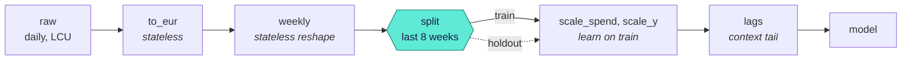
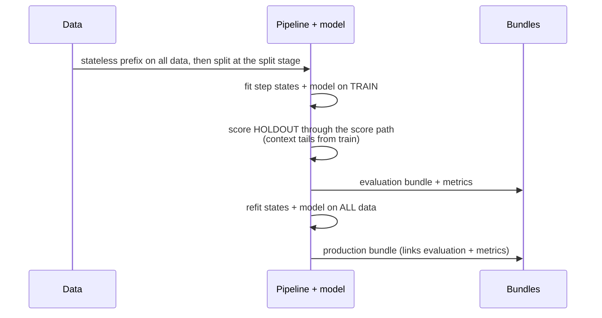
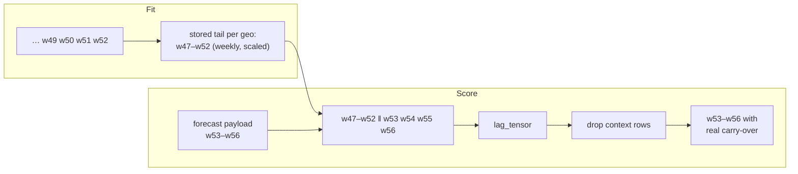

# Pipelines, stages and replay

A pipeline is an ordered list of **steps**. Each step is a small, versioned transform with
typed settings and, if it learns something, a fitted **state**. The promise of the platform is
simple to state and fiddly to keep:

> **Scoring replays exactly the preprocessing that was learned at fit time. It never refits.**

This page explains the pieces that keep that promise: stages, the split stage, context tails,
inverse transforms and scenario entry points.

## Steps

A step implements `fit` (learn, on train only), `transform` (apply; never learns) and, when it
can, `inverse`. A complete one, from the [porting guide](../guides/port-a-model.md):

??? example "A scaling step, in full"

    ```python
    --8<-- "plugin_custom.py:step"
    ```

Every step has a **kind**:

| Kind | Changes | Inverted on the way out? | Examples |
|---|---|---|---|
| `reshape` | Structure: dims, frequency, layout | Never | `resample`, `to_long`, `stack`, `filter_coords` |
| `value` | Values of existing variables | Yes, if `invertible` | `fx_convert`, `mean_scale`, `standardize`, `log1p` |
| `feature` | Adds new variables | Not needed | `lag`, `fourier`, `calendar`, `one_hot`, `formula` |

And a **static schema effect**: a JSON template that says how the step changes the schema
(adds `lag` dim, sets units to `1`, turns daily `date` into weekly `time`). The control plane
uses it to propagate the schema through the whole pipeline without running anything.

## Stages

A **stage** is the dataset after a named step; `raw` is the bound input. Static validation
computes the schema at every stage, so problems surface before any data is read:

```python
--8<-- "concepts_pipeline.py:stages"
```

Stages are how specs refer to points in the pipeline:

- `data.split.after_step`: where the train/holdout split happens;
- `ScoreRequest.inputs_stage`: where a scenario enters the pipeline;
- the **output space**: the stage outputs are inverted back to.

## Where the split happens



Some dims only exist after preprocessing: a holdout of "the last 8 weeks" cannot be cut from
daily data before it is resampled. So the split happens at a **stage**. If `after_step` is not
given, it defaults to the end of the **stateless prefix**, the leading steps that learn nothing
(unit conversion, resampling).

If a step that **learns** runs before the split, its state would be learned partly from the
holdout and the evaluation would be optimistic. Validation reports it:

```python
--8<-- "concepts_pipeline.py:leakage"
```

Set `allow_leakage: true` on the split to downgrade the error to an acknowledged warning.

## Evaluate the way you will forecast

`fit.mode: evaluate_then_refit` (the default) does this:



The holdout is never scored by a separate code path: it goes through `score_bundle`, with the
context it would have in production. Then everything is refitted on all data, so the context
tails and terminal states that forecasts start from are the latest ones. `train_only` stops
after evaluation and keeps the train fit.

## Context tails: looking back across the fit boundary

Steps that look back in time (lags, carry-over) declare a **context need**, for example
`{along: time, n: 6, within: [geo]}`. At fit time the step stores the last `n` rows of its
**own input stage**, per group. At score time the platform prepends them before transforming,
checks that the new data continues the fitted range, and drops them from the output.



The result is identical to transforming the whole series at once; the contract kit checks this
"context-window equivalence" for every step and model. A new market has no tail, so its lags
are padded according to the step's settings (`pad: first`).

Sequential models (HMMs, Kalman filters) keep a model-side **terminal state** instead; see
[Forecasting](../guides/time-series.md).

## Inverse transforms and the output space

On the way out, the platform undoes invertible **value** steps in reverse order and stops at the
**last reshape step**. A model fitted on weekly, scaled EUR returns weekly EUR: scaling can be
undone, the weekly resample cannot (daily values are not recoverable from weekly sums).

Every output records where it ended up:

| Attribute | Example | Meaning |
|---|---|---|
| `output_space` | `{"y_hat": "weekly"}` | The stage the values live at |
| `units` | `EUR` | Units after inversion |
| `retransform` | `{"y_hat": "median"}` | For point models through a non-linear inverse: the inverse of a mean is not a mean, so the value is labelled (or Duan smearing is used) |

Ask for `output: {units: model}` to skip inversion, for example to get contributions that add up
exactly through a `log1p`.

## Scenarios enter at a stage

A planner should not have to invent daily local-currency spend to ask about a weekly EUR
budget. `ScoreRequest.inputs_stage` lets data enter the pipeline after a named step; the steps
before it, and the side tables they need, are skipped:

```yaml
mode: forecast
horizon: {dim: time, periods: 8}
inputs_stage: weekly        # send weekly EUR spend; to_eur and the FX table are skipped
```

The E33 conformance fixture checks that this gives exactly the same forecast as the raw daily
path for the same spend.

## Models that own their preprocessing

Some models do their own scaling or carry-over (pymc-marketing's `MMM` does both). They declare
`owns: [scaling, carryover, inverse_units]` in their capabilities, the platform steps aside,
and outputs are labelled as already in original units. See
[the pymc-marketing adapter](../guides/mmm.md#the-pymc-marketing-adapter).

## Recursion

A lag of the **target** is a recursive feature: forecasting more periods than the smallest lag
would need predictions as inputs. v1 forecasts are direct, so such specs are rejected with
`RECURSIVE_UNSUPPORTED` unless the model declares `owns: [recursion]`.

Next: [Representations and summaries](representations.md).
