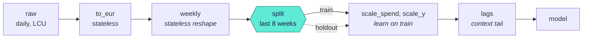
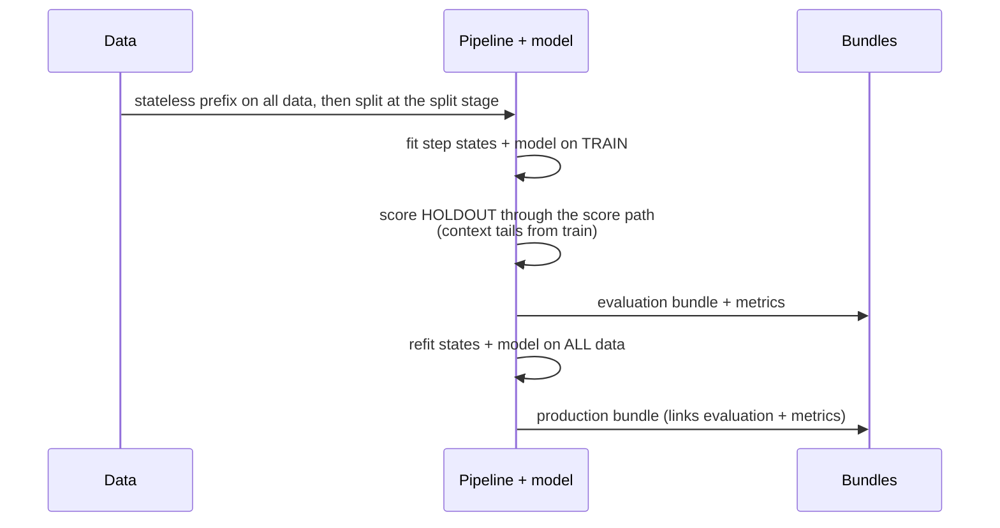
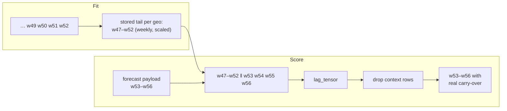

# Pipelines, stages and replay

A pipeline is a list of **steps** in sequence. Each step is a small transform with a version
and typed settings. If a step learns something, it also has a fitted **state**. The promise of
the platform is easy to say but difficult to keep:

> **When you score a model, the platform uses exactly the preprocessing that it learned at fit time. It never fits again.**

This page tells about the parts that keep that promise. These parts are stages, the split
stage, context tails, inverse transforms and the entry points for scenarios.

## Steps

A step has a `fit` function (it learns, on the training data only) and a `transform` function
(it applies the step and never learns). When possible, a step also has an `inverse` function.
This is a full step from the [porting guide](../guides/port-a-model.md):

??? example "A scaling step, in full"

    ```python
    --8<-- "plugin_custom.py:step"
    ```

Each step has a **kind**:

| Kind | Changes | Inverted on the way out? | Examples |
|---|---|---|---|
| `reshape` | Structure: dims, frequency, layout | Never | `resample`, `to_long`, `stack`, `filter_coords` |
| `value` | Values of variables that exist | Yes, if `invertible` | `fx_convert`, `mean_scale`, `standardize`, `log1p` |
| `feature` | Adds new variables | Not necessary | `lag`, `fourier`, `calendar`, `one_hot`, `formula` |

Each step also has a **static schema effect**. This is a JSON template that tells how the step
changes the schema. For example, it adds a `lag` dim, sets units to `1`, or changes daily
`date` into weekly `time`. The control plane uses the template to calculate the schema through
the full pipeline. It does not run a step to do this.

## Stages

A **stage** is the dataset after a named step. `raw` is the bound input. Static validation
calculates the schema at each stage. Thus you see problems before the platform reads data:

```python
--8<-- "concepts_pipeline.py:stages"
```

Specs use stages to refer to points in the pipeline:

- `data.split.after_step`: the point of the train/holdout split
- `ScoreRequest.inputs_stage`: the point where a scenario goes into the pipeline
- the **output space**: the stage to which the platform inverts the outputs.

## Where the split happens



Some dims exist only after preprocessing. For example, you cannot cut a holdout of "the last 8
weeks" from daily data before the data is resampled. Thus the split occurs at a **stage**. If
you do not give `after_step`, the default is the end of the **stateless prefix**. The
stateless prefix is the first steps that learn nothing (unit conversion, resampling).

If a step that **learns** runs before the split, it learns its state partly from the holdout.
Then the evaluation is too optimistic. Validation reports this:

```python
--8<-- "concepts_pipeline.py:leakage"
```

To change the error to a warning that you accept, set `allow_leakage: true` on the split.

### Kinds of split

`data.split.kind` selects how the platform holds out data:

| Kind | Holds out |
|---|---|
| `time_holdout` | The end of an ordered dim: the `last` periods, a `fraction` or the periods `after` a coordinate |
| `last_per_group` | The last rows along a dim in each group |
| `as_of` | The coordinates after `as_of`, with an optional `gap` |
| `leave_group_out` | Full groups of a dim: the `groups` that you name, or `n` random groups |
| `mask_block` | Random blocks over some dims, for a `fraction` of the cells |
| `column` <span class="mapi-badge">v0.14</span> | The rows with a value of a column that is in `holdout`, for example `split = test` |
| `stratified` <span class="mapi-badge">v0.14</span> | The same random `fraction` of the rows in each level of a class label (`by`). A level with one row stays in training. |

An [image collection](image-collections.md) takes only the row splits `column`,
`stratified` and `leave_group_out`. For the fields of each kind, see the
[spec format](../reference/spec-format.md#column-and-stratified-splits).

## Evaluate the way you will forecast

`fit.mode: evaluate_then_refit` (the default) does these steps:



The platform never uses a separate code path to score the holdout. The holdout goes through
`score_bundle`, with the context that it would have in production. Then the platform fits all
parts again on all the data. Thus forecasts start from the latest context tails and terminal
states. `train_only` stops after the evaluation and keeps the fit on the training data.

## Context tails: looking back across the fit boundary

Steps that look back in time (lags, carry-over) declare a **context need**, for example
`{along: time, n: 6, within: [geo]}`. At fit time, the step stores the last `n` rows of its
**own input stage**, for each group. At score time, the platform does these steps:

1. It adds the stored rows before the new data, and then transforms the data.
2. It makes sure that the new data continues the fitted range.
3. It removes the stored rows from the output.



The result is the same as when you transform the full series at one time. The contract kit
does a check of this "context-window equivalence" for each step and model. A new market has no
tail. Thus the step pads its lags as its settings tell (`pad: first`).

Sequential models (HMMs, Kalman filters) keep a **terminal state** in the model instead. Refer
to [Forecasting](../guides/time-series.md).

## Inverse transforms and the output space

On the way out, the platform reverses the invertible **value** steps in the opposite sequence.
It stops at the **last reshape step**. A model that is fitted on weekly, scaled EUR returns
weekly EUR. The platform can reverse the scaling, but it cannot reverse the weekly resample.
Daily values are not available from weekly sums.

Each output records where it stopped:

| Attribute | Example | Meaning |
|---|---|---|
| `output_space` | `{"y_hat": "weekly"}` | The stage of the values |
| `units` | `EUR` | The units after inversion |
| `retransform` | `{"y_hat": "median"}` | For point models through a non-linear inverse. The inverse of a mean is not a mean. Thus the platform labels the value (or uses Duan smearing) |

To skip inversion, ask for `output: {units: model}`. For example, use this to get
contributions that add up exactly through a `log1p`.

## Scenarios enter at a stage

A planner must not have to make up daily spend in local currency to ask about a weekly EUR
budget. With `ScoreRequest.inputs_stage`, data can go into the pipeline after a named step.
The platform skips the steps before it, and the side tables that these steps need:

```yaml
mode: forecast
horizon: {dim: time, periods: 8}
inputs_stage: weekly        # send weekly EUR spend; to_eur and the FX table are skipped
```

The E33 conformance fixture makes sure that this gives exactly the same forecast as the raw
daily path for the same spend.

## Models that own their preprocessing

Some models do their own scaling or carry-over (the mmm-framework MMMs do both). These models
declare `owns: [scaling, carryover, inverse_units]` in their capabilities. Then the platform
does not apply these steps. The outputs have a label that tells that they are already in the
original units. Refer to
[the mmm-framework models](../models/mmm-framework.md#what-the-data-looks-like).

## Recursion

A lag of the **target** is a recursive feature. If a forecast has more periods than the
smallest lag, it needs predictions as inputs. v1 forecasts are direct. Thus the platform
refuses such specs with `RECURSIVE_UNSUPPORTED`, unless the model declares
`owns: [recursion]`.

Next: [Representations and summaries](representations.md).
