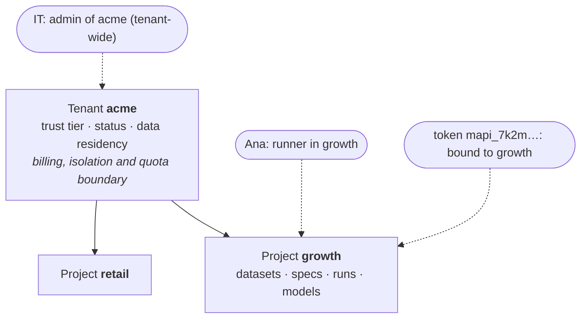

# Tenancy and authentication <span class="mapi-badge">v0.3</span>

From v0.3, one deployment serves many organisations. Each organisation is a **tenant**. In a
tenant, the work is in **projects**. Persons and programs get **roles** in projects. For each
request, the platform does three checks:

- It authenticates the caller (who calls).
- It finds the scope (in which project).
- It authorizes the request (can the caller do this).

One pure function does these checks. The API, the web app and the tests share this function.
The contracts are in `mapi_spec.tenancy` and `mapi_spec.tokens`. The endpoints are in
[HTTP API: Multi-tenant API](../reference/http-api.md#multi-tenant-api).

!!! note "Coming from v0.2"
    A v0.2 install had one tenant and one project, both with the name `default`, and no
    sign-in. Each row and storage key already contained the tenant and the project. Thus,
    v0.3 needs no data migration, and your work is in `default/default`.
    `MAPI_PROFILE=single-tenant` keeps the old behaviour without credentials. The
    [Administration guide](../guides/administration.md) gives the practical side of this page:
    who does what, with screenshots and a tested walkthrough.
    [Authentication](../guides/authentication.md) tells how to sign in.

## Tenants and projects



A **tenant** is the unit of billing, isolation and quotas. Postgres enforces the tenant with
row-level security on `tenant_id` in all tables. Each storage key starts with `t/{tenant}/`.
A tenant has these fields:

| Field | Values | Effect |
|---|---|---|
| Trust tier | `internal`, `verified`, `public`, `self-hosted-trusted` | The location where its runs can execute, and its default quotas |
| Status | `active`, `suspended`, `deleting` | `suspended` tenants can read, but they cannot change or run items. You cannot get access to `deleting` tenants. |
| Data residency | A multi-region (`eu`, `us`, `asia`) or one region (`europe-west1`) | Runs go only to executors that declare a matching region. Cloud Run Jobs declare their region. The self-hosted executors (`local-process`, `docker`, `docker-gvisor`) declare no region, and the platform does not check them. For these executors, the location of the install is the residency. |

The trust tier decides the placement. The dispatcher enforces the placement. Tenant
configuration never controls it.

| Tier | Who | The executor must give |
|---|---|---|
| `internal` | The platform team | Process isolation or better |
| `self-hosted-trusted` | One organisation that runs its own install | Process isolation or better |
| `verified` | Known customers (identity or card verified) | gVisor or a microVM, with egress and DNS enforced |
| `public` | All persons who signed up | gVisor or a microVM, with egress and DNS enforced |

Thus, the runs of a `verified` or `public` tenant never go to the `local-process` or plain
`docker` executor. The executor must also pass the executor conformance suite and the security
suite for its current configuration. An operator records these results
([the shared-tier gate](../operations/cloud-run.md#the-shared-tier-gate)). Until an executor
qualifies, the platform refuses the runs of those tenants at submission. By default, new
tenants are `verified`.

A **project** is a workspace in a tenant and the unit of access control. Its id is a short
slug that is unique in the tenant. The id is short because it shows in references such as
`dataset://growth/eu_media_daily`.

## Roles

There are four project roles. Each role can do all the actions of the role before it:

| Role | Can |
|---|---|
| `viewer` | Read all items in the project: datasets, specs, runs, logs, models, plots and usage. Validate specs. Mint tokens for themselves. |
| `editor` | Also make and change datasets, specs, workflows and saved plots. |
| `runner` | Also **spend compute**. Submit, cancel, resume and retry runs. Run and cancel workflows. Score models and endpoints. Render plots. Submit models for governance validation. |
| `admin` | Also manage members, endpoints and their promotion, plugins, webhooks, governance policies and the tokens of other persons. Deprecate validated versions. Delete items. |

The runner role is above the editor role intentionally. Compute costs money. Thus, you can let
a team member edit a spec, but not start a 200-task sweep.

A **membership** gives one role, on one project or tenant-wide. It can also give
**capabilities** in addition to the role (v0.5). With `reviewer`, an editor or a runner can
approve or reject model validations that wait for a second person. They can never approve
their own submissions, and they can never approve through a token. Project admins have all
capabilities implicitly.

A tenant-wide grant applies to the tenant itself and to all projects in it. For the tenant,
this includes its name, its member list, its audit log and its bill. In a project, the
effective role of a member is the higher role of their tenant-wide grant and their project
grant.

The full permission matrix is `mapi_spec.tenancy.PERMISSIONS`. A test checks each
combination of role, action and resource against a table that a different person wrote. In
summary:

| Resource | `read` | `create` | `update` | `delete` | Other |
|---|---|---|---|---|---|
| tenant | viewer (tenant-wide) | operator | admin (tenant-wide) | operator | `manage` (tier, status, residency): operator |
| tenant members | viewer (tenant-wide) | admin (tenant-wide) | admin (tenant-wide) | admin (tenant-wide) | — |
| project | viewer | admin (tenant-wide) | admin | admin (tenant-wide) | — |
| project members | viewer | admin | admin | admin | — |
| token | viewer | viewer | — | viewer (own) | `manage` (tokens of other persons): admin |
| catalog | viewer | — | — | — | — |
| dataset, spec | viewer | editor | editor | admin | — |
| run | viewer | runner | — | — | `cancel`: runner |
| model | viewer | — | — | admin | `run` (score): runner |
| endpoint | viewer | admin | admin | admin | `run`: runner. `promote`: admin. |
| plot | viewer | editor | — | — | `run` (render): runner |
| plugin | viewer | admin | — | admin | — |
| embed link | viewer | editor | — | editor | — |
| webhook | admin | admin | admin | admin | — |
| workflow (v0.5) | viewer | editor | editor | admin | `run`, `cancel`: runner |
| governance policy (v0.5) | viewer | admin | admin | admin | tenant-wide policies: admin (tenant-wide) |
| model validation (v0.5) | viewer | — | admin (deprecate) | — | `validate`: runner. `approve`: editor or runner with `reviewer`, or admin. |
| usage (project) | viewer | — | — | — | — |
| billing, audit (tenant) | admin (tenant-wide) | — | — | — | — |
| quotas, kill switches, executors | operator | — | operator | operator | — |

**Operators** run the platform. They manage tenants, quotas, kill switches and executors. They
can read tenant metadata, usage and audit logs. They cannot read tenant content (datasets,
specs, models and plots) through the API. No role or flag gives this access.

```python
--8<-- "concepts_tenancy.py:can"
```

## Who can call

| Principal | How it authenticates | Identity |
|---|---|---|
| **User** | Signs in with OpenID Connect in the browser | `(issuer, subject)` from the identity provider. At the first sign-in, the platform maps it to a platform id `usr_…`. |
| **Token** | `Authorization: Bearer mapi_…` | The token id `tok_…`. The token acts as its owner: a user or a service account `sa_…` (a *service token*). |
| **Internal service** | Platform identity (for example, the signed OIDC token of Pub/Sub on `/internal/events`) | `svc_…`. Only internal routes accept it. |

## How a request is authorized

1. **Authenticate.** The caller uses a session cookie, a bearer token or a service identity.
   If the credential is missing or not valid, the answer is `401 UNAUTHENTICATED`.
2. **Select the project.** The project comes from the path, the
   `X-Mapi-Project: <tenant>/<project>` header, or the binding of the token (see below).
3. **Resolve roles.** The platform gets the tenant-wide and project roles of the caller from
   the memberships *now*. For a token, it uses the memberships of the owner. Thus, if you
   remove a person from a project, their tokens stop working there immediately.
4. **Check the permission.** `AuthContext.allows(action, resource)` applies these rules in
   this sequence: internal rules, operator rules, the status of the tenant, and the role at
   the level of the rule. For tokens, it then applies the scopes. If the caller cannot see a
   resource, the answer is `404`. If the caller can see a resource but cannot change it, the
   answer is `403 FORBIDDEN`.
5. **Check quotas.** The platform checks quotas before each action that uses compute or
   storage (see [Quotas and cost](quotas-and-cost.md)).

```python
--8<-- "concepts_tenancy.py:context"
```

### Selecting the project

All resources of v0.2 (datasets, specs, runs, models and plots) are now in a project. Send
`X-Mapi-Project: acme/growth`. If there is only one possible tenant, you can send only
`X-Mapi-Project: growth`. Tokens have a binding to one project and do not need the header. If
a token names a different project, the answer is `403 FORBIDDEN`. A local single-tenant
install uses `default/default`.

A token has a binding to one project. Thus, it cannot administer its tenant. These actions
need a signed-in session: tenant members, the creation or deletion of projects, the tenant
audit log and tenant usage. For a token, the answer is `403 FORBIDDEN`. This is true for all
scopes and all roles of the owner. A token can read its own tenant (`GET /v1/tenants/{tenant}`)
and list its own project.

```python
--8<-- "concepts_tenancy.py:project"
```

## API tokens

Programs (the Python client, the CLI and BI exports) use API tokens:

```text
mapi_7k2m9q4x_0123456789abcdefghjkmnpqrstvwxyz072gj7d
     prefix   secret (160 random bits)        checksum
```

- Tokens use lowercase Crockford base32 (no `i`, `l`, `o`, `u`). Thus, you can read a token
  aloud or type it again without errors.
- The **prefix** is public. Lists show the token as `mapi_7k2m9q4x_…`.
- The platform shows the **secret** one time, in the response to `POST /v1/tokens`. The server
  keeps only an HMAC-SHA256 of the full token under a server-side pepper. It compares tokens
  in constant time.
- The **checksum** is a CRC-32 of the remaining characters. Clients and secret scanners use it
  to refuse typing errors and random strings, without a request to the server. The checksum
  finds all single-character typing errors. It also finds each swap of two adjacent
  characters.

```python
--8<-- "concepts_tenancy.py:tokens"
```

### Scopes

The **scopes** of a token limit what the token can do. They never add to the role of its
owner. The token of an admin with `models:read` can only read.

| Scope | Allows |
|---|---|
| `models:read` | Read datasets, specs, runs, models, endpoints, plots, usage and the catalog |
| `runs:create` | `models:read`, plus submit and cancel runs, score models and endpoints, and render plots |
| `score:{target}` | Score one model by its id, for example `score:mdl_01jaf3r1s2t3v4w5x6y7z8a9b0` (`POST /v1/models/{id}/versions/{v}:score`). `score:*` covers all models in the project. When endpoints exist, an endpoint alias works in the same way, for example `score:geo-mmm-prod`. |
| `datasets:write` | Make datasets and add versions |
| `plugins:publish` | Publish and yank plugins (plugin upload comes in v0.6) |
| `endpoints:promote` | Make, promote, roll back and delete endpoints, and read models (CI pipelines). It never overrides a gate. |
| `webhooks:manage` | Manage the webhooks of the project and replay deliveries |
| `workflows:write` (v0.5) | Make workflows and save revisions (workflow-as-code from CI) |
| `workflows:run` (v0.5) | Run and cancel workflows, and manage their schedules and triggers |
| `models:validate` (v0.5) | Submit model versions for governance validation, and read policies. It never approves. |
| `policies:manage` (v0.5) | Make, edit and retire the governance policies of the project (policy-as-code) |
| `admin` | All actions that the role of the owner allows, except three: mint tokens, override a promotion gate and approve a validation |

No scope lets a token mint tokens. A child token would escape the expiry, budget, rate limit
and revocation of its parent. Mint tokens from a signed-in session (`mapi login` or the
browser). To override a promotion gate or approve a model validation, a signed-in person is
also necessary. These are human decisions, and the audit log names the person who made them.
The generated [permissions reference](../reference/generated/permissions.md) shows all scopes
against all actions.

Each token also has an expiry. The default is 90 days, and the maximum is 365 days. A token
can also have its own limit of requests per minute and a vCPU-second budget for each day or
month. These limits apply in addition to the quotas of the tenant.

## Signing in from the browser

The web app never holds an OAuth token. The API acts as a backend-for-frontend:

```mermaid
sequenceDiagram
    autonumber
    participant B as Browser
    participant A as API (/auth)
    participant I as Identity provider
    B->>A: GET /auth/login?return_to=/runs
    A->>A: new state, nonce, PKCE verifier (kept server-side, 10 min)
    A-->>B: 302 to IdP (code_challenge S256, state, nonce) + __Host-mapi_login cookie
    B->>I: sign in
    I-->>B: 302 /auth/callback?code&state
    B->>A: GET /auth/callback (with the login cookie)
    A->>I: exchange code + PKCE verifier
    I-->>A: ID token
    A->>A: check issuer, audience, nonce, expiry; map (issuer, subject) to usr_…
    A-->>B: 302 /runs + __Host-mapi_session (HttpOnly, Secure, SameSite=Strict)
    B->>A: fetch /v1/... (cookie sent same-site only)
```

- The session cookie is `HttpOnly`, thus scripts cannot read it. It is `Secure`. It is
  `SameSite=Strict`, thus cross-site requests never send it. It is host-only (the `__Host-`
  prefix: no `Domain`, `Path=/`).
- A session ends after 2 hours with no activity, or after 12 hours in total.
  `POST /auth/logout` ends a session immediately.
- Requests that change state with the session cookie must also send the CSRF token of the
  session in `X-CSRF-Token`. The token comes from the readable `__Host-mapi_csrf` cookie or
  from `GET /auth/session`. If the token is missing, or if the request comes from a different
  origin, the platform refuses the request.
- `return_to` accepts only a path on the same origin. Thus, an attacker cannot use the login
  flow as an open redirect.
- `GET /auth/session` tells the web app if it is signed in. `authenticated: false` is a
  usual 200 answer.

## Audit

The platform writes actions that are important for security to an append-only audit log.
These actions are:

- Sign-ins
- Token creation and revocation
- Changes to memberships and projects
- Changes to quotas and kill switches
- Artifact links that the platform mints
- Quota denials and refused run events

Each entry records the platform id of the actor, the action, the resource, the result and a
problem code. The platform keeps client IP addresses and user agents only as keyed HMACs.
Thus, you can correlate entries, but you cannot get the original values back. Tenant admins
read the log of their tenant at `GET /v1/tenants/{tenant_id}/audit`. Operators read all
entries at `GET /v1/admin/audit`.
