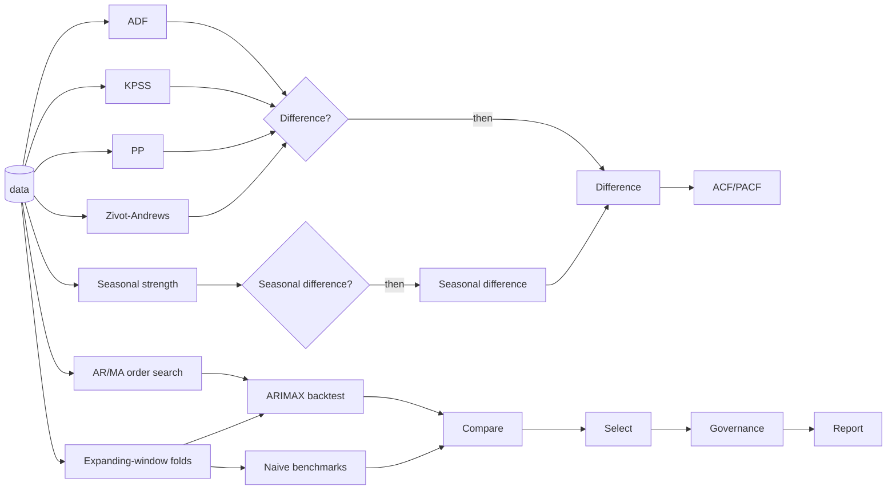

# Workflows <span class="mapi-badge">v0.5</span>

A **workflow** connects the steps of an analysis. The steps run as one unit, in the same way
each time. A usual sequence is: do a check of the data, decide what to do, prepare the data,
choose settings, fit, and test against benchmarks. Then select the best model, do the
governance checks and write a report. Each step is a **node**. The arrows between the nodes
carry typed results.

A workflow is a document (`kind: Workflow`, YAML or JSON). It has versions, the same as a
spec. The platform validates it before it runs. A workflow can run on a schedule, or each
time that a dataset gets a new version.

!!! info "Status"
    The contracts are in `mapi_spec.workflow`, `mapi_spec.workflow_nodes`,
    `mapi_spec.workflow_templates`, `mapi_spec.expr`, `mapi_spec.splitplan` and
    `mapi_spec.stattests`. The engine and the node implementations are in `mapi_workflows`.
    The endpoints are in the [HTTP API reference](../reference/http-api.md#m35). The
    [workflows guide](../guides/workflows.md) gives the practical walkthrough and cookbook.

## The canonical example

Most forecasting projects need the template `ts_readiness_arimax`:



1. **Unit-root tests.** ADF and Phillips-Perron ask "does the series wander?". KPSS asks the
   opposite question. Zivot-Andrews permits one sudden break.
2. **Decisions.** One branch differences the series only if the tests show that it wanders.
   A different branch seasonally differences the series only if the season is strong.
3. **Orders.** ACF/PACF shows how many past values are important. An information-criterion
   grid search selects the AR and MA orders. It gets the differencing decision as an input.
4. **A correct backtest.** An expanding-window plan refits ARIMAX on each fold. The plan has
   an optional gap (for late data) and some horizons (1, 4 and 8 weeks ahead).
5. **Benchmarks.** The same folds score naive and seasonal-naive forecasts. The comparison
   and the selection keep ARIMAX only if it is better than the benchmarks.
6. **Governance and report.** The selected model goes through the policy checks. A
   plain-language report explains each decision.

## The document

```yaml
apiVersion: mapi/v1
kind: Workflow
metadata: {name: ts-readiness, project: growth}
params:
  alpha: {type: number, default: 0.05}
  season: {type: integer, default: 52}
inputs:
  data: {type: dataset}
nodes:
  - {id: adf, use: test.adf, inputs: {data: inputs.data}, with: {alpha: {$param: alpha}}}
  - {id: kpss, use: test.kpss, inputs: {data: inputs.data}}
  - id: wanders
    use: branch.if
    with: {condition: "not nodes.adf.reject or nodes.kpss.reject"}
  - {id: diff, use: transform.difference, inputs: {data: inputs.data}, when: wanders.then}
  - id: order
    use: search.arma_order
    inputs: {data: inputs.data}
    with: {d: {$expr: "if(nodes.wanders.value, 1, 0)"}, max_p: 3, max_q: 3}
outputs: {orders: order.table}
```

| Field | Meaning |
|---|---|
| `params` | Run-time parameters with a type, a default (or `required: true`), bounds and permitted values. A run can override them. |
| `inputs` | The items that the workflow uses: `dataset`, `model_version`, `split_plan`... with an optional default reference |
| `nodes[].use` | The node implementation (below), optionally with a version range |
| `nodes[].inputs` | Port bindings: `inputs.<name>` or `<node>.<port>`. For a single-value port, a list gives **alternatives**. The port uses the first alternative whose node ran. For a multiple port (`compare.models` candidates, report items), a list collects all sources that ran. |
| `nodes[].with` | Parameters. The platform checks them against the JSON Schema of the node. A value can be `{$param: name}` (a workflow parameter) or `{$expr: "..."}` (calculated from upstream results). |
| `nodes[].when` | `<branch>.then` or `<branch>.else`. The node runs only on that arm. |
| `nodes[].retries`, `timeout`, `cache`, `on_failure` | Execution settings for each node. With `on_failure: continue`, the platform treats a failure as a skip. |
| `outputs` | Named results of the workflow (`<node>.<port>`). A parent workflow reads these results from a sub-workflow. |

If a node is gated by an arm that the workflow did not take, the node is **skipped**. All
nodes that need that node are also skipped, unless their input has an alternative. This is
how "difference only if necessary" goes into the next step: `data: [diff.data, inputs.data]`.

### Typed ports

Each edge carries one of these types: `dataset`, `test_result`, `split_plan`,
`model_version`, `metrics`, `table`, `plot`, `report` or `evidence`
(`mapi_spec.workflow_nodes.PortType`). If you bind a `test_result` to a `dataset` port, you
get a validation error before a node runs.

## Conditions: a safe expression language

Branch conditions and `$expr` values use a very small language (`mapi_spec.expr`). A
hand-written parser parses it, and the platform evaluates it over JSON. The platform
**never** gives it to the Python `eval`. It never reads an attribute of a Python object. All
inputs have limits: 2000 characters, 400 tokens, nesting depth 32 and 10 000 evaluation steps.

```text
nodes.adf.p_value < params.alpha and not nodes.kpss.reject
nodes.seas.strength >= 0.64 or 'seasonal' in params.flags
[nodes.order.best_p, if(nodes.wanders.value, 1, 0), nodes.order.best_q]
coalesce(nodes.search.best_score, 0) < 500 and exists(nodes.za.details.break_at)
```

- **Values:** numbers, `'text'` or `"text"`, `true`, `false`, `null`, and lists `[a, b]`.
- **References:** `nodes.<id>.<field>` (the result of a node), `params.<name>`,
  `inputs.<name>` and `run.<field>`. Index with `[0]` or `['5%']`.
- **Operators:** `== != < <= > >=`, `in`, `not in`, `and`, `or`, `not`, `+ - * / %`, unary `-`
  and parentheses. You cannot chain comparisons. The language refuses `a < b < c`. Write
  `a < b and b < c`.
- **Functions:** `abs`, `min`, `max`, `len`, `round`, `any`, `all`, `exists`, `coalesce` and
  `if(condition, a, b)`. The `if` function evaluates only the selected value.

The rules are strict. Thus, a condition means exactly what it says:

- `and`/`or`/`not` need true or false. Numbers are not "truthy".
- An order comparison compares numbers with numbers and text with text.
- A missing result is an error, unless it is in `exists` or `coalesce`.

Static validation makes sure that each referenced node runs **before** the branch. It also
makes sure that the node produces the field (its `result_fields`).

## Validation

`POST /v1/workflows:validate` runs `mapi_spec.workflow.validate_workflow`. Each saved revision
also runs it. It reports each problem with a JSON pointer:

| Check | Example message |
|---|---|
| Unknown implementation | `/nodes/0/use`: node 'adf' uses 'test.nope', which is not in the node catalog |
| Parameters | `/nodes/0/with/alpha`: 2 is greater than or equal to the maximum of 0.5 |
| Missing or unknown ports | `/nodes/4/inputs`: node 'order' needs input 'data' (dataset) |
| Port types | `/nodes/4/inputs/data`: expects dataset but adf.result is test_result |
| References | `/nodes/2/with/condition`: nodes.adf.p_valu: test.adf results have no field 'p_valu' |
| Cycles | `/nodes`: the workflow has a cycle: a -> b -> a |
| Unreachable nodes | `/nodes/6`: node 'x' can never run: it needs both the then and the else arm of 'wanders' |
| Unused results (warning) | `/nodes/5`: the result of 'lone' is not used by any node or output |
| Models | `/nodes/7/with/model`: no catalog model matches 'ts.sarimx@^1' |

The platform stores a revision with errors, thus you can correct it. But the revision cannot
run (`409 WORKFLOW_NOT_RUNNABLE`).

## Runs, caching and automation

A run (`POST /v1/workflows/{workflow_id}/runs`) is a parent run of kind `workflow`. The
orchestrator goes through the graph in topological order. It does these actions:

- It evaluates **branches** and **selections** itself, on JSON results only (`orchestrator`
  nodes). It records a `BranchDecision` with the values that the condition read.
- It sends **tests, transforms, splits, searches, backtests, forecasts, evaluations and
  governance checks** to sandboxed `workflow_node` child runs. Only the sandbox decodes user
  data.
- It starts **fits** as usual `fit` child runs, and **sub-workflows** as child workflow runs
  (see [where nodes run](../guides/workflows.md#where-nodes-run)).

The identity of each node is a **cache key** (`node_cache_key`). The key contains the
resolved implementation, its resolved parameters and the content of its inputs. If a node
did not change, it uses its earlier result again (status `cached`). For example, if you change
only the final report and run the workflow again, only the report runs again. Each node
records its status, attempt, result, outputs, child runs and cost.

**Schedules** run a workflow on a cron expression in a time zone (`@daily`, `0 6 * * 1`). The
shortest interval is 15 minutes. The schedule handles daylight-saving gaps. **Triggers** run a
workflow each time that a dataset gets a new version. A trigger has a binding to one of the
inputs of the workflow. Terminal runs send a notification to webhooks.

## The node catalog

`GET /v1/catalog/workflow-nodes` lists all implementations. For each implementation, it gives
its ports, parameter schema, result fields and an [About card](about-and-choosing.md).

| Kind | Implementations |
|---|---|
| Statistical tests | `test.adf`, `test.kpss`, `test.pp`, `test.zivot_andrews`, `test.johansen`, `test.engle_granger`, `test.ljung_box`, `test.jarque_bera`, `test.breusch_pagan`, `test.white`, `test.arch_lm`, `test.granger`, `test.acf_pacf`, `test.seasonal_strength`, `test.vif`, `test.cusum`, `test.chow` |
| Data processing | `transform.difference`, `transform.seasonal_difference`, `transform.log`, `transform.box_cox`, `transform.steps` (all catalog preprocessing steps), `transform.select` |
| Train/test plans | `split.holdout`, `split.rolling_origin`, `split.expanding_window`, `split.blocked_kfold`, `split.purged_kfold`, `split.geo_holdout`, `split.nested` |
| Searches | `search.arma_order`, `search.sarima_order`, `search.var_lag_order`, `search.coint_rank`, `search.grid` |
| Models | `model.fit` (all catalog models), `model.backtest`, `model.forecast`, `model.summary`, `model.score` |
| Evaluation | `evaluate.metrics`, `evaluate.baseline`, `evaluate.residuals`, `evaluate.ppc` |
| Comparison and selection | `compare.models`, `compare.diebold_mariano`, `compare.stacking`, `select.best`, `select.threshold` |
| Governance | `governance.policy`, `governance.check` (see [Governance](governance.md)) |
| Reports | `report.summary`, `report.evidence_pack` |
| Plots | `plot.render` (all catalog plot recipes) |
| Control | `branch.if`, `subworkflow.run` |

Each test returns a `StatTestResult`. It contains these items:

- The statistic and the p-value
- The decision at the significance level: `reject`, and a label such as `unit_root` or
  `stationary`
- The verdict in plain words
- For panels, the result for each series

The null hypothesis of KPSS is the "good" case. Thus, its labels are the opposite of the
labels of ADF. `mapi_spec.stattests.decide` keeps them correct.

### Train/test plans

A `SplitPlan` describes many folds at one time (`mapi_spec.splitplan`). Window plans have
these fields: `horizons` (scored separately), a `step` between origins, a `gap` between
training and test, `n_folds` and an `anchor`. By default, the last test window ends at the
last period. The platform calculates folds from the number of periods only. Thus, the web app
shows the folds before a node runs.

`expanding_window` and `rolling_origin` match the scikit-learn `TimeSeriesSplit`. An
expanding fold is exactly the existing `as_of` split with its `gap`. `geo_holdout` holds out
full markets, optionally only over their last periods. `nested` runs an inner plan in each
outer training window, for correct tuning.

## The gallery

| Template | What it automates |
|---|---|
| `ts_readiness_arimax` | Unit-root tests, differencing that branches decide, order search, an expanding-window backtest against naive benchmarks, selection, governance and a report |
| `var_vecm_cointegration` | A Johansen test. If the series are tied together, a VECM with the selected rank. If not, differences, a lag search and a VAR. Granger tests and a report. |
| `mmm_governed` | Driver collinearity, the mmm-framework marketing mix model with a holdout, the governance policy, a report and an evidence pack |
| `forecast_bakeoff` | A backtest of SARIMAX, ETS, Theta and the smooth-trend model on the same folds, against benchmarks. The platform fits the best model again. |
| `sci_phylo_signal` | Four fits of `sci.phylo_regression` (no tree, Brownian motion, Pagel's lambda, Ornstein-Uhlenbeck), ranked by `elpd_loo` and weighed by stacking. A branch on the slope of one predictor of the winner: does its range exclude zero? A plot of the tree and a report. |
| `sci_calibrate_then_design` | A fit of `sci.heat_plate` with one calibration run held out. A branch on the error on that run and on R-hat. If the calibration is good enough, the predicted temperature field of a new heater layout, as a map. A report. |

To make a workflow from a template, use `POST /v1/workflows` with `{"template": "<id>"}`.
Then edit its parameters or nodes, the same as for all other workflows.
