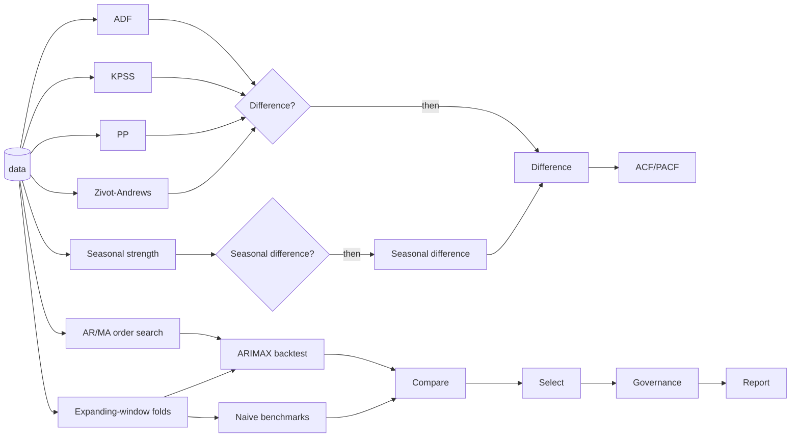

# Workflows <span class="mapi-badge">v0.5</span>

A **workflow** strings the steps of an analysis together so they run as one, the same way
every time: check the data, decide what to do about it, prepare it, choose settings, fit,
test against benchmarks, pick a winner, run the governance checks and write a report. Each
step is a **node**; the arrows between them carry typed results. A workflow is a document
(`kind: Workflow`, YAML or JSON) that is versioned like a spec, validated before it runs,
and can run on a schedule or whenever a dataset gets a new version.

!!! info "Status"
    v0.5 defines the contracts in `mapi_spec.workflow`, `mapi_spec.workflow_nodes`,
    `mapi_spec.workflow_templates`, `mapi_spec.expr`, `mapi_spec.splitplan` and
    `mapi_spec.stattests`, and the endpoints in the
    [HTTP API reference](../reference/http-api.md#m35). The orchestrator, the node runner
    and the web editor build on them.

## The canonical example

The template `ts_readiness_arimax` is what most forecasting projects need:



1. **Unit-root tests.** ADF and Phillips-Perron ask "does the series wander?"; KPSS asks the
   opposite question; Zivot-Andrews allows for one sudden break.
2. **Decisions.** A branch differences the series only if the tests say it wanders; another
   seasonally differences it only if the season is strong.
3. **Orders.** ACF/PACF suggests how many past values matter; an information-criterion grid
   search picks the AR and MA orders, with the differencing decision passed in.
4. **An honest backtest.** An expanding-window plan with an optional gap (for late data)
   and several horizons (1, 4 and 8 weeks ahead) refits ARIMAX on every fold.
5. **Benchmarks.** The same folds score naive and seasonal-naive forecasts; the comparison
   and selection only keep ARIMAX if it beats them.
6. **Governance and report.** The chosen model goes through the policy checks and a
   plain-language report explains every decision.

## The document

```yaml
apiVersion: mapi/v1
kind: Workflow
metadata: {name: ts-readiness, project: growth}
params:
  alpha: {type: number, default: 0.05}
  season: {type: integer, default: 52}
inputs:
  data: {type: dataset}
nodes:
  - {id: adf, use: test.adf, inputs: {data: inputs.data}, with: {alpha: {$param: alpha}}}
  - {id: kpss, use: test.kpss, inputs: {data: inputs.data}}
  - id: wanders
    use: branch.if
    with: {condition: "not nodes.adf.reject or nodes.kpss.reject"}
  - {id: diff, use: transform.difference, inputs: {data: inputs.data}, when: wanders.then}
  - id: order
    use: search.arma_order
    inputs: {data: inputs.data}
    with: {d: {$expr: "if(nodes.wanders.value, 1, 0)"}, max_p: 3, max_q: 3}
outputs: {orders: order.table}
```

| Field | Meaning |
|---|---|
| `params` | Run-time parameters with a type, a default (or `required: true`), bounds and allowed values; a run may override them |
| `inputs` | What the workflow consumes: `dataset`, `model_version`, `split_plan`... with an optional default reference |
| `nodes[].use` | The node implementation (below), optionally with a version range |
| `nodes[].inputs` | Port bindings: `inputs.<name>` or `<node>.<port>`. For a single-value port a list gives **alternatives** - the first one whose node ran; for a multiple port (`compare.models` candidates, report items) a list collects every source that ran |
| `nodes[].with` | Parameters, checked against the node's JSON Schema. A value can be `{$param: name}` (a workflow parameter) or `{$expr: "..."}` (computed from upstream results) |
| `nodes[].when` | `<branch>.then` or `<branch>.else`: the node only runs on that arm |
| `nodes[].retries`, `timeout`, `cache`, `on_failure` | Per-node execution settings (`on_failure: continue` treats a failure like a skip) |
| `outputs` | Named results of the workflow (`<node>.<port>`), what a parent workflow reads from a sub-workflow |

A node gated by an arm that was not taken is **skipped**, and so is every node that needs it,
unless that node's input has an alternative. This is how "difference only if needed" flows
into the next step: `data: [diff.data, inputs.data]`.

### Typed ports

Every edge carries one of `dataset`, `test_result`, `split_plan`, `model_version`, `metrics`,
`table`, `plot`, `report` or `evidence` (`mapi_spec.workflow_nodes.PortType`). Binding a
`test_result` to a `dataset` port is a validation error, before anything runs.

## Conditions: a safe expression language

Branch conditions and `$expr` values use a tiny language (`mapi_spec.expr`), parsed by a
hand-written parser and evaluated over JSON. It is **never** passed to Python's `eval`, never
reads an attribute of a Python object, and every input is bounded (2000 characters, 400
tokens, nesting depth 32, 10 000 evaluation steps).

```text
nodes.adf.p_value < params.alpha and not nodes.kpss.reject
nodes.seas.strength >= 0.64 or 'seasonal' in params.flags
[nodes.order.best_p, if(nodes.wanders.value, 1, 0), nodes.order.best_q]
coalesce(nodes.search.best_score, 0) < 500 and exists(nodes.za.details.break_at)
```

- **Values:** numbers, `'text'` or `"text"`, `true`, `false`, `null`, lists `[a, b]`.
- **References:** `nodes.<id>.<field>` (a node's result), `params.<name>`, `inputs.<name>`,
  `run.<field>`; index with `[0]` or `['5%']`.
- **Operators:** `== != < <= > >=`, `in`, `not in`, `and`, `or`, `not`, `+ - * / %`, unary `-`
  and parentheses. Comparisons cannot be chained (`a < b < c` is refused: write
  `a < b and b < c`).
- **Functions:** `abs`, `min`, `max`, `len`, `round`, `any`, `all`, `exists`, `coalesce` and
  `if(condition, a, b)`, which only evaluates the chosen value.

The rules are strict so a condition means what it says: `and`/`or`/`not` need true or false
(no "truthy" numbers), ordering compares numbers with numbers and text with text, and a
missing result is an error unless it is wrapped in `exists` or `coalesce`. Static validation
checks that every referenced node runs **before** the branch and that the field is one the
node produces (its `result_fields`).

## Validation

`POST /v1/workflows:validate` (and every saved revision) runs
`mapi_spec.workflow.validate_workflow`, which reports each problem with a JSON pointer:

| Check | Example message |
|---|---|
| Unknown implementation | `/nodes/0/use`: node 'adf' uses 'test.nope', which is not in the node catalog |
| Parameters | `/nodes/0/with/alpha`: 2 is greater than or equal to the maximum of 0.5 |
| Missing or unknown ports | `/nodes/4/inputs`: node 'order' needs input 'data' (dataset) |
| Port types | `/nodes/4/inputs/data`: expects dataset but adf.result is test_result |
| References | `/nodes/2/with/condition`: nodes.adf.p_valu: test.adf results have no field 'p_valu' |
| Cycles | `/nodes`: the workflow has a cycle: a -> b -> a |
| Unreachable nodes | `/nodes/6`: node 'x' can never run: it needs both the then and the else arm of 'wanders' |
| Unused results (warning) | `/nodes/5`: the result of 'lone' is not used by any node or output |
| Models | `/nodes/7/with/model`: no catalog model matches 'ts.sarimx@^1' |

A revision with errors is stored (so you can fix it) but cannot run
(`409 WORKFLOW_NOT_RUNNABLE`).

## Runs, caching and automation

A run (`POST /v1/workflows/{workflow_id}/runs`) is a parent run of kind `workflow`. The
orchestrator walks the graph in topological order and:

- evaluates **branches** and **selections** itself, on JSON results only (`orchestrator`
  nodes), recording a `BranchDecision` with the values the condition read;
- sends **tests, transforms, splits and searches** to sandboxed `workflow_node` runs (user
  data is only ever decoded in the sandbox);
- starts **fits, backtests and governance checks** as child runs (`child_run` nodes).

Each node's identity is a **cache key** (`node_cache_key`): the resolved implementation, its
resolved parameters and the content of its inputs. An unchanged node reuses its earlier result
(status `cached`) - rerunning a workflow after changing only the final report re-runs only
the report. Every node records its status, attempt, result, outputs, child runs and cost.

**Schedules** run a workflow on a cron expression in a time zone (`@daily`, `0 6 * * 1`; at
most every 15 minutes; daylight-saving gaps are handled). **Triggers** run it whenever a
dataset gets a new version, bound to one of its inputs. Terminal runs notify webhooks.

## The node catalog

`GET /v1/catalog/workflow-nodes` lists every implementation with its ports, parameter
schema, result fields and an [About card](about-and-choosing.md).

| Kind | Implementations |
|---|---|
| Statistical tests | `test.adf`, `test.kpss`, `test.pp`, `test.zivot_andrews`, `test.johansen`, `test.engle_granger`, `test.ljung_box`, `test.jarque_bera`, `test.breusch_pagan`, `test.white`, `test.arch_lm`, `test.granger`, `test.acf_pacf`, `test.seasonal_strength`, `test.vif`, `test.cusum`, `test.chow` |
| Data processing | `transform.difference`, `transform.seasonal_difference`, `transform.log`, `transform.box_cox`, `transform.steps` (any catalog preprocessing steps), `transform.select` |
| Train/test plans | `split.holdout`, `split.rolling_origin`, `split.expanding_window`, `split.blocked_kfold`, `split.purged_kfold`, `split.geo_holdout`, `split.nested` |
| Searches | `search.arma_order`, `search.sarima_order`, `search.var_lag_order`, `search.coint_rank`, `search.grid` |
| Models | `model.fit` (any catalog model), `model.backtest`, `model.forecast` |
| Evaluation | `evaluate.metrics`, `evaluate.baseline`, `evaluate.residuals` |
| Comparison and selection | `compare.models`, `compare.diebold_mariano`, `select.best`, `select.threshold` |
| Governance | `governance.policy`, `governance.check` (see [Governance](governance.md)) |
| Reports | `report.summary`, `report.evidence_pack` |
| Control | `branch.if`, `subworkflow.run` |

Every test returns a `StatTestResult`: the statistic, the p-value, the decision at the
significance level (`reject`, and a label such as `unit_root` or `stationary`), the verdict
in plain words and, for panels, the result per series. KPSS's null hypothesis is the "good"
case, so its labels are the other way round from ADF's; `mapi_spec.stattests.decide` keeps
them straight.

### Train/test plans

A `SplitPlan` describes many folds at once (`mapi_spec.splitplan`). Window plans have
`horizons` (scored separately), a `step` between origins, a `gap` between training and test,
`n_folds` and an `anchor` (by default the last test window ends at the last period). Folds are
computed from the number of periods alone, so the web app shows them before anything runs;
`expanding_window` and `rolling_origin` match scikit-learn's `TimeSeriesSplit`, and an
expanding fold is exactly the existing `as_of` split with its `gap`. `geo_holdout` holds out
whole markets (optionally only over their last periods), and `nested` runs an inner plan
inside each outer training window for honest tuning.

## The gallery

| Template | What it automates |
|---|---|
| `ts_readiness_arimax` | Unit-root tests, differencing decided by branches, order search, an expanding-window backtest against naive benchmarks, selection, governance, report |
| `var_vecm_cointegration` | Johansen test; a VECM with the selected rank when the series are tied together, otherwise differences, a lag search and a VAR; Granger tests; report |
| `mmm_governed` | Driver collinearity, the mmm-framework marketing mix model with a holdout, the governance policy, a report and an evidence pack |
| `forecast_bakeoff` | SARIMAX, ETS, Theta and the smooth-trend model backtested on the same folds against benchmarks; the winner is refitted |

Create a workflow from a template with `POST /v1/workflows` and `{"template": "<id>"}`, then
edit its parameters or nodes like any other workflow.
