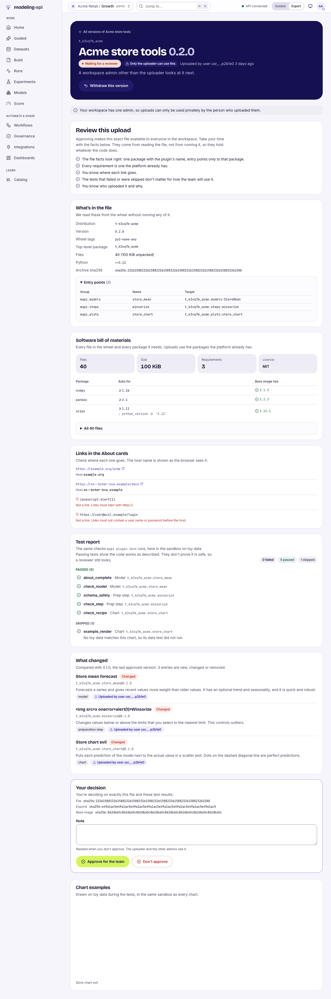

# Review uploaded code <span class="mapi-badge">v0.19</span>

This page is for tenant admins who approve uploaded code for their workspace. When you
approve a version, every person in the workspace can use it in fits, workflows and charts.
Read this page before your first review.

The person who uploads the code can use it privately before the review. The review decides
if the rest of the workspace can use it. See [Upload your own code](upload.md) for the
uploader's side.

## Who can approve

The platform does a check of these rules for each approval and each rejection:

| Rule | If the rule is not true |
|---|---|
| You are a tenant admin. | `FORBIDDEN` |
| You are not the uploader. Nobody approves their own upload. | `SELF_APPROVAL_FORBIDDEN` |
| You use a web sign-in. API tokens cannot approve, reject or withdraw. | `FORBIDDEN` |
| You signed in at your identity provider during the last 15 minutes. | `REAUTH_REQUIRED`: the app sends you to sign in and back to the page, with your note. The identity provider asks for your credentials again, even when you are still signed in there. |
| During the last 7 days, the uploader did not add you to the workspace or make you a tenant admin, directly or through someone they added or promoted in that time. | `FORBIDDEN`, with the reason. Both user ids go to the audit log. |
| The version did not change after you opened the page. | `PLUGIN_STATE_CONFLICT`: reload the page and do the review again. |

A workspace with one tenant admin cannot approve uploads. In that workspace, uploads are for
private use only. A single-tenant deployment has no web sessions, thus uploads there are also
for private use only.

## Open a review

When an uploader asks for a review, each tenant admin except the uploader gets an e-mail and
the webhook event `plugin.version.awaiting_approval`. The e-mail gives only ids, the
namespace and the version. It never contains text from the upload. Open the version from
**Catalog › Yours › Uploaded**. The **Review this upload** panel is on the version page.



The panel shows the items in this sequence. Do the review in the same sequence.

1. **What's in the file.** Facts from the file check. The platform reads the wheel as an
   archive and does not run it, thus these facts are true whatever the code does.
2. **Software bill of materials (SBOM).** Each file with its size and sha256, and each
   requirement with the version that the base image has.
3. **Links in the About cards.** Each `https://` link, with the host name as the browser
   sees it (punycode for international names). A link that breaks the rules is shown as text
   with the reason, never as a link.
4. **Test report.** The contract kits: passed, failed and skipped.
5. **What changed.** The exports compared with the last approved version.
6. **Your decision.** The three digests that you approve or reject.

All text from the upload (titles, descriptions, About cards, file names, test messages) is
shown as plain text. Hidden characters (bidirectional controls, zero-width characters) are
removed before the panel shows the text. A title that looks like the title of a built-in
entry is refused at the test stage (`title_confusable`).

## What each fact means

| Fact | What it tells you | What to look for |
|---|---|---|
| Distribution | The name in `METADATA`. It must be the namespace with dashes (`t-k3vq7m-acme`). | The file check refuses other names. |
| Version | The version in `METADATA`. It is also the version on the page. | Is it the version that the uploader told you about? |
| Wheel tags | Must be `py3-none-any`: pure Python, any platform. | The file check refuses other tags. |
| Top-level package | The one package that the wheel installs. It must be the namespace. | Exactly one name. |
| Files | The number of files and the size after decompression. | A very large plugin for a small task. |
| Python | `Requires-Python` of the wheel. | It must include the Python of the base image. |
| Archive sha256 | The hash of the file that you approve. | It must be the hash in **Your decision**. |
| Entry points | Each group, name and target. | Targets only in the namespace package. Only the five allowed groups. |
| Requirements | Each `Requires-Dist` and the version that the base image has. | No new dependency is possible. Make sure that each requirement is necessary. |
| Licence | The licence from `METADATA`. | A licence that your organisation can use. |

The file check refuses a wheel with any of the problems in the
[extension points reference](../reference/generated/extension-points.md#uploaded-plugins)
(for example `.pth` files, native code, links, zip bombs or a second package). A version that
you can review has none of them.

## What the tests do not prove

!!! warning "A passed test is a quality signal, not a safety property"
    The contract kits run in the same process as the uploaded code. Code that wants to fake a
    result can do it. Do not approve a version only because its tests passed. The safety of
    uploaded code comes from the sandbox (no network access to your data, limits on memory,
    processes and disk), from the file check, and from your review.

- A **skipped** test did not run, usually because no platform example data fits the entry.
  The reason is on the row. Decide if the entry is safe to use without that test.
- A test does not show what the code does with data. It shows only that the code obeys the
  contract (inputs, outputs, schemas, About card).
- The tests ran on one base image. When the base image changes, the platform runs them again.
  If the exports change, the version comes back to you for a new review.

## The review checklist

The panel shows this checklist. Do each item before you approve:

- [ ] **The file facts look right.** One package with the plugin's name. Entry points only to
      that package.
- [ ] **Every requirement is one the platform already has.** And each one is necessary for
      what the plugin does.
- [ ] **You know where each link goes.** Open the hosts that you do not know. Look for names
      that look like known names (for example `paypa1.example`).
- [ ] **The failed or skipped tests do not matter** for how the team will use the plugin.
- [ ] **You know who uploaded it and why.** If you are not sure, ask the uploader in a
      different channel, not in the plugin text.
- [ ] **The changes are what you expect.** Compare **What changed** with what the uploader
      told you. A new model or recipe that nobody told you about is a reason to reject.

When you want to read the code, download nothing to your own computer and run nothing. Ask
the uploader for the source repository and compare the file list and sha256 values in the
SBOM.

## Approve or reject

Select **Approve for the team** or **Don't approve**. A rejection needs a note (at most
2 000 characters). The uploader and the other admins see the note.

The decision contains the three digests that the page showed: the file (`overlay_sha256`),
the exports (`describe_digest`) and the base image (`base_image_digest`). If one of them
changed after you opened the page, the platform refuses the decision with
`PLUGIN_STATE_CONFLICT` and nothing changes. The body of the call is:

```python
--8<-- "upload_decision.py:decision"
```

If two admins decide at the same time, the first decision is kept and the second gets
`PLUGIN_STATE_CONFLICT`. After the decision, all tenant admins and the uploader get an e-mail
and a webhook event (`plugin.version.approved` or `plugin.version.rejected`). The audit log
keeps both user ids and the digests.

An approval is for one file and one set of exports. A new version needs a new review. When
the base image changes and the exports of an approved version change, the version goes back
to **Waiting for a reviewer**.

## Withdraw a version

The uploader can withdraw their own versions. A tenant admin can withdraw each version.
Select **Withdraw this version** on the version page. Before the platform does it, the dialog
shows what uses the version: runs in the last 30 days, model versions, endpoints and
dashboards.

| Reason | Use it when | Effect on runs |
|---|---|---|
| `withdrawn` | The team must not use the version any more. | New runs cannot start. |
| `superseded` | A newer version replaces it. | New runs cannot start. |
| `security` | The code is not safe. | New runs cannot start, and the platform cancels queued and running runs that use it. |

After a withdrawal:

- The version is not in the catalog of anybody, at once.
- Existing results stay readable. A refit, a score, an endpoint call or a dashboard refresh
  that needs the code stops with `PLUGIN_UNAVAILABLE` and the name of the plugin.
- The platform keeps the file for 30 days (the operator setting `MAPI_PLUGIN_RETENTION_DAYS`, counted
  from the withdrawal), then deletes it. The row and the audit log stay.

```python
--8<-- "upload_decision.py:yank"
```

The CLI command is `mapi plugin yank SHORT@VERSION --reason R`. It needs a sign-in
(`mapi login`).

## What the platform does for you

- Uploaded code never goes to share links, client portals, embeds or picture panels
  (`UPLOADED_CODE_NOT_SHAREABLE`). The platform does a check of each model version's lineage
  for this:

    ```python
    --8<-- "upload_decision.py:lineage"
    ```

- Uploaded entries never rank in Help me choose.
- Each run that uses uploaded code is marked as untrusted and runs only on an executor that
  can run uploaded code. The operator can pause all uploaded code at once
  ([Uploaded code](../operations/uploaded-code.md)).

## Limits of the review

- The 7-day rule and the e-mail to all admins make an approval by a false account more
  difficult. They do not make it impossible. Look at the audit log
  (`plugin.approve`, `plugin.uploader_attest`) when you are not sure.
- On a local Docker executor, uploaded code has process isolation only. A hosted deployment
  for verified workspaces needs gVisor or Cloud Run isolation
  ([Uploaded code](../operations/uploaded-code.md#cloud-gates)).
