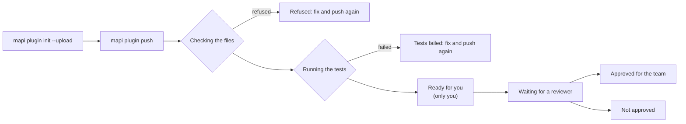
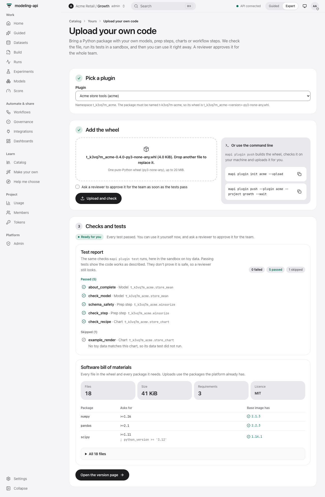
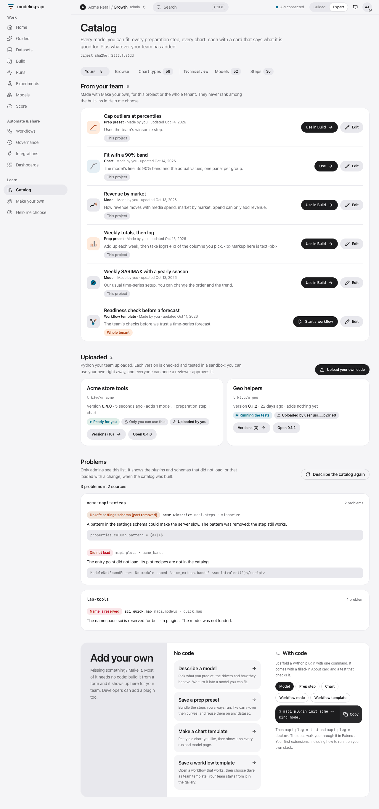

# Upload your own code: models, steps and plots <span class="mapi-badge">v0.19</span>

Got a model, a prep step or a chart in Python that the catalog doesn't have? From v0.19 you
can upload it to your workspace. You don't need to run a stack or ask an operator to build an
image. The platform checks your wheel in its sandbox and runs the contract kits on it. Then
you can use it yourself straight away. When a second admin of your workspace approves it,
everyone in the workspace can use it too.

This page walks you through it, from an empty folder to an approved plugin in Build. It takes
about fifteen minutes. If you review uploads for your team, read
[Review uploaded code](review-uploads.md) as well.



## Before you start

- **Who can upload.** A tenant admin, or an editor that a tenant admin confirmed as an
  uploader (Settings › Workspace › Uploaded code › Who can upload). Ask an admin if you
  are not sure.
- **Which workspaces.** Internal and self-hosted workspaces can upload. A verified workspace
  can upload when its identity verification is done. Public workspaces can't upload code.
- **Where it runs.** Uploaded code runs only on a sandboxed executor (Docker, Docker with
  gVisor or Cloud Run). If your deployment has none, the upload stops with
  `UNTRUSTED_PLACEMENT_UNAVAILABLE`, and the page tells you why. Operators can read
  [Uploaded code](../operations/uploaded-code.md).
- **On your machine.** The `mapi` CLI (`pip install mapi-cli`) and
  [uv](https://docs.astral.sh/uv/) or the `build` package, so that `mapi plugin push` can
  build a wheel.

!!! info "What a wheel can hold"
    One pure-Python package, at most 20 MiB. It can use only the packages that the platform
    image already has (`mapi-sdk`, `pymc`, `pandas`, `scikit-learn` and the others). It can't
    bring new dependencies or compiled code. The [rules](#the-rules-for-a-wheel) are below.

## 1. Claim a name and scaffold the package

```bash
--8<-- "upload_cli.sh:init"
```

`mapi plugin init acme --upload` claims the short name `acme` for your workspace. The
platform answers with your **namespace**, `t_<tenant code>_acme`, for example
`t_k3vq7m_acme`. The tenant code is six characters that the platform gave your workspace on
its first claim. Every id in your package starts with the namespace, so it never clashes with
a built-in or with another workspace:

```python
--8<-- "upload_namespace.py:namespace"
```

The scaffold is the same as the one in [Develop a plugin](develop/index.md), with the
namespace filled in for you: a model `t_k3vq7m_acme.group_mean`, a step
`t_k3vq7m_acme.winsorize`, a recipe `t_k3vq7m_acme.weekly_total`, a node
`test.t_k3vq7m_acme_zero_share` and a template `t_k3vq7m_acme_weekly_check`, depending on the
`--kind` options you give. Its `pyproject.toml` also gets a `[tool.mapi.upload]` table, which
`mapi plugin push` reads to find your plugin.

Write your code as you would for any plugin. The pages for each kind explain how:
[models](develop/models.md), [steps](develop/steps.md),
[plot recipes](develop/plot-recipes.md), [workflow nodes](develop/workflow-nodes.md) and
[workflow templates](develop/workflow-templates.md). Keep `mapi plugin test` green and fill in
every About card: the platform requires complete About cards for uploads.

## 2. Push it

```bash
--8<-- "upload_cli.sh:push"
```

`mapi plugin push` runs `mapi plugin validate` first (as a warning only), builds the wheel,
checks the tag and the size, and uploads it. Then the platform does two checks, each one a
run in the sandbox:

1. **Checking the files** (`plugin_inspect`). The platform reads the wheel as an archive and
   runs none of it. It lists every file with its sha256 (the SBOM) and refuses anything a
   wheel should not have.
2. **Running the tests** (`plugin_describe`). The platform loads your package in a sandbox,
   reads its catalog entries and runs the contract kits. Where a kit needs data, it uses
   small platform examples; when none fits, the check shows "skipped" with the reason.

Both are usually done in under a minute. With `--wait` the CLI waits and prints the result.
It exits with 0 when the checks passed, 1 when the upload was refused or a test failed, and
2 when it could not reach the server.

You can also upload in the app. Open **Catalog › Yours › Uploaded** and select **Upload your
own code**, or go to `/plugins/new`. Pick a plugin (or **Start a new plugin**), then
**Drop a wheel here, or choose one**. The page shows the checks as they run.



### When the files are refused

A refused upload shows each problem in plain words, with the file it is about. For example,
a wheel with a `.pth` file:

```python
--8<-- "upload_wheel_check.py:refused"
```

You can run the same check on your machine before you push. It is the function that the
sandbox runs, and it never extracts or imports the wheel:

??? example "Check a wheel on your machine"

    ```python
    --8<-- "upload_wheel_check.py:inspect"
    ```

Fix the problem, bump `version` in `pyproject.toml` and push again. A version number can be
uploaded only once.

## 3. Use it yourself

When the checks pass, the version is **Ready for you**. You can use it straight away, in
your own fits, workflows and charts. Nobody else can see it yet: the card in Catalog › Yours ›
Uploaded says "Only you can use this".



- In **Build**, your models and steps show in the palette with an "Uploaded by" chip.
- Your plot recipes show with your run's charts, and your node and template show in the
  workflow editor and the gallery.
- A run that uses uploaded code gets an **Uploaded code** badge on its page, and its model
  version remembers exactly which file it used.

A tenant admin can turn private use off (Settings › Workspace › Uploaded code). Then only
approved versions can run.

## 4. Ask for approval

When you are happy with it, ask for a review. On the version page, select **Ask a reviewer to
approve it for the team**, or push the next version with `--request-approval`:

```bash
--8<-- "upload_cli.sh:approval"
```

The version is now **Waiting for a reviewer**. Every tenant admin except you gets an e-mail
(and a `plugin.version.awaiting_approval` webhook, if your workspace has webhooks). You can
keep using it yourself while you wait.

A reviewer must be a tenant admin other than you, signed in to the web app in the last 15
minutes. If your workspace has only one admin, an upload can only ever be used privately.
The reviewer sees the facts about the file first, then the SBOM, the links of your About
cards, the test report and what changed since the last approved version. They approve or
reject exactly the file and the exports that they saw.

## 5. Use it with your team

When a reviewer approves it, the version is **Approved for the team**. Everyone in the
workspace now sees your entries in the catalog: in Build, in the workflow editor and in the
gallery. You get an e-mail, and so do the other admins.

If the reviewer doesn't approve it, the version is **Not approved** and the note says what
to change. Fix it, bump the version and push again.

## New versions, and withdrawing one

Each push is a new version with its own checks and its own review. An approval never moves
to a different file. When the platform's base image changes, the platform runs the tests of
each approved version again. If the exports changed, the version goes back to "Waiting for a
reviewer". If its tests now fail, the platform withdraws it and tells you.

To take a version out of use, select **Withdraw this version** on its page, or:

```bash
--8<-- "upload_cli.sh:yank"
```

The page first shows what uses it (runs in the last 30 days, model versions, endpoints and
dashboards). After that, nothing new can start with it. Existing results stay readable, but
anything that needs the code again (a refit, a score, an endpoint call) stops with
`PLUGIN_UNAVAILABLE`. Use the reason `security` when the code is unsafe: it also cancels the
runs that use it now. Withdrawing needs a sign-in (`mapi login`); API tokens can't do it.

## What uploads don't do

- **No share links, client portals or embeds.** A dashboard, chart or model version that
  used uploaded code can't be shared outside the workspace (`UPLOADED_CODE_NOT_SHAREABLE`).
  You can still publish an internal dashboard on such a model version: your team reads it
  and runs its what-ifs (they use the same uploaded code again). Share links, client grants
  and embeds of it are refused.
- **Not in Help me choose.** Your entries never rank among the built-ins. You pick them
  yourself.
- **Not across workspaces.** Another workspace never sees your upload.
- **Tests are a quality signal, not a safety promise.** Your code runs in the same process
  as its tests. The safety comes from the sandbox and from the reviewer, not from the test
  report.

## The rules for a wheel

The file check refuses a wheel that breaks one of these rules. The
[extension points reference](../reference/generated/extension-points.md#uploaded-plugins)
lists every check and limit.

| Rule | Why |
|---|---|
| One `.whl` file, tag `py3-none-any`, `Root-Is-Purelib: true`, at most 20 MiB | Pure Python only. The API does not take source archives: `mapi plugin push` builds the wheel for you. |
| Distribution name = your namespace with dashes (`t-k3vq7m-acme`) | The name tells the platform which plugin the file is for. |
| Exactly one top-level package, named the namespace, with an `__init__.py` | Your code can't hide or replace a package of the platform. |
| Entry points only in `mapi.models`, `mapi.steps`, `mapi.plots`, `mapi.workflow_nodes`, `mapi.workflow_templates`, and only to your package | Uploaded governance checks and console scripts are not supported. |
| Every `Requires-Dist` already installed in the base image, in a version that fits | There is no `pip install` in the sandbox. |
| No `.pth` files, `sitecustomize`, `__main__.py` at the top, compiled code, bytecode, archives, links or `.data` directories | These run code when Python starts, or hide what the file holds. |
| At most 2 000 files, 100 MiB uncompressed, and a compression ratio of 100 for each file | Zip bombs. |
| Every id in your namespace; About cards complete; reference links `https://` only | The catalog shows them to other people. |

## When something goes wrong

| What you see | What to do |
|---|---|
| `IDENTITY_VERIFICATION_REQUIRED` or `FORBIDDEN` when you claim or upload | Ask a tenant admin to confirm you as an uploader, or to finish the identity verification of the workspace. |
| `PLUGIN_NAMESPACE_TAKEN` | Somebody in your workspace has this short name. Pick another one. |
| `PLUGIN_VERSION_EXISTS` | Bump `version` in `pyproject.toml`. |
| `UNTRUSTED_PLACEMENT_UNAVAILABLE` | The deployment has no sandbox for uploaded code. Tell its operator. |
| `RATE_LIMITED` | You took 20 upload tickets today. Try again tomorrow. |
| "Paused by the platform" | The operator paused uploaded code. Your checks continue when they resume it. |
| `PLUGIN_UNAVAILABLE` in a run | The run needs a version that is withdrawn, not approved, or private to somebody else. |
| `UPLOADED_CODE_NOT_SHAREABLE` | Share a result that uses built-in code only. |

See also: [Review uploaded code](review-uploads.md) ·
[Uploaded code for operators](../operations/uploaded-code.md) ·
[Run your plugin on your stack](develop/run-on-your-stack.md) (no upload, your own stack).
