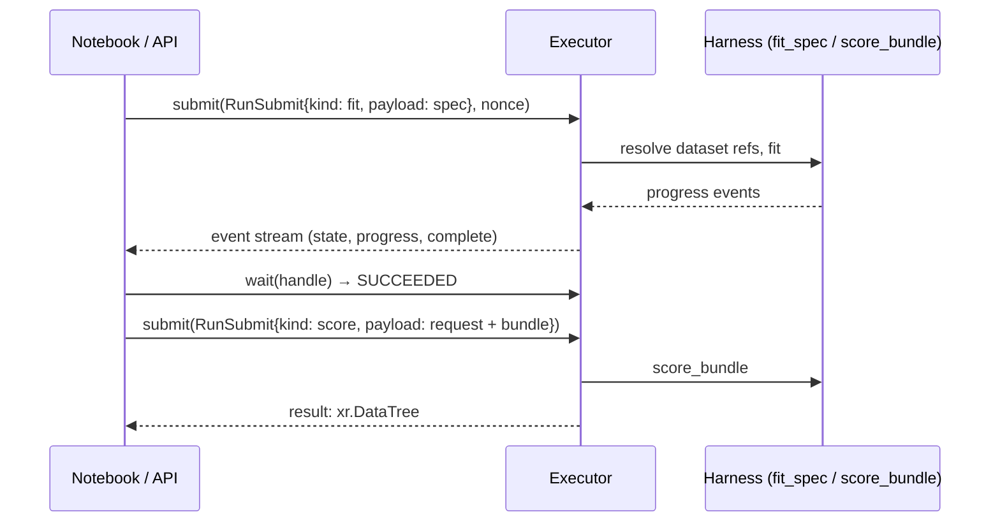

# Runs and executors

`fit_spec` and `score_bundle` are plain functions. The platform does the same work as
**runs**: JSON-only submissions handed to an **executor**, which reports progress as events and
returns a status that is the source of truth. The in-process executor implements that protocol
inside your Python process, so notebooks, tests and the platform's `local-process` and
`docker` executors share one code path.



## Set up

The executor resolves the `dataset://` references in specs and requests through a
**resolver**. Here it is a mapping to in-memory datasets; the built-in tabular plugin ships the
store-demand data and spec used below.

```python
--8<-- "executor.py:setup"
```

## Submit, wait, score

```python
--8<-- "executor.py:runs"
```

```text
succeeded
2 validated the spec and the data
3 split the data
4 fitted quantile model 1
5 persisting the fitted estimators
6 fitted on the training data
7 evaluated the holdout through the score path
8 fitted quantile model 1
9 persisting the fitted estimators
10 fit complete
{'stat': 3, 'store_id': 4, 'sku': 2, 'week': 8}
```

What to notice:

- **Payloads are JSON.** The spec travels as YAML text or a dict, the raw schema as a dict, and
  data only as references. This is exactly what the API will store and what a sandboxed runner
  will receive.
- **Submissions are idempotent.** Re-submitting with the same `nonce` returns the same handle,
  so a retried API call never starts a second fit. `adopt(nonce)` finds a run after a restart.
- **Status is the source of truth.** Events are for progress bars; `status()` and `wait()`
  decide whether a run succeeded. Failures come back as RFC 7807 problems with a stable code.
- **Cancellation is cooperative.** `cancel(handle)` is checked between pipeline phases and
  inside long fits.

## Isolation levels

Every executor declares how strongly it isolates a run, and the platform refuses to send
untrusted code to an executor that is not strong enough.

| Executor | Isolation | For | Status |
|---|---|---|---|
| `InprocExecutor` | `NONE` | Notebooks, tests, your own trusted code | <span class="mapi-badge">available</span> |
| Local process / Docker | `PROCESS` / `GVISOR` | Local platform, CI | <span class="mapi-badge">v0.2</span> |
| Cloud Run Jobs (gen2) | `MICROVM` | Hosted runs, one fresh sandbox per run | <span class="mapi-badge mapi-badge--soon">v0.3</span> |

!!! warning "Never run untrusted code in-process"
    The in-process executor runs plugins with your permissions in your interpreter. It is for
    code you wrote or trust. Public plugins only ever run in the sandboxed executors.

See the [roadmap](../roadmap/cloud.md) for the sandbox design.
