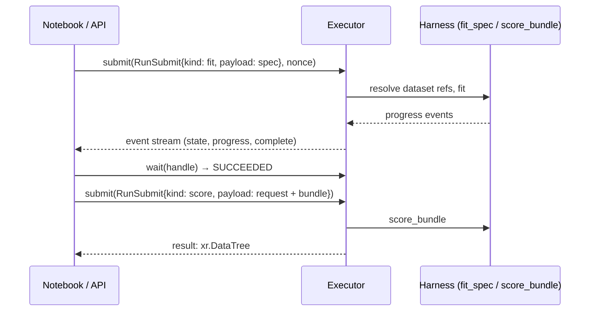

# Runs and executors

`fit_spec` and `score_bundle` are plain functions. The platform does the same work as
**runs**. A run is a JSON-only submission that goes to an **executor**. The executor sends
progress as events. It also returns a status, and the status is the source of truth. The
in-process executor uses that protocol inside your Python process. Thus notebooks, tests and
the `local-process` and `docker` executors of the platform use one code path.



## Set up

The executor uses a **resolver** to find the datasets for the `dataset://` references in
specs and requests. Here, the resolver is a mapping to in-memory datasets. The built-in
tabular plugin contains the store-demand data and the spec that this page uses.

```python
--8<-- "executor.py:setup"
```

## Submit, wait, score

```python
--8<-- "executor.py:runs"
```

```text
succeeded
2 validated the spec and the data
3 split the data
4 fitted quantile model 1
5 persisting the fitted estimators
6 fitted on the training data
7 evaluated the holdout through the score path
8 fitted quantile model 1
9 persisting the fitted estimators
10 fit complete
{'stat': 3, 'store_id': 4, 'sku': 2, 'week': 8}
```

Look at these points:

- **Payloads are JSON.** The spec goes as YAML text or as a dict. The raw schema goes as a
  dict. Data goes only as references. This is exactly what the API will store and what a
  sandboxed runner will receive.
- **Submissions are idempotent.** If you submit again with the same `nonce`, you get the same
  handle. Thus an API call that you try again never starts a second fit. `adopt(nonce)` finds
  a run after a restart.
- **Status is the source of truth.** Events are for progress bars. `status()` and `wait()`
  tell you if a run succeeded. Failures come back as RFC 7807 problems with a stable code.
- **Cancellation is cooperative.** The executor checks `cancel(handle)` between the phases
  of the pipeline and inside long fits.

## Isolation levels

Each executor declares how strongly it isolates a run. The platform does not send untrusted
code to an executor that is not sufficiently strong.

| Executor | Isolation | For | Status |
|---|---|---|---|
| `InprocExecutor` | `NONE` | Notebooks, tests and your own trusted code | <span class="mapi-badge">available</span> |
| Local process / Docker | `PROCESS` / `GVISOR` | Local platform, CI | <span class="mapi-badge">v0.2</span> |
| Cloud Run Jobs (gen2) | `MICROVM` | Hosted runs, one new sandbox for each run | <span class="mapi-badge">v0.3</span> |

!!! warning "Never run untrusted code in-process"
    The in-process executor runs plugins in your interpreter, with your permissions. Use it
    only for code that you wrote or that you trust. Public plugins run only in the sandboxed
    executors.

For the sandbox design, see the [roadmap](../roadmap/cloud.md).
