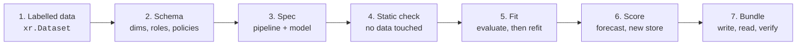

# Your first model

In this walkthrough, you fit a demand model for three stores and two products. You forecast
the next four weeks, and the forecast includes a store that is not open yet. You also see the
errors that stop dishonest answers. You run all the code in a notebook, one cell at a time.
The complete script is [`docs/snippets/quickstart.py`](#the-whole-script). The test suite runs
it on each change.



## 1. Labelled data

Your data is an `xr.Dataset`. Each variable has **named dims**, and each dim has
**coordinates** (labels). No later part of the process uses the sequence of stores or
products.

```python
--8<-- "quickstart.py:data"
```

!!! tip "Coming from pandas?"
    A long DataFrame with one row for each store, sku and week becomes this dataset with
    `df.set_index(["store", "sku", "week"]).to_xarray()`.

## 2. Describe it with a schema

A [`DataSchema`](../concepts/labelled-data.md) tells what each dim *is*. It also tells what
can occur to the dim when you score:

```python
--8<-- "quickstart.py:schema"
```

| Dim | Policy | At score time |
|---|---|---|
| `store` | `new_levels` (`pooled`) | Stores that the fit did not see are permitted. They get the pooled prediction. |
| `sku` | `fixed` | Only the fitted products. All other products are `UNSEEN_LEVELS`. |
| `week` | `extend` | New weeks must continue the fitted range. Gaps are not permitted. |

If you do not write the schema, `mapi_sdk.infer_schema(data, targets=[...])` makes a draft.
In the draft, time dims become `extend` and all other dims become `fixed`.

## 3. Write the spec

A **ModelSpec** does these things:

- It names the dataset.
- It binds your names to the **canonical** names of the model.
- It selects a train/holdout split.
- It lists the preprocessing steps.
- It selects the model.

```python
--8<-- "quickstart.py:spec"
```

- `bind` maps canonical names onto the names in your dataset. Steps and models use the
  canonical names. Outputs come back with **your** names.
- `core.calendar` adds week-of-year features. `core.log1p` models `log(1 + units)`. The
  pipeline inverts it automatically on the way out.
- `tabular.regressor` is a built-in quantile model (xgboost underneath). It stacks its rows
  from the labelled dims. Store and sku become categorical features.

## 4. Check it before you fit it

This is the same static check that the API does before it accepts a job. It reads no data,
and it takes milliseconds.

```python
--8<-- "quickstart.py:validate"
```

The check finds these errors, among others:

- An incorrect variable name.
- A split on a dim that does not exist yet.
- A stateful step before the split.

Each error has a stable code and a JSON pointer, for example `/pipeline/1/with/vars/0`.

## 5. Fit

```python
--8<-- "quickstart.py:fit"
```

With the default `fit.mode: evaluate_then_refit`, `fit_spec` does these steps:

1. It fits each stateful step and the model on the first 44 weeks.
2. It scores the last 8 weeks **through the score path**, exactly as a forecast. It
   calculates `rmse`, `mape` and `coverage_80` **in units sold** (it undoes the `log1p`).
3. It fits again on all 52 weeks, so that a forecast starts from the latest data. It links
   the evaluation fit in the bundle.

## 6. Forecast, with a new store

Supply the plan for the next four weeks. Prices and promotions are `future_required`. The
target is not necessary. The fit did not see `west`.

```python
--8<-- "quickstart.py:forecast"
```

The result is an `xr.DataTree`. `summary` holds the statistics that you asked for, along a
`stat` dim, with your dim names. Its attributes tell you how to read it:

| Attribute | Value here | Meaning |
|---|---|---|
| `representation` | `quantiles` | Quantiles for each cell. You can read them, but you cannot add them. |
| `output_space` | `{"y_hat": "raw"}` | The pipeline inverted the values through each value step, back to the space of the raw data. |
| `issues` | `UNSEEN_LEVELS` (info) | The model scored `west` with the `pooled` strategy. |

## 7. The errors that protect you

These requests fail **before model code runs**. Each failure has a stable code:

```python
--8<-- "quickstart.py:errors"
```

```text
MISSING_FUTURE_COVARIATE - forecasting needs future values of ['promo'] at stage 'raw'
CAPABILITY_UNSUPPORTED - cannot aggregate 'quantiles' output: Quantiles are marginal per cell; summing quantiles is not a quantile of the sum.
UNSEEN_LEVELS - 1 level(s) of 'sku' were not seen at fit and the dim's policy is 'fixed'
```

!!! question "So how do I get a total over stores?"
    Use a model that has a representation that supports totals. `sklearn.tabular_bootstrap`
    returns joint draws, and you can add them for each draw. Bayesian models return posterior
    draws. See [Representations](../concepts/representations.md).

## 8. Save and reload the bundle

```python
--8<-- "quickstart.py:bundle"
```

A bundle holds these items:

- The spec and the binding.
- The state and the context tail of each step.
- The fitted groups and the native artifacts of the model (here, the xgboost model as JSON).
- A manifest with the size, CRC32C, MD5 and SHA-256 of each file.

The bundle contains no pickled objects. See [Bundles](../concepts/bundles.md).

## The whole script

??? example "docs/snippets/quickstart.py"

    ```python
    --8<-- "quickstart.py"
    ```

## Next steps

- To do the same fit and score as **runs** through an executor, read
  [Runs and executors](executor.md).
- To learn why the split occurred at that position, read
  [Pipelines and stages](../concepts/pipelines.md).
- To try a Bayesian model, read about the [radon model](../guides/pymc.md) or the
  [marketing-mix model](../guides/mmm.md).
