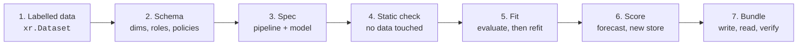

# Your first model

In this walkthrough you fit a demand model for three stores and two products, forecast the
next four weeks (including a store that has not opened yet) and see the errors that stop
dishonest answers. Everything runs in a notebook cell by cell; the complete script is
[`docs/snippets/quickstart.py`](#the-whole-script) and the test suite runs it on every change.



## 1. Labelled data

Your data is an `xr.Dataset`: every variable has **named dims** and every dim has
**coordinates** (labels). Nothing downstream depends on the order of stores or products.

```python
--8<-- "quickstart.py:data"
```

!!! tip "Coming from pandas?"
    A long DataFrame with one row per store, sku and week becomes this dataset with
    `df.set_index(["store", "sku", "week"]).to_xarray()`.

## 2. Describe it with a schema

A [`DataSchema`](../concepts/labelled-data.md) says what each dim *is* and what may happen to
it when you score:

```python
--8<-- "quickstart.py:schema"
```

| Dim | Policy | At score time |
|---|---|---|
| `store` | `new_levels` (`pooled`) | Unseen stores are allowed and get the pooled prediction |
| `sku` | `fixed` | Only the fitted products; anything else is `UNSEEN_LEVELS` |
| `week` | `extend` | New weeks must continue the fitted range without gaps |

If you skip the schema, `mapi_sdk.infer_schema(data, targets=[...])` drafts one: time dims
become `extend`, everything else `fixed`.

## 3. Write the spec

A **ModelSpec** names the dataset, binds your names to the model's **canonical** names, picks
a train/holdout split, lists the preprocessing steps and chooses the model.

```python
--8<-- "quickstart.py:spec"
```

- `bind` maps canonical names (what steps and models use) onto your dataset's names. Outputs
  come back under **your** names.
- `core.calendar` adds week-of-year features; `core.log1p` models `log(1 + units)` and is
  inverted automatically on the way out.
- `tabular.regressor` is a built-in quantile model (xgboost underneath) whose rows are stacked
  from the labelled dims; store and sku become categorical features.

## 4. Check it before fitting

The same static check the API runs before accepting a job: no data is read, and it takes
milliseconds.

```python
--8<-- "quickstart.py:validate"
```

A typo in a variable name, a split on a dim that does not exist yet, or a stateful step before
the split would be reported here, each with a stable code and a JSON pointer such as
`/pipeline/1/with/vars/0`.

## 5. Fit

```python
--8<-- "quickstart.py:fit"
```

With the default `fit.mode: evaluate_then_refit`, `fit_spec`:

1. fits every stateful step and the model on the first 44 weeks;
2. scores the last 8 weeks **through the score path**, exactly like a forecast, and
   computes `rmse`, `mape` and `coverage_80` **in units sold** (the `log1p` is undone);
3. refits on all 52 weeks, so a forecast starts from the latest data, and links the
   evaluation fit in the bundle.

## 6. Forecast, including a new store

Supply the plan for the next four weeks: prices and promotions are `future_required`, the
target is not needed. `west` has never been seen.

```python
--8<-- "quickstart.py:forecast"
```

The result is an `xr.DataTree`. `summary` holds the statistics you asked for along a `stat`
dim, with your dim names restored. Its attributes tell you how to read it:

| Attribute | Value here | Meaning |
|---|---|---|
| `representation` | `quantiles` | Per-cell quantiles: you can read them, not add them up |
| `output_space` | `{"y_hat": "raw"}` | Inverted through every value step back to the raw data's space |
| `issues` | `UNSEEN_LEVELS` (info) | `west` was scored with the `pooled` strategy |

## 7. The errors that protect you

These requests fail **before any model code runs**, each with a stable code:

```python
--8<-- "quickstart.py:errors"
```

```text
MISSING_FUTURE_COVARIATE - forecasting needs future values of ['promo'] at stage 'raw'
CAPABILITY_UNSUPPORTED - cannot aggregate 'quantiles' output: Quantiles are marginal per cell; summing quantiles is not a quantile of the sum.
UNSEEN_LEVELS - 1 level(s) of 'sku' were not seen at fit and the dim's policy is 'fixed'
```

!!! question "So how do I get a total over stores?"
    Use a model whose representation supports it. `sklearn.tabular_bootstrap` returns joint
    draws, which can be summed per draw, and Bayesian models return posterior draws. See
    [Representations](../concepts/representations.md).

## 8. Save and reload the bundle

```python
--8<-- "quickstart.py:bundle"
```

A bundle holds the spec, the binding, every step's state and context tail, the model's fitted
groups and native artifacts (here: the xgboost model as JSON), and a manifest with the size,
CRC32C, MD5 and SHA-256 of every file. Nothing is pickled. See [Bundles](../concepts/bundles.md).

## The whole script

??? example "docs/snippets/quickstart.py"

    ```python
    --8<-- "quickstart.py"
    ```

## Next steps

- Run the same fit and score as **runs** through an executor: [Runs and executors](executor.md).
- Learn why the split happened where it did: [Pipelines and stages](../concepts/pipelines.md).
- Try a Bayesian model: the [radon model](../guides/pymc.md) or the
  [marketing-mix model](../guides/mmm.md).
