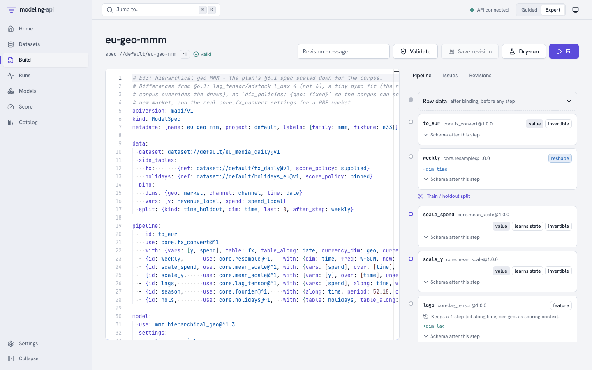
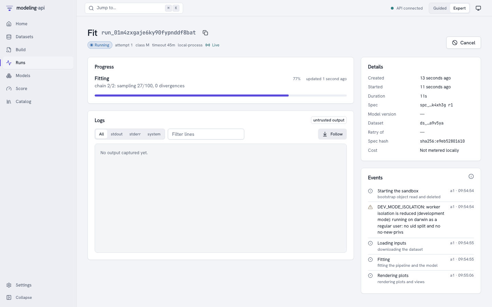
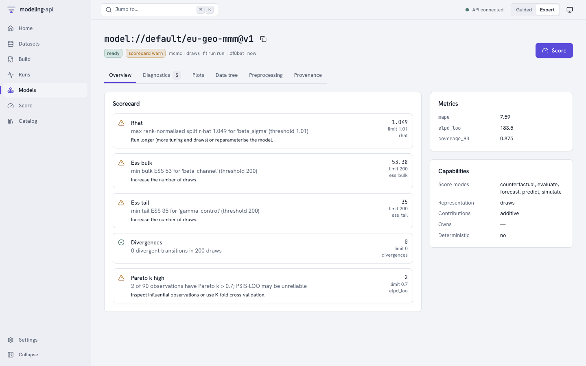
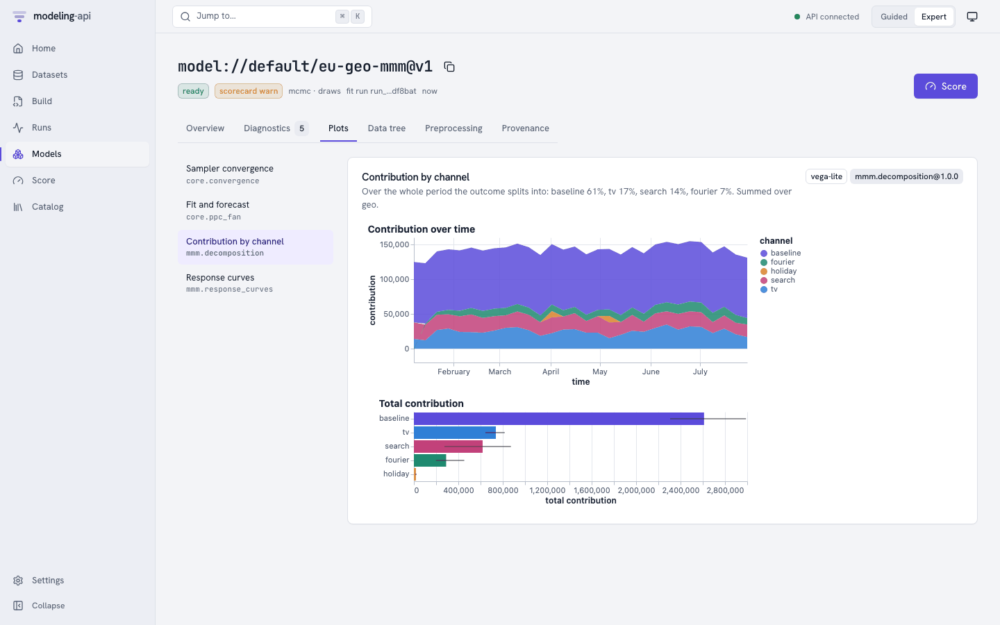
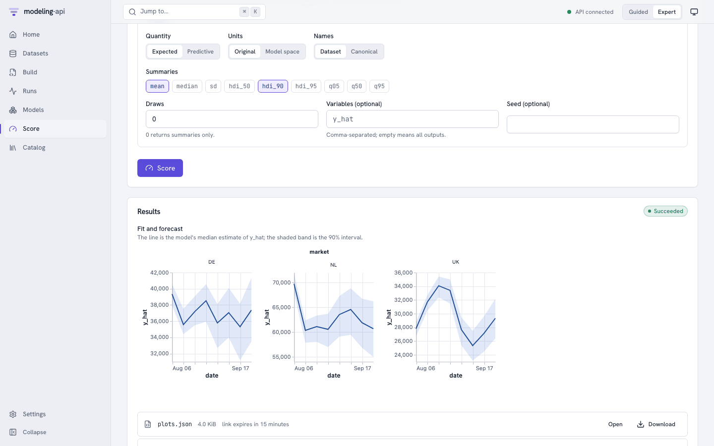

# Quickstart: zero to first model in 10 minutes <span class="mapi-badge">v0.2</span>

You will start the platform on your own machine, load a demo dataset, fit a hierarchical
geo marketing-mix model from the web app, read its scorecard and plots, and score an
8-week forecast. No Docker and no cloud account are needed: PostgreSQL is embedded and
object storage is a local emulator of Google Cloud Storage.

| Step | What happens | Time on a laptop |
|---|---|---|
| [1. Install](#1-install) | Python and JavaScript dependencies | 2–5 min the first time |
| [2. Start the stack](#2-start-the-stack) | Database, object store, API, worker, web app, plot sandbox | about 10 s |
| [3. Load the demo](#3-load-the-demo) | Three datasets and a model spec, through the API | about 40 s |
| [4. Fit from the browser](#4-fit-from-the-browser) | A sandboxed fit run, followed live | 20–60 s |
| [5. Inspect](#5-inspect-the-model) | Scorecard, diagnostics, plots, provenance | – |
| [6. Score](#6-score-a-forecast) | An 8-week forecast with the fitted preprocessing replayed | about 10 s |

We ran exactly these steps on a fresh clone while writing this page: from `make dev` to a
scored forecast took under three minutes. The screenshots below come from that run.

## Before you start

- macOS or Linux, about 2 GB of free disk space;
- [uv](https://docs.astral.sh/uv/) (it installs Python 3.12 for you if needed);
- Node.js 22 or newer with pnpm (`corepack enable` provides the pinned pnpm version);
- `git`, and `jq` and `curl` if you want to follow the HTTP examples later.

## 1. Install

```bash
git clone <repository-url> modeling-api
cd modeling-api
make install          # uv sync --all-packages, then pnpm install
```

`make install` puts every Python package of the workspace into `.venv` and the web app's
dependencies into `node_modules`. Nothing is installed globally.

## 2. Start the stack

```bash
make dev
```

`make dev` runs every service in the foreground, each output line prefixed with its name,
and prints `all 6 services up` when it is ready. Leave it running; ++ctrl+c++ stops
everything. The first start also queues a sandboxed *describe* run that exports the catalog
of installed models and steps; it finishes in a few seconds.

| Service | Address |
|---|---|
| Web app | <http://127.0.0.1:5173> |
| API | <http://127.0.0.1:8000> (OpenAPI document at `/openapi.json`) |
| Plot sandbox (a separate origin, on purpose) | <http://127.0.0.1:5174> |
| GCS shim (signed URLs point here) | <http://127.0.0.1:4443> |

!!! tip "Port 8000 (or any other) already taken?"
    Export the matching variable before `make dev`, and in every other shell you use:

    ```bash
    export MAPI_API_URL=http://127.0.0.1:18000
    export MAPI_GCS_ENDPOINT=http://127.0.0.1:14443
    export MAPI_WEB_ORIGIN=http://127.0.0.1:15173
    export MAPI_PLOTS_ORIGIN=http://127.0.0.1:15174
    ```

    `make dev`, `make seed`, the CLI, the Python client and the web app all read the same
    variables. This page was produced on exactly these ports.
    [Troubleshooting](../operations/troubleshooting.md#port-conflicts) has more.

## 3. Load the demo

In a second shell:

```bash
make seed
```

```text
API http://127.0.0.1:8000 is ok (version 0.6.0)
uploading eu_media_daily (17 KiB) ...
  dataset://default/eu_media_daily@v1 ready
uploading fx_daily (17 KiB) ...
  dataset://default/fx_daily@v1 ready
uploading holidays_eu (7 KiB) ...
  dataset://default/holidays_eu@v1 ready
spec spec://default/eu-geo-mmm@r1: valid
```

`make seed` talks to the public API only. For each table it asks for a signed upload URL,
sends the file straight to object storage, and starts a sandboxed *ingest* run that opens
the file, checks it against its schema and stores an immutable, content-addressed version.
Then it saves the model spec and validates it.

The data is the conformance corpus' E33 example: 30 weeks of daily spend per market and
channel and daily revenue per market for NL, DE and UK (UK in GBP), an FX table and a
holiday calendar.

Scoring needs the spend you plan for the coming weeks. Upload it with the CLI:

```bash
uv run python scripts/seed.py --export demo/     # the demo tables, score payloads and spec
uv run mapi datasets upload demo/eu_media_future.zarr.zip --name eu_media_future
```

## 4. Fit from the browser

Open <http://127.0.0.1:5173>, go to **Build** and click the `eu-geo-mmm` row.

{ .mapi-shot }

The editor validated the spec on the server as it opened: every `dataset://` reference,
every step and the model settings resolve, and the panel on the right shows what each
pipeline step does to the data. The split into training and holdout weeks sits after the
`weekly` step, because a week only exists from that stage on.

Press **Fit**. The run page follows the run over server-sent events:

{ .mapi-shot }

- *Starting the sandbox*: the run's supervisor read its one-time bootstrap object and
  deleted it before any model code started.
- `DEV_MODE_ISOLATION` is expected on a laptop: the local executor cannot run the model code
  as a separate user. Containers and the cloud executor can.
- The progress bar and message come straight from the sampler.

The spec uses tiny sampler settings, so the fit takes well under a minute (the first one
on a new machine also compiles PyTensor code). When it succeeds the platform checks every
file the run wrote against the storage's own checksums, copies the files where runs cannot
reach them and signs a manifest. Press **Inspect model://default/eu-geo-mmm@v1**.

## 5. Inspect the model

{ .mapi-shot }

The scorecard flags R-hat and effective sample size: two chains of 100 draws are not enough
to converge, and each warning says what to do about it. The metrics come from the 8 holdout
weeks, scored through the same code path a forecast uses, before the model was refitted on
all the data (`fit.mode: evaluate_then_refit`).

Open **Plots** → **Contribution by channel**:

{ .mapi-shot }

Every plot is a Vega-Lite or Plotly spec that the server sanitized, rendered inside an
`<iframe sandbox="allow-scripts">` served from the plot sandbox's own origin. **Provenance**
shows the signed manifest, every stored object with its generation, and the lineage.

## 6. Score a forecast

Press **Score** (top right). **What this model needs** lists the inputs the model reads and
what it was fitted on; the form only offers the modes this model supports.

1. Keep **Forecast** and **8** periods.
2. Under **Values to score**, choose **Use a dataset** and enter
   `dataset://default/eu_media_future@v1` (or keep **Type values** and type the planned spend
   into the grid: no upload needed).
3. Leave the `fx` side table (under **Advanced**) at the version the fit used; it covers the
   forecast weeks.
4. Press **Forecast**.

{ .mapi-shot }

Nothing was refitted: the run replayed the fitted preprocessing (currency conversion, weekly
resampling, scaling, and the last weeks of spend each market carries into the adstock) and
inverted the result back to weekly EUR. The result's `output_space` says so.

## Stop, and start again later

```bash
make stop             # or Ctrl-C in the make dev shell
make dev              # everything you loaded is still there (.local/)
make clean-local      # delete the local database and objects, start from scratch
```

## Where next

<div class="grid cards" markdown>

-   :material-monitor-dashboard: **[Tour every page of the web app](../guides/web-ui.md)**

    Datasets and CSV mapping, revisions and dry-runs, run controls, the data tree,
    counterfactuals.

-   :material-console: **[Do the same from the command line](../guides/cli.md)**

    `mapi datasets upload`, `mapi fit --remote @`, `mapi score`, `--json` for scripts.

-   :material-language-python: **[Or from Python](../guides/python-client.md)**

    `mapi_client.Client`: uploads, live events, model versions and `xr.DataTree` results.

-   :material-book-open-variant: **[Understand what just happened](../concepts/architecture.md)**

    The control plane, the run sandbox, storage integrity and the event path.

</div>
