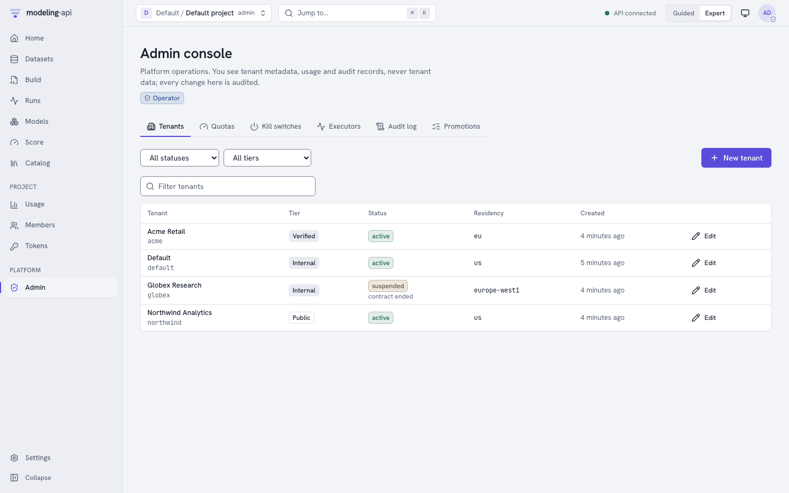
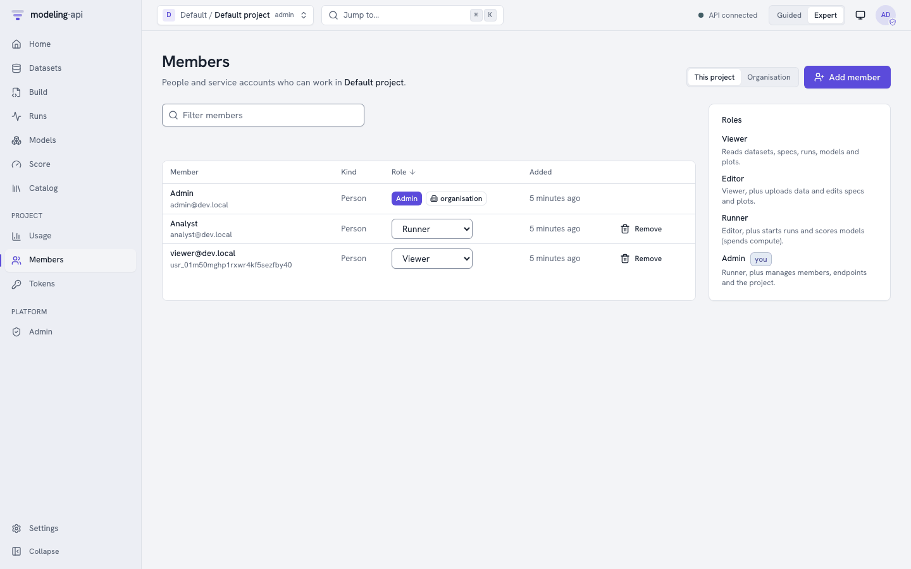
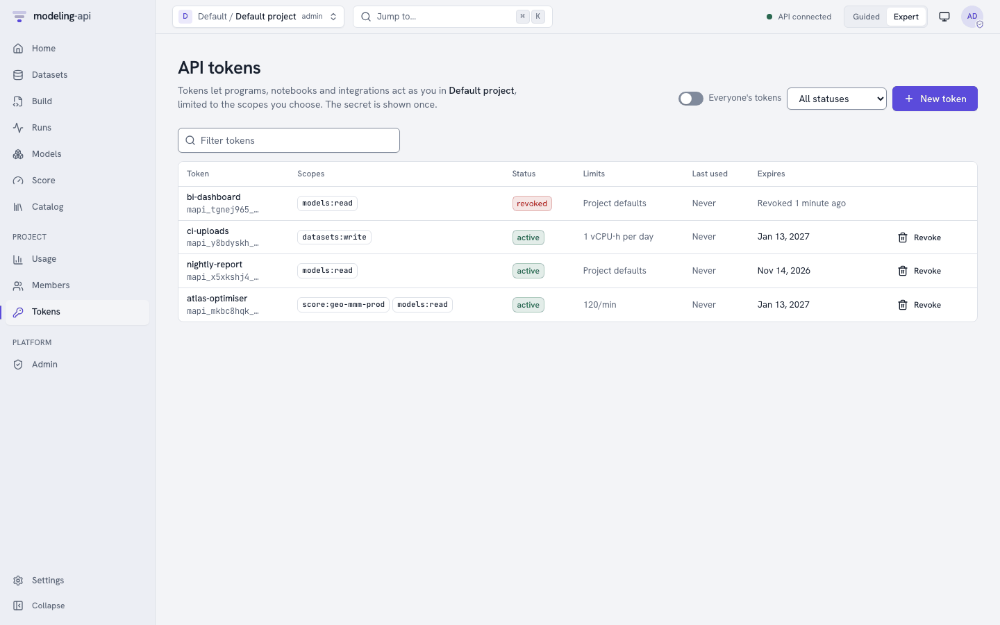
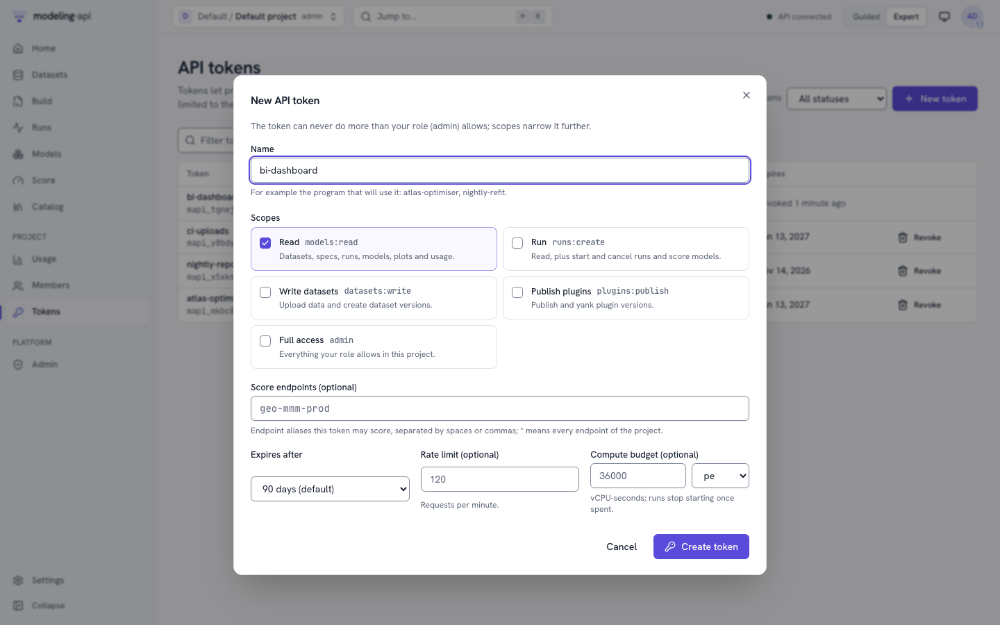
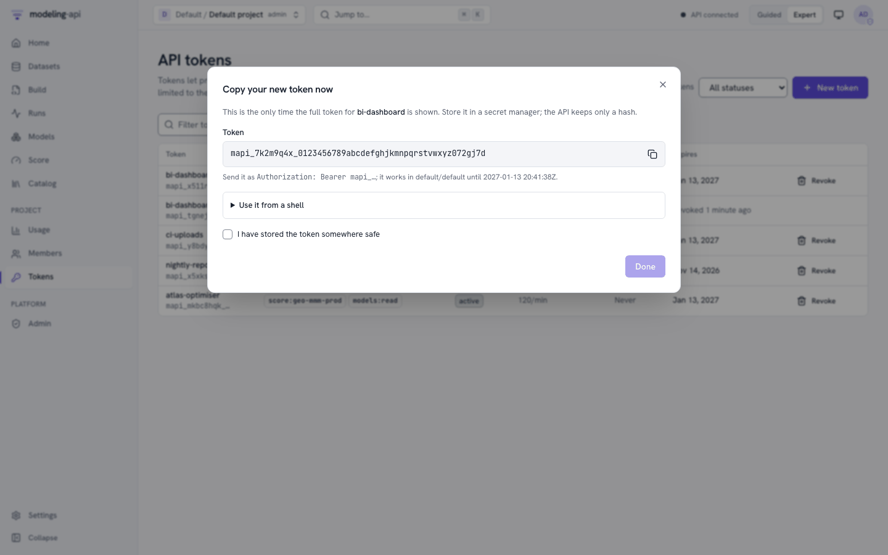
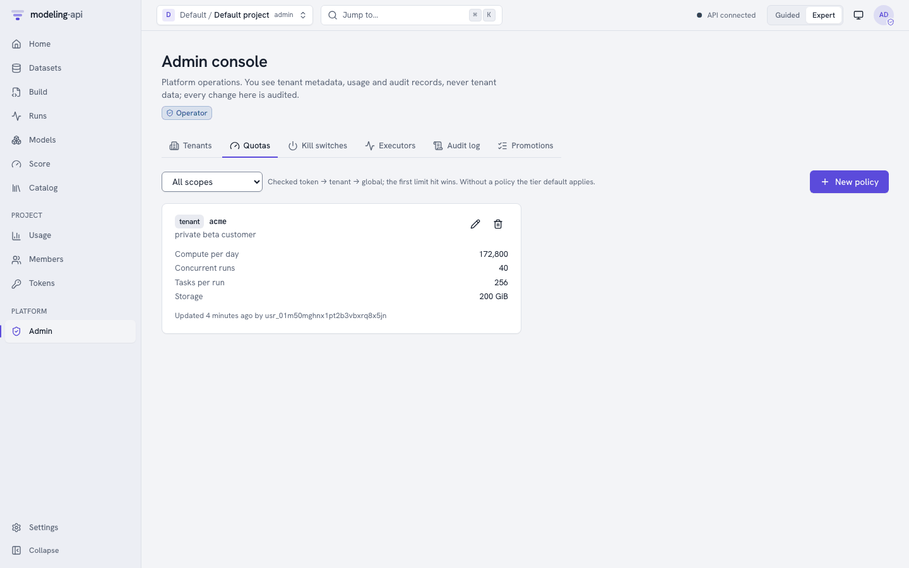
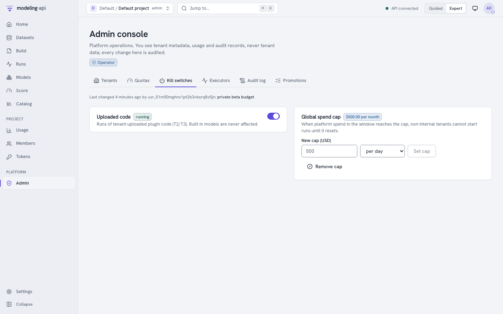
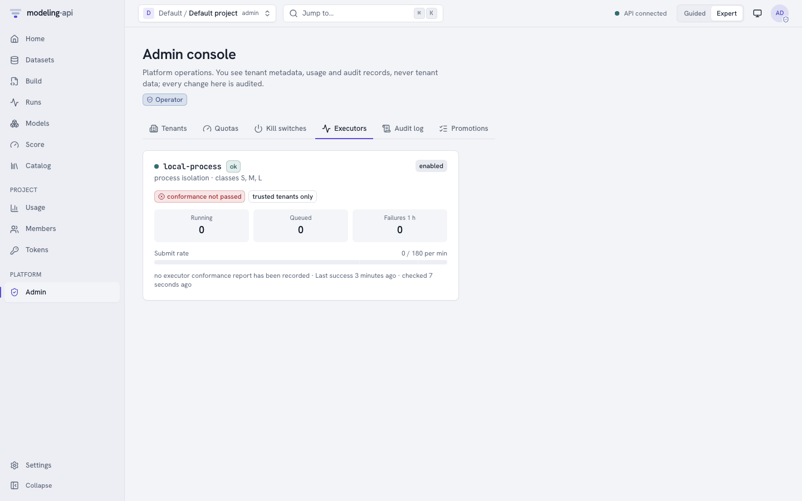
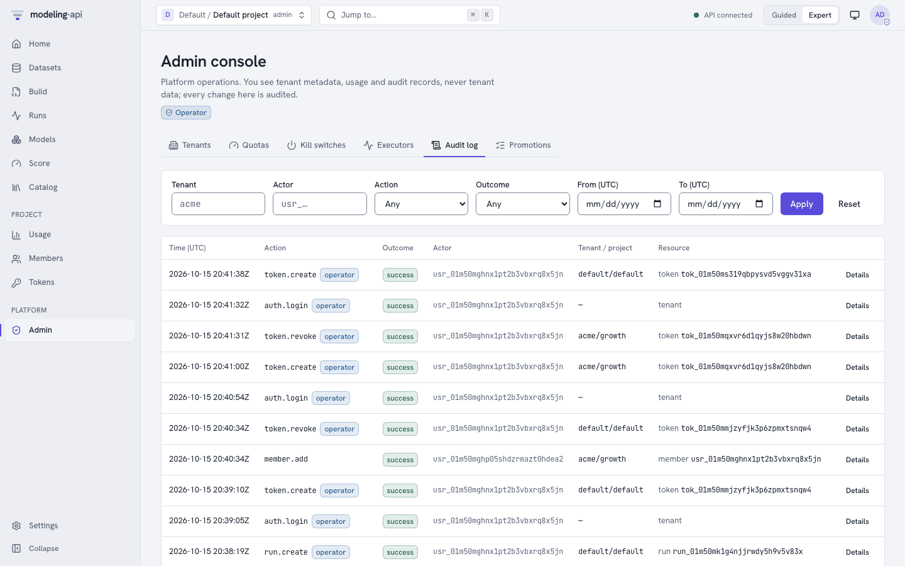

# Administration <span class="mapi-badge">v0.3</span>

From v0.3 one deployment serves many organisations. This guide is for the people who look
after it: who may do what, how compute is limited and paid for, and what to do when something
goes wrong. The concepts behind it are in
[Tenancy and authentication](../concepts/tenancy-and-auth.md) and
[Quotas and cost](../concepts/quotas-and-cost.md); signing in is in
[Authentication](authentication.md).

There are three administrative jobs, and the platform keeps them apart:

| Who | Holds | Works in | Does |
|---|---|---|---|
| **Platform operator** | A verified e-mail listed in `MAPI_OPERATOR_EMAILS`, signed in | **Admin** console, `mapi admin …`, `/v1/admin/*` | Creates and suspends tenants, sets trust tiers and quotas, flips kill switches, watches executors, reads every audit log. **Never reads tenant content** (datasets, specs, models, plots) |
| **Tenant admin** | The `admin` role, tenant-wide | **Members**, **Usage** (Organisation), `/v1/tenants/{tenant}/…` | Creates projects, adds and removes people, reads the tenant's bill and audit log |
| **Project admin** | The `admin` role in one project | **Members**, **Tokens**, **Usage** | Manages that project's members, endpoints, plugins and everyone's tokens there |

Every example on this page is one walkthrough, `docs/snippets/admin_tour.sh`, which the test
suite runs against a development stack (`make dev`). It signs in through the development
identity provider twice: as `admin@dev.local` (a platform operator) and as
`analyst@dev.local` (who becomes the new tenant's admin).

```bash
--8<-- "admin_tour.sh:signin"
```

On a real deployment each person runs `mapi login` instead (see
[Authentication](authentication.md#the-command-line)). Operator commands always need a
sign-in: an API token never carries operator powers, even its owner's.

## Tenants

A **tenant** is an organisation: the boundary of billing, isolation and quotas. PostgreSQL
row-level security keeps every tenant's rows apart, and every storage key starts with
`t/{tenant}/`. Only operators create tenants:

```bash
--8<-- "admin_tour.sh:tenant"
```

| Field | Values | Effect |
|---|---|---|
| id | A lowercase slug (`acme`) | Part of every reference (`dataset://growth/eu_media_daily` lives in a tenant's project) and storage key; it cannot change |
| Trust tier | `internal`, `verified`, `public`, `self-hosted-trusted` | Where the tenant's runs may execute, and its default quotas ([below](#trust-tiers)) |
| Status | `active`, `suspended`, `deleting` | `suspended`: people can read and download, but nothing can be created, changed or run. `deleting`: no access at all |
| Data residency | `eu`, `us`, `asia` or one region (`europe-west1`) | Runs are placed only on executors in a matching region. Changing it applies to new runs only |
| Admin e-mail | Any address | Invited as tenant admin. The invitation is claimed at that person's first sign-in with that **verified** e-mail |

{ .mapi-shot }

The **Admin** console (operators only; everyone else sees an explanation instead) lists every
tenant with its tier, status and residency. **New tenant** and **Edit** do the same as the
commands above. Suspending or deleting asks for a reason and for the tenant's id, typed out.

Suspending is the reversible way to stop an organisation: its people keep read access to their
work, and every change, upload and run is refused with `403 FORBIDDEN`. Operators can still
act on the tenant.

```bash
--8<-- "admin_tour.sh:suspend"
```

### Trust tiers

The tier decides **where a tenant's code may run**, and this is enforced by the dispatcher in
code, never by tenant configuration: a run whose executor does not meet its tenant's
requirement is never submitted. The dispatcher fails it with `INFRA_ERROR` and a detail naming
the requirement (for example *verified tenants require an executor with isolation >= gvisor
and enforced egress/DNS*). The tier also sets the tenant's default quotas until an operator
overrides them.

<!-- generated: trust-tiers -->

!!! warning "Which executors can take `verified` and `public` tenants today"
    Shared tiers need an executor with gVisor or microVM isolation **and** enforced egress and
    DNS. In v0.3 that is:

    - **`cloudrun-jobs`**, once `MAPI_CLOUDRUN_DNS_ENFORCED=true`. It is `false` by default,
      because the DNS response policy has not yet been verified against a real Cloud Run Jobs
      execution (the first item of the [M0 checklist](../operations/gcp-deployment.md#before-you-start-the-verify-m0-checklist)).
      Until then, `verified` and `public` runs fail at dispatch rather than run somewhere
      weaker.
    - **`docker-gvisor`**, only with `MAPI_DOCKER_NETWORK=none`, which needs an HTTPS bootstrap
      URL; with the local GCS shim it is not available.

    `internal` and `self-hosted-trusted` tenants run anywhere, including `local-process`
    (which refuses to start at all under `MAPI_PROFILE=multi-tenant`).

## Projects and members

A **project** is a workspace inside a tenant and the unit of access control. Tenant admins
create projects and decide who works in them; there is no CLI command for members yet, so the
walkthrough uses the HTTP API:

```bash
--8<-- "admin_tour.sh:projects"
```

A **membership** grants one role, either on one project or **tenant-wide** (on the tenant and
every project in it). In a project, a person's effective role is the higher of the two.
Membership is read at every request, so removing someone from a project immediately disarms
their sessions *and* their tokens there.

{ .mapi-shot }

**Members** shows the project's members (or, with **Organisation**, the tenant-wide grants).
Admins change a role in place, remove a member, or **Add member** by e-mail: an address
nobody has signed in with yet becomes an invitation, claimed at first sign-in. A grant marked
*organisation* comes from a tenant-wide membership and is changed there.

### Roles

There are four roles, each including the one before it. Running sits above editing on purpose:
compute costs money, so someone can be trusted to edit a spec without being able to start a
200-task sweep.

| Role | Adds |
|---|---|
| `viewer` | Read everything in the project; validate specs; mint tokens for themselves |
| `editor` | Create and change datasets, specs and saved plots |
| `runner` | **Spend compute**: submit, cancel and retry runs, score models and endpoints, render plots |
| `admin` | Manage members, endpoints, plugins and other people's tokens; delete things |

The complete matrix, generated from `mapi_spec.tenancy.PERMISSIONS` (the table every component
checks). *tenant-wide* means only a tenant-wide grant counts; a pair that is not listed is
denied to everyone:

<!-- generated: roles-matrix -->

The [Permissions reference](../reference/generated/permissions.md) has the same matrix with
the token scopes and the operators' permissions side by side.

## API tokens

Programs (the Python client, the CLI in CI, BI exports) use **API tokens**. A token is
minted by a person in one project, **acts as that person** narrowed by its scopes, and is bound
to that project. Anyone with a role can mint tokens for themselves; project admins can list
and revoke everyone's.

```bash
--8<-- "admin_tour.sh:tokens"
```

{ .mapi-shot }

**New token** asks for a name, the scopes, optional endpoint aliases, an expiry (default 90
days, at most 365), a requests-per-minute limit and a vCPU-second budget per day or month. It
names your role, which is the most any of your tokens can do.

<div class="grid" markdown>

{ .mapi-shot }

{ .mapi-shot }

</div>

The secret is shown **once**. The server stores only an HMAC of it, so a lost token is revoked
and replaced, never recovered. Revoking takes effect on the next request.

### Scopes

Scopes only narrow: a token can never do more than its owner's role, and both must allow an
action. `admin` covers everything the owner's role allows. Generated from
`mapi_spec.tokens.scope_allows`:

<!-- generated: token-scopes -->

`score:<alias>` covers one endpoint (`score:geo-mmm-prod`), `score:*` every endpoint of the
project. Tenant-level actions (members, the bill, the audit log) and operator actions are never
reachable with a token.

## Quotas

Compute is limited in **vCPU-seconds**, at three levels checked in order: the token's own
limits, the tenant's policy (or its tier's defaults, above), and platform-wide limits that
protect the cloud project. The first limit a request would exceed answers `429` with
`QUOTA_EXCEEDED` or `RATE_LIMITED`, a `detail` naming the level and the limit, and
`Retry-After` when it resets ([Quotas and cost](../concepts/quotas-and-cost.md) explains every
limit). Operators override a tenant's defaults:

```bash
--8<-- "admin_tour.sh:quotas"
```

`set` **replaces** the policy: limits you leave out are removed, and the tier default applies
to them again. `mapi admin quotas rm tenant acme` removes the override.

{ .mapi-shot }

## Cost and usage

Every run is estimated when it is submitted (and checked against the quotas with that
estimate), then metered when each attempt ends: vCPU-seconds and GiB-seconds of its resource
class, at the deployment's versioned price table, written to an append-only **cost ledger**.
Amounts are exact integer micros of a currency, and each names the price table it used. A run's
page and `mapi runs get` show its cost; usage pages add it up.

```bash
--8<-- "admin_tour.sh:usage"
```

{ .mapi-shot }

**Usage** shows a project's (or, with **Organisation**, the whole tenant's) cost, compute,
runs and memory for a UTC day or month; a daily chart; how close each quota is (warnings at 70 %
and 90 %); and the totals by token and by resource class. Anyone in a project sees its usage;
the tenant-wide view needs a tenant-wide admin. The amounts are an estimate of compute cost at
list prices, not an invoice.

## Kill switches

Two platform-wide switches stop compute fast. Both are audited and need a reason:

| Switch | Effect |
|---|---|
| **Uploaded code** (`untrusted_execution_enabled`) | Off: no run of tenant-uploaded plugin code is accepted or leased. Built-in models keep working |
| **Global spend cap** | Once the platform's spend in the current UTC day or month reaches the cap, no new compute starts except for `internal` tenants |

```bash
--8<-- "admin_tour.sh:kill"
```

{ .mapi-shot }

Turning off uploaded code is the first step of the sandbox-escape runbook
(`ops/runbooks/sandbox-escape.md`). Spend opens a ticket at 70 % of the cap and pages at 90 %
([Observability](../operations/observability.md#dashboards-alerts-and-runbooks)).

## Executors

**Executors** in the admin console (and `mapi admin executors ls`) show each execution
backend's health, isolation, resource classes, running and queued work, failures in the last
hour, its `jobs.run` rate against the limit, and whether it has passed the executor
conformance suite. *trusted tenants only* marks an executor that `verified` and `public`
tenants can never be placed on.

{ .mapi-shot }

## Audit log

Security-relevant actions are appended to an audit log: sign-ins (and failed ones), tenant,
project and membership changes, token creation, revocation and failed use, quota and
kill-switch changes, quota denials, run creation and cancellation, integrity failures,
artifact links and dataset downloads, and refused run events. Each entry records who (and
whether as an operator), what, on which resource, the outcome and a problem code. IP addresses
and user agents are kept only as keyed hashes: entries can be correlated, never reversed.

```bash
--8<-- "admin_tour.sh:audit"
```

{ .mapi-shot }

Tenant admins read their own tenant's log (`GET /v1/tenants/{tenant}/audit`); operators read
everyone's in the **Audit log** tab or with `mapi admin audit`, filtered by tenant, project,
actor, action, outcome and time.

## Where next

- [Authentication](authentication.md): browser sign-in, the development IdP, Identity
  Platform, API tokens and the CLI.
- [Permissions](../reference/generated/permissions.md): the generated matrices.
- [CLI reference](../reference/generated/cli-reference.md#mapi-admin): every `mapi admin` and
  `mapi tokens` option.
- [HTTP API: multi-tenant API](../reference/http-api.md#multi-tenant-api): the endpoints.
- [Observability](../operations/observability.md): the metrics, alerts and runbooks behind
  the kill switches and quotas.
