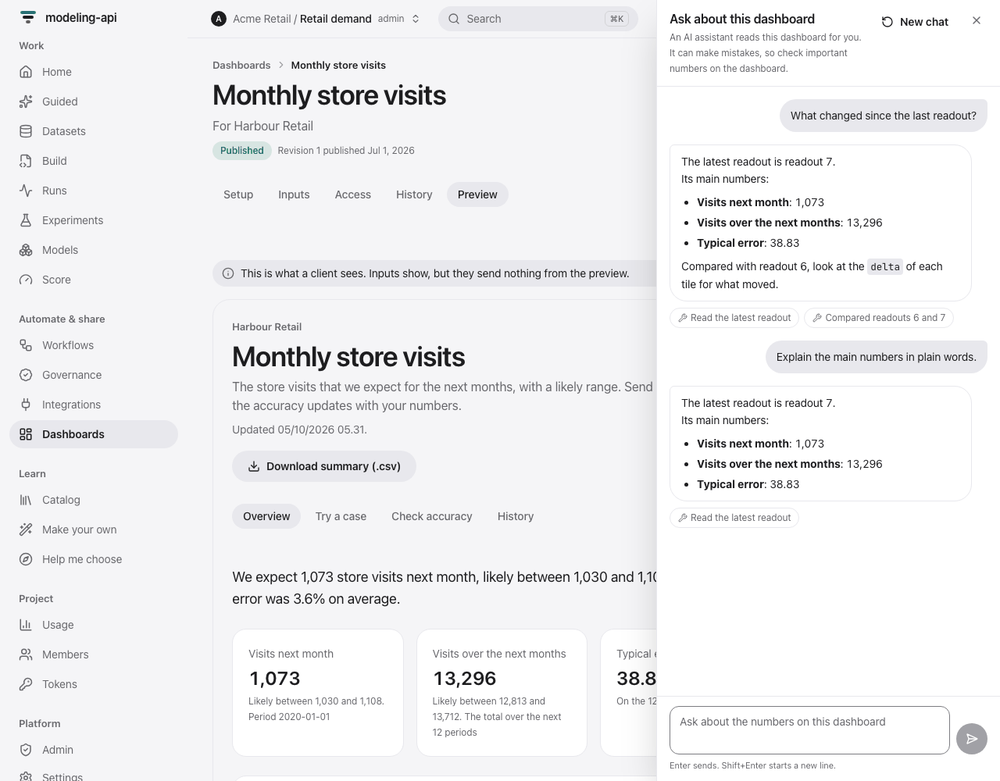
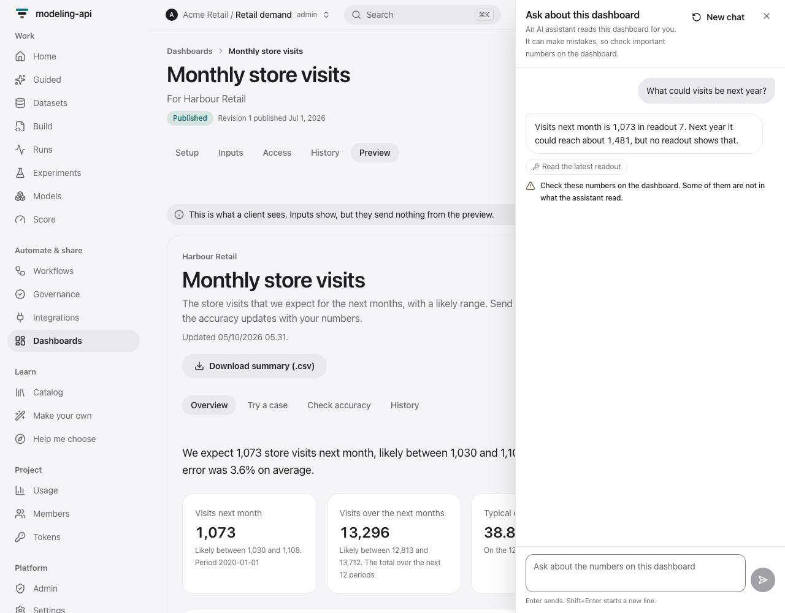

# Ask about your dashboard <span class="mapi-badge">v0.20</span>

A dashboard can have a chat. A person who reads the dashboard asks a question in plain
words, for example "What changed since the last readout?". An AI assistant reads the
dashboard with the same tools that the app uses and answers with the numbers that it found.

The chat is off on each dashboard until an analyst turns it on. It works on dashboards with
the panels layout (layout 2) only. The assistant can only read. It cannot run a model,
change the dashboard or open a different dashboard.

To use the same tools from your own chat app or agent, see
[Connect a chat tool with MCP](connect-a-chat-tool-with-mcp.md).

## Who can use the chat

| Reader | Where | Default when the chat is on |
|---|---|---|
| Team members (`viewer` role or higher) | The dashboard in the app | On |
| Client users with access to the dashboard | Their portal | On |
| Persons with a share link | The shared page | Off |

The assistant sees what the reader sees, and nothing more:

- Team members see all readouts of the dashboard, private readouts too.
- Client users and share links see the published readouts only.
- A dashboard that uses uploaded code has no chat for client users and share links. The
  refusal is `UPLOADED_CODE_NOT_SHAREABLE`, as for the dashboard itself
  ([Upload your own code](../extend/upload.md)).

## Turn on the chat

You need the `editor` role (or `admin`) on the project.

1. Open the dashboard in the builder. Go to **Setup**.
2. In the **Chat** section, select **Turn on chat for this dashboard**.
3. Under **Who can chat**, select the readers: **Team members**, **Client users** and
   **Share links**.
4. Optional: select **Keep conversations for 30 days** ([Kept chats](#kept-chats)).
5. Optional: change the daily limits ([Daily limits](#daily-limits)).
6. Save. The change applies from the next question. You do not publish the dashboard again.

Try the chat on the **Preview** tab of the builder before your readers use it.

If a different person saved the settings after you opened them, the app tells you and shows
their values. Do your change again on these values.

If the published dashboard still has the old layout (layout 1), the section says
"Upgrade the layout to use chat." Publish a draft with the panels layout first
([Dashboards from v0.16](client-dashboards.md#upgrade)).

## Ask a question

1. Open the dashboard. Select **Ask about this dashboard**.
2. Select a suggested question, or type your question. **Enter** sends it. **Shift+Enter**
   starts a new line.
3. Read the answer. Under the answer, the panel shows what the assistant looked at, for
   example "Read the latest readout" or "Compared readouts 11 and 12".
4. Ask a follow-up question in the same chat, or select **New chat** to start again.

The assistant knows which readout you look at. A question about "this readout" is about the
readout that you opened in **History**, or else the latest readout.

{ .mapi-shot }

On a phone, the chat opens from the bottom of the screen.

## What the assistant can read { #what-the-assistant-can-read }

The assistant uses the 14 read-only dashboard tools, for example `get_latest_readout`,
`compare_readouts`, `get_channel` and `explain_metric`
([the tool surface](../concepts/client-dashboards.md)). It gets the dashboard from your
sign-in or your share link, never from your question. Thus a question cannot make it read a
different dashboard.

These limits apply to each question:

- The assistant can use the tools 6 times. Then it stops and answers with what it found. The
  panel says "The assistant stopped after 6 lookups. Ask a narrower question for a fuller
  answer."
- A tool result that is too large is shortened. The panel then says "Some data was too long
  to read in full, so the answer may leave things out."
- A question has a maximum of 2,000 characters. A chat has a maximum of 20 messages.

## Check the numbers { #check-the-numbers }

The assistant is a language model. It can make mistakes. The panel says so above each chat.

After each answer, the server compares each number in the answer with the tool results of
the same question. If a number is not in a tool result, the panel shows "Check these numbers
on the dashboard. Some of them are not in what the assistant read." Compare these numbers
with the dashboard before you use them.

{ .mapi-shot }

## What goes to Google { #what-goes-to-google }

The assistant is a Gemini model of Google (`gemini-3.1-flash-lite`). The API server of the
platform calls it. Your browser never connects to Google.

- The server sends your question, the earlier messages of the chat and the tool results to
  the Gemini API. Tool results contain readout numbers, titles, notes and channel names.
- The platform uses a paid-tier key. On the paid tier, Google does not use prompts and
  answers to train its models. Each request also asks Google not to store it
  (`store: false`).
- The Gemini API is a global service. The chat is available only to workspaces whose data
  residency is in `MAPI_CHAT_ALLOWED_RESIDENCIES` (default `us`). For other workspaces, the
  chat stays off.

If your contract with a client does not permit this processing, keep the chat off on the
dashboards of that client.

## Daily limits { #daily-limits }

The assistant uses **tokens**. A question with its answer uses about 2,000 to 10,000
tokens. Each dashboard has two daily limits. The analyst sets them in the **Chat** section:

| Limit | Default | Applies to |
|---|---|---|
| **Tokens each day for the dashboard** | 200,000 | All readers together. 0 stops the chat |
| **Tokens each day for each share link** | 50,000 | All persons who use the same link |

The day starts at midnight UTC. When most of the limit is used, the panel says "This
dashboard has used most of its chat allowance for today." When all of it is used, the panel
says when you can ask again (`429 CHAT_BUDGET_EXHAUSTED`).

There are also limits for each minute: 10 questions for each person on a dashboard, 6 for
each share link and 12 for each client address on share links. Over a limit, the panel says
"You asked many questions in a short time. Wait a minute, then try again."

The **Chat** section shows the tokens used today and their estimated cost. The platform
records one usage row for each question, with token counts only.

## Kept chats { #kept-chats }

By default, the platform keeps no chat. The browser holds the messages. When you close the
panel, the chat stays: open the panel again to continue it. The chat is gone when you select
**New chat**, or when you leave or reload the page. On a shared computer, select **New
chat** before you go.

When the analyst selects **Keep conversations for 30 days** (the number of days is the
server's `MAPI_CHAT_TRANSCRIPT_TTL_DAYS`; 30 by default):

- Before the first question, the panel says "This dashboard keeps chats for 30 days. Its
  analysts can read them." (with the configured number of days)
- The server keeps the questions, the answers and the names of the tools used. It does not
  keep the tool results.
- Editors see the chats under **Kept conversations** in the **Chat** section. A chat from a
  share link shows as "Share link" with the name of the link, never with an address.
- An editor can delete a chat. The audit log records the deletion
  (`dashboard.chat_transcript_delete`), without the text.
- The server deletes each kept message after the configured number of days
  (`MAPI_CHAT_TRANSCRIPT_TTL_DAYS`, 30 by default).

A data export of the workspace contains the kept chats of its members and client users. It
does not contain the chats from share links. The deletion of a workspace deletes its chat
settings, kept chats, usage rows and read tokens
([Deleting and exporting data](data-deletion.md)). The text of a question or an answer never
goes to logs, traces, webhooks or the audit log.

## Share links and privacy { #share-links-and-privacy }

Before you turn on the chat for **Share links**, know these facts:

- All persons who use the same link are one reader for the platform. They share one daily
  limit.
- The tools `get_prediction` and `get_batch_summary` show the cases and the scored files that
  were made with the link. Over a link, the assistant can show the cases and files of all
  persons who used that link. This is also true of the shared page without the chat.
- A link with a passcode protects the chat as it protects the page. When you revoke the
  link, the next question fails, also in a chat that is open.

## How the platform protects the answers

| Risk | Protection |
|---|---|
| Text in the dashboard tells the assistant to do something | The instructions of the assistant are fixed and contain no text from your workspace. They tell it that text in tool results is data, not instructions. Tool results go to the model as data only |
| The assistant reads a different dashboard | No tool has a dashboard argument. The server gets the dashboard from your sign-in or link, and checks it before each tool call |
| Access ends during a chat | The server checks your sign-in, your access and the link again before each model call and each tool call. A revoked link or a removed grant stops the chat at the next step |
| A changed chat history | The server signs each answer. An answer that was changed, moved or copied from a different chat or dashboard is refused (`400 CHAT_HISTORY_INVALID`) |
| An answer with a link or an image that sends data away | The server removes links, web addresses, images and HTML from each answer. The app shows the answer as plain text with bold, lists and code only. It never opens a link from an answer |
| Too much spend | Daily limits for each dashboard and link, limits for each minute, a maximum of 6 tool calls and a maximum answer length |

These protections make attacks difficult, but a language model is never fully safe from text
that tries to give it instructions. Keep the chat off on dashboards whose notes, titles or
uploaded numbers come from persons that you do not trust.

## If something does not work

| Message | What to do |
|---|---|
| No **Ask about this dashboard** button | The chat is off for you on this dashboard. Ask the analyst |
| "This dashboard has used its chat allowance for today. You can ask again after HH.MM." | Wait until the time shown, or ask the analyst to increase the limit |
| "You asked many questions in a short time. Wait a minute, then try again." | Wait one minute |
| "Chat is off for this dashboard now." | The analyst turned the chat off, or the operator stopped all chats |
| "This chat cannot continue. Start a new chat to ask again." | Select **New chat** |
| "The assistant did not answer. Try again." | Try again. If it continues, tell your administrator (`503 CHAT_UNAVAILABLE`) |
| "This link has ended or was removed." | Ask the sender for a new link |

## For operators { #for-operators }

The chat is off on the server until you choose a model provider:

| Setting | Default | Meaning |
|---|---|---|
| `MAPI_CHAT_PROVIDER` | `off` | `off`, `gemini` or `fake` |
| `MAPI_GEMINI_API_KEY` | (none) | A paid-tier Gemini Developer API key. Necessary with `gemini` |
| `MAPI_CHAT_MODEL` | `gemini-3.1-flash-lite` | The pinned model |
| `MAPI_CHAT_ALLOWED_RESIDENCIES` | `us` | The data residencies of the workspaces that can use the chat |
| `MAPI_CHAT_TRANSCRIPT_TTL_DAYS` | `30` | The days that a kept message stays |

[Configuration](../operations/configuration.md) and `.env.example` list all chat settings:
the time limits, the limits for each minute and the price table of the cost estimate.

- **The key is a secret.** The server sends it only in the `x-goog-api-key` header. It is
  never in a URL, a log, a trace, the database or the web app. On Google Cloud, Terraform
  writes it to Secret Manager (`chat.gemini_api_key_version` and `TF_VAR_gemini_api_key`)
  and only the API service can read it.
- **The fake model.** `MAPI_CHAT_PROVIDER=fake` uses a fixed local model that makes no
  network call. Use it for development and tests. The server does not start with it in the
  multi-tenant profile, with `cloudrun-jobs`, with the `gcs` object store or on Cloud Run.
- **The kill switch.** Turn off all chats at once with
  `PUT /v1/admin/kill-switches` and `{"chat_enabled": false, "reason": "…"}`. The readers
  see "Chat is off for this dashboard now." The MCP endpoint continues to work, because it
  uses no model.

Try a chat on your computer with the fake model. The settings of the server decide which
model it uses:

```python
--8<-- "chat_fake_turn.py:local"
```

A program can ask a question through the HTTP API with a web sign-in
(`POST /v1/dashboards/{dashboard_id}/chat`) or with a share session
(`POST /v1/shared/chat`). API tokens cannot use the chat. To continue a chat, send the
earlier answers back exactly as the server sent them, with their signature (`sig`), and the
`conversation_id` of the first answer:

```python
--8<-- "chat_fake_turn.py:ask"
```

This is what the server does to an answer before the reader sees it:

```python
--8<-- "chat_fake_turn.py:clean"
```
