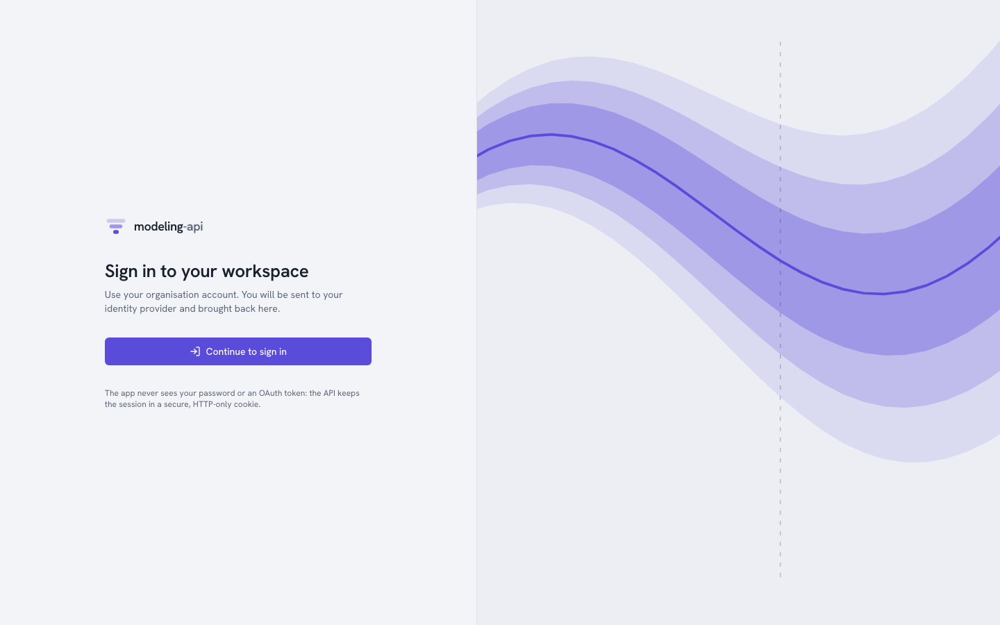
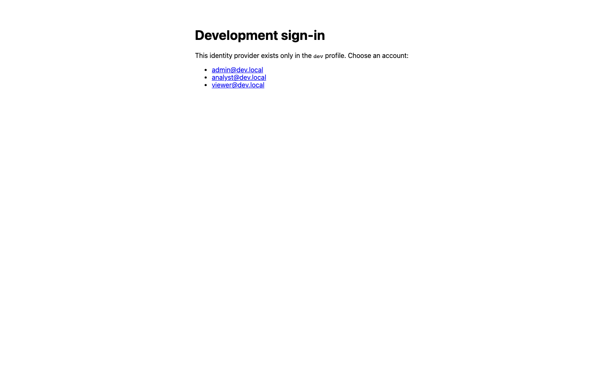

# Authentication <span class="mapi-badge">v0.3</span>

A v0.3 deployment answers `401 UNAUTHENTICATED` to all callers that it does not know. There
are three ways in, one for each type of caller:

| Caller | Signs in with | Sends | Reference |
|---|---|---|---|
| A person in a **browser** | The identity provider of the organisation (OpenID Connect) | An `HttpOnly` session cookie. The app never sees a token. | [Browser sign-in](#browser-sign-in) |
| A person in a **terminal** | `mapi login`: the same provider, from the command line | The ID token of the provider as `Authorization: Bearer` | [The command line](#the-command-line) |
| A **program** | Nothing. A person mints an API token for it. | `Authorization: Bearer mapi_…` | [API tokens](#api-tokens) |

In all three ways, the caller is a user (`usr_…`) with roles in projects. The platform
checks each request against those roles at that time
([Administration](administration.md#roles)). This page is for the persons who sign in and
who set up sign-in. For the protocol details (cookies, CSRF, PKCE, JWKS, the database roles),
see [Authentication and tenant isolation](../operations/authentication.md).

## Browser sign-in

{ .mapi-shot }

If you open the web app without a session, it shows **Sign in to your workspace**.
**Continue to sign in** goes to `/auth/login` on the API. The API sends the browser to the
identity provider. After the sign-in at the provider, the browser comes back to the page
where it started.

The API does all the OpenID Connect work. This work is the authorization code with PKCE, a
nonce, and the verification of the ID token against the keys of the provider. The API keeps
the tokens. The browser holds only two cookies: a `__Host-` session cookie that scripts
cannot read, and a CSRF token. A session ends after 2 hours without activity or after 12
hours in total. It also ends when you click **Sign out**.

{ .mapi-shot }

After you sign in, the **project switcher** at the top left lists each tenant and project
where you have a role. It shows that role and the trust tier of the tenant. All that the app
shows and does applies to the selected project. The app sends the project as
`X-Mapi-Project` on each request. The avatar menu shows who you are. A shield marks a
platform operator.

The **first sign-in** of a person creates their user from the `(issuer, subject)` of the
provider. If the provider tells that the e-mail is **verified**, the platform also claims all
invitations to that address. Invitations come from **Add member** (a tenant admin) or
`--admin-email` (an operator). A person with no membership yet sees *You are not in a
project yet*.

## The development IdP

`make dev` (and Docker Compose) run the servers in the `dev` profile. This profile mounts a
small OpenID provider inside the API at `/dev/idp`. Then sign-in works offline, through
exactly the same code path as a real provider. It uses RS256-signed ID tokens, PKCE and
single-use codes.

{ .mapi-shot }

There are no passwords. All persons who can get to a `dev` API can sign in as any listed
account. The accounts come from `MAPI_DEVIDP_USERS`:

| Account | Gets at start-up |
|---|---|
| `admin@dev.local` | Admin of the `default` tenant and a **platform operator** |
| `analyst@dev.local` | `runner` in `default/default` |
| `viewer@dev.local` (and all other addresses) | `viewer` in `default/default` |

Scripts sign in without a browser with `mapi_client.oidc.dev_idp_login(api_url, email)`.
This function does the same flow and returns an ID token that is valid for an hour.
`make seed`, the end-to-end tests and the walkthroughs on this page use it. A server in any
other profile answers 404. Thus you cannot use the function against production. The
walkthrough below is `docs/snippets/auth_tour.sh`. The test suite runs it against `make dev`:

```bash
--8<-- "auth_tour.sh:signin"
```

```text
anonymous: 401
{"email":"analyst@dev.local","auth":"session","operator":false,"projects":["acme/growth admin","acme/retail admin","default/default runner"]}
```

`MAPI_STACK_PROFILE=single-tenant make dev` turns off sign-in fully. This is the v0.2
behaviour: each request acts as the local administrator of `default`.

## Set up a real identity provider

The API can sign in persons with any **OpenID Connect provider that has the
authorization-code flow**. The provider needs an issuer whose
`/.well-known/openid-configuration` lists an authorization endpoint, a token endpoint and a
JWKS.

### Google accounts

Google accounts are the default of the
[Google Cloud deployment](../operations/gcp-deployment.md). They are the simplest selection
for an organisation on Google Workspace.

1. In the Google Cloud console (**APIs & Services → Credentials**), create an **OAuth client
   ID** of type *Web application*. Set the authorized redirect URI to
   `https://<your app domain>/auth/callback`.
2. Give the id to Terraform (`oidc_client_id` in `terraform.tfvars`). Give the secret as the
   ephemeral variable `TF_VAR_oidc_client_secret`, with `oidc_client_secret_version = 1`
   ([step 4 of the deployment](../operations/gcp-deployment.md#4-add-the-oauth-client-secret)).
3. If you do not use Terraform, set `MAPI_OIDC_ISSUER=https://accounts.google.com`,
   `MAPI_OIDC_CLIENT_ID` and `MAPI_OIDC_CLIENT_SECRET` on the API.
4. Put the e-mails of the operators in `MAPI_OPERATOR_EMAILS`.
5. Create the tenant of each organisation with an `--admin-email`
   ([Administration](administration.md#tenants)).

`MAPI_OIDC_EXTRA_PARAMS='{"hd": "acme.com"}'` selects a Workspace domain in advance in the
account chooser of Google. It is only a hint. Memberships control who can do what. The
e-mail domain never controls it.

### Identity Platform

Terraform also enables **Identity Platform** in the control project
(`infra/terraform/modules/control/identity.tf`). It registers the domain of the app as an
authorized domain. It turns off anonymous sign-in and, by default, e-mail/password sign-in.
You add SAML and OIDC providers for enterprise single sign-on in Identity Platform. Add them
in the console, or with `google_identity_platform_*_idp_config` resources outside the module.
Keep these resources outside the module, because their secrets must not be in its state.

!!! warning "Known gap in v0.3"
    The sign-in of the API cannot use the tokens of Identity Platform yet. You get those
    tokens (issuer `https://securetoken.google.com/<project>`) with the client SDK of
    Identity Platform. That issuer has no authorization-code endpoint for the API to
    redirect to. Until that adapter exists, point `MAPI_OIDC_ISSUER` at Google (above). As an
    alternative, point it directly at the own OpenID provider of the organisation (below).
    Until then, the Identity Platform configuration that Terraform creates causes no
    problems.

### Other providers

Okta, Microsoft Entra ID, Keycloak, Auth0 and all other standard providers work in the same
way:

1. Register a web client with the redirect URI `https://<your app domain>/auth/callback`.
2. Set `MAPI_OIDC_ISSUER` to its issuer.
3. If its discovery document is not under the issuer, set `MAPI_OIDC_DISCOVERY_URL`.
4. Set `MAPI_OIDC_CLIENT_ID` and `MAPI_OIDC_CLIENT_SECRET`.

ID tokens must have a signature with an asymmetric algorithm (`MAPI_OIDC_ALGORITHMS`,
default `RS256,ES256`).

## The command line

`mapi login` signs in with the same provider, from the terminal:

```bash
--8<-- "cli_tenancy.sh:login"
```

- With a browser, it opens the page of the provider. It listens one time on `127.0.0.1` for
  the redirect (authorization code with PKCE).
- `--device` shows a short code. Type the code on a different device. This works with
  providers that support the device flow.
- `--with-token` reads an API token from standard input and stores it instead (CI).

The CLI keeps the sign-in in `credentials.json` next to the config file (mode `0600`). It
sends the ID token of the provider as `Authorization: Bearer`. The API accepts such a token
only when its audience is one of `MAPI_OIDC_CLI_CLIENT_IDS` (default `mapi-cli`). Register
the CLI with your provider as a public *installed app* client. Use a loopback redirect, PKCE
and the `openid email` scopes. The installed-app clients of Google need a client secret. The
CLI reads it from `MAPI_OIDC_CLIENT_SECRET` and never shows it.

To sign in against the development IdP, use this command:

```bash
mapi login --issuer https://dev-idp.mapi.localhost \
           --discovery-url http://127.0.0.1:8000/dev/idp
```

Then select the project where commands act. Use `mapi use <tenant>/<project>`, `--project`
or `MAPI_PROJECT`. `mapi whoami` shows who you are, how you signed in and your projects. See
[The command line](cli.md#sign-in-and-choose-a-project).

## API tokens

Programs never sign in. A person mints a token for them in one project, with only the scopes
that the program needs. The token then acts as that person, but only in that project. Its
scopes limit what it can do. To mint a token, use one of these methods:

- In the web app, use **Tokens → New token** ([Administration](administration.md#api-tokens)).
- From the CLI, use `mapi tokens create`.
- Over HTTP, use this request:

```bash
--8<-- "auth_tour.sh:mint"
```

```text
{"id":"tok_01m50mxfqh4k95ed2dv2jc005v","display":"mapi_hhb9gjzf_…","scopes":["models:read"],"project":"default/default","expires_at":"2026-10-16T20:44:02.161164Z"}
```

The secret (`mapi_<prefix>_<secret><checksum>`) is in the response **one time** only. The
server keeps only an HMAC of it. Lists show the prefix (`mapi_hhb9gjzf_…`). Clients and
secret scanners use the built-in checksum to reject an incorrect or invented token. They do
not have to ask the server.

A program sends the token as a bearer. The token is bound to its project, so it does not
need an `X-Mapi-Project` header:

```bash
--8<-- "auth_tour.sh:use"
```

The Python client accepts the token as `Client(token=…)` or `MAPI_TOKEN`. The CLI accepts it
as `--token`, `MAPI_TOKEN` or `mapi login --with-token`
([Python client](python-client.md#projects-tokens-and-usage)). Both refuse to send a token
over plain HTTP to an address that is not a loopback address.

### What a token cannot do

Scopes can only make a token more limited. A `models:read` token cannot start a run, also
when its owner is a runner. A token cannot act in a different project. No token has operator
powers:

```bash
--8<-- "auth_tour.sh:narrow"
```

```text
{"status":403,"code":"FORBIDDEN"}
{"status":403,"code":"FORBIDDEN"}
{"status":403,"code":"FORBIDDEN"}
```

Tokens expire. The default is 90 days, and the maximum is 365 days. If you revoke a token, or
remove its owner from the project, the token stops at the next request:

```bash
--8<-- "auth_tour.sh:revoke"
```

```text
revoke: 204
{"status":401,"code":"UNAUTHENTICATED"}
```

The platform writes failed uses of a known token to the audit log as `token.auth_failed`.
Examples are an incorrect secret, or an expired or revoked token. No error ever shows the
token.

## Who can see what

| | Browser session | `mapi login` | API token |
|---|---|---|---|
| Identity | The person | The person | The person who minted it |
| Projects | Each project with a role (select one for each request) | Same | Only the project where it was minted |
| Permissions | The role | The role | The role **and** the scopes |
| Operator powers | Yes, for operators | Yes, for operators | Never |
| Needs CSRF token | Yes, for changes | No | No |
| Ends | 2 h without activity, 12 h total, sign-out | `mapi logout`. If the provider gave a refresh token, the CLI uses it to renew the ID token. If not, use `mapi login` again. | Expiry or revocation |

## Where next

- [Administration](administration.md): tenants, members, roles, tokens, quotas and audit.
- [Authentication and tenant isolation](../operations/authentication.md): the view of the
  operator, with cookies, CSRF, row-level security and Pub/Sub push authentication.
- [Tenancy and authentication](../concepts/tenancy-and-auth.md): the concepts and the
  request-authorization pipeline.
