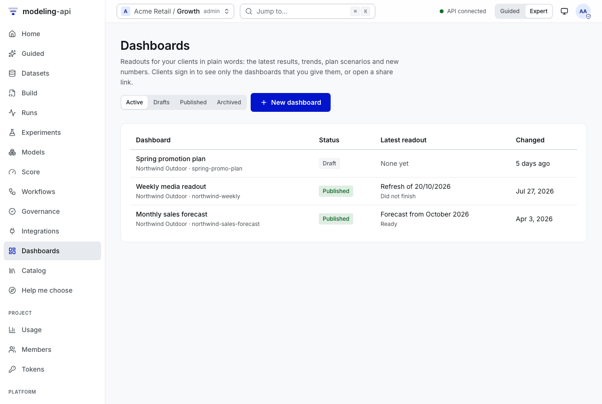
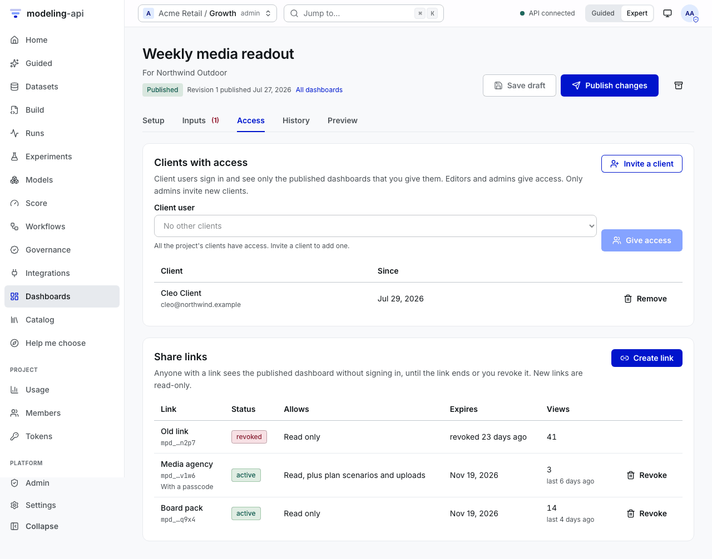

# Build a client dashboard <span class="mapi-badge">v0.16</span>

This guide is for analysts. It shows how to make a dashboard for a client, publish it and
give access to it. [Client dashboards](../concepts/client-dashboards.md) tells how the parts
work. [For clients](for-clients.md) is the page to send to your client.

You need:

- the `editor` role to make and change a dashboard,
- the `runner` role to publish it, because its live inputs run as you,
- a fitted model version or an endpoint. For what-ifs, the model must have a response grid
  (`ui/grids/response_curves.json`). The marketing-mix models of mmm-framework have one.

## 1. Make the dashboard

1. Open **Dashboards** in the navigation.
2. Select **New dashboard**.
3. Type a name. Only your team sees the name. It must be unique in the project.
4. Select the source: **An endpoint (recommended)** or **A model version**.



## 2. Set up the content

The **Setup** tab sets what the client sees:

- **Title**, **Client name** and **Summary**. The client sees these words.
- **KPI**: the model variable (for example `revenue`), its label and its unit. For a count
  KPI, set the value of one unit in the currency of the spend. Then the dashboard can show
  where the spend of each channel sits.
- **Channels**: the media channels of the scorecard. The slider range is a multiple of the
  current plan (1× is the plan). If the model has a response grid, the channels come from it.
- **Tiles**: up to 4 key numbers, for example **Expected result** and **Return on media**.
- **Tabs**: **This period**, **Trends**, **Plan scenarios**, **Update numbers** and
  **History**.
- **Note**: plain text for the client, for example "Spend is net media spend. Agency fees
  are not included."
- **Let the client open the technical details**: shows the toggle "Show technical notes"
  (model version, fit checks and intervals).

All text is plain text. HTML tags and entities are refused.


Select **Save draft**. The **Preview** tab shows the saved draft as a client sees it.

## 3. Set the inputs { #inputs }

The **Inputs** tab sets what clients can do. No input refits the model.


| Setting | Effect | Cost |
|---|---|---|
| **Let the client try other spend (what-ifs)** | Adds the **Plan scenarios** tab. Sliders on the response grid | Free. No run starts |
| **Offer exact results** | Adds **Get exact result** to the scenarios | One score run for each exact result |
| **Let the client upload new numbers** | Adds the **Update numbers** tab | One score run for each upload |
| **Number uploads**: review or auto | **Review** (the default): an editor publishes each upload into the history. **Auto**: an upload goes into the history at once | — |
| **Let the uploader ask for a refit** | Shows "Ask the analyst to refit with these numbers" on the upload tab. Needs a **Refit workflow** | The refit runs only if you approve |
| **Refresh workflow** | Each successful run of this workflow adds a readout | No new run |
| **Follow the endpoint** | A promotion of the endpoint publishes a new revision on the new version | One score run for each promotion |
| **Runs each day** | The maximum number of exact results, uploads and manual refreshes in 24 hours (default 20) | — |

With **Review** (the default), an upload has the visibility `pending_review`: the uploader
sees the result at once, and the other clients see it only after an editor publishes it. For
a marketing-mix model, the dashboard compares the uploaded numbers with the
model's prediction. The model does not change. Models that can use actuals in a forecast
(statsmodels models with `conditions_on_actuals`) use them in the forecast.

## 4. Publish

Select **Publish**. The dialog checks the draft and tells you what is not correct. It also
tells you: "Live inputs run as you and use your project's compute."


Publishing:

- pins the spec and the model version as a revision. For an endpoint, it pins the current
  version and the endpoint revision. A refit does not change a published dashboard by
  surprise.
- makes you the run-as owner. If you lose the `runner` role later, the live inputs stop
  ("Inputs paused"). The readouts that exist stay visible. Publish again with a runner to
  start them again.
- starts the first readout (the `baseline`). It takes a few minutes.

To change a published dashboard, change the draft and select **Publish changes**. Clients
and share links see the new revision from their next page load. The history stays.

## 5. Give access

The **Access** tab has two parts.



**Clients with access.** Client users sign in and see only the published dashboards that
you give them.

1. Select a person in **Client user**.
2. Select **Give access**.

Editors and admins give access. Only admins invite new clients (**Invite a client** opens the
member invitation with the role `client`). A client role is always for one project.

**Share links.** Persons without an account open a link. See
[Share dashboards securely](sharing-dashboards-securely.md).

## 6. Review the history

The **History** tab shows all readouts, also the readouts that clients do not see: failed
refreshes, private scenarios and hidden readouts.


**Readouts waiting for review** lists the uploads from clients and share links. For each
upload, select **Publish** to add it to the client history, or **Hide** to keep it only for
audit. Viewers see the list but cannot decide.

**Refresh now** (an editor) queues a new readout of the published revision.

## Refit requests { #refit-requests }

When an uploader asks for a refit, the request shows in **Refit requests**. A dashboard has a
maximum of one open request. A newer request replaces the older one ("Replaced by a newer
request").

To approve a request, you need the `editor` role and the `runner` role:

1. Select **Approve** on the request.
2. Read the dialog. It tells which workflow starts, as you.
3. Select **Approve and start the refit**.

The approval:

1. publishes the readout of the upload,
2. adds the uploaded numbers as a new version of the dataset of the dashboard (the server
   validates them again, with the same limits as all uploads),
3. starts the refit workflow as you, through the usual governance, approval and cost checks.

When the workflow run succeeds, the refresh workflow adds a new readout. **Reject** starts
nothing. The comparison stays available. The uploader does not see your note.

The refit workflow must be in the same project, and its input node must take the dataset of
the dashboard.

## Refresh without a new scheduler

- **A workflow.** Select a workflow with a `model.score` or `model.forecast` node as the
  **Refresh workflow**. Schedule it on its **Automation** tab, or start it with a dataset
  trigger. Each successful run adds a readout from that node. No new run starts.
- **An endpoint.** With **Follow the endpoint**, a promotion publishes a new revision on the
  new version and adds a readout. Without it, the dashboard only shows that a new version is
  available.
- **Refresh now** on the History tab.

Two refreshes of one dashboard are a minimum of 60 seconds apart. If a refresh fails, the
clients see the last good readout with "Last updated DD/MM/YYYY HH.MM".

## Control the cost

All exact results, uploads and refreshes run as the run-as owner and use the quotas of your
tenant. The limits are:

- **Runs each day** for each dashboard (`limits.exact_runs_per_day`, default 20).
- 6 exact results each hour for each share link (`MAPI_SHARE_RUN_RATE_PER_HOUR`).
- 12 exact results each hour for each client user and dashboard
  (`MAPI_CLIENT_RUN_RATE_PER_HOUR`).

Over a limit, the client sees: "You reached today's limit for new results. Try again
tomorrow or ask your analyst." (`429 DASHBOARD_RUN_LIMIT`). The same scenario or the same
numbers within 24 hours give the cached readout, not a new run.

## Archive

**Archive the dashboard** (the icon next to **Publish changes**) hides it from clients and
revokes all its share links. The readouts stay for audit.

## With the API or the Python client

```bash
curl -s -X POST "$MAPI_URL/v1/dashboards" \
  -H "Authorization: Bearer $MAPI_TOKEN" -H "X-Mapi-Project: growth" \
  -H "Content-Type: application/json" \
  -d '{"name": "acme-weekly", "spec": {
        "title": "Weekly media results", "client_name": "Acme Retail",
        "source": {"kind": "endpoint", "alias": "eu-mmm-prod"},
        "kpi": {"variable": "orders", "label": "Orders", "unit": "count", "value_per_unit": 42},
        "channels": [{"name": "tv", "label": "TV"}, {"name": "search", "label": "Paid search"}],
        "whatif": {"enabled": true, "exact": false}}}'

curl -s -X POST "$MAPI_URL/v1/dashboards/$DASHBOARD:publish" \
  -H "Authorization: Bearer $MAPI_TOKEN" -H "X-Mapi-Project: growth"
```

The Python client has the same calls in `api.dashboards`
([The Python client](python-client.md#client-dashboards)). All routes are in
[HTTP API: client dashboards](../reference/http-api.md#v016).
