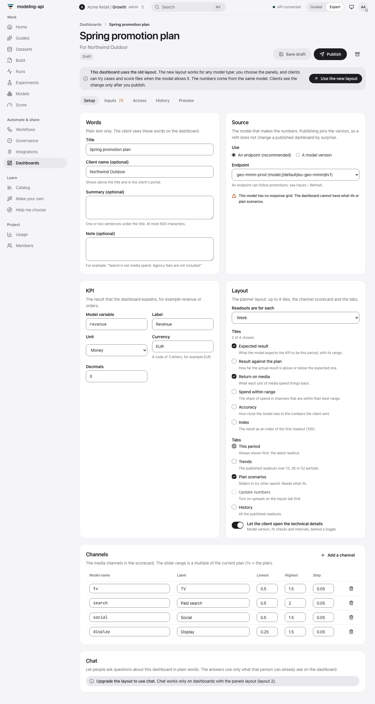
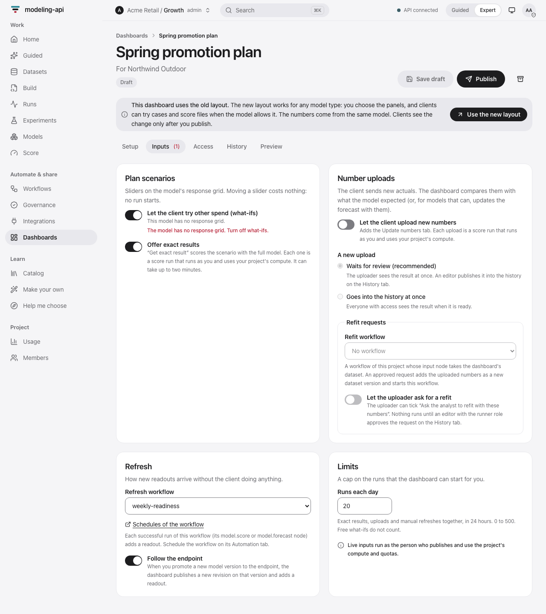
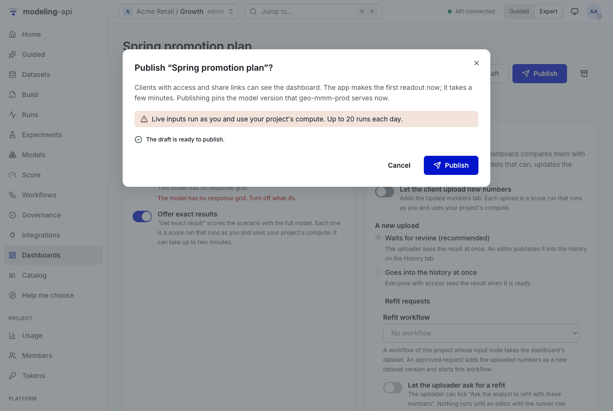
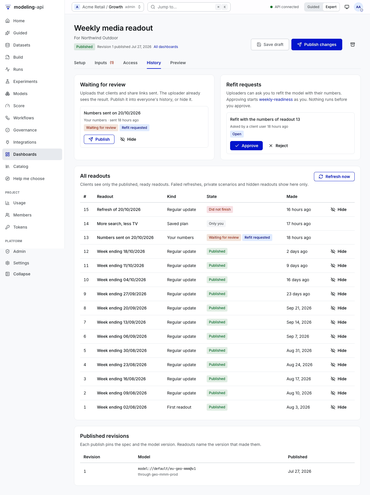

# Build a client dashboard <span class="mapi-badge">v0.16</span> <span class="mapi-badge">v0.17</span>

This guide is for analysts. It shows how to make a dashboard for a client, publish it and
give access to it. From v0.17, a dashboard can show any model type: a forecast, a
classifier, a regression, a model of a change, a map of a science model, an image model or
a marketing-mix model. [Client dashboards](../concepts/client-dashboards.md) tells how the
parts work. [For clients](for-clients.md) is the page to send to your client.

You need:

- the `editor` role to make and change a dashboard,
- the `runner` role to publish it, because its live inputs run as you,
- a fitted model version or an endpoint. For media what-ifs, the model must have a response
  grid (`ui/grids/response_curves.json`). The marketing-mix models of mmm-framework have one.

## 1. Make the dashboard

1. Open **Dashboards** in the navigation.
2. Select **New dashboard**.
3. Type a name. Only your team sees the name. It must be unique in the project.
4. Select the source: **An endpoint (recommended)** or **A model version**.
5. Select a layout. The app looks at the model and shows the layouts that fit it, with
   **Suggested** on the best one and the reasons. A layout that cannot offer an input says
   why, for example "the model has no row dim".
6. Select **Create dashboard**. The app makes a starting draft. Nothing is shown to clients before you
   publish.


The layouts (presets) are:

| Layout | For | Clients see first |
|---|---|---|
| **Media planner** | Marketing-mix models | Key numbers, the channel scorecard, trends and plan scenarios |
| **Forecast** | Time series models with a forecast | The next period with its likely range, and how close earlier forecasts were |
| **Predictions** | A value for each case (regression) | The prediction for a case, with its likely range |
| **Classifier** | The chance of an outcome for each case | "Chance of …" and how often the model is right |
| **Effect of a change** | Causal models | The total effect, the effect in percent and the chance of an effect |
| **Map** | Science models with a grid or areas | A map of the results and key numbers for the whole area |
| **Image model** | Image classifiers | The accuracy from the fit and the plots of the model |
| **General** | Any other model | Key numbers and charts of the outputs |

You can change the layout later on the **Setup** tab (**Change the layout**). The app asks
you to confirm before anything changes.

## 2. Set up the content

The **Setup** tab sets what the client sees:

- **Title**, **Client name** and **Summary**. The client sees these words.
- **What the dashboard is about**: the main model output (for example `sales` or
  `p_churn`), its label and its unit. For a classifier, type the class to report (for
  example `churned`). For the media planner, you can set the value of one unit in the
  currency of the spend. Then the dashboard can show where the spend of each channel sits.
- **Readouts are for each**: the period word (week, month and more).
- **Note**: plain text for the client, for example "Sales are net of returns."
- **Let the client open the technical details**: shows the toggle "Show technical notes"
  (model version, fit checks and intervals).

All text is plain text. HTML tags and entities are refused.



### Panels { #panels }

The **Panels** list shows the parts of the page, in order. The preset fills it. You can:

- select **Add a panel** and choose a **Key number**, a **Chart**, a **Table**, a **Note** or
  a **Model plot**,
- remove a panel,
- move a panel up or down (also with the keyboard).

For each panel, choose the source from the list that the app reads from the model version:
a model output, a metric of the fit, a check of the scorecard, the accuracy of the sent
numbers or a plot of the model version. The list shows only the sources that the panel can
use. A key number can show **The middle value**, **The low end of the range** or **The high
end of the range**, and can compare with the previous readout.

The range of a key number can be:

- **Where one new result will probably be** (the default for results): the predictive range.
- **Where the average will probably be**: a narrower range.

Some rules keep the numbers correct. The app tells you in plain words when a choice is not
possible:

- A total over the forecast comes from the draws of the model, so its range is correct. A
  total of single values is marked **Approximate**. A total of a range that the model gives
  as quantiles is refused ("show per-period values").
- A dashboard has a maximum of 24 panels and 8 key numbers.
- A **Model plot** that the page cannot draw is a picture. The app makes it one time when you
  publish. Until it is ready, clients see "The picture is being prepared".

Select **Save draft**. The **Preview** tab shows the saved draft as a client sees it, from
the latest readout. In the preview, your team also sees the real plots of the model.

## 3. Set the inputs { #inputs }

The **Inputs** tab sets what clients can do. No input refits the model. The tab shows only
the inputs that the layout and the model allow. If an input is not possible, the tab tells
why.



| Setting | Effect | Cost |
|---|---|---|
| **Let the client try cases** | Adds **Try a case**. The client changes a few values and sees the prediction with its range | One score run for each try |
| **Let the client upload new numbers** | Adds **Check accuracy** (or **Update numbers** in the media planner) | One score run for each upload |
| **Let the client score a file** | Adds **Score a file**. The client sends a CSV file of new cases and downloads the predictions | One score run for each file |
| **Let the client try other spend (what-ifs)** | Media planner only. Adds **Plan scenarios**. Sliders on the response grid | Free. No run starts |
| **Offer exact results** | Media planner only. Adds **Get exact result** to the scenarios | One score run for each exact result |
| **Number uploads**: review or auto | **Waits for review (recommended)**: an editor publishes each upload into the history. **Goes into the history at once** | — |
| **Let the uploader ask for a refit** | Shows "Ask the analyst to refit with these numbers". Needs a **Refit workflow** | The refit runs only if you approve |
| **Refresh workflow** | Each successful run of this workflow adds a readout | No new run |
| **Follow the endpoint** | A promotion of the endpoint publishes a new revision on the new version | One score run for each promotion |
| **Runs each day** | The maximum number of runs that the dashboard can start for you in 24 hours (default 20) | — |
| **Scored files each day** | The maximum number of scored files in 24 hours (default 3) | — |

### Try a case

Under **Values the client changes**, add the model inputs that the client can change. For
each one, set the label, the type (a number, a whole number, a choice, a date or yes/no),
the range or the choices, and the default. The app fills the ranges from the limits that the
model declares. If the model declares no limits, the app uses the data that the model
learned from and shows a warning. Make sure that each range makes sense for your client
before you publish. Values that the client does not change come from the defaults.

For a forecast, **Let the client choose how far ahead** adds a **Periods ahead** input.

The server checks each value that a client sends. A value outside the range is refused and
the page marks it at its field. The server never changes a value in silence. A tried case is
private to the client. The client can **Keep this case**. Then it waits for your review on
the **History** tab.

### Check accuracy (actuals)

Under **Match the numbers**, choose how the sent numbers join the predictions:

- **By period**: one row for each date or period, as in a forecast.
- **By case**: one row for each case, with the case's id and its actual outcome. Set the
  **Case id column** and, if necessary, the **Outcome column**.

The dashboard then shows the accuracy that fits the model:

| Model | Accuracy |
|---|---|
| Forecast, regression | Typical error (MAE, RMSE), error in percent (MAPE, sMAPE, WAPE), bias, R², results inside the range |
| Classifier | How often the model is right, how well it ranks cases (AUC), the probability error (Brier), the log score, calibration and the right and wrong predictions. You set the **Threshold** (0.05 to 0.95). Clients cannot change it |
| Causal impact | The effect so far, updated with the new numbers, with its range |
| Synthetic control, difference-in-differences | A comparison. The effect changes only after you refit, so offer a refit request |

A history of the accuracy shows the published uploads over time. Private uploads never go
into it. For statsmodels models that use actuals in a forecast, the forecast uses the sent
numbers. The model does not change.

### Score a file

Set the **Case id column**, the **Outputs in the file** and **Rows at most** (a maximum of
5000). With **Check every value against the Try a case ranges**, a file with a value out of
range is refused with the row and the column.

The client downloads the predictions as a CSV file. Only the person or the link that sent
the file, and the editors, can download it. The download stops when the private result
expires (30 days by default).

Image dashboards do not let clients or share links score a file in v0.17.

## 4. Publish

Select **Publish**. The dialog checks the draft and tells you what is not correct. It also
tells you: "Live inputs run as you and use your project's compute."



Publishing:

- pins the spec and the model version as a revision. For an endpoint, it pins the current
  version and the endpoint revision. A refit does not change a published dashboard by
  surprise.
- makes you the run-as owner. If you lose the `runner` role later, the live inputs stop
  ("Inputs paused"). The readouts that exist stay visible. Publish again with a runner to
  start them again.
- starts the first readout (the `baseline`). It takes a few minutes. Image and some causal
  dashboards use the metrics of the fit and start no run.
- makes the pictures of the model plots (a maximum of 4 for each revision).

To change a published dashboard, change the draft and select **Publish changes**. Clients
and share links see the new revision from their next page load. The history stays.

## Dashboards from v0.16 { #upgrade }

Your v0.16 dashboards move to the new layout by themselves when the server of v0.17 starts.
A marketing-mix dashboard becomes a **Media planner**. A forecast dashboard with a
placeholder channel becomes a **Forecast**. The move keeps the model version, the run-as
owner, the share links, the grants and the history. The old readouts keep their old look
in **History**.

Two things change for clients:

- They see the note "This dashboard has a new layout. The numbers come from the same model."
  one time.
- The likely ranges now show where one new result will probably be. They are wider than
  before. The middle values stay the same. Tell your clients if they compare ranges.

If the app cannot move a dashboard by itself, the builder shows "This dashboard could not
move to the new layout by itself" with the issues. Clients still see the old layout. Select
**Use the new layout**, fix the issues and publish.

## 5. Give access

The **Access** tab has two parts.


**Clients with access.** Client users sign in and see only the published dashboards that
you give them.

1. Select a person in **Client user**.
2. Select **Give access**.

Editors and admins give access. Only admins invite new clients (**Invite a client** opens the
member invitation with the role `client`). A client role is always for one project.

**Share links.** Persons without an account open a link. New links are read-only. When you
make a link, you can let it try cases, upload numbers, score files or try plan scenarios,
if the dashboard offers them. See [Share dashboards securely](sharing-dashboards-securely.md).

## 6. Review the history

The **History** tab shows all readouts, also the readouts that clients do not see: failed
refreshes, private scenarios, tried cases, scored files and hidden readouts.



**Readouts waiting for review** lists the uploads and the kept cases from clients and share
links. For each one, select **Publish** to add it to the client history, or **Hide** to keep
it only for audit. Viewers see the list but cannot decide.

**Refresh now** (an editor) queues a new readout of the published revision.

## Refit requests { #refit-requests }

When an uploader asks for a refit, the request shows in **Refit requests**. A dashboard has a
maximum of one open request. A newer request replaces the older one ("Replaced by a newer
request").

To approve a request, you need the `editor` role and the `runner` role:

1. Select **Approve** on the request.
2. Read the dialog. It tells which workflow starts, as you.
3. Select **Approve and start the refit**.

The approval:

1. publishes the readout of the upload,
2. adds the uploaded numbers as a new version of the dataset of the dashboard (the server
   validates them again, with the same limits as all uploads),
3. starts the refit workflow as you, through the usual governance, approval and cost checks.

When the workflow run succeeds, the refresh workflow adds a new readout. **Reject** starts
nothing. The comparison stays available. The uploader does not see your note.

The refit workflow must be in the same project, and its input node must take the dataset of
the dashboard.

## Refresh without a new scheduler

- **A workflow.** Select a workflow with a `model.score` or `model.forecast` node as the
  **Refresh workflow**. Schedule it on its **Automation** tab, or start it with a dataset
  trigger. Each successful run adds a readout from that node. No new run starts.
- **An endpoint.** With **Follow the endpoint**, a promotion publishes a new revision on the
  new version and adds a readout. Without it, the dashboard only shows that a new version is
  available.
- **Refresh now** on the History tab.

Two refreshes of one dashboard are a minimum of 60 seconds apart. If a refresh fails, the
clients see the last good readout with "Last updated DD/MM/YYYY HH.MM".

## Control the cost

All tried cases, exact results, uploads, scored files and refreshes run as the run-as owner
and use the quotas of your tenant. The limits are:

- **Runs each day** for each dashboard (`limits.exact_runs_per_day`, default 20).
- **Scored files each day** for each dashboard (`limits.batch_runs_per_day`, default 3).
- 6 runs each hour for each share link (`MAPI_SHARE_RUN_RATE_PER_HOUR`).
- 12 runs each hour for each client user and dashboard (`MAPI_CLIENT_RUN_RATE_PER_HOUR`).
- 2 scored files each day for each share link (`MAPI_SHARE_BATCH_PER_DAY`) and 4 for each
  client user (`MAPI_CLIENT_BATCH_PER_DAY`).
- 20 000 scored rows each day for each dashboard (`MAPI_BATCH_ROWS_PER_DAY`).

Over a limit, the client sees: "You reached today's limit for new results. Try again
tomorrow or ask your analyst." (`429 DASHBOARD_RUN_LIMIT`). The same case, the same file or
the same numbers within 24 hours give the cached readout, not a new run.

## Archive

**Archive the dashboard** (the icon next to **Publish changes**) hides it from clients and
revokes all its share links. The readouts stay for audit.

## With the API or the Python client

Get the presets of a model version and a starting draft, then create and publish it:

```bash
curl -s "$MAPI_URL/v1/dashboards:presets?model_id=churn&version=3" \
  -H "Authorization: Bearer $MAPI_TOKEN" -H "X-Mapi-Project: growth" > presets.json

jq '{name: "churn-weekly", spec: .spec}' presets.json |
  curl -s -X POST "$MAPI_URL/v1/dashboards" \
    -H "Authorization: Bearer $MAPI_TOKEN" -H "X-Mapi-Project: growth" \
    -H "Content-Type: application/json" -d @-

curl -s -X POST "$MAPI_URL/v1/dashboards/$DASHBOARD:publish" \
  -H "Authorization: Bearer $MAPI_TOKEN" -H "X-Mapi-Project: growth"
```

The Python client has the same calls on `client.dashboards`:

```python
from mapi_client import Client

with Client() as client:
    found = client.dashboards.presets(model_id="churn", version=3)
    print([(s.preset, s.reasons) for s in found.suggestions])
    board = client.dashboards.create("churn-weekly", found.spec)
    client.dashboards.publish(board.id)

    # try a case: one private prediction readout (a value out of range is refused)
    tried = client.dashboards.predict(board.id, {"tenure": 24, "plan": "plus"})
    print(client.dashboards.wait_readout(board.id, tried.seq).snapshot)

    # score a file of new cases, then download the predictions as CSV
    template = client.dashboards.batch_template(board.id)
    batch = client.dashboards.score_batch(board.id, new_cases)  # an xr.Dataset or XrJSON
    client.dashboards.wait_readout(board.id, batch.seq)
    csv_bytes = client.dashboards.download_predictions(board.id, batch.seq)
```

`sources()` reads what the model version offers to panels and inputs, `upgrade()` moves a
layout 1 draft by hand, `keep_readout()` keeps a tried case and `asset()` reads a picture. A
share link opened with `open_share()` has `predict()`, `batch_template()`, `score_batch()`,
`download_predictions()` and `asset()` too. See also
[The Python client](python-client.md#client-dashboards-v017). All routes are in
[HTTP API: client dashboards](../reference/http-api.md#v016) and
[HTTP API: dashboards for any model type](../reference/http-api.md#v017).
