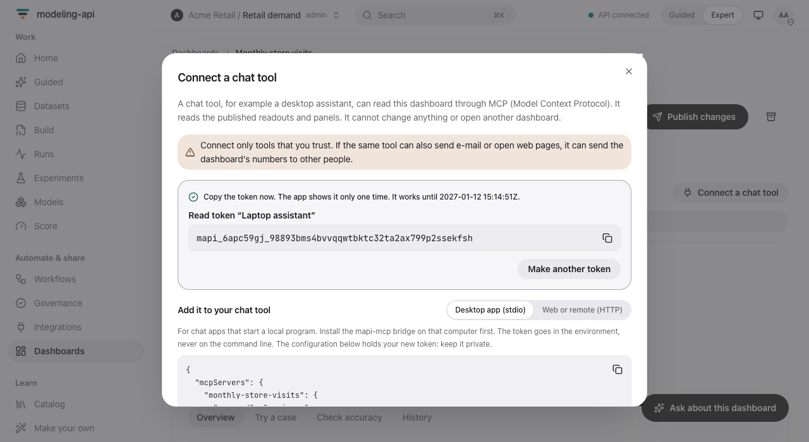

# Connect a chat tool with MCP <span class="mapi-badge">v0.20</span>

A chat tool, for example a desktop assistant, an IDE or an agent that you write, can read a
dashboard through **MCP** (Model Context Protocol). The tool gets the same 14 read-only
dashboard tools that the [dashboard chat](ask-about-your-dashboard.md) uses. It can read the
published readouts, panels, channels, metrics, accuracy and the what-if grid. It cannot
change anything, run a model or open a different dashboard.

The tool uses its own model. The platform sends nothing to a model for MCP and the daily
chat limits do not apply.

!!! warning "Connect only tools that you trust"
    The tool reads the numbers of the dashboard. If the same tool can also send e-mail, open
    web pages, write files or call other services, a mistake of its model, or text in the
    dashboard that tries to give it instructions, can send these numbers to other persons.
    Give the tool only the other tools that it needs. Do not connect a client's dashboard
    to an agent that can act without your approval.

## Before you start

You need one of these credentials. Each credential is for one dashboard:

| Credential | Who gets it | How the tool sends it |
|---|---|---|
| A **read token** (`mapi_…`) | A team member or a client user with access to the dashboard | `Authorization: Bearer mapi_…` |
| A **share link** and its passcode | A person who received the link | The tool exchanges them for a share session (`X-Mapi-Share: mps_…`) |

The dashboard must be published with the panels layout (layout 2). A dashboard that uses
uploaded code refuses all read tokens and share links (`403 UPLOADED_CODE_NOT_SHAREABLE`),
also the tokens of team members ([Upload your own code](../extend/upload.md)). The app does
not make a token for such a dashboard: **Make token** says why (uploaded code, layout 1, or
not published now).

## Make a read token

1. Open the dashboard: in the app, or in the client portal.
2. Select **Connect a chat tool**.
3. Under **Make a read token**, type a name, for example the name of the tool. Select how
   long the token works in **Ends after** (a maximum of 90 days).
4. Select **Make token**.
5. Select **Copy read token**. The app shows the token **one time** only. If you lose it,
   revoke it and make a new one.
6. Under **Add it to your chat tool**, select **Desktop app (stdio)** or
   **Web or remote (HTTP)**, then **Copy configuration**. The configuration contains the
   new token.

{ .mapi-shot }

The rules of a read token:

- It can read **one dashboard**, and only through MCP. All other API routes refuse it
  (`403 FORBIDDEN`). It cannot use the chat of the app.
- It sees the **published** readouts only, also when a team member made it. It never sees
  private readouts.
- It acts as you. If you lose access to the dashboard, or the dashboard is unpublished, the
  token stops at the next request. It works again when the access comes back, so revoke a
  token that you do not use. You can revoke your own tokens also after you lost access.
- You can have 5 active tokens for each dashboard. Make one token for each tool.
- Only a web sign-in can make a token. A token cannot make a different token.

## Add the tool

### Desktop app (stdio)

Desktop apps start a local program and talk to it through its standard input and output.
The program is `mapi-mcp`, the MCP bridge of the platform. It sends each message to the API
with your credential.

1. Install `mapi-mcp` on the computer of the chat tool. In a checkout of the platform,
   `make install` puts it into `.venv/bin`. On a different computer, install the
   `packages/spec` and `packages/mcp` packages of the same release, for example
   `pip install ./packages/spec ./packages/mcp`.
2. Add the configuration to the chat tool. Many desktop apps read this shape:

```json
--8<-- "mcp_stdio_config.json"
```

3. Start the chat tool again. Ask it, for example: "Use the dashboard tools. What does the
   latest readout show?"

Some desktop apps do not use the `PATH` of your shell. If the app cannot find `mapi-mcp`,
type the full path of the program in `command`.

The bridge reads its credential from its environment, never from its command line. It
refuses arguments, because a command line can show in a list of processes or in a shell
history. These are the variables:

| Variable | Value |
|---|---|
| `MAPI_API_URL` | The address of the API, for example `https://api.example.com`. Use `https://` (`http://` works for `localhost` only) |
| `MAPI_DASHBOARD_TOKEN` | A read token |
| `MAPI_SHARE_LINK` and `MAPI_SHARE_PASSCODE` | A share link (or only its `mpd_…` token) and its passcode, in place of a read token |
| `MAPI_MCP_CONFIG` | Optional: a different path for the configuration file |
| `MAPI_MCP_LOG` | Optional: `INFO` writes one line for each request to the standard error |

You can also put the same values in the file `~/.config/mapi/mcp.json`, with the keys
`api_url`, `dashboard_token`, `share_link` and `share_passcode`. The file contains a secret.
Thus only you can read it (`chmod 600 ~/.config/mapi/mcp.json`), or the bridge does not
start.

The bridge writes only MCP messages to its standard output. Its log goes to the standard
error, and it removes tokens, share links, sessions and passcodes from each line.

### Web or remote (HTTP)

Tools that connect to a URL use the MCP endpoint of the API directly:

```json
{
  "mcpServers": {
    "weekly-sales": {
      "type": "http",
      "url": "https://api.example.com/v1/mcp",
      "headers": {"Authorization": "Bearer <your read token>"}
    }
  }
}
```

Put the token in the `Authorization` header, never in the URL. The endpoint refuses a
token in the query string (`?token=`, `401`).

The endpoint is `POST /v1/mcp` (streamable HTTP, JSON answers, no sessions). Each request
sends one JSON-RPC 2.0 message. This Python example does a full session: `initialize`,
`tools/list` and one `tools/call`:

```python
--8<-- "mcp_http_session.py:session"
```

### With a share link

A person with a share link can connect a tool without an account. Give the bridge the link
and its passcode (`MAPI_SHARE_LINK` and `MAPI_SHARE_PASSCODE`). The bridge exchanges them for
a share session (`POST /v1/share-sessions`), sends the session in the `X-Mapi-Share` header
and gets a new session before the old one ends. A session lasts 30 minutes
(`MAPI_SHARE_SESSION_TTL_S`).

A tool that connects with HTTP must do these steps itself.

When the analyst revokes the link, or the link ends, the next request fails
(`410 LINK_EXPIRED`). All persons who use the same link are one reader for the platform: the
tools `get_prediction` and `get_batch_summary` show the cases and scored files of all persons
who used that link ([Share links and privacy](ask-about-your-dashboard.md#share-links-and-privacy)).

## Revoke a token

1. Open the dashboard and select **Connect a chat tool**.
2. In **Your read tokens**, select **Revoke** on the row of the token, then **Revoke now**.

The next request with the token fails. Editors can select **Show everyone's tokens** to see
and revoke the tokens of all persons on the dashboard. A token also stops when it ends, and
while its owner has no access to the dashboard. A revoked token never works again. You can
list and revoke your own tokens also when you no longer have access to the dashboard
(`GET` and `DELETE /v1/dashboards/{id}/read-tokens…`).

The audit log records each token that is made or revoked (`dashboard.read_token_create`,
`dashboard.read_token_revoke`).

## What the tool gets

| MCP method | Result |
|---|---|
| `initialize` | The server `mapi-dashboards`, the protocol revision and fixed instructions. The instructions contain no text from your workspace |
| `tools/list` | The 14 dashboard tools, with their argument schemas. All tools are read-only (`readOnlyHint: true`) |
| `tools/call` | The result as JSON text, and as `structuredContent` when it was not shortened |
| `ping` | An empty result |

Other methods (`resources/*`, `prompts/*`, `sampling/*`) answer the JSON-RPC error `-32601`.
The tool descriptions are fixed text. They never contain a dashboard title or a channel
name.

The supported protocol revisions are `2025-11-25` and `2025-06-18`. A client that asks for
an older revision (such as `2025-03-26`, which needs batches) gets `2025-11-25` in the
`initialize` answer. After `initialize`, send the revision in the `MCP-Protocol-Version`
header. A request without the header is answered as `2025-06-18`. The endpoint answers
`GET` and `DELETE` with `405`: there is no event stream and no session to end.

## Limits and errors

- A message has a maximum of 64 KiB (`413`). A JSON array of messages (a batch) is refused
  (`-32600`).
- A tool result larger than 64 KiB is shortened. The shortened result has no
  `structuredContent`.
- Each read token or share link can send 120 requests each minute
  (`MAPI_MCP_RATE_PER_MINUTE`). Over the limit, the answer is `429` with `Retry-After`.

| Answer | Meaning |
|---|---|
| `401 UNAUTHENTICATED` | The token is not valid: it is unknown, it ended or it was revoked. Or the request has no credential, has a cookie only, or has a credential in the URL |
| `403 FORBIDDEN` | The credential is an API token without a dashboard scope, or the `Origin` of a browser is not allowed |
| `403 UPLOADED_CODE_NOT_SHAREABLE` | The dashboard uses uploaded code |
| `404 NOT_FOUND` | You do not have access to the dashboard now, or the server has no MCP endpoint |
| `409 DASHBOARD_NOT_PUBLISHED` | The dashboard is not published |
| `410 LINK_EXPIRED` | The share link ended or was revoked |
| A result with `isError: true` | The tool call failed, for example with wrong arguments (`SCHEMA_INVALID`) or a readout that is not ready. The text has a `code` and a `message` |

## How the platform protects the dashboard

- The credential selects the dashboard. No tool has a dashboard argument.
- The server checks the token, its owner, the access to the dashboard and the share link on
  each request.
- The endpoint ignores cookies. A request from a web page (with an `Origin` header) is
  refused, except from the origins in `MAPI_MCP_ALLOWED_ORIGINS` (default: none).
- Answers set `Cache-Control: no-store`. Logs never contain tokens or results.

## For operators

| Setting | Default | Meaning |
|---|---|---|
| `MAPI_MCP_ENABLED` | `true` | Serve `POST /v1/mcp` |
| `MAPI_MCP_ALLOWED_ORIGINS` | (empty) | Browser origins that can call the endpoint |
| `MAPI_MCP_RATE_PER_MINUTE` | `120` | Requests each minute for each read token or share link |
| `MAPI_DASHBOARD_READ_TOKEN_MAX_DAYS` | `90` | The longest life of a read token |
| `MAPI_DASHBOARD_READ_TOKENS_PER_USER` | `5` | Active read tokens of a person on one dashboard |

The chat kill switch (`chat_enabled`) does not stop MCP. To stop MCP, set
`MAPI_MCP_ENABLED=false` and restart the API.
