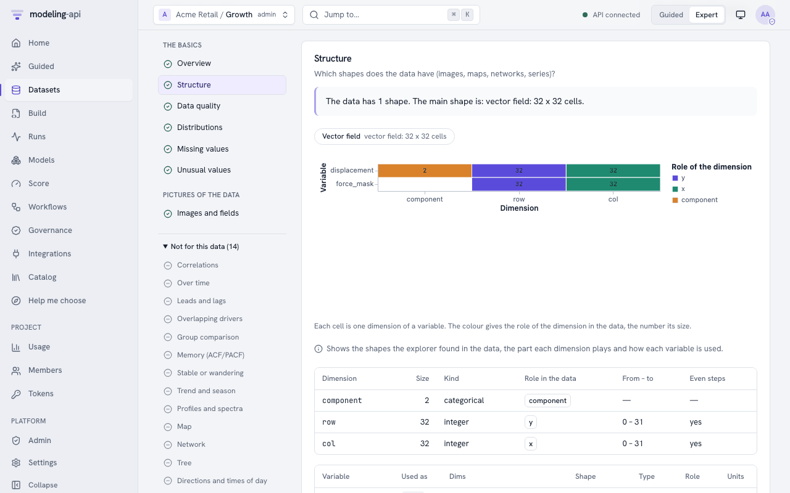
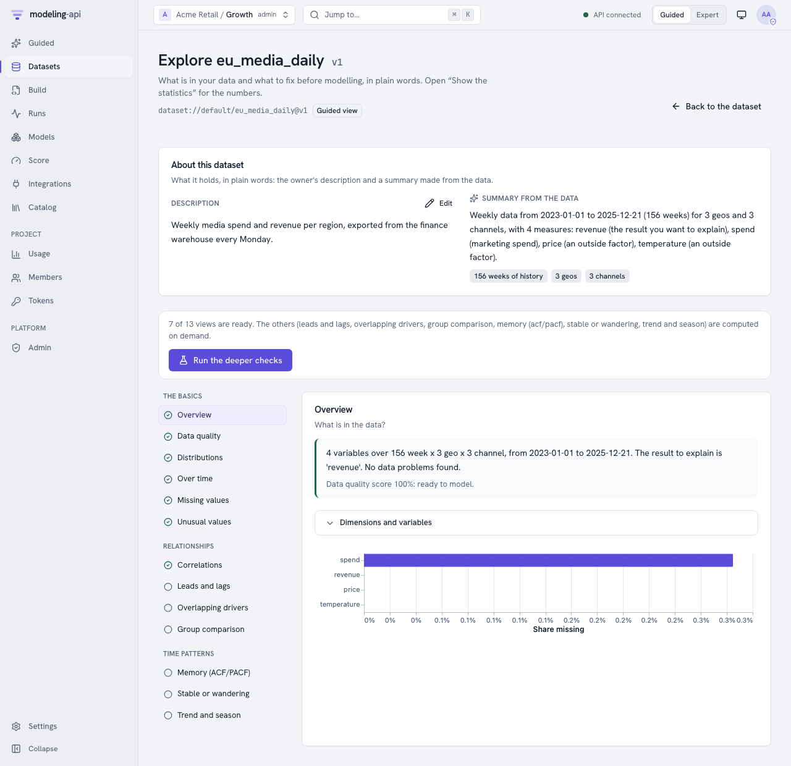
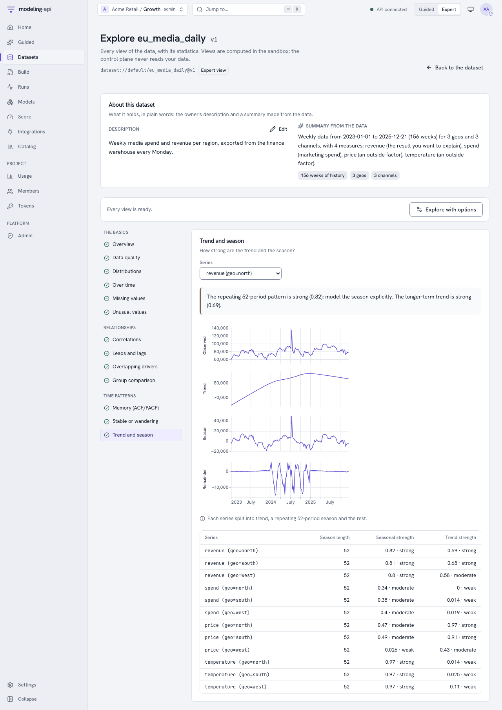
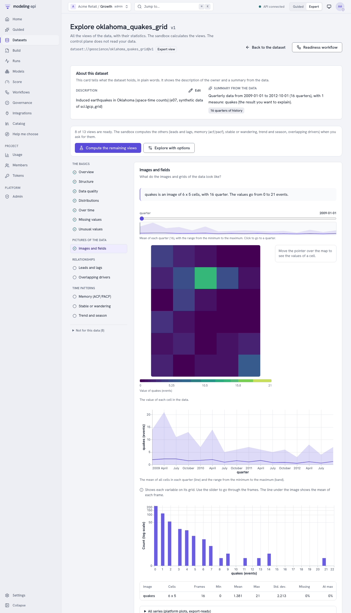
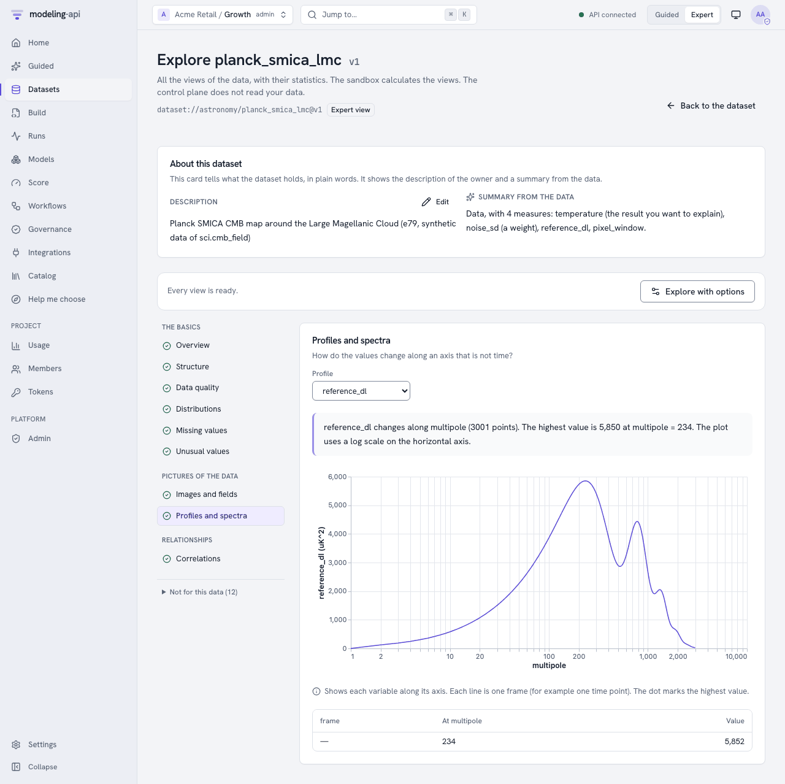
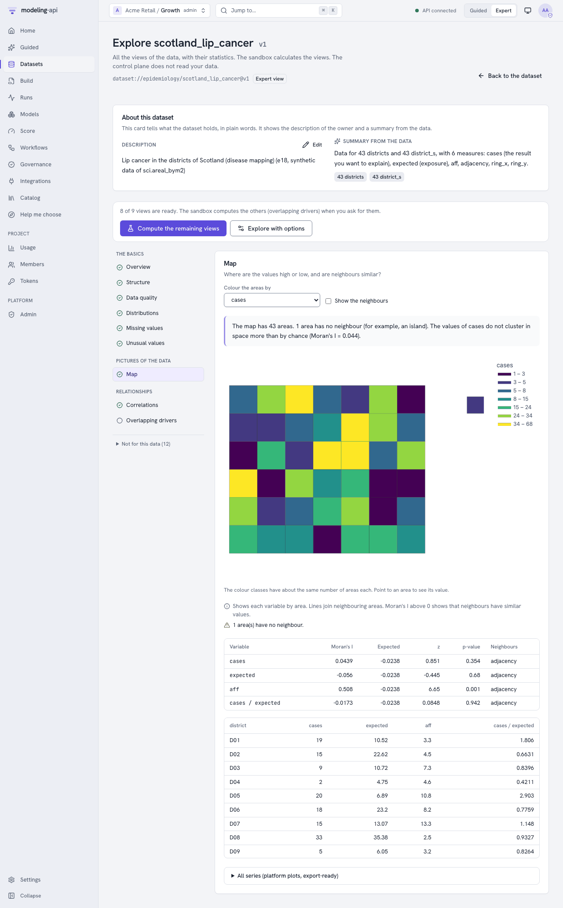
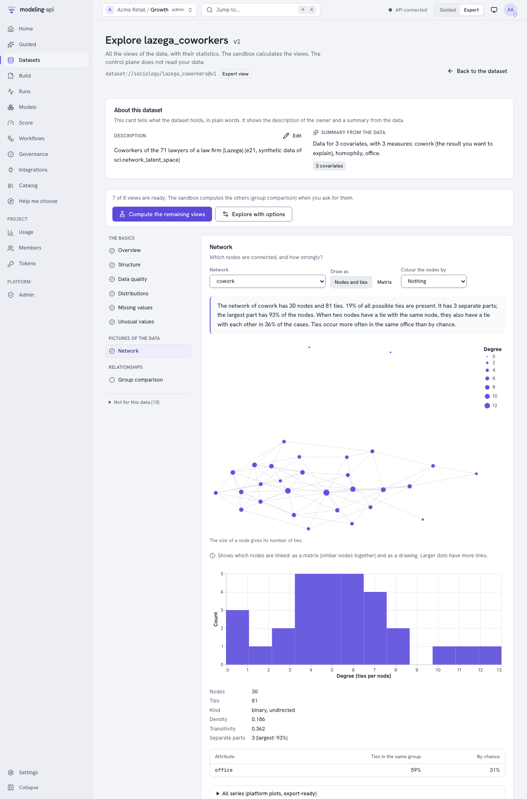
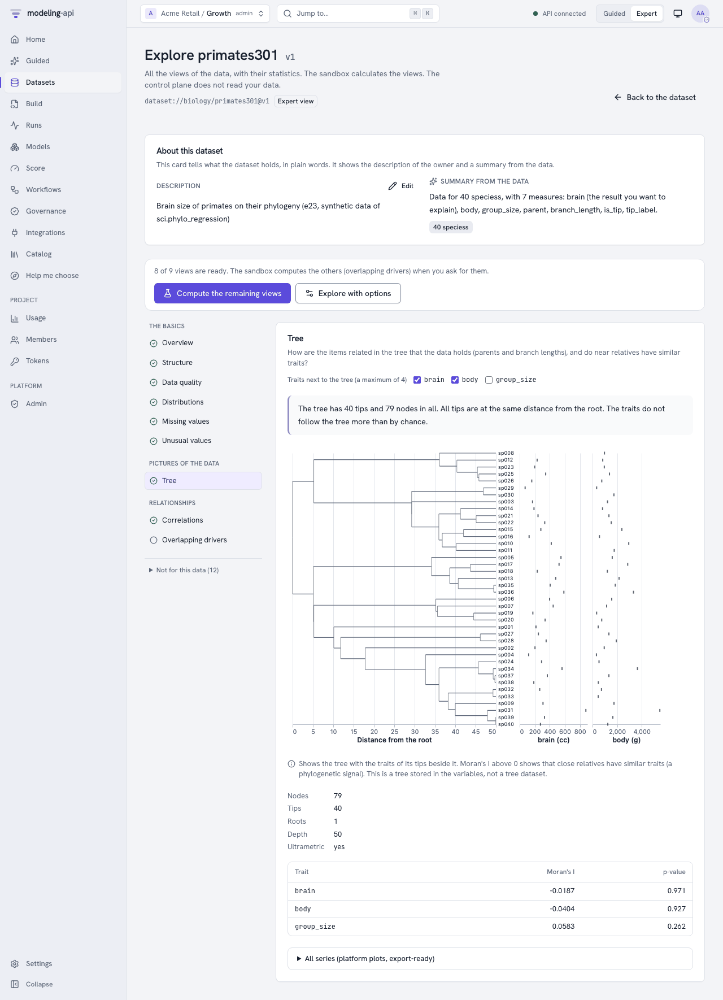
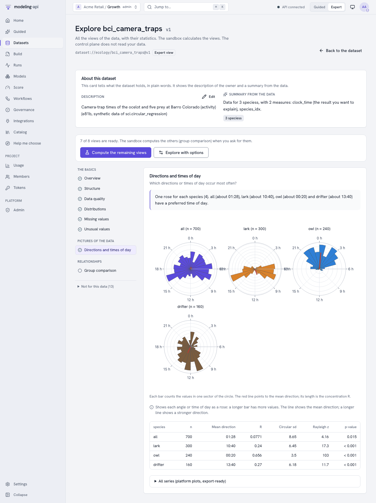
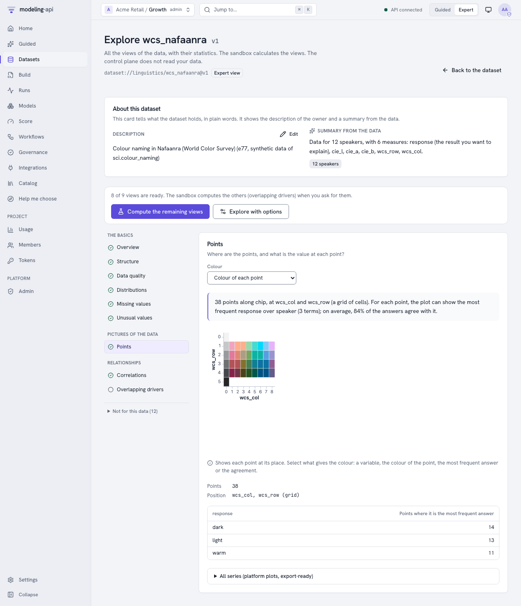

# Explore a dataset <span class="mapi-badge">v0.5</span>

The **Data Explorer** answers the questions to ask before you fit a model. It answers these
questions:

- What is in the data, and how does it move over time?
- What is the shape of the data: series over time, images, a map, a network, a tree or
  directions?
- Where are values missing or unusual?
- Which drivers move with the result, and with how much delay?
- Do series wander, or do they return to a level?
- How strong is the season?
- Which drivers overlap?
- What must you correct first?

The sandbox calculates each view. The control plane never reads your data. Each view comes
with Vega-Lite plots and captions in plain language. The [web app](#in-the-web-app) shows
all views. The other parts of this guide use the HTTP API, which the web app calls.

## In the web app

1. Open a dataset.
2. Click **Explore this version**. Alternatively, go to
   `/datasets/<dataset>/versions/<n>/explore`.

The page starts with the [About](#dataset-about) of the dataset. It has 21 sections in four
groups:

- *The basics*: overview, structure, data quality, distributions, over time, missing values
  and unusual values.
- *Pictures of the data*: images and fields, profiles and spectra, map, network, tree,
  directions and times of day, and points. Refer to [Scientific data](#scientific-data).
- *Relationships*: correlations, leads and lags, overlapping drivers and group comparison.
- *Time patterns*: memory (ACF/PACF), stable or wandering, and trend and season.

The list shows only the sections that apply to the data. The structure of the data sets the
sequence of the sections. Thus a dataset of images starts with **Images and fields**, and a
weekly panel starts with the overview and **Over time**. The sections that do not apply go in
the closed list **Not for this data** below the other sections. Open this list to see each of
these sections and the reason. A link to one of these sections (`?section=`) continues to open
it.

{ .mapi-shot }

A tick marks a section that is ready. An empty circle marks a section that the platform
calculates when you ask for it. A dash marks a section that cannot show a result for this
data, for example because a series is too short. The dash shows the reason.

!!! note "Datasets from an earlier release"
    The index of a version that you ingested before this change does not give the reasons.
    For these versions, the list shows the thirteen sections of the earlier releases. Click
    **Run the deeper checks** (Guided) or **Compute the remaining views** (Expert) to add the
    new sections.

{ .mapi-shot }

- **Guided mode** shows the plain summary of each section first ("4 series return to a stable
  level, 3 series wander (model their changes)…"). To see the numbers, click
  *Show the statistics*. **Run the deeper checks** calculates all the sections that the
  ingest did not calculate. It uses sensible defaults (the target of the dataset as the KPI).
- **Expert mode** shows all statistics: test statistics and p-values, quantiles, VIFs and
  the condition number, and the significant lags. It also shows *All series*: the plots of
  the platform that are ready for export (`ui/explore/plots/<section>.json`).
  **Explore with options** sets the request of the run. The request contains the sections,
  the KPI and the dimensions that split the series. It also contains the lags, the season
  length, α, the correlation and outlier methods, and prewhitening.
- Pickers select the variable or series that a plot shows. Examples are one line for each
  market, the STL decomposition of a series, or the cross-correlation of a driver with the
  KPI. The plots render in the isolated plot sandbox, as all plots do.
- A section that is not calculated yet has a **Compute it now** button. This button starts
  an explore run for this section and for the other missing sections. The id of the run goes
  in the address (`?run=`). Thus you can share or reload the page. If you ask again with the
  same options, the platform answers immediately from the cached run.

{ .mapi-shot }

{ .mapi-shot }

## From Python and the command line

```python
--8<-- "client_v05_more.py:data-explorer"
```

```bash
mapi explore dataset dataset://growth/weekly_sales@latest \
  -s overview -s stationarity -s ccf -s stl --kpi sales --out views/
mapi explore dataset weekly_sales --show quality      # one view as JSON
```

## Views written at ingest

Each ingest writes the quick sections next to the dataset: `overview`, `distributions`,
`timeseries`, `missingness`, `outliers`, `correlation` and `quality`. It also writes
`structure` and each [picture section](#scientific-data) that applies to the data. Get the
index, and then any view, through the artifact route:

```bash
api "$API/v1/datasets/$DATASET_ID/versions/1/artifacts/ui/explore/index.json"
api "$API/v1/datasets/$DATASET_ID/versions/1/artifacts/ui/explore/quality.json"
```

Each answer is a signed link (`ArtifactLink`) to the JSON view. The index lists each section
with its `status`:

- `ok`.
- `skipped`, with the reason in plain words. An example is "the data has no time
  dimension". The field `reason` gives the type of reason:
    - `not_applicable`: the section is not for this data. The web app puts the section in
      **Not for this data**.
    - `insufficient_data`: the section applies, but the data is too small. An example is a
      series with fewer than 16 periods.
    - `needs_option`: the section needs an option of the request.
- `error`.

The index also gives `shapes` (the data shapes that the explorer found, see
[How the explorer finds the structure](#how-the-explorer-finds-the-structure)) and `order`
(the sections in the sequence that the web app shows them). An index without these fields
comes from an earlier release.

The plots for a section are at `ui/explore/plots/<section>.json`. This file is a list of
PlotSpecs to render in the plot sandbox.

**Tree datasets** <span class="mapi-badge">v0.8</span>. For a
[tree dataset](tree-data.md), `ui/explore/` holds the views of the default node: the root, or
the first node with variables. The views of each node with variables are under
`ui/explore/nodes/<slug>/`, where the slug is `~root` for the root, or the node path with `~`
in place of `/` (`sales~weekly` for `/sales/weekly`). `ui/explore/nodes/index.json` gives the
default node and the index of each node. An explore run takes `"node": "/sales"` in its
request. The default is the default node.

## Everything else, on demand

The heavier sections run as an **explore run**. These sections are `stl`, `stationarity`,
`ccf`, `acf_pacf`, `vif` and `groups`. All sections with other options also run as an
explore run:

```bash
api -X POST "$API/v1/datasets/$DATASET_ID/versions/1/explore" -d '{
  "sections": ["stationarity", "stl", "ccf", "vif"],
  "kpi": "revenue",
  "facet_by": ["geo"],
  "max_lag": 12,
  "prewhiten": true
}'
```

The answer (`202`) is an `Exploration` with the run. Poll `GET /v1/explorations/{run_id}`.
When the state is `done`, it holds the `index` and a signed link for each view. If you ask
again with the same request, the platform answers `200` from the last run. Thus, after the
platform calculates the explorers one time, they are instant.

| Option | Default | Meaning |
|---|---|---|
| `sections` | all 21 | The sections to calculate |
| `vars` | each numeric variable | The variables to include |
| `kpi` | the target variable | The result that the cross-correlations use |
| `time_dim` | the time dim of the schema | The dimension that "over time" means |
| `facet_by` | none (each series) | A maximum of two dims that split the series. For spend, media and the target, the platform adds the other dims. For all other variables, it calculates the average. |
| `group_by` | the first categorical dim | The dim that `groups` compares |
| `max_lag` | 26 | The lags for ACF/PACF and cross-correlations |
| `period` | from the frequency (52 weekly, 12 monthly, 7 daily) | The season length for STL |
| `alpha` | 0.05 | The significance level of the tests |
| `correlation` | `pearson` | Or `spearman` |
| `outliers`, `outlier_threshold` | `mad`, 3.5 | The robust score (`mad`, `iqr` or `zscore`, all on a standard-normal scale) and its threshold |
| `prewhiten` | true | Filter the two series with the own AR model of the driver before the cross-correlation. To see the raw correlations, turn it off. |
| `max_series` | 50 | The number of series in each view. The platform counts the other series as omitted. |
| `hints` | none | Corrections to the structure that the explorer finds. Refer to [Correct the structure](#correct-the-structure-hints). |

## The sections

| Section | What you see | Read it like this |
|---|---|---|
| `overview` | Dims, variables, roles, the fraction of missing values, a summary and a quality score | "104 weeks for 3 markets; 2 data problems to look at." |
| `distributions` | For each variable: histogram, mean, spread, skew, quantiles and fraction of zeros | Heavy tails or many zeros can need a transform or a different likelihood. |
| `timeseries` | Each variable over time, in facets | It is easier to see breaks, level shifts and gaps than to test for them. |
| `missingness` | A heatmap of the fraction of missing values by variable and period, and the longest gap | You cannot impute long gaps reliably. |
| `outliers` | Values that are far from the typical value, with their coordinates | Are they errors or real events? For real events, add a control variable. |
| `correlation` | The correlation matrix with p-values | It is difficult to separate drivers that move almost together. |
| `ccf` | The correlation of each driver with the KPI at each lag. A positive lag means that the driver leads. | A peak at lag 2 means that the effect shows two periods later. Prewhitening is on by default. The significance band uses the formula of Bartlett for two autocorrelated series. Thus the platform does not flag two smooth but unrelated series at half of their lags. |
| `acf_pacf` | Autocorrelation and partial autocorrelation with the significance band, and suggested AR/MA orders | Bars outside the dashed band are more than chance. |
| `stationarity` | ADF and KPSS for each series, with one verdict | `stable`, `difference` (it wanders: model the changes), `trend_stable` or `unclear` (the tests do not agree: look at the plot). |
| `stl` | Trend, season and remainder, with their strengths (0 to 1) | If the seasonal strength is more than about 0.6, model the season explicitly. |
| `vif` | The variance inflation for each driver, and the condition number | Above 10, the model cannot identify the separate effect of the driver well. |
| `groups` | Each variable across markets or stores, with an ANOVA or Kruskal-Wallis test | Very different groups can need a hierarchical model. |
| `quality` | Warnings in plain language, the most serious first. Each warning has a suggested action. | Correct errors before you model. Look at the warnings. |

The `data.quality` governance check also counts the quality warnings (see
[Validate models with governance policies](governance.md)).

The sections for images, maps, networks, trees, directions and points are in
[Scientific data](#scientific-data).

## Scientific data

The Data Explorer is not only for data over time. It also shows images, fields on a grid,
profiles and spectra, maps of areas, networks, trees, directions, times of day and points.
The datasets of the [pymc-challenges tutorials](../tutorials/pymc-challenges/index.md) are
examples of each shape. Each tutorial has a step "Explore the data" that tells you what to
look at.

### How the explorer finds the structure

The runner finds the structure from the dims, the coords, the roles and the units of each
variable. You do not give settings. For each dataset, and for each node of a tree dataset, the
runner finds one or more *shapes*. The section **Structure** shows the shapes, the role of
each dim and how the explorer uses each variable. The overview shows each shape as a link to
its section.

| Shape | The explorer finds it when | Example | Section |
|---|---|---|---|
| Image or field | A variable has two spatial dims: `row` and `col`, `y` and `x`, `lat` and `lon`, also with a prefix or a suffix (`y_cm`, `psf_row`). Else, the last two dims of the variable have numeric coords. Another dim of the variable gives the frames. | E07 `quakes` on `quarter`, `row` and `col`: one frame for each quarter | Images and fields |
| Vector field | An image has a dim of two components (`x` and `y`, or `u` and `v`) | E60 `displacement` | Images and fields |
| Profile or spectrum | A variable is on a numeric dim with five or more values that is not time | E50 `cells` along `position`, one line for each hour. E79 `reference_dl` along `multipole`. | Profiles and spectra |
| Map of areas | The variables `ring_x` and `ring_y` on (area, vertex) give the border of each area. A variable on (area, area_) gives the neighbours. | E18, 56 districts | Map |
| Network | A numeric variable is on two dims of the same size, `X` and `X_` | E21 `cowork` on `lawyer` and `lawyer_` | Network |
| Tree | An integer variable `parent` gives the parent of each node (−1 for the root) | E23, 452 nodes and 186 species | Tree |
| Directions and times of day | The units of a variable are degrees, radians, hours of the day or days of the year, or the variable has the attribute `circular` | E81 `wind_from` (deg), `clock_time` (h) | Directions and times of day |
| Points | Two numeric variables on one dim have names for x and y (`x`, `col`, `lon`, `east` and `y`, `row`, `lat`, `north`, also with a prefix such as `wcs_`) | E77 the 330 colour chips at `wcs_col` and `wcs_row` | Points |
| Table | A numeric variable is on (item, column), with 64 columns or fewer and 30 items or more | E19 `level` on `cell` and `protein` | Correlations (one column for each protein) |
| Time series | A dim has `kind: time` in the schema, or its coords are dates | A weekly panel | Over time and the time patterns |
| Sequence | A dim has `policy: extend`, and its coords are numbers that increase. The dim is not a list of ids. | E61 `t` | Over time |

Some variables are not data. The explorer uses them to draw the pictures, but it does not
use them in the statistics (distributions, unusual values, correlations and quality):

- Geometry: `ring_x`, `ring_y` and the neighbour matrix of a map, `parent`, `branch_length`,
  `is_tip` and `tip_label` of a tree, and the positions of points (`wcs_row`, `wcs_col`).
  The empty values (NaN) at the end of a border are not missing values.
- Masks (the role `mask`). The images show a mask as a layer on the image.
- Weights (the role `weight`) are images of their own.

### The sections for scientific data

| Section | What you see | Read it like this |
|---|---|---|
| `structure` (Structure) | The shapes. A matrix of the variables and the dims, with the role of each dim (time, frame, y, x, area, node and other roles) and its size. How the explorer uses each variable: data, geometry, mask, weight, index or label. The section that shows each shape. | "2 images of 81 x 81 pixels and 1 of 31 x 31 pixels." If the explorer reads a dim incorrectly, [correct the structure](#correct-the-structure-hints). |
| `images` (Images and fields) | Each image in the field viewer, with a colour bar, a frame slider and the value of the cell below the pointer. A vector field shows the magnitude and arrows. A mask shows as a layer. For each variable: the mean, the spread, the minimum and the maximum of each frame on a line, a histogram of all cells, and the fraction of missing and saturated cells. For a label coord on the frames (E31 `label`), the mean image of each class. | Look for frames that are not the same as the others, and for many cells at the maximum value (a saturated detector). A colour map with two colours (blue and red) shows values on the two sides of zero. |
| `profiles` (Profiles and spectra) | One line for each frame along the axis (position, multipole, wavelength or frequency), with the peak of each line. A picker selects the frame. The axes are logarithmic when the values cover a large range. | A peak that moves from frame to frame shows a front or a wave (E50). |
| `map` (Map) | Each variable in colour on the areas, and the lines between neighbours. When the data has a target and an exposure, the map also shows their ratio (E18: `cases` / `expected`). The areas with no neighbour. Moran's I for each variable, with a p-value from 999 permutations. | A positive Moran's I with a small p-value shows that neighbour areas have similar values. Then a spatial model (ICAR or BYM2) is useful. |
| `network` (Network) | The matrix of ties, with similar nodes next to each other (140 nodes or fewer). A drawing of the nodes and the edges. A histogram of the degree of the nodes. The density, the transitivity, the reciprocity (directed networks) and the components. For each attribute of the nodes, the fraction of ties in the same group. | Blocks on the diagonal of the matrix show groups. If the fraction of ties in the same group is much more than the expected fraction, the attribute explains the ties (homophily). |
| `tree` (Tree) | The tree, with the traits of the tips next to it. The number of nodes and of tips, the depth, and if all tips are at the same distance from the root. How the explorer matched the tips to the traits: by label, by count or by sequence. The phylogenetic signal of each trait (Moran's I with the inverse distance on the tree, 999 permutations). | A small p-value shows that near species have similar traits. Then a model that uses the tree is necessary (E23). |
| `circular` (Directions and times of day) | A rose for each group, with the mean direction as a line of length R. The circular spread and the Rayleigh test. For two circular variables on one dim (E81 the hour and the wind direction), a heat map of the two and their circular correlation. | A small Rayleigh p-value shows a preferred direction or time. R near 1 shows values near one direction. R near 0 shows values in all directions, or in opposite directions. |
| `points` (Points) | The points, or the cells of a lattice. A picker sets the colour: the colour of a CIE Lab triple, the most frequent answer, the agreement of the answers, or a numeric variable. For points that are not on a lattice, the Clark-Evans R. | R less than 1 shows clusters. R more than 1 shows points at regular distances. For E77, the agreement shows where the speakers do not agree on the name of a colour. |

{ .mapi-shot }

{ .mapi-shot }

{ .mapi-shot }

{ .mapi-shot }

{ .mapi-shot }

{ .mapi-shot }

{ .mapi-shot }

In Expert mode, *All series* also shows the export plots of the science plot recipes: the
map (`sci.area_map`), the network (`net.graph`) and the roses (`sci.rose`). These plots are
Plotly plots. The other export plots are Vega-Lite plots.

### The time sections on scientific data

The explorer uses the time sections only when the data has a real time dim:

- A dim is time only when the schema gives `kind: time`, or when its coords are dates.
- A dim with `policy: extend` is a sequence only when its coords are numbers that increase,
  and the dim is not a list of ids. A list of observations (`report` in E81, `record` in
  E81b) is never time.
- **Over time** shows a time or a sequence dim. For an image with frames in time, the
  explorer adds (or averages) all cells of each frame to make one series. It does not make a
  series for each cell. E07 gives one series: the earthquakes in all cells for each quarter.
- **Memory (ACF/PACF)**, **Stable or wandering**, **Trend and season** and **Leads and lags**
  need a time dim and 16 periods or more in each series.
- **Group comparison** compares only real groups: a categorical dim with 2 to 50 levels, or a
  variable that gives a group (an index with `index_of`, or an integer variable with 12 values
  or fewer). It never compares rows of pixels, cells, nodes or ids.
- **Correlations**, **Distributions** and **Unusual values** use the dim with the most data
  variables. For E23, these sections use the traits `brain`, `body` and `group_size` of the
  species, not the tree. For E19, the correlations use the 11 proteins as columns.
- **Missing values** without a time dim shows the frames of an image, or the units of the
  data (areas, species, nodes).
- **Data quality** does not give `SHORT_HISTORY` for data without a time dim. It has new
  warnings: `GEOMETRY_INVALID` (an area without a border, or a border that is not closed),
  `TREE_INVALID` (a cycle, more than one root, or a negative branch length),
  `NETWORK_ASYMMETRIC` (information: the ties are directed), `ANGLE_RANGE` (values out of the
  period) and `IMAGE_SATURATED` (1 % of the cells or more at the maximum value).

!!! note "A change for data with `policy: extend`"
    In earlier releases, the explorer used each dim with `policy: extend` as time. Now a list
    of ids (coords 0 to n−1, or no coords) is not time. If your data uses such a dim as
    time, give `time_dim` in the request.

### The Tree section and tree datasets

The section **Tree** shows a tree that is in the data, for example the variables `parent`
and `branch_length` of a phylogeny. A [tree dataset](tree-data.md) is a different thing: it
is a dataset with nodes (HDF5 groups), and the node picker (`?node=`) selects one node. The
explorer finds the shapes of each node of a tree dataset separately.

### Correct the structure: hints { #correct-the-structure-hints }

If the explorer reads a dim or a variable incorrectly, give hints. In the web app, open
**Explore with options** (Expert mode) and set the fields under **Shape of the data
(hints)**. Through the API, give the
field `hints` of the request:

```bash
api -X POST "$API/v1/datasets/$DATASET_ID/versions/1/explore" -d '{
  "hints": {
    "y_dim": "lat",
    "x_dim": "lon",
    "frame_dim": "month",
    "angle_vars": {"heading": "deg"}
  }
}'
```

| Hint | Meaning |
|---|---|
| `y_dim`, `x_dim` | The two dims of the image. Give the two hints together. |
| `frame_dim` | The dim that gives the frames of the images |
| `node_dim` | The dim of the nodes of a network |
| `angle_vars` | Variables that are angles or times, with their units: `deg`, `rad`, `h` (hour of the day), `d` (day of the year) or `month` |
| `time_dim` | The dim that is time. If the request also has `time_dim`, the two values must be the same. |

A hint changes only the variable or the dim that it names. The other rules stay the same.

## Dataset About

`GET /v1/datasets/{dataset_id}/about` describes the latest version in plain words. It uses
the schema and the coordinates of the version ("Weekly data from 2023-01-01 to 2024-12-29 (104
weeks) for 10 markets …"). The response also shows the own description of the owner. `PATCH`
changes that description:

```bash
api -X PATCH "$API/v1/datasets/$DATASET_ID/about" \
  -d '{"description_user": "Weekly media spend and revenue from the finance warehouse."}'
```

In the web app, the dataset page and the Data Explorer show the two descriptions next to each
other (*About this dataset*). Editors change the description on the page with **Edit**.

## Notes

- Views have limits. The maximums are 200 series in each view, 5,000 points in each series,
  256 variables and 200 lags. The platform thins longer series evenly and flags them
  `downsampled`.
- The picture sections also have limits:

    | View | Maximum |
    |---|---|
    | Images and fields | 8 images, 160 × 160 cells in each frame (for a larger image, the platform shows the mean of blocks of cells), 24 frames, 1,000,000 cells in the view. The statistics of each frame cover up to 5,000 frames. The mean image of each class covers up to 12 classes. |
    | Profiles and spectra | 60 lines in each profile, 5,000 points in each line |
    | Map | 2,000 areas, 20,000 border points in all (the platform keeps each k-th point of a border, and the first and the last point), 20,000 neighbour lines |
    | Network | 300 nodes in the drawing (the nodes with the highest degree), 140 nodes in the matrix, 3,000 edges (the strongest) |
    | Tree | 5,000 nodes. The phylogenetic signal uses up to 1,000 tips. |
    | Directions and times of day | 72 bins, 12 groups |
    | Points | 5,000 points (an even sample). Above this number, the view also has a 64 × 64 grid of counts. |
- The statistical tests come from statsmodels and scipy. The test suite validates them
  against their reference outputs.
- Strings in views come from your data. Render them only as text.
