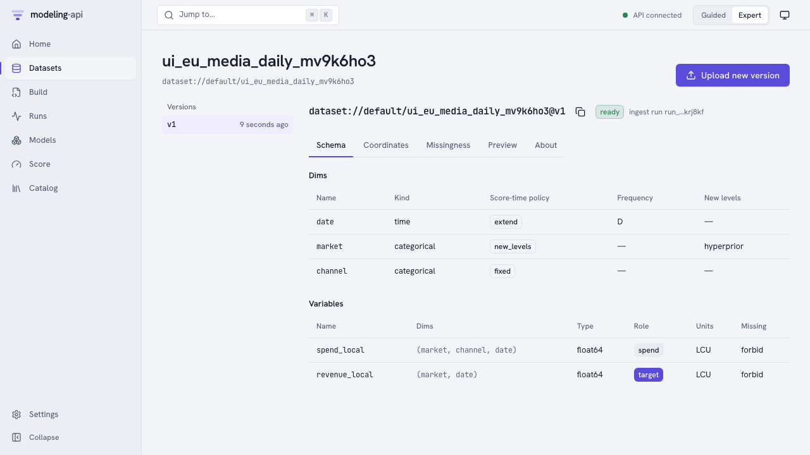
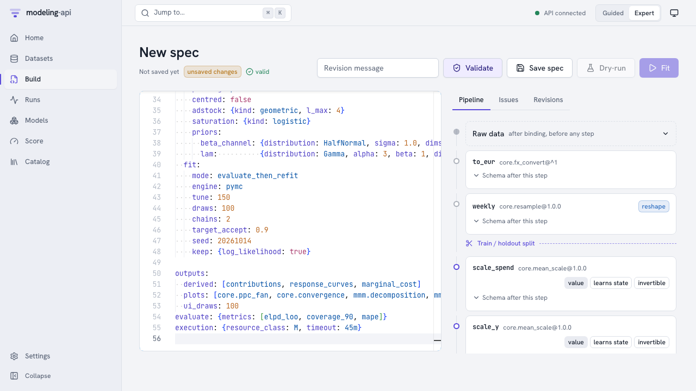
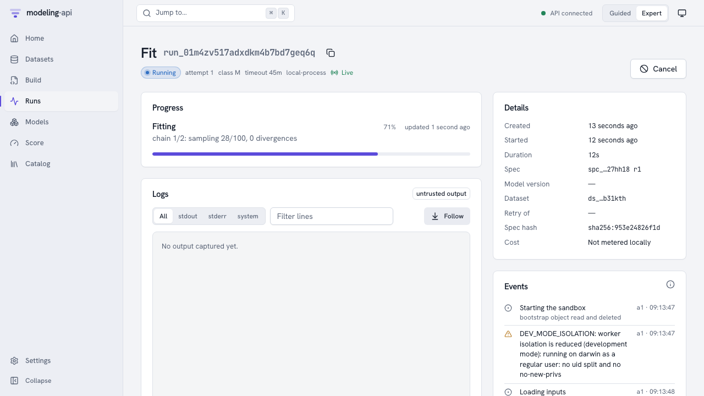
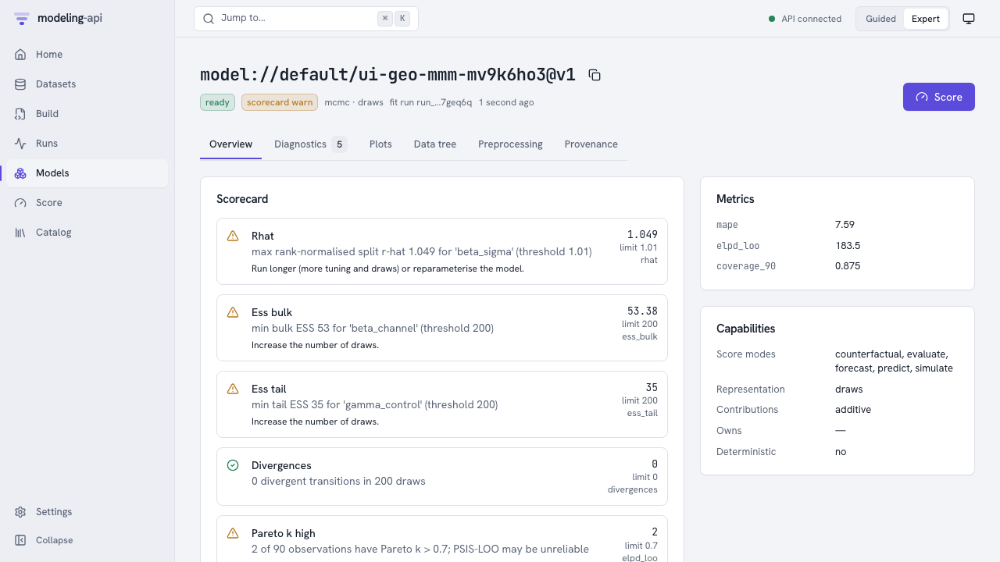
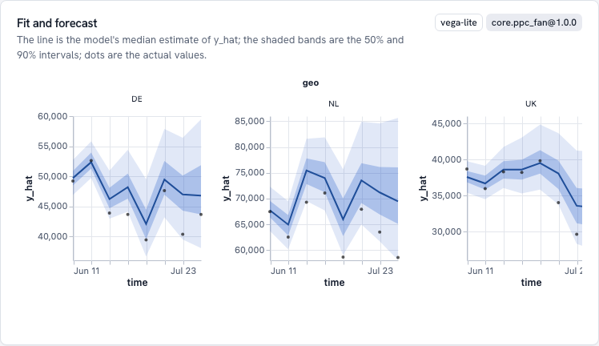
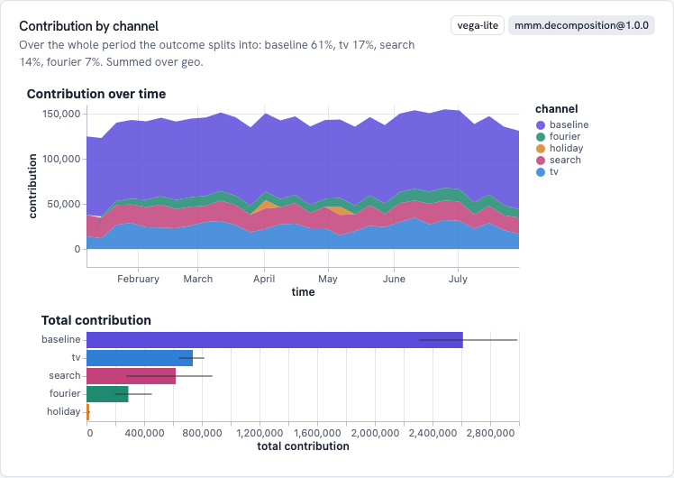
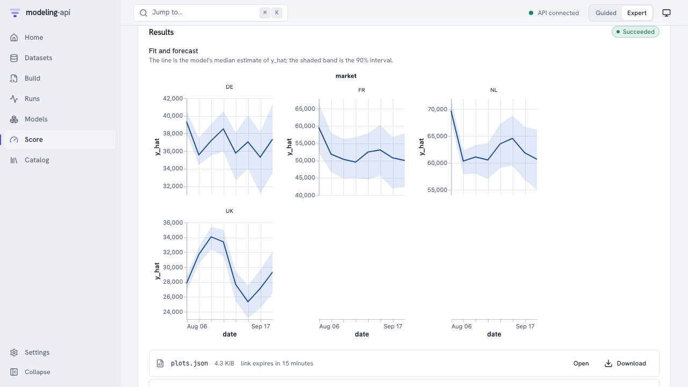

# Your first model in the web app <span class="mapi-badge">v0.2</span>

This guide fits a hierarchical geo marketing-mix model (the corpus' E33 example) on the
local stack and then uses it, entirely from the browser:

1. upload daily spend and revenue per market and channel, an FX table and a holiday table;
2. paste the model spec into the editor and let it validate as you type;
3. fit it and follow the sampler live;
4. read the sanity scorecard, the posterior predictive check and the channel decomposition;
5. score an 8-week forecast, a market the model has never seen, and a weekly budget in EUR.

It takes about ten minutes, most of it reading. The fit itself uses tiny sampler settings
and finishes in under a minute on a laptop.

## Before you start

Start the stack and leave it running ([Local development](../operations/local-development.md)):

```bash
make install
make dev                      # PostgreSQL, GCS shim, API, worker, web app, plot sandbox
open http://127.0.0.1:5173
```

!!! tip "Port 8000 taken?"
    Move the API with `export MAPI_API_URL=http://127.0.0.1:8010` before `make dev`. Every
    other command in this guide (`make seed`, `make e2e`) reads the same variable. The other
    three ports move the same way; see [Port conflicts](../operations/troubleshooting.md#port-conflicts).

This guide clicks through every step, including the uploads. For the short path (`make seed`
loads the data and the spec for you) see the [quickstart](../getting-started/quickstart.md);
for every page of the app, [The Expert web app](web-ui.md).

Then write the demo files to a folder. Nothing is uploaded yet:

```bash
uv run python scripts/seed.py --export demo/
```

| File | What it is | Upload it as |
|---|---|---|
| `eu_media_daily.zarr.zip` | 30 weeks of daily `spend_local(market, channel, date)` and `revenue_local(market, date)` for NL, DE and UK (UK in GBP) | `eu_media_daily` |
| `fx_daily.zarr.zip` | Daily EUR per GBP, covering the fit window and the forecast horizon | `fx_daily` |
| `holidays_eu.zarr.zip` | A daily holiday indicator | `holidays_eu` |
| `eu_media_future.zarr.zip` | Planned daily spend for the 8 weeks after the data (no revenue) | `eu_media_future` |
| `eu_media_future_fr.zarr.zip` | The same weeks plus FR, a market the model has not seen | `eu_media_future_fr` |
| `eu_media_weekly_plan.zarr.zip` | A planner's budget: weekly spend in EUR | `eu_media_weekly_plan` |
| `eu_media_window.zarr.zip` | The last four weeks of the data, for counterfactuals | `eu_media_window` |
| `eu-geo-mmm.yaml` | The model spec, pointing at `dataset://default/<name>@latest` | (paste it) |

`make seed` does steps 1 and 2 for you through the HTTP API. This guide clicks through them.

## 1. Upload the data

Open **Datasets → New dataset**, name it `eu_media_daily` and create it. The upload panel
opens: choose `eu_media_daily.zarr.zip` and press **Upload and ingest**. The browser sends
the file straight to object storage through a signed URL; a sandboxed *ingest* run then
opens it, checks it and stores an immutable, content-addressed version. The page refreshes
on its own until the version is `ready`.



The schema came with the file: `market` allows **new levels** at score time (with a
hyperprior), `channel` is **fixed**, and `date` may be **extended** into the future.
`revenue_local` is the target, `spend_local` is spend, both in local currency. A CSV upload
would ask you for the same mapping column by column.

Repeat for the other six files, using the names in the table above.

## 2. Write and validate the spec

Open **Build → New spec**, select everything in the editor and paste `eu-geo-mmm.yaml`.
The editor validates as you type: the server resolves every `dataset://` reference and step,
checks the settings and propagates the schema through the pipeline without running
anything. Problems appear as squiggles at the exact YAML path.



The pipeline panel shows what each step does to the data. `to_eur` converts both spend and
revenue to EUR with the `fx` side table, `weekly` resamples days to weeks (only from this
stage on does a week exist, so the train/holdout split sits right after it), and
`scale_spend`, `scale_y` and `lags` learn state from the training weeks only. Open
**Schema after this step** on any card to see the variables and dims at that stage.

Press **Save spec**. The spec becomes revision `r1` of `spec://default/eu-geo-mmm`. (If you
ran `make seed` before, that name is taken: change `metadata.name` first, or open the
seeded spec under **Build** instead.)

## 3. Fit it

Press **Fit**. The run page follows the run over server-sent events:



- **Starting the sandbox**: the run's supervisor read its one-time bootstrap object and
  deleted it, so the credentials it held are gone before any model code runs.
- `DEV_MODE_ISOLATION` is expected on a laptop: the local executor cannot drop to a separate
  user for the model code. Containers and Cloud Run do.
- The progress bar and message come straight from the sampler (`chain 1/2: sampling
  39/100`).

`fit.mode: evaluate_then_refit` makes the run fit the training weeks, score the 8 holdout
weeks through the normal scoring path, then refit on all the data, so the model you use
has seen the latest weeks while its metrics are honest. When the run succeeds, the
platform checks every file the run claims to have written against the storage's own
checksums, copies them where the run cannot reach, and signs a manifest. Press
**Inspect model://default/eu-geo-mmm@v1**.

## 4. Inspect the model

The **Overview** tab opens on the sanity scorecard, the holdout metrics and what the model
can do.



With 2 chains of 100 draws the sampler has not converged: R-hat above 1.01 and fewer than
200 effective samples are flagged as warnings, each with a suggested action. That is the
point of the tiny settings; raise `tune` and `draws` (and use more chains) for a model you
mean to use. **Diagnostics** lists the same checks per variable.

**Plots** has the recipes the spec asked for. Every plot renders inside an
`<iframe sandbox="allow-scripts">` served from a separate origin (port 5174), so even a
malicious plot spec could not read the app, its cookies or your data.



**Fit and forecast** compares the model's predictions for the holdout weeks with what
happened: the line is the median, the bands are the 50% and 90% intervals, the dots are the
actual weekly EUR revenue.



**Contribution by component** splits revenue over time into the baseline, each channel,
seasonality and holidays, in EUR, with the totals and their uncertainty below.
**Response curves** shows what an extra euro of spend returns per channel, and **Sampler
convergence** has the trace and rank plots behind the scorecard. **Provenance** shows the
signed manifest, every stored object with its generation, and the lineage: data and side
table versions, spec hash, plugin, seed and library versions.

## 5. Score it

Press **Score**. The form only offers what this model supports, and the fitted
preprocessing is replayed exactly: nothing is refitted.

**An 8-week forecast.** Keep mode `forecast` with 8 periods along `time`, set **Input data**
to `dataset://default/eu_media_future@v1` and press **Score**. The `fx` side table defaults
to the one the fit used; it covers the horizon, so the planned local-currency spend can be
converted to EUR. The result shows a fan per market, then the outputs: the result tree
(`score.zarr.zip`), its summary as a table, and a quick chart you can re-plot by any column.

**A new market.** Score again with `dataset://default/eu_media_future_fr@v1`. FR was never
seen in training; its effects are drawn from the hierarchical prior over markets, so its
band is visibly wider than the others'. The result's `issues` record an `UNSEEN_LEVELS`
note saying so.



**A weekly plan in EUR.** Planners think in weekly euros, not daily local currency. Set
**Inputs enter at stage** to `weekly` and **Input data** to
`dataset://default/eu_media_weekly_plan@v1`. The request enters the pipeline after `to_eur`
and `weekly`, so no FX table is needed. Because this plan is the same spend as the daily
file, the forecast is identical to the first one, which is exactly what replaying the
preprocessing promises.

**A counterfactual.** Choose mode `counterfactual`, set **Input data** to
`dataset://default/eu_media_window@v1`, add an intervention `spend_local` where
`channel=tv`, multiply by `1.2`, choose **Predictive** output and set **Draws** to `100` (with
0 draws you get the means, but not the uncertainty of the change). The result holds the
baseline, the scenario and their difference, computed with common random numbers so the
delta is not drowned in sampling noise.

## What was checked along the way

The same flow runs as two automated suites against the running stack (`make e2e`):

- `tests/e2e/test_m1_stack.py` drives it through the Python client. It also verifies the
  manifest signature, that every bundle object sits in the bundles bucket at its signed
  generation, that the bundle reads back with all hashes intact, that the bootstrap object
  is gone, and that forged run events are refused.
- `apps/web/e2e/m1-flow.e2e.spec.ts` clicks through the pages above with Playwright and
  checks that the plot frame is an opaque origin with no access to its parent.

## Next steps

- [Marketing-mix models](mmm.md): the model, its priors, derived quantities and budget plots.
- [Spec format](../reference/spec-format.md) and the [steps](../reference/steps.md) used here.
- [Web app and plot sandbox](../reference/web-app.md): every page and how plots are isolated.
