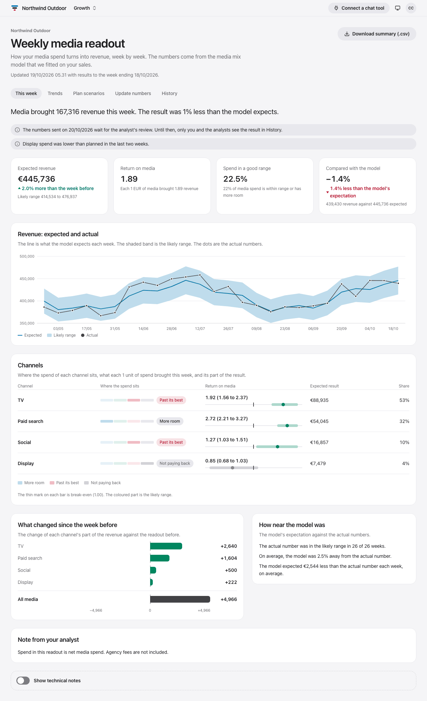
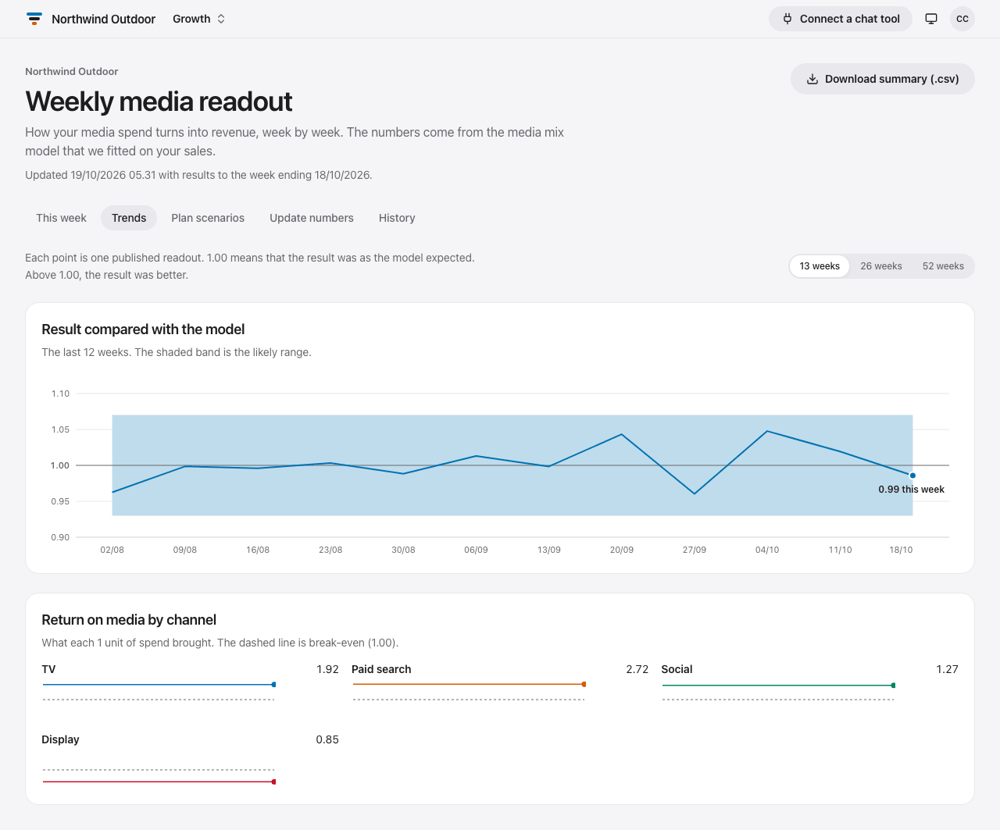
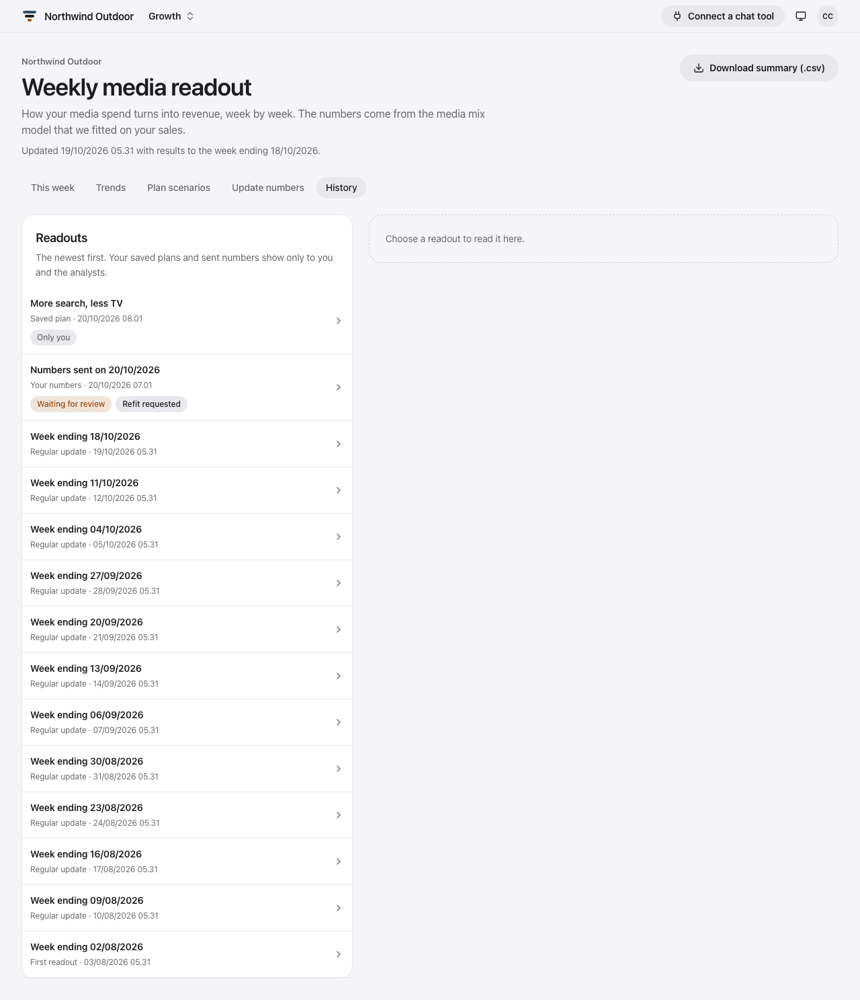

# Read your dashboard

This page is for you if an analyst made a dashboard for you. It tells how to open the
dashboard and what each part shows. You do not need to know statistics.

## Open the dashboard

There are two ways:

- **With an account.** Sign in to the app. The page **Your dashboards** shows the dashboards
  that your analyst gave you. Select one to open it. If you work with more than one team,
  select the team at the top of the page.
- **With a link.** Open the link that you got. If the page asks for a passcode, type the
  passcode that the sender gave you. The page shows "Shared view. The link ends on
  DD/MM/YYYY." at the bottom.

Keep the link private. All persons who have the link can see the dashboard until it ends.

If the page says "This link has ended or was removed. Ask the sender for a new link.", the
link stopped. Ask the person who sent it for a new link.

## This week (or this month)

The first tab shows the latest results.

- **The sentence at the top** tells the main result in one line.
- **The key numbers**:
    - **Expected result**: the result that the model calculates from your media spend and
      the other inputs. The small text shows the likely range.
    - **Return on media**: the result that each 1 unit of media spend brought. For money
      results, a value above 1 means that the media paid back.
    - **Spend in a good range**: the part of your media spend that is within range or has
      more room.
    - **Compared with the model**: the difference between the actual result and the result
      that the model expected. A positive number means that the actual result was better.
- **The chart** shows what the model expects for each week (the line), the likely range (the
  band) and your actual numbers (the dots).
- **Channels** shows each media channel:
    - **Where the spend sits**: **More room** (more spend is still useful), **Within range**,
      **Past its best** (the next unit of spend brings less than it costs) or **Not paying
      back**.
    - **Return on media**, with its likely range. The thin mark is break-even.
    - **Expected result** and **Share** of the media result.
- **How near the model was** tells how often your actual numbers were in the likely range.

The likely range is the range where the model is 90% sure that the true value is.

If your analyst allows it, **Show technical notes** at the bottom shows the model version and
the checks of the model.

## Trends

**Trends** shows the results of the last 13, 26 or 52 weeks. A mark shows when your analyst
updated the model ("Model updated on DD/MM/YYYY").

## Plan scenarios

On **Plan scenarios**, you can try a different spend for each channel.

1. Move the slider of a channel. 1× is the current plan.
2. Read the result at the top and the change for each channel. The result shows at once.
   Nothing runs on the server.
3. To keep the plan, select **Save scenario**. Only you and your analysts see saved
   scenarios.
4. If you see **Get exact result**, select it for a full calculation. This can take up to two
   minutes.

Select **Reset to current plan** to start again. The sliders stop at the range that the
model knows.

## Update numbers

On **Update numbers**, you can send your newest actual numbers.

1. Select **Download template (.csv)**.
2. Fill in the template with your numbers, one row for each week. Do not leave gaps between
   the weeks.
3. Drop the file on the page, or paste the rows.
4. Read the checks. Correct the cells that the page shows in red.
5. Optional: select **Ask the analyst to refit with these numbers**, if you see it.
6. Select **Send**.

The page tells you what happens to your numbers. Usually: "We compare your results with what
the model expected. The model does not change." You see the result at once in **History**.
Usually, other persons see it only after your analyst checks it.

If you asked for a refit, your analyst decides. A refit updates the model with your numbers.
When it is done, a new result shows in **History**.

## History

**History** lists all results, newest first. Your saved scenarios and the numbers that you
sent show only to you and your analysts. Select a result to see it.

## Download

**Download summary (.csv)** at the top saves the key numbers and the channels of the result
that you see.

## If something does not work

| Message | What to do |
|---|---|
| "You reached today's limit for new results. Try again tomorrow or ask your analyst." | Use the sliders. They have no limit. Or ask your analyst |
| "New results are paused. The readouts here stay available. Your analyst is checking the dashboard." | Wait for your analyst. The results that exist stay visible |
| "The link is locked after too many wrong passcodes. Try again in 15 minutes." | Wait 15 minutes. Then type the passcode again |
| "This dashboard is not available. It may have been removed, or it was not shared with you. Ask your analyst." | Ask your analyst to give you access again |
