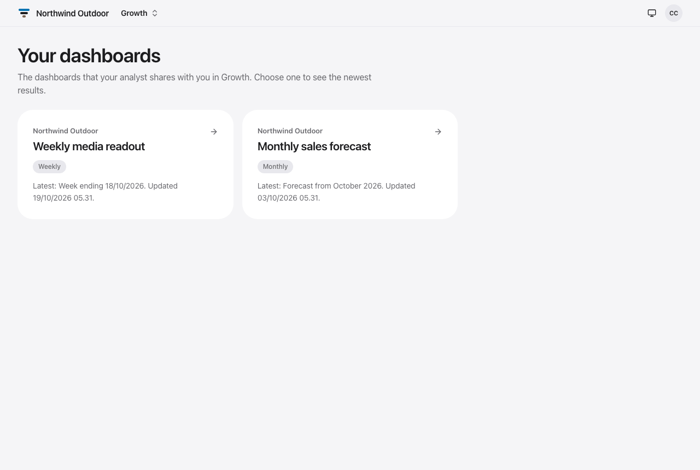
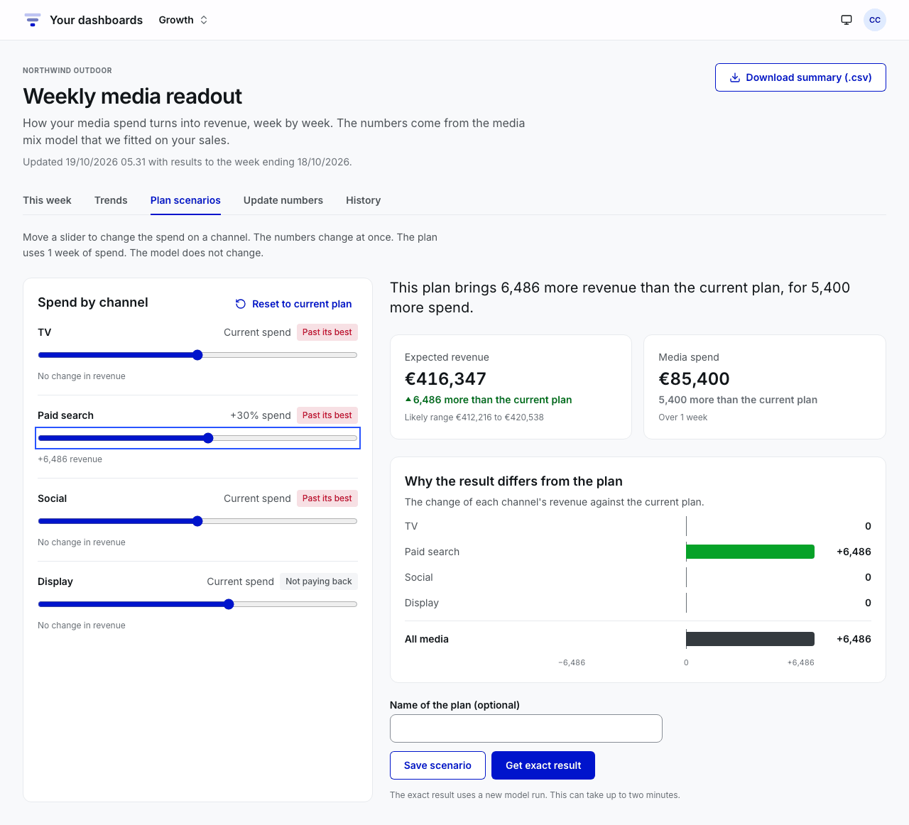
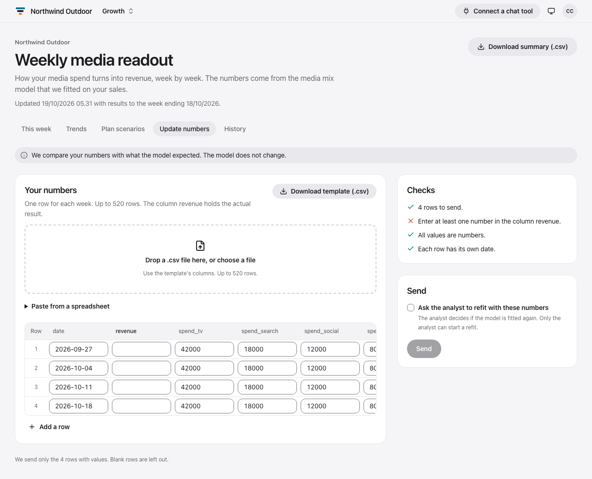

# Read your dashboard

This page is for you if an analyst made a dashboard for you. It tells how to open the
dashboard and what each part shows. You do not need to know statistics.

Dashboards are of two kinds:

- **A dashboard about media spend** (a media planner). It has the tabs **This week** (or
  this month), **Trends**, **Plan scenarios**, **Update numbers** and **History**. See
  [Media spend dashboards](#media-spend-dashboards).
- **All other dashboards**, for example a sales forecast, the chance that a customer
  leaves, a price prediction, the effect of a change or a map. They have the sections
  **Overview**, **Try a case**, **Check accuracy**, **Score a file** and **History**. See
  [Other dashboards](#other-dashboards).

Your analyst chooses which sections you see. If you do not see a section, your analyst did
not turn it on.

## Open the dashboard

There are two ways:

- **With an account.** Sign in to the app. The page **Your dashboards** shows the dashboards
  that your analyst gave you. Select one to open it. If you work with more than one team,
  select the team at the top of the page.
- **With a link.** Open the link that you got. If the page asks for a passcode, type the
  passcode that the sender gave you. The page shows "Shared view. The link ends on
  DD/MM/YYYY." at the bottom.

Keep the link private. All persons who have the link can see the dashboard until it ends.

If the page says "This link has ended or was removed. Ask the sender for a new link.", the
link stopped. Ask the person who sent it for a new link.

## Words on the page

- **The likely range**: the model is 90% sure that the true value is in this range. A
  narrow range means that the model is more sure.
- **Where one new result will probably be**: the range for one new week, one new case or one
  new period. It is wider than the range of the average, because single results vary more.
- **Approximate**: the number is a sum of single values. It has no likely range.
- **Chance of …**: how probable an outcome is, from 0% to 100%.

## A new layout { #a-new-layout }

Some dashboards moved to a new layout. If your dashboard moved, you see this note one
time:

> This dashboard has a new layout. The numbers come from the same model.

The model is the same. The middle numbers are the same. The likely ranges can be wider than
before, because they now show where one new result will probably be. Select **Close** to
hide the note. Older results in **History** keep their old look.

## Other dashboards { #other-dashboards }

### Overview

The first section shows the latest results.

- **The sentence at the top** tells the main result in one line. For example: "We expect
  1 240 orders next week, likely between 1 100 and 1 390."
- **The key numbers**: for example the next period, the chance of an outcome, the effect of
  a change or how often the model was right. The small text shows the likely range. An
  arrow shows the change from the previous result, when your analyst turns it on.
- **The charts**: each chart has a title and a short caption. A band shows the likely
  range. Dots show actual numbers. A map shows the result for each place. The darker the
  colour, the higher the value.
- **Notes** from your analyst, in plain text.

If a panel says that it has no values yet, or that a picture is being prepared, look again
later.

### Try a case

On **Try a case**, you can see what the model predicts for a case that you set.

1. Change the values. Each value stays in the range that your analyst set. A value that you
   do not change keeps its default.
2. Select **Calculate**. The result can take a few minutes.
3. Read the prediction and its likely range. For a classifier, the result is the chance of
   each outcome.
4. To show the case to your analyst, select **Keep this case**.

Only you and your analysts see the cases that you try. If a value is not correct, the page
marks it in red at its field, for example "Price must be a number". Correct it and select
**Calculate** again.

### Check accuracy

On **Check accuracy**, you can send the actual results and see how right the model was.

1. Select **Download template (.csv)**.
2. Fill in the template with your numbers:
    - For a forecast: one row for each period. Do not leave gaps between the periods.
    - For predictions by case: one row for each case, with the case's id and the actual
      outcome.
3. Drop the file on the page, or paste the rows.
4. Read the checks. Correct the cells that the page shows in red.
5. Optional: select **Ask the analyst to refit with these numbers**, if you see it.
6. Select **Send**.

The page tells you what happens to your numbers. Usually: "We compare the actual results
with the predictions. The model does not change." Then the page shows:

- for a forecast or predictions: the **typical error** (how far the predictions were from
  the actual numbers, on average) and how many actual numbers were **inside the likely
  range**,
- for a classifier: how often the model was **right**, and if the chances were right (for
  example, of the cases with a 70% chance, about 70 in 100 had the outcome),
- for the effect of a change: the **effect so far**, updated with your numbers.

A chart shows the accuracy of each time that numbers were sent. You see your result at
once. Usually, other persons see it only after your analyst checks it.

### Score a file

On **Score a file**, you can get predictions for many new cases at one time.

1. Select **Download template (.csv)** to see the columns that the file needs.
2. Fill in one row for each case. Put the column names in the first row.
3. Drop the file on the page, or choose it.
4. Read the first cases of the file and the checks.
5. Select **Score the file**.
6. When the result is ready, read the summary and select **Download predictions**.

The predictions file has your columns and, for each case, the prediction with its likely
range. Only you and your analysts can see and download the predictions. Download the file
soon: after some weeks, the page says "The predictions are no longer kept. Score the file
again to get them."

A file can have a maximum number of rows. If the page says "The file is too large to send.
Send fewer cases at a time.", split the file.

## Media spend dashboards { #media-spend-dashboards }

### This week (or this month)

The first tab shows the latest results.

- **The sentence at the top** tells the main result in one line.
- **The key numbers**:
    - **Expected result**: the result that the model calculates from your media spend and
      the other inputs. The small text shows the likely range.
    - **Return on media**: the result that each 1 unit of media spend brought. For money
      results, a value above 1 means that the media paid back.
    - **Spend in a good range**: the part of your media spend that is within range or has
      more room.
    - **Compared with the model**: the difference between the actual result and the result
      that the model expected. A positive number means that the actual result was better.
- **The chart** shows what the model expects for each week (the line), the likely range (the
  band) and your actual numbers (the dots).
- **Channels** shows each media channel:
    - **Where the spend sits**: **More room** (more spend is still useful), **Within range**,
      **Past its best** (the next unit of spend brings less than it costs) or **Not paying
      back**.
    - **Return on media**, with its likely range. The thin mark is break-even.
    - **Expected result** and **Share** of the media result. The expected result and the
      spend are for one week: the average week of the period that the model learned from.
- **How near the model was** tells how often your actual numbers were in the likely range.

The likely range is the range where the model is 90% sure that the true value is.

If your analyst allows it, **Show technical notes** at the bottom shows the model version and
the checks of the model.

### Trends

**Trends** shows the results of the last 13, 26 or 52 weeks. A mark shows when your analyst
updated the model ("Model updated on DD/MM/YYYY").

### Plan scenarios

On **Plan scenarios**, you can try a different spend for each channel.

1. Move the slider of a channel. 1× is the current plan.
2. Read the result at the top and the change for each channel. The result shows at once.
   Nothing runs on the server. The numbers are for one week: the average week of the period
   that the model learned from.
3. To keep the plan, select **Save scenario**. Only you and your analysts see saved
   scenarios.
4. If you see **Get exact result**, select it for a full calculation. This can take up to two
   minutes.

Select **Reset to current plan** to start again. The sliders stop at the range that the
model knows.

### Update numbers

On **Update numbers**, you can send your newest actual numbers.

1. Select **Download template (.csv)**.
2. Fill in the template with your numbers, one row for each week. Do not leave gaps between
   the weeks.
3. Drop the file on the page, or paste the rows.
4. Read the checks. Correct the cells that the page shows in red.
5. Optional: select **Ask the analyst to refit with these numbers**, if you see it.
6. Select **Send**.

The page tells you what happens to your numbers. Usually: "We compare your results with what
the model expected. The model does not change." You see the result at once in **History**.
Usually, other persons see it only after your analyst checks it.

If you asked for a refit, your analyst decides. A refit updates the model with your numbers.
When it is done, a new result shows in **History**.

## History

**History** lists all results, newest first. Your saved scenarios, the cases that you tried,
the files that you scored and the numbers that you sent show only to you and your analysts.
Select a result to see it.

## Download

**Download summary (.csv)** at the top saves the key numbers (and, on a media spend
dashboard, the channels) of the result that you see.

## If something does not work

| Message | What to do |
|---|---|
| "You reached today's limit for new results. Try again tomorrow or ask your analyst." | Try again tomorrow. On a media spend dashboard, use the sliders. They have no limit. Or ask your analyst |
| "Trying cases is paused on this dashboard. Your analyst is checking it." | Wait for your analyst. The results that exist stay visible |
| "The predictions are no longer kept. Score the file again to get them." | Send the file again |
| "New results are paused. The readouts here stay available. Your analyst is checking the dashboard." | Wait for your analyst. The results that exist stay visible |
| "The link is locked after too many wrong passcodes. Try again in 15 minutes." | Wait 15 minutes. Then type the passcode again |
| "This dashboard is not available. It may have been removed, or it was not shared with you. Ask your analyst." | Ask your analyst to give you access again |
