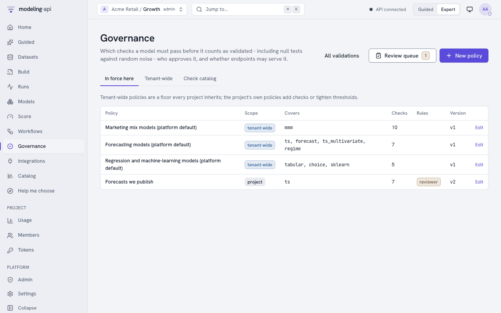
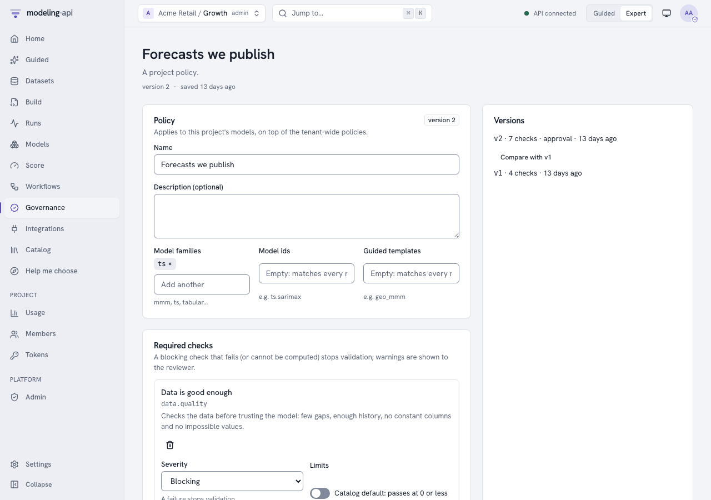
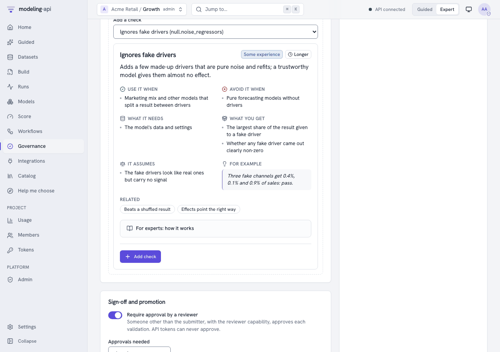
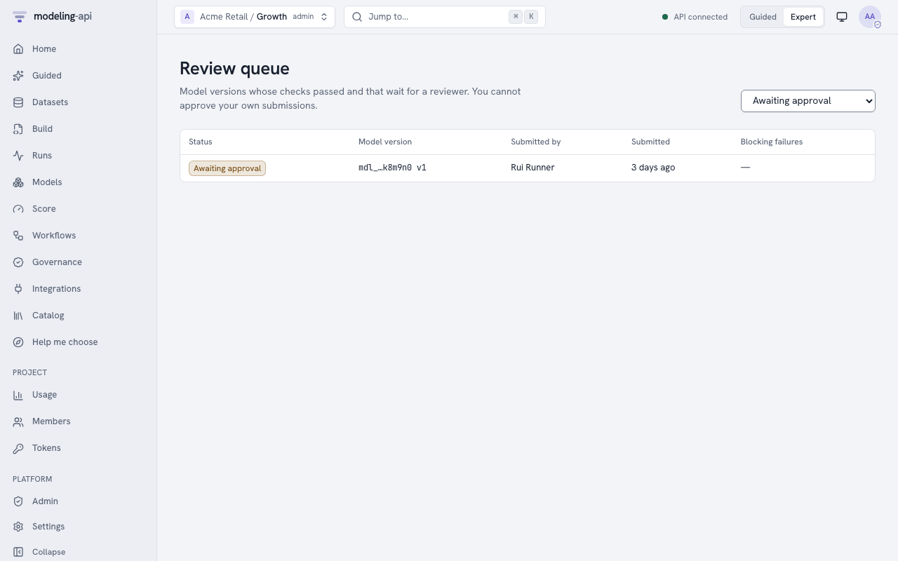

# Validate models with governance policies <span class="mapi-badge">v0.5</span>

If a model gives information for decisions, it must show that it learned something real. This
guide shows how to do these tasks:

- Tell which checks a model must pass (a **policy**).
- Run the checks on a model version (a **validation**).
- Get a second person to **approve** the version.
- Export the **evidence pack** for an auditor.
- Make endpoints refuse models that are not validated.

[Governance](../concepts/governance.md) gives the concepts and the full state machine. The
[HTTP API reference](../reference/http-api.md#m35) gives all the operations.

You can also do all these tasks in the web app. See [In the web app](#in-the-web-app).
[Can you trust this model?](null-tests.md) tells why the null tests are important, in plain
words and in statistics. In Python, use `api.governance` and `api.validations`
([client guide](python-client.md#governance)). In a terminal, use `mapi governance`,
`mapi validate model`, `mapi validations` and `mapi approve`
([CLI guide](cli.md#workflows-governance-and-explorers)):

```bash
--8<-- "cli_v05.sh:governance"
```

The examples below use `curl` with an API token. For the `api` helper, see
[Endpoints and webhooks](endpoints-and-webhooks.md):

```bash
api() { curl -sS -H "Authorization: Bearer $MAPI_TOKEN" -H "X-Mapi-Project: $MAPI_PROJECT" \
  -H 'Content-Type: application/json' "$@"; }
```

## What the checks mean, in plain words

Each check has an About card (`GET /v1/catalog/governance-checks`). The
[governance checks reference](../reference/generated/governance-checks.md) lists each check
with its card, metric, default limits, necessary conditions and parameters. In summary:

| Check | It asks | How the platform measures it |
|---|---|---|
| `null.permutation_target` | Is the model better than versions of itself that were fitted on **shuffled data**? | A model with drivers keeps its result. The platform shuffles its drivers together in blocks of time. Thus trend, season and controls cannot pass alone. For a model without drivers (or a model that ignores them), the platform shuffles the changes from period to period of its result. Then it adds them up again from the same start. For a series that does not wander, it shuffles the plain values. This keeps the quantity of wander, but removes all that is predictable. The platform fits the model again `n_permutations` times. It scores each fit on its held-out skill against the null forecast (the last value, or the mean). This skill does not change with the level where a shuffle lands. The p-value is the fraction of shuffled fits that did as well as the real fit, `(1 + #as good) / (n + 1)`. With 20 shuffles, the smallest possible p is 0.048. Thus, for a 5% test, use a minimum of 19. |
| `null.noise_regressors` | Does the model give **fake drivers made of pure noise** almost no credit? | The platform adds `n_noise` placebo drivers. Each placebo is a real driver shuffled in time, or Gaussian noise with the mean and spread of a real driver. The placebos are new channels of a marketing-mix model, or new variables of other models. Then the platform fits the model again. Placebos get the default prior of the model. The platform does not copy the priors and calibration of the real channels (business priors, lift tests). The platform switches each placebo off and scores again. Thus it measures the share of each placebo in the total effect of the real drivers. If it cannot measure the effect of the drivers, it uses the share of the result. The check flags a Bayesian model when a placebo share is above the warn limit with a minimum of 90% posterior probability. It does not flag it when the interval does not include zero, because the positive-only effects of a marketing mix model always do this. For frequentist models, the check uses Holm's correction for the number of placebos on the placebo p-values. |
| `null.placebo_time_shift` | Do the effects **go away when the drivers move** months away? | The platform shifts the drivers (`shifts`, default ±26 periods, wrapped around) and fits the model again. The check gives the placebo effect as a share of the real effect. If a model still finds most of the effect, it finds trend or season, not the drivers. |
| `baseline.beats_naive` | Is the model better than **simple benchmarks** on held-out periods? | The platform scores the train-only model on the held-out periods. It compares the model with "same as last period", "same as last season", the mean and the drift line. It forecasts these benchmarks from the training history. Skill is `1 - error(model) / error(best benchmark)`. The check also gives MASE. |
| `residuals.whiteness` | Is there **no pattern left** in the errors? | Ljung-Box on the in-sample residuals of each series. The smallest p-value counts. ARMA orders decrease the degrees of freedom. |
| `stability.rolling_params` | Are the key estimates **stable over time**? | The platform fits the model again on rolling windows of history. The check gives the largest coefficient of variation of the key estimates across the windows. |
| `plausibility.signs` | Do effects **go in the expected direction**? | By default, media and spend must increase the result. If you switch a channel off, the prediction must decrease. For Bayesian models, this applies to each posterior draw. List other expectations in `expected`, for example `{"price": "negative"}`. |
| `sensitivity.prior` | For Bayesian models: do the **data control the answers**, and not the assumptions? | The platform multiplies each prior width of the model by each value of `scales`. This includes the default values of the plugin that the settings do not give. For `mmm.bayesian`, these are the default ROI prior `LogNormal(0, 1)`, `seasonality.prior_sigma`, `trend.growth_prior_sigma` and `hierarchy.media_geo_sigma`. It also includes business priors that the platform translates at fit time. Widths are `sigma`, `scale`, `sd` and `tau` under a `prior…` key, and keys named `…prior_sigma` or `…_sigma`. Beta/Gamma `beta` or `b` parameters are not widths, and the platform never changes them. The check gives the largest relative change of a key posterior mean. |
| `recovery.simulated` | Does the model **find known answers**? | The platform simulates data from the fit. A Bayesian model gives the data from its posterior predictive draws (one posterior draw and the noise of the model). Other models give the expected values plus block-bootstrapped residuals. The platform fits the model again `n_sims` times. The check counts how frequently the 90% intervals contain the known values: the values of the posterior draw, or the fitted values. The target is 90%. If the model has no predictive draws and the target holds whole numbers (counts), the check is `skipped`. The evidence counts the simulated datasets that the model cannot fit (`failed_simulations`). This is a parametric-bootstrap version of simulation-based calibration. |
| `convergence` | Did the **fit finish correctly**? | Bayesian: the largest split R-hat. Divergences and the effective sample size are evidence. One divergence changes a pass to a warning. Other models: the converged flag of the optimiser. |
| `holdout.accuracy` | Is the error on **unseen data** below your limit? | The holdout metric of the fit (`mape` by default, as a fraction). For `rmse` or `mae`, set thresholds in the units of the KPI. |
| `data.quality` | Is the **data sufficiently good**? | The quality warnings of the Data Explorer that are more than information: missing shares above `max_missing`, fewer than `min_history_periods`, constant drivers, negative spend, values outside declared bounds, duplicated periods, long gaps and collinear drivers. |

Each result has these items:

- The measured value.
- The threshold.
- A plain-language `message_plain`.
- A `suggested_action`, if the check did not pass.
- Evidence (tables, numbers) for the auditor.

### Model families

The checks change for the method that estimates the model (`mapi_spec.governance.model_kind`):

- **Bayesian** (MCMC, VI, SMC): A new fit uses a budget of a maximum of 200 draws and 200
  tuning steps on 2 chains (`RefitBudget`). Intervals are highest-density intervals.
  `sensitivity.prior` applies.
- **Frequentist** (statsmodels, MAP, Kalman, ridge): A new fit runs as configured. Intervals
  are confidence intervals from standard errors. `convergence` reads the optimiser flag.
- **Machine learning** (scikit-learn, xgboost, quantile and conformal models): There are no
  parameter intervals. If the model has no coefficients, the platform skips
  `recovery.simulated` and `stability.rolling_params`. The null tests and the benchmarks apply
  with no change.

If a check does not apply, the result is `skipped` with the reason. For example: "the model
has no test period (add a data split and refit)". If the platform cannot calculate a check, the
result is `error`. If the check is blocking, `error` blocks the validation. A governance run
fits the model again a maximum of `max_refits` times (120 by default).

## The default policies

When a project uses governance for the first time, the platform makes three **tenant-wide**
policies. They decide what a validation checks. But they **do not gate promotion and do not
need approval**. An admin can switch on these functions.

| Policy | Families | Blocking | Warning | Information |
|---|---|---|---|---|
| Marketing mix models | `mmm` | data quality, convergence, holdout accuracy (MAPE ≤ 15% warn / 30% fail), shuffled results (20), fake drivers (3), effect signs | beats benchmarks, time-shift placebo, prior sensitivity | residual whiteness |
| Forecasting models | `ts`, `forecast`, `ts_multivariate`, `regime` | data quality, convergence, beats benchmarks, holdout accuracy | residual whiteness, shuffled results | parameter stability |
| Regression and machine learning | `tabular`, `choice`, `sklearn` | data quality, holdout accuracy, shuffled results | fake drivers | convergence |

A policy matches the family of a model or the namespace of its id. Thus the forecasting
policy also covers `ts.bsts` (v0.13), and the regression policy covers
`sklearn.multiclass_classifier` and `tabular.image_logistic` (v0.14). No default policy
covers the causal models (`causal.*`, v0.13) or the neural networks (`dl.*`, v0.15). To
validate them, write a policy with `"applies_to": {"families": ["causal"]}` or
`{"families": ["dl"]}` (see [Write a policy](#write-a-policy)).

The thresholds are the catalog defaults:

| Measure | Passes | Warns |
|---|---|---|
| Shuffled-result p-value | ≤ 0.05 | ≤ 0.10 |
| Fake-driver share | ≤ 2% | ≤ 5% |
| Placebo effect | ≤ 25% | ≤ 50% |
| Benchmark skill | ≥ 0.05 | ≥ 0 |
| Ljung-Box p | ≥ 0.05 | ≥ 0.01 |
| Rolling variation | ≤ 25% | ≤ 50% |
| Wrong-sign share | ≤ 10% | ≤ 25% |
| Prior sensitivity | ≤ 20% | ≤ 50% |
| Interval coverage | within 10 points of 90% | within 25 points |
| R-hat | ≤ 1.01 | ≤ 1.05 |
| Holdout MAPE | ≤ 15% | ≤ 30% |
| Data problems | none | a maximum of 2 |

## Write a policy

Project admins add policies to a project. Tenant admins add tenant-wide policies. Each project
gets the tenant-wide policies as a minimum. A project can make a threshold stricter, but it
can never make it less strict:

```bash
api -X POST "$API/v1/governance/policies" -d '{
  "name": "Forecasts we publish",
  "applies_to": {"families": ["ts"]},
  "checks": [
    {"check": "baseline.beats_naive"},
    {"check": "null.permutation_target", "params": {"n_permutations": 20}},
    {"check": "residuals.whiteness", "severity": "warning"},
    {"check": "holdout.accuracy", "thresholds": {"warn": 0.10, "fail": 0.20}}
  ],
  "require_approval": true,
  "approvals_required": 1,
  "require_validated_for_promotion": true
}'
```

- `PUT …/policies/{policy_id}` saves the next **version**. To refuse an edit that occurs at
  the same time with `409`, send `expected_version`.
- `GET …/versions` lists all the versions.
- `DELETE` retires the policy, but keeps its versions for audit.
- `GET /v1/governance/policies` lists the policies in force in the project. The tenant-wide
  policies are first.

## Validate a model version

```bash
api -X POST "$API/v1/models/$MODEL_ID/versions/7/validations" -d '{"note": "Q4 refresh"}'
```

The answer (`202`) is a validation in `checks_running`. It has the checks that apply to it. It
also has the governance run (`workflow_run_id`) that measures the checks in the sandbox.

**All** the policies in force for the model always apply to a validation. These are the
tenant-wide minimum and the policies of the project. `policy_ids` can only add more active
policies. It can never remove a policy. The platform locks the version while it checks a
request. Thus two requests at the same time make one validation. A request and the submission
of a workflow also make one validation. The other request gets `409
VALIDATION_TRANSITION_INVALID`.

Monitor the run as you monitor other runs (`GET /v1/runs/{run_id}`, or its event stream). When
the run finishes, the validation moves to the next status automatically:

```text
checks_running -> checks_passed -> validated              (no approval required)
checks_running -> checks_passed -> awaiting_approval      (approval required)
checks_running -> checks_failed                           (a blocking check failed or errored)
```

`GET /v1/validations/{validation_id}` shows the status, all the results and the history.
`GET …/evidence` gives the results with their evidence, one page at a time.

If the validation fails, or a reviewer rejects it, do these steps:

1. Repair the model or the data.
2. Send `POST /v1/validations/{id}:resubmit`. A new round starts under the policies that are
   in force now.

`:cancel` stops the checks that run. The validation goes back to `draft`.

## Approve as a second person

When a policy needs approval, a different person from the submitter decides. This person must
have the **reviewer** capability, or be a project admin. Give the capability on the
membership:

```bash
api -X PATCH "$API/v1/tenants/acme/projects/growth/members/$USER_ID" \
  -d '{"capabilities": ["reviewer"]}'
```

Reviewers find their queue at `GET /v1/validations?status=awaiting_approval`. They decide in a
signed-in session. API tokens can never approve:

```bash
curl -X POST "$API/v1/validations/$VALIDATION_ID/approvals" -d '{"decision": "approve",
  "comment": "Null tests are convincing; benchmarks beaten by 30%."}'
```

- The platform refuses the submitter (`403 SELF_APPROVAL_FORBIDDEN`).
- Each reviewer decides one time in each round.
- `approvals_required` approvals validate the version.
- One rejection rejects the version. A rejection needs a comment.

If a validated version must not be used again, retire it with `:deprecate` and a reason.

## Promotion requires validation

A policy in force can say `require_validated_for_promotion`. If it does, you can promote a
model version to an endpoint only when these conditions are true:

- The latest validation of the version is `validated`.
- The latest validation covered each such policy as it is now.

A validation covers a policy in one of two ways:

- It gives the policy at its current version.
- It applied each check of the policy at the same strictness or stricter (severity, limits and
  settings). It also had the reviewers that the policy asks for.

If a version was validated before a gating policy was added or made stricter, the platform
shows it as *validated under other or older policies*. In this case, request a new validation.
The platform refuses all other promotions with `409 NOT_VALIDATED`. No administrator override
changes this. The audit log records the refusal as `endpoint.promote_not_validated`.

## Export the evidence pack

```bash
api -X POST "$API/v1/validations/$VALIDATION_ID/evidence-pack" -d '{"format": "html"}'
```

The answer is the pack as JSON (`format: mapi.evidence-pack/v1`). The pack has these items:

- The validation with all the results, their evidence, the approvals and the history.
- The policies at the versions that applied to the validation.
- The lineage and the sanity scorecard of the model.
- A `digest` (sha256 of the canonical content).

With `format: html`, the answer also has `download`. This is a signed link to a static HTML
page that contains all its content. The page has only inline styles. It has no scripts and no
external assets, because a Content-Security-Policy prevents them. The page escapes all values.
The audit log records exports (`model.evidence_export`).

## In the web app

**Governance** in the sidebar (++g++ then ++v++) has three tabs:

- **In force here**: The tenant-wide policies first, then the policies of the project. For each
  policy, the tab shows what it covers and its number of checks. It also shows if the policy
  needs a reviewer and if it gates promotion.
- **Tenant-wide**.
- **Check catalog**: Each check has its About card, what it measures and its default limits.

{ .mapi-shot }

### Editing a policy

Project admins edit project policies. Tenant admins edit tenant-wide policies. Other users can
only read the policies.

1. Open a policy, or click **New policy**.
2. In **Covers**, set the model families, the model ids and the Guided templates. Empty lists
   match all models.
3. In **Required checks**, add a check from the catalog. Its About card shows before you add
   it.
4. Set the severity of the check: *Blocking*, *Warning* or *Information*.
5. To set the warn and fail values of the check, switch on **Custom** limits.
6. Adjust the settings of the check. The form for the settings comes from the parameters of
   the check, for example the number of shuffles.
7. In **Sign-off and promotion**, set **Require approval by a reviewer** and the number of
   reviewers.
8. Set **Only validated models can be promoted to an endpoint** and **Active**.
9. Click **Save version N**. The app saves the next version.

The page refuses a fail limit that is less strict than the warn limit, as the server does.

<div class="grid" markdown>

{ .mapi-shot }

{ .mapi-shot }

</div>

If a different person edits the policy at the same time, the app refuses your save. Your edit
stays on the screen. **Versions** lists all the versions and compares two versions side by
side. **Retire policy** keeps the versions of the policy for audit.

### Validating a model version

The page of a model version has a **Validation** button. The button lists the validations of
the version and requests a new validation. A new request has these items:

- The policies that apply. All the policies in force always apply. If you tick other
  policies, they also apply.
- The data to check against (optional).
- A note.

The validation page then shows these items:

- **Status**: The position of the validation on its path. The path is draft → checks running →
  checks passed → awaiting approval → validated. Other statuses are checks failed, rejected and
  deprecated. The status also shows the history of each transition, with the person who made
  it and their note.
- **Checks**: Failures first. Each check has its plain-language message and **What to do** if
  it did not pass. It also has the measured value against its limit, and its evidence. The
  evidence is small tables and numbers. For the shuffled-result test, it is also a plot. The
  plot shows the distribution of the errors of the shuffled fits, with a mark at the error of
  the real model. The plot sandbox draws the plot.
- **Approvals**, **Evidence pack** and **Held to** (the policy versions).

{ .mapi-shot }

{ .mapi-shot }

The page shows these buttons for the applicable states:

- **Cancel checks**.
- **Resubmit**, after failed checks or a rejection.
- **Deprecate**, with a reason, for a validated version. Only project admins can deprecate.

**Export evidence pack** saves the HTML page or the JSON as a file. The app never opens the
HTML.

### Reviewing

Reviewers find **Review queue** on the Governance page, with the number of validations that
wait. They can also use **Validations** with the filter *Awaiting approval*. The approval form
shows only to members who can approve. These are project admins, and editors or runners who
have the **reviewer** capability. A rejection needs a comment.

On your own submission, the form tells you that a second person must review it. Its buttons
are disabled. The server also refuses your decision (`SELF_APPROVAL_FORBIDDEN`).

Project admins give and remove the capability in the **Reviewer** column of **Members**.
Admins have the capability automatically. Viewers cannot have it.

{ .mapi-shot }

### Promotion in the app

A policy can gate promotion. In this case, if you promote a version that is not validated from
**Integrations**, the app refuses. It shows *A governance policy requires a validated model*
and the current validation status of the version. It also shows links to the validation, or to
request a validation. The app gives no override, because no override passes this rule.

## Audit and webhooks

The audit log records these events:

- Each policy change (`policy.create`, `policy.update`, `policy.delete`).
- Each request (`model.validation_request`).
- Each transition (`model.validation_transition`, with from, to and the actor).
- Each decision (`model.approve`, `model.reject`).
- Each deprecation.

To start review queues and release pipelines, subscribe webhooks to these events:

- `model.validation.checks_passed`
- `model.validation.checks_failed`
- `model.validation.awaiting_approval`
- `model.validated`
- `model.rejected`
- `model.deprecated`.
