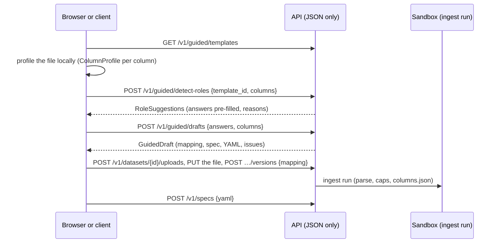

# From a spreadsheet to a Guided draft <span class="mapi-badge">v0.4</span>

This guide follows the Guided data path over the HTTP API. You do these steps:

1. Select a template.
2. Let the platform suggest which column answers each question.
3. Change the answers into a draft. A draft is an ingest mapping and a `ModelSpec`.
4. Upload the data with that mapping.
5. Save the spec.

The Guided screens of the web app and the Python client make the same calls.
[Guided mode](../concepts/guided-mode.md) gives the concepts.

All calls are project-scoped. Send `X-Mapi-Project: <tenant>/<project>`, or use a token that
is bound to the project. The examples use the single-tenant development server.



## 1. Pick a template

```bash
curl -s localhost:8000/v1/guided/templates | jq '.items[] | {id, title, plugin}'
```

| Template | Built-in model | Data that it expects |
|---|---|---|
| `geo_mmm` | `mmm.bayesian` (mmm-framework) | One row for each market and week: the result, one spend column for each channel, and optional controls |
| `weekly_forecast` | `ts.hsgp_trend` | One row for each week (or day): the series to forecast |
| `store_demand` | `tabular.regressor` | One row for each store and week: the units sold and the drivers (price, promotions) |
| `customer_choice` | `choice.multinomial_logit` | One row for each household and shopping trip: the product chosen, and one price (and promotion) column for each product |

`GET /v1/guided/templates/{id}` gives one template with these items:

- Its questions.
- The spec template.
- The scorecard checks.
- The `x-ui-level` of each field.

## 2. Let the platform suggest the answers

The browser profiles the upload locally. Thus no hostile data goes to the servers only for a
preview. The browser sends one `ColumnProfile` for each column:

```bash
curl -s localhost:8000/v1/guided/detect-roles -H 'content-type: application/json' -d '{
  "template_id": "geo_mmm",
  "columns": [
    {"name": "Week", "dtype": "date", "n_rows": 520, "n_distinct": 104, "detected_freq": "W-SUN"},
    {"name": "Region", "dtype": "string", "n_rows": 520, "n_distinct": 5},
    {"name": "Revenue", "dtype": "number", "n_rows": 520, "min": 10, "max": 90000},
    {"name": "TV_Spend", "dtype": "number", "n_rows": 520, "min": 0, "max": 50000},
    {"name": "Search_Spend", "dtype": "number", "n_rows": 520, "min": 0, "max": 20000},
    {"name": "avg_price", "dtype": "number", "n_rows": 520, "min": 1, "max": 3}
  ]}' | jq '.questions[] | {question_id, answer}'
```

Each question comes back with ranked candidates, a `confidence` and a `reason_plain`. An
example reason is "named like a revenue column; never negative". The heuristics look at these
properties:

- Names. The heuristics split names into words and compare them with the keywords of each
  question.
- Types.
- The number of distinct values. Labels are good for dims.
- Ordered dates and trip numbers.
- Negative or constant values. These are bad candidates for spend.
- Columns that are almost empty.

A column answers a maximum of one question. If a necessary question has no good candidate, it
comes back as a warning in `issues`.

### From a stored dataset

Instead of `columns`, give a stored version: `{"template_id": "geo_mmm", "dataset":
"dataset://growth/eu_media@v2"}`. Each ingest run from v0.4 writes `columns.json`. This file
has the profile of each **uploaded** column, which the sandbox calculates. Detection reads
this file. You can also download it with
`GET /v1/datasets/{id}/versions/{v}/artifacts/columns.json`.

For an MFF upload, the profiles are the profiles of the pivoted table. These are `Period`, the
key columns that vary, and one column for each `VariableName`. Thus `TV_Spend` answers the
spend question. For versions ingested before v0.4, and for zarr or netCDF uploads, detection
uses their dims and variables. It reads them from the stored schema and summary. In all cases,
the API reads only JSON metadata, never the data.

## 3. Turn the answers into a draft

```bash
curl -s localhost:8000/v1/guided/drafts -H 'content-type: application/json' -d '{
  "template_id": "geo_mmm", "name": "eu-geo-mmm", "dataset": "eu_media",
  "answers": {"kpi": "Revenue", "date": "Week", "geo": "Region",
              "spend": ["TV_Spend", "Search_Spend"], "controls": ["avg_price"]},
  "columns": [ ...the same profiles... ]}'
```

The `GuidedDraft` holds these items:

- `mapping`: The `IngestMapping` for the upload. Column names become safe dataset names
  (`Avg Price` → `avg_price`). Spend columns become one `spend` variable along a new `channel`
  dim. The labels come from the names (`TV_Spend` → `tv`). For the choice template,
  `price_cola` and `promo_cola` both give the label of the product `cola`.
- `spec` and `yaml`: The `ModelSpec` for the project, with `fit.mode: evaluate_then_refit`.
- `issues`: Answer warnings (a column with a type that does not agree with the question) and
  the findings of the **static validator**. The validator checks the draft against the catalog
  with the schema that its mapping promises, before data exists. For example, a control with
  the name `Fourier` would conflict with the seasonality that the template adds
  (`/pipeline/4`).

Impossible answers get `422 GUIDED_ANSWERS_INVALID`, which points at `/answers/<question>`.
Impossible answers are these:

- A necessary answer is missing.
- A column is used two times.
- Two columns would get the same dataset name.
- A choice or a number is out of range.

For an MFF upload, send `"format": "mff"`. Then the answers give `Period`, the MFF key columns
and the `VariableName` values. The mapping uses the `mff` preset.

The draft call stores nothing. Upload the data with the mapping of the draft, then save the
spec:

```bash
curl -s -X POST localhost:8000/v1/datasets/$DS/versions -H 'content-type: application/json' \
  -d "{\"upload_id\": \"$UPLOAD\", \"mapping\": $(jq .mapping draft.json)}"
curl -s -X POST localhost:8000/v1/specs -H 'content-type: application/json' \
  -d "{\"yaml\": $(jq .yaml draft.json)}"
```

## File formats and presets

A sandboxed ingest run parses each upload. Tabular uploads are CSV or Parquet. A CSV file can
use comma, semicolon, tab or `|` separators. It must be UTF-8, and it can be gzip-compressed.
`zarr_zip` and `netcdf` files have their own descriptions. From v0.8, NetCDF-4 and zarr files
with groups become tree datasets, a raw HDF5 file (`hdf5`) needs a mapping of its arrays, and
one version can come from several files. Refer to
[Tree datasets, HDF5 and multi-file versions](tree-data.md).

| Mapping | What the ingest does |
|---|---|
| `dims`, `vars`, `wide` | One column for each dim and variable. `wide` collects one column for each label into one variable along a new dim. Wide variables that share a dim must use the same labels |
| `preset: mff` (or `format: mff`) | Pivots the MFF long table. `Period` becomes the time dim. Key columns with more than one value become dims. Each `VariableName` becomes a variable. With `vars`/`wide`, these select and rename the pivoted variables, as for CSV columns. `mff.combine` joins key columns into one dim. For example, `{"geo": ["Geography", "Product"]}` gives labels such as `US|Watches` |
| `preset: meridian` | The `CoordToColumns` contract of Google Meridian on a wide table: `time`, `geo`, `kpi` (target), `revenue_per_kpi`, `population`, `controls`, and `media`/`media_spend` (and reach and frequency) along `channel` |

### Limits

The ingest checks what a file *declares* before a parser allocates memory. It checks each cell
after the parse. `IngestJob` sets the limits. The table below gives the defaults of the
server.

| Limit | Default | Checked |
|---|---|---|
| rows | 50 million | CSV: the parse stops one row after the limit. Parquet: from its metadata |
| columns | 4,096 | The CSV header or the Parquet schema. MFF: distinct variables |
| characters for each cell or column name | 4,096 (names: 256) | Each header and text cell |
| decompression ratio | 50 × the stored size | gzip CSV (streamed), Parquet, zip archives, netCDF (decoded bytes). The ingest never refuses files that decode to less than 64 MiB because of their ratio |
| uncompressed size | The scratch budget of the ingest run: 3 GiB (class S), 6 GiB (M), 12 GiB (L) | The same, as an absolute size. The class is the smallest class with a dataset cap that holds the upload |
| dataset size | 250 million values, and 8 bytes for each value in the scratch budget | The dense dataset that a table pivots to (each combination of the dim labels, multiplied by the variables). The ingest checks it before it builds the dataset (`PAYLOAD_TOO_LARGE`) |
| nodes of a tree dataset (v0.8) | 256, 8 levels below the root | NetCDF-4 and HDF5 groups, zarr groups and the nodes of a multi-file version |
| files in one version (v0.8) | 64, and 5 GB together | `assembly.sources`. The server adds the sizes of the uploads before it starts the ingest |
| HDF5 objects (v0.8) | 10,000 links and 10,000 attributes, 32 group levels | The HDF5 guard, before a reader opens the file |
| dims of one array (v0.8) | 32 | HDF5, NetCDF-4 and zarr arrays |
| bytes of one attribute value (v0.8) | 64 KiB. Self-describing NetCDF: the file size | The HDF5 guard (`INGEST_UNSAFE_FILE`) |

Some dates have a UTC offset or a time zone, for example `2024-01-07T00:00:00+01:00` or a
tz-aware Parquet timestamp. The ingest reads them as the local date and time that they give,
and removes the offset. Thus midnight labels stay on their day. The ingest gives this as an
`info` issue.

The ingest refuses bzip2, xz and zstd compressed uploads. Each refusal is one plain-language
message and a suggested action. For example:

| Problem | Message | Suggested action |
|---|---|---|
| a mapped column is missing | column 'week' (dim 'week') is not in the upload | Did you mean 'Week'? |
| repeated rows | 52 rows repeat a (week) combination | Columns such as 'Region' vary within a combination: map them as dims too, or aggregate the rows first. |
| text in a spend column | column 'TV' ('spend' for 'tv') has 3 cells that are not numbers | Use plain numbers without currency signs or thousands separators. |
| not UTF-8 | the upload is not UTF-8 text | Save the file as 'CSV UTF-8' (in Excel: File > Save As > CSV UTF-8). |
| a decompression bomb | the gzip file expands to more than … bytes | Upload the CSV uncompressed, or split it into several files. |
| dims that rarely repeat | the mapped dims span 100,000 store x 100,000 day = 10,000,000,000 combinations, so the dataset would hold … values | Most combinations have no row: map fewer columns as dims (keep the others as variables), use a long layout with one id dim, or split the upload. |

If an ingest fails, the dataset version becomes `failed`. Its `issues` have the messages. The
events of the run also have them as diagnostics with `message_plain` and `suggested_action`.
The platform quotes cell values only in `untrusted_text`.


## Locking a project to Guided mode

A project admin can lock a project in two ways:

- In the web app: **Settings > Mode > Lock … to Guided mode**.
- With `PATCH /v1/tenants/{tenant}/projects/{project} {"guided_locked": true}`.

The audit log records the lock as `project.guided_lock`. Then members below admin see only the
Guided screens. Their spec writes (`POST /v1/specs` and new revisions) must stay Guided specs:

- The spec gives its template in `metadata.labels.guided`, and it uses the plugin of that
  template. Drafts do this.
- Fields that the template marks `advanced` or `hidden` keep their values. A revision cannot
  change them from its parent. A new spec has the values of the template where the template
  sets them. For `geo_mmm`, these are the pipeline, the adstock and saturation settings, the
  fit settings and the execution block.
- Answers, `basic` settings (such as `pooling`), business priors and lift tests can change.

All other writes get `403 FORBIDDEN`, with one issue for each pointer that is not permitted.
The issue suggests that you ask an admin. The lock does not apply to admins,
`POST /v1/specs:validate`, runs and scores. The lock also does not apply to the score calls of
integrations.
