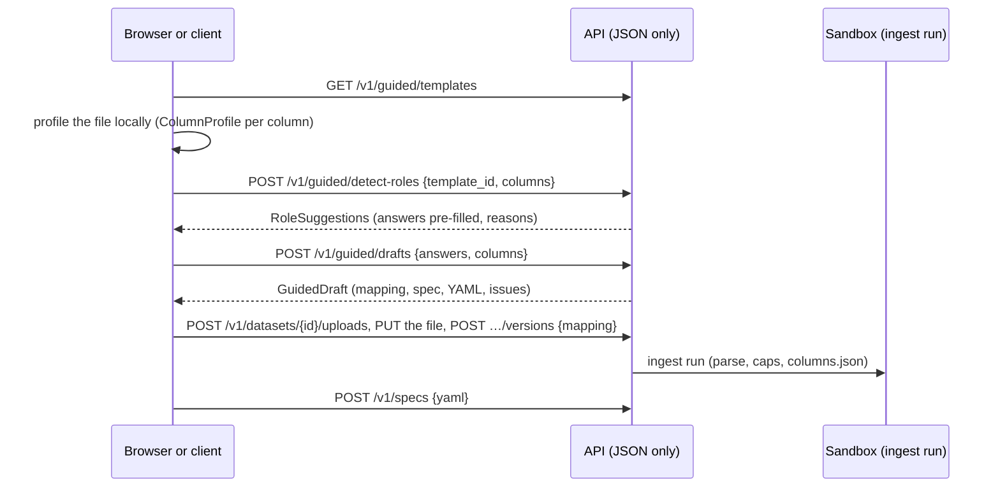

# From a spreadsheet to a Guided draft <span class="mapi-badge">v0.4</span>

This guide follows the Guided data path over the HTTP API: pick a template, let the platform
suggest which column answers which question, turn the answers into a draft (an ingest
mapping plus a `ModelSpec`), upload the data with that mapping and save the spec. The web
app's Guided screens and the Python client make exactly these calls. The concepts are in
[Guided mode](../concepts/guided-mode.md).

Every call is project-scoped: send `X-Mapi-Project: <tenant>/<project>` (or use a token
bound to the project). The examples use the single-tenant development server.



## 1. Pick a template

```bash
curl -s localhost:8000/v1/guided/templates | jq '.items[] | {id, title, plugin}'
```

| Template | Built-in model | Data it expects |
|---|---|---|
| `geo_mmm` | `mmm.hierarchical_geo` | one row per market and week: the result, one spend column per channel, optional controls |
| `weekly_forecast` | `ts.hsgp_trend` | one row per week (or day): the series to forecast |
| `store_demand` | `tabular.regressor` | one row per store and week: units sold and the drivers (price, promotions) |
| `customer_choice` | `choice.multinomial_logit` | one row per household and shopping trip: the product chosen and one price (and promotion) column per product |

`GET /v1/guided/templates/{id}` returns one template with its questions, the spec template,
the scorecard checks and the `x-ui-level` of every field.

## 2. Let the platform suggest the answers

The browser profiles the upload locally, so nothing hostile reaches the servers just to be
previewed, and sends one `ColumnProfile` per column:

```bash
curl -s localhost:8000/v1/guided/detect-roles -H 'content-type: application/json' -d '{
  "template_id": "geo_mmm",
  "columns": [
    {"name": "Week", "dtype": "date", "n_rows": 520, "n_distinct": 104, "detected_freq": "W-SUN"},
    {"name": "Region", "dtype": "string", "n_rows": 520, "n_distinct": 5},
    {"name": "Revenue", "dtype": "number", "n_rows": 520, "min": 10, "max": 90000},
    {"name": "TV_Spend", "dtype": "number", "n_rows": 520, "min": 0, "max": 50000},
    {"name": "Search_Spend", "dtype": "number", "n_rows": 520, "min": 0, "max": 20000},
    {"name": "avg_price", "dtype": "number", "n_rows": 520, "min": 1, "max": 3}
  ]}' | jq '.questions[] | {question_id, answer}'
```

Each question comes back with ranked candidates, a `confidence` and a `reason_plain`
("named like a revenue column; never negative"). The heuristics look at names (split into
words, matched against each question's keywords), types, the number of distinct values
(labels suit dims), ordered dates and trip numbers, negative or constant values (bad spend
candidates) and mostly empty columns. A column answers at most one question; required
questions without a good candidate come back as warnings in `issues`.

### From a stored dataset

Instead of `columns`, name a stored version: `{"template_id": "geo_mmm", "dataset":
"dataset://growth/eu_media@v2"}`. Every ingest run since v0.4 writes `columns.json` - the
profile of each **uploaded** column, computed in the sandbox - and detection reads it (also
downloadable as `GET /v1/datasets/{id}/versions/{v}/artifacts/columns.json`). For an MFF
upload the profiles are those of the pivoted table: `Period`, the key columns that vary and
one column per `VariableName`, so `TV_Spend` answers the spend question. Versions ingested
before v0.4 (and zarr or netCDF uploads) fall back to their dims and variables, read from the
stored schema and summary. Either way the API reads only JSON metadata, never the data.

## 3. Turn the answers into a draft

```bash
curl -s localhost:8000/v1/guided/drafts -H 'content-type: application/json' -d '{
  "template_id": "geo_mmm", "name": "eu-geo-mmm", "dataset": "eu_media",
  "answers": {"kpi": "Revenue", "date": "Week", "geo": "Region",
              "spend": ["TV_Spend", "Search_Spend"], "controls": ["avg_price"]},
  "columns": [ ...the same profiles... ]}'
```

The `GuidedDraft` holds:

- `mapping`: the `IngestMapping` for the upload. Column names become safe dataset names
  (`Avg Price` → `avg_price`); spend columns become one `spend` variable along a new
  `channel` dim, labelled from the names (`TV_Spend` → `tv`; for the choice template
  `price_cola` and `promo_cola` both label product `cola`).
- `spec` and `yaml`: the `ModelSpec` for the project, with `fit.mode: evaluate_then_refit`.
- `issues`: answer warnings (a column whose type does not fit the question) and the
  **static validator's** findings. The draft is validated against the catalog with the
  schema its mapping promises, before any data exists - for example a control named
  `Fourier` would clash with the seasonality the template adds (`/pipeline/4`).

Impossible answers are `422 GUIDED_ANSWERS_INVALID` pointing at `/answers/<question>`: a
missing required answer, a column used twice, two columns that would get the same dataset
name, a choice or number out of range.

For an MFF upload send `"format": "mff"`: the answers then name `Period`, the MFF key columns
and `VariableName` values, and the mapping uses the `mff` preset.

Nothing is stored. Upload the data with the draft's mapping and save the spec:

```bash
curl -s -X POST localhost:8000/v1/datasets/$DS/versions -H 'content-type: application/json' \
  -d "{\"upload_id\": \"$UPLOAD\", \"mapping\": $(jq .mapping draft.json)}"
curl -s -X POST localhost:8000/v1/specs -H 'content-type: application/json' \
  -d "{\"yaml\": $(jq .yaml draft.json)}"
```

## File formats and presets

Every upload is parsed in a sandboxed ingest run. Tabular uploads are CSV (comma, semicolon,
tab or `|` separated, UTF-8, optionally gzip-compressed) or Parquet; `zarr_zip` and `netcdf`
are self-describing.

| Mapping | What the ingest does |
|---|---|
| `dims`, `vars`, `wide` | one column per dim and variable; `wide` gathers one column per label into one variable along a new dim. Wide variables sharing a dim must use the same labels |
| `preset: mff` (or `format: mff`) | pivots the MFF long table: `Period` becomes the time dim, key columns with several values become dims, every `VariableName` a variable. With `vars`/`wide`, those pick and rename the pivoted variables like CSV columns. `mff.combine` joins key columns into one dim (`{"geo": ["Geography", "Product"]}` gives labels such as `US|Watches`) |
| `preset: bayesinsight` | an MFF table restricted to what BayesInsight's `metadata.json` allows: the `allowed_*` key values and the `start_period`/`end_period` range; `necessary_variables` must be present. A weekly period's weekday comes from the data |
| `preset: meridian` | Google Meridian's `CoordToColumns` contract on a wide table: `time`, `geo`, `kpi` (target), `revenue_per_kpi`, `population`, `controls`, and `media`/`media_spend` (and reach and frequency) along `channel` |

### Limits

The ingest checks what a file *declares* before a parser allocates anything, and every cell
after parsing (`IngestJob` sets the limits; the server's defaults are below).

| Limit | Default | Checked |
|---|---|---|
| rows | 50 million | CSV: parsing stops one row past it; Parquet: from its metadata |
| columns | 4,096 | the CSV header or Parquet schema; MFF: distinct variables |
| characters per cell or column name | 4,096 (names: 256) | every header and text cell |
| decompression ratio | 50 × the stored size | gzip CSV (streamed), Parquet, zip archives, netCDF (decoded bytes); files that decode to less than 64 MiB are never refused for their ratio |
| uncompressed size | the ingest run's scratch budget: 3 GiB (class S), 6 GiB (M), 12 GiB (L) | the same, as an absolute size; the class is the smallest whose dataset cap holds the upload |
| dataset size | 250 million values, and 8 bytes per value within the scratch budget | the dense dataset a table pivots to (every combination of the dim labels, times the variables), checked before it is built (`PAYLOAD_TOO_LARGE`) |

bzip2, xz and zstd compressed uploads are refused. Every refusal is one plain-language
message and a suggested action, for example:

| Problem | Message | Suggested action |
|---|---|---|
| a mapped column is missing | column 'week' (dim 'week') is not in the upload | Did you mean 'Week'? |
| repeated rows | 52 rows repeat a (week) combination | Columns such as 'Region' vary within a combination: map them as dims too, or aggregate the rows first. |
| text in a spend column | column 'TV' ('spend' for 'tv') has 3 cells that are not numbers | Use plain numbers without currency signs or thousands separators. |
| not UTF-8 | the upload is not UTF-8 text | Save the file as 'CSV UTF-8' (in Excel: File > Save As > CSV UTF-8). |
| a decompression bomb | the gzip file expands to more than … bytes | Upload the CSV uncompressed, or split it into several files. |
| dims that rarely repeat | the mapped dims span 100,000 store x 100,000 day = 10,000,000,000 combinations, so the dataset would hold … values | Most combinations have no row: map fewer columns as dims (keep the others as variables), use a long layout with one id dim, or split the upload. |

A failed ingest marks the dataset version `failed`; its `issues` carry the messages and the
run's events carry them as diagnostics with `message_plain` and `suggested_action`. Cell
values are only ever quoted in `untrusted_text`.

## Import a BayesInsight model

A BayesInsight project imports as a draft for the built-in geo MMM (the default target) or,
with `"target": "mmm.bayesinsight"`, for the dedicated BayesInsight model (below):

```bash
curl -s localhost:8000/v1/guided/import/bayesinsight -H 'content-type: application/json' -d "{
  \"name\": \"bi-import\", \"dataset\": \"bi_mff\",
  \"model_def\": $(cat model_def.json), \"metadata\": $(cat data/metadata.json)}"
```

The mapping uses the `bayesinsight` preset: the media variables become `spend` along
`channel`, the controls and the KPI become variables, and the key columns of `row_ids`
(without `Period`) are joined into one `geo` dim. The spec carries every feature that has an
equivalent, with BayesInsight's own distributions where they exist:

| BayesInsight | Geo MMM spec |
|---|---|
| `adstock: delayed` / `geometric` | `adstock.kind`, 12 lags (BayesInsight's `l_max`) |
| `adstock_prior` (Delayed) | `alpha ~ Beta(mu=retention_rate_mean, nu=retention_rate_std)`, `theta ~ Exponential(lag_max)`, per channel |
| `media_transform: hill` / `linear` | `saturation.kind: hill` / `none` |
| `media_transform_prior` (Hill) | `half ~ LogNormal(log K_ave, log(K_std / K_ave + 1))`; `slope ~ Gamma` with the mean and sd of BayesInsight's `1 + Exponential` |
| media `random_coeff_dims` | `pooling: partial` (`fixed_ind_coeff_dims`: `none`; neither: `complete`) |
| `normalization: Global Standardize` | a `core.standardize` step over time and geo |
| `season` | `core.fourier` with its `period` and `n_fourier` |
| `localtrend` | a `core.trend` control (warned: an approximation) |

Everything without an equivalent is listed as an `IMPORT_UNSUPPORTED` **warning** at its
pointer, so nothing is dropped silently: non-Normal likelihoods, coefficient and intercept
priors (stated in KPI units, which mean something else on the mean-scaled KPI - state them as
business priors instead), Weibull adstock, S-shaped curves, sign constraints on controls,
time and non-linear transforms, and per-dim random effects of controls. A model that cannot
run at all is `422 IMPORT_UNSUPPORTED`: no single `exog` KPI, no media variable, variable
names that do not match the metadata's `row_ids`, or variables split into several series by
a key column that is not a row id.

### Importing for `mmm.bayesinsight`

`"target": "mmm.bayesinsight"` drafts the dedicated built-in model instead, which fits
BayesInsight's model as `model_def.json` defines it - nothing above needs an equivalent:

```bash
curl -s localhost:8000/v1/guided/import/bayesinsight -H 'content-type: application/json' -d "{
  \"name\": \"bi-sales\", \"dataset\": \"bi_mff\", \"target\": \"mmm.bayesinsight\",
  \"model_def\": $(cat model_def.json), \"metadata\": $(cat data/metadata.json)}"
```

- **Data.** The `bayesinsight` preset with every row id besides `Period` as a panel dim of its
  own (`Geography` → `geo`, `Product` → `product`, kept even with a single label, as
  BayesInsight keeps it). A panel dim is `new_levels` (pooled), or `fixed` when some
  coefficient is estimated separately per level of it (`fixed_ind_coeff_dims`). Variables
  keep their MFF names, made safe (`Sales` → `sales`).
- **Spec.** The KPI is bound to `y`, the media get a 12-lag `core.lag_tensor` with
  `pad: nan`, and `model.settings` carries `model_def` plus the map from every analytic name
  (`TV_Total_Total_Total`) to its variable. Priors stay in the KPI's own units.
- **Issues.** What the plugin cannot run falls back to BayesInsight's own default with an
  `IMPORT_UNSUPPORTED` **warning** at its pointer: an `MvNormal` likelihood (fitted with
  independent Normal errors), time transforms, priors with unknown families or parameters,
  coefficient dims that are not row ids, keys a variable type does not have. Faithful but
  surprising behaviour is an **info** issue: a KPI without a likelihood is fitted as Poisson,
  `random_coeff_dims` with `partial_pooling_sigma: 0` pool nothing, signs on controls are
  enforced, and carry-overs and curves that BayesInsight's code cannot run are fitted as
  documented in the [models reference](../reference/models.md#mmmbayesinsight-a-bayesinsight-model_defjson).
- **Refusals** (`422 IMPORT_UNSUPPORTED`): no single `exog` KPI, no media or control
  variable, names that do not match the row ids, a series split by a key column that is not
  a row id, or a variable whose safe name is taken.

The draft is validated against the catalog like the geo MMM's.

## Locking a project to Guided mode

A project admin locks a project with `PATCH /v1/tenants/{tenant}/projects/{project}
{"guided_locked": true}` (audited as `project.guided_lock`). Members below admin then see
the Guided screens only, and their spec writes (`POST /v1/specs` and new revisions) must stay
Guided specs:

- the spec names its template in `metadata.labels.guided` (drafts do) and uses that
  template's plugin;
- fields the template marks `advanced` or `hidden` keep their values: a revision may not
  change them from its parent, and a new spec has the template's values wherever the
  template fixes them (for `geo_mmm`: the pipeline, the adstock and saturation settings, the
  fit settings and the execution block);
- answers, `basic` settings (such as `pooling`), business priors and lift tests may change.

Anything else is `403 FORBIDDEN` with one issue per offending pointer and the suggestion to
ask an admin. Admins, `POST /v1/specs:validate`, runs and scoring are not affected, and the
lock does not reach integrations' score calls.
