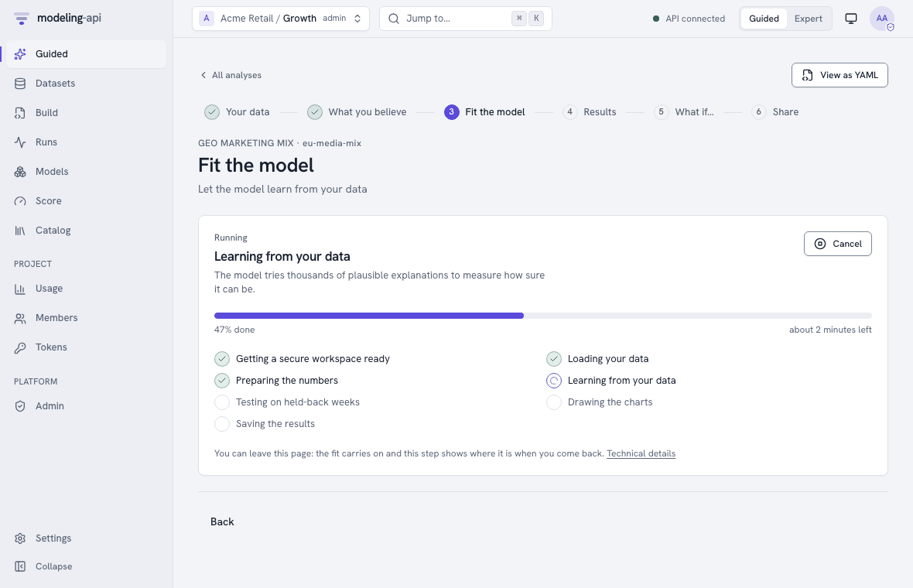
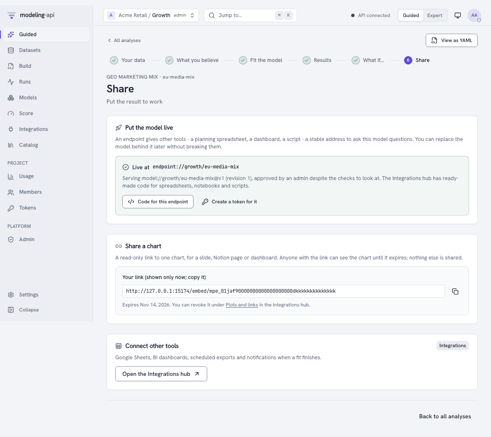
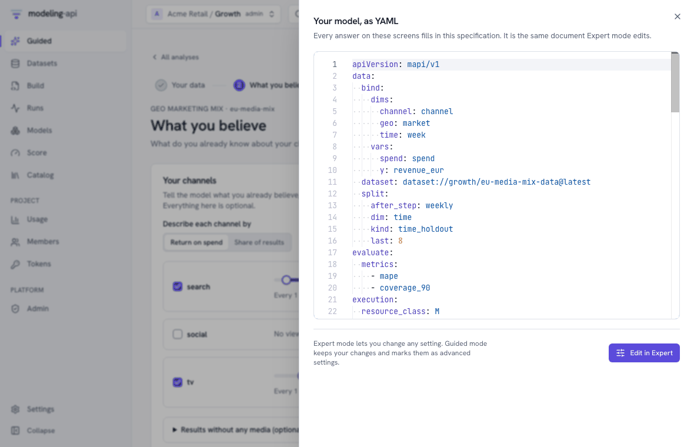
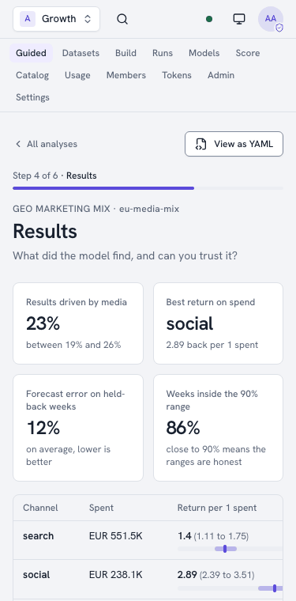

# Your first analysis in Guided mode v0.4

Guided mode takes you from a spreadsheet to a trustworthy answer without writing YAML or
knowing statistics: you pick what you want to learn, answer a few questions about your
columns, say what you already believe, and the platform fits a model in a secure sandbox and
explains what it found in plain words. Behind every screen sits the same `ModelSpec` that
Expert mode edits (see [Guided mode](../concepts/guided-mode.md) for the concepts).

This tutorial walks through a **geo marketing mix**: weekly revenue and media spend per
market. It takes about ten minutes. To follow along without your own data, use the sample in
the repository, `apps/web/e2e/fixtures/guided-geo-mmm.csv` (40 weeks, two markets, TV,
search and social spend and an average price). The screenshots come from the web app in mock
mode (`pnpm --filter @mapi/web dev:mock`), so the numbers are illustrative.

!!! tip "Every step has its own address"
    An analysis is saved as soon as its data is uploaded. Each step has its own URL
    (`/guided/<analysis>/<step>`), so you can bookmark it, send it to a colleague, close the
    browser during a fit, and pick up later from **Guided → Continue where you left off**.

## 1. Choose what you want to learn

A workspace you signed up for opens here. Elsewhere, switch the header to **Guided** (the
choice is remembered for your account) or open **Guided** in the sidebar or from **Start a
guided analysis** on Home. Each card is a template: the question it answers, the data it
needs and what you can do with the result.

{ .mapi-shot }

| Template | Use it for |
|---|---|
| Geo marketing mix | What each channel adds to your results per market, ROI per channel, what-if budgets |
| Weekly forecast | One weekly or daily series, forecast with a likely range |
| Demand by store | Units per store and week from prices and promotions, with low and high estimates |
| Customer choice | Which product shoppers pick on each trip, and how prices shift the choice |

Pick **Geo marketing mix**.

## 2. Your data

Give the analysis a name, then drop your file on the page (CSV or Parquet). Your file is
**read in your browser first**: the page profiles every column (type, range, how often the
dates repeat) and sends only that profile to the platform, which suggests which column
answers which question. Nothing is uploaded until you press **Upload and continue**.

{ .mapi-shot }

- Each question shows the suggested column, how sure the suggestion is and why ("named like a
  revenue column; never negative"). Change any answer that is wrong; columns another question
  already uses are not offered twice.
- The preview on the right labels each column with its role and draws a small line per
  series you picked, added up per week, so a column of zeros or a broken week is easy to
  spot.
- **MFF long tables** (`Period`, `Geography`, `VariableName`, `VariableValue`, as BayesInsight
  uses) and **Google Meridian tables** (`time`, `geo`, `kpi`, `<channel>_spend`) are recognised
  automatically and the answers filled in from their standard names.
- Parquet files are opened only inside the sandbox, so for them you type the column names.
- **More options** holds the settings most people never change, such as how many of the
  latest weeks to hold back to test the model.

When every required question is answered the panel says *Everything the model needs is
answered*. **Upload and continue** then creates the dataset, uploads the file to storage,
starts the sandboxed check of the data and saves the analysis.

## 3. What you believe

If you already know something about your channels - from earlier studies, industry
benchmarks or experiments - say so here. Everything on this step is optional.

{ .mapi-shot }

- **Return on spend** or **Share of results**: describe each channel either way. A range of
  1.5 to 4 means "every euro spent brings back between 1.5 and 4 euros". **How sure?** sets
  how firmly the model should hold to the range.
- Channels start unticked: without a view, the data decides alone. Tick a channel to give
  it a range (it starts from a wide, sensible one).
- **Results without any media** (optional) is the share of results that would happen anyway.
- **Experiments you have run** take lift tests or geo holdouts: the channel and market, the
  dates, how much spend changed and the measured change in results with its uncertainty. The
  model treats each as extra evidence.

**Preview what this means** runs a quick simulation in the sandbox and shows what your
beliefs imply before any fitting: the range the model now believes for each channel you
ticked (the shaded bar is the range you gave) and the results it would expect week by week.
A sentence per channel says how much of the model's belief falls inside your range. Channels
you left unticked are named below the charts but not drawn: the model starts them from a
deliberately wide default, which is not a belief. If the expected
results are far from your usual numbers, a belief is probably off.

**Save and continue** stores the beliefs in the analysis. If you previewed exactly these
beliefs, the fit reuses the translation; otherwise it translates them itself.

## 4. Fit the model

Press **Fit the model**. The page follows the run live: what is happening in plain words, a
progress bar, roughly how long is left and a **Cancel** button.

{ .mapi-shot }

The model is first fitted without the latest weeks, to measure how well it forecasts weeks it
has not seen, and then refitted on everything. You can leave the page; the fit carries on.
**Technical details** opens the run in Expert mode.

## 5. Results and the sanity scorecard

{ .mapi-shot }

- **Headline numbers**: how much of your results media drove, the channel with the best
  return, the forecast error on the held-back weeks and how many weeks fell inside the 90%
  range (close to 90% means the ranges are honest).
- **Per channel**: spend, return per 1 spent and share of results. The bold number is the
  best estimate; the bracket and the bar show where the true value lies with 90%
  probability.
- **Charts**: the model against your actual results, and how much each channel adds as its
  spend grows (the dot is what you actually spent).

The **sanity scorecard** groups its checks by the question they answer: did the model settle,
does it forecast well, are the numbers believable, is the data good enough. Each check is
*Pass*, *Check* or *Fail*, says what it found in plain words and, when it is not a pass, what
to do about it.

{ .mapi-shot }

**Inspect in Expert mode** opens the model's diagnostics for a closer look. The checks and
their thresholds are listed in [Guided mode](../concepts/guided-mode.md#scorecard).

## 6. What if…

{ .mapi-shot }

- **Change the budget**: move a channel's slider to spend more or less over the same period.
  The change in results updates as you move, with the range of likely outcomes. It is
  answered in your browser from response curves the fit precomputed for every posterior
  draw, so the range stays honest when several channels move at once.
- **Run exact** asks the full model the same question (a real score run) and shows its answer
  under the instant one; they should be close.
- **Quick scenarios**: what if a channel were turned off, or every budget changed by a
  percentage.
- **Forecast**: how results may develop over the next weeks if you carry on as in the latest
  ones, with the split between history and forecast marked.

The sliders cover the range the fit precomputed (from nothing to three times what you
spent).

## 7. Share

{ .mapi-shot }

- **Put the model live** gives other tools a stable address (an endpoint) to ask the model
  questions. Before you press the button the page explains the promotion gate: a model whose
  checks all passed goes live straight away; one with checks to look at needs a **project
  admin**, who approves it with a short reason that is kept in the audit log; a model with a
  failed check cannot go live. See [Integrations](../concepts/integrations.md#promotion-gate).
- **Share a chart** creates a read-only link to one chart for a slide, a Notion page or a
  dashboard. The link is shown once, expires, and can be revoked. Only charts the platform
  itself drew can be shared ([Sharing plots](sharing-plots.md)).
- Once the model is live, **Code for this endpoint** opens its page in the
  [Integrations hub](integrations-hub.md) on the Snippets tab (Google Sheets, Python, a
  notebook cell and more), and **Create a token for it** a key that may score only this
  endpoint. The chart link can be revoked later under **Plots and links**.
- **Open the Integrations hub** for spreadsheets, BI tools, scheduled exports and webhooks. In a
  project locked to Guided mode the hub stays in the navigation.

## View as YAML and Expert mode

Every step has **View as YAML**: the specification your answers produced, read-only. **Edit
in Expert** opens it in the Expert editor, where any setting can change. Back in Guided mode
(the **Back to Guided mode** link in the editor), your changes are kept as they are and the
analysis shows **Advanced settings applied**, listing what was changed.

{ .mapi-shot }

!!! note "Projects locked to Guided mode"
    A project admin can lock a project to Guided mode. Members below admin then see only
    Guided screens - no Expert switch and no Expert pages in the navigation - and can change
    only the basic settings, their answers and their beliefs. See
    [the persona lock](../concepts/guided-mode.md#the-persona-lock).

## On a phone

Every Guided screen works on a phone: the steps collapse to "Step 4 of 6" with a progress bar
and the panels stack.

{ .mapi-shot style="max-width: 320px" }

## What happens behind the screens

| Step | Calls |
|---|---|
| Templates | `GET /v1/guided/templates` |
| Your data | `POST /v1/guided/detect-roles`, `POST /v1/guided/drafts`, then `POST /v1/datasets`, the upload, `POST /v1/datasets/{id}/versions` and `POST /v1/specs` |
| What you believe | `POST /v1/guided/prior-translations` (preview), `POST /v1/specs/{id}/revisions` |
| Fit | `POST /v1/runs`, `GET /v1/runs/{id}/events` (live progress), `POST /v1/runs/{id}:cancel` |
| Results | `GET /v1/models/{id}/versions/{v}` (scorecard, metrics), its plots and `ui/grids/response_curves.json` |
| What if… | `POST /v1/guided/requests:compile`, then `POST /v1/models/{id}/versions/{v}:score` |
| Share | `PUT /v1/endpoints/{alias}`, `POST /v1/plots`, `POST /v1/plots/{id}/embeds` |

[From a spreadsheet to a Guided draft](guided-data.md) and
[Guided modelling](guided-modelling.md) make the same calls with `curl`.
