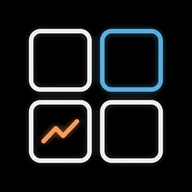

# Guides

These guides are for persons who use the platform: analysts, data scientists and clients.
Each guide does one task from start to end.

-   { .mono-icon }

    ### Build a dashboard

    Publish the results of a model to a client.

    [Build a client dashboard](client-dashboards.md){ .mono-more }

-   { .mono-icon }

    ### Choose a model

    Answer some questions and get a ranked shortlist.

    [Choose a model](choosing-a-model.md){ .mono-more }

-   { .mono-icon }

    ### Check a model

    Prove that a model is better than noise.

    [Read about null tests](null-tests.md){ .mono-more }

## Data

- [**From a spreadsheet to a Guided draft** Upload a spreadsheet and make a Guided draft with the HTTP API.](guided-data.md)
- [**Tree datasets, HDF5 and multi-file versions** Use NetCDF and HDF5 groups, and make one version from many files.](tree-data.md)
- [**Image data** Upload a folder of images, look at them and classify them.](image-data.md)
- [**Explore a dataset** Find gaps, outliers, trends and seasons before you fit a model.](data-explorer.md)

## Models

- [**Choose a model** Use the About cards and Help me choose to find the correct model.](choosing-a-model.md)
- [**Guided modelling** Set priors in business terms, add lift tests and read the scorecard.](guided-modelling.md)
- [**Marketing-mix models (MMM)** Fit an MMM and get the return of each channel.](mmm.md)
- [**Forecasting and sequential models** Make forecasts that start from the correct history.](time-series.md)
- [**statsmodels time-series models** Use twelve classical models, from SARIMAX to VECM.](../models/statsmodels.md)
- [**Measure the effect of a change** Measure the effect of a campaign, a launch or a price change.](causal.md)
- [**Deep learning** Train neural networks on tables and images.](deep-learning.md)
- [**Bring a PyMC model** Write one `build()` method and run your PyMC model on the platform.](pymc.md)
- [**Tabular models** Use scikit-learn, xgboost, LightGBM and CatBoost estimators.](sklearn.md)

## Trust and compare

- [**Can you trust this model?** Learn why a model must be better than noise, in plain words.](null-tests.md)
- [**Validate models with governance policies** Apply a policy, get the approval of a second person and keep the evidence.](governance.md)
- [**Track metrics, params and tags** Log metrics, params, tags and images in each run.](tracking.md)
- [**Compare runs and use experiments** Find runs, compare them side by side and group them.](run-comparison.md)
- [**Explore a model** See what a fitted model learned and how well it works.](model-explorer.md)

## Workflows

- [**Workflows** Build, run and schedule a full analysis as one graph.](workflows.md)
- [**Workflow cookbook** Copy one of ten complete, tested analyses.](workflow-cookbook.md)

## Plots

- [**Plots, recipes and templates** Use the standard plots of a model and add your own.](plots.md)
- [**Share plots** Save a plot, export an image or make an embed link.](sharing-plots.md)

## Dashboards and clients

- [**Build a client dashboard** Make a dashboard from a model or an endpoint and publish it. *Analyst*](client-dashboards.md)
- [**Share a dashboard with a link** Make, send and revoke a share link with a passcode. *Analyst*](sharing-dashboards-securely.md)
- [**Read your dashboard** Open your dashboard and read the numbers. You do not need statistics. *Client*](for-clients.md)
- [**Ask about your dashboard** Ask an AI assistant about the numbers on a dashboard. *Client*](ask-about-your-dashboard.md)
- [**Connect a chat tool with MCP** Let a desktop assistant or an agent read one dashboard. *Developer*](connect-a-chat-tool-with-mcp.md)

## Automate

- [**Endpoints and webhooks** Serve a model under a stable name and get signed events.](endpoints-and-webhooks.md)
- [**The Integrations hub** Connect a model to Google Sheets, a BI tool or a webhook.](integrations-hub.md)
- [**The command line** Use the `mapi` command on your computer or on a platform.](cli.md)
- [**The Python client** Control the platform from Python with `mapi_client`.](python-client.md)
- [**The HTTP API** Do the main flow with curl, one request at a time.](http-api.md)

## In other tabs

Some pages that were in Guides are now in the tab of their task.

- [**Your first MMM in Guided mode** The tutorial for a first analysis. *Learn*](guided-tutorial.md)
- [**Start here** The tours, the checklist and the sample project of the web app. *Learn*](start-here.md)
- [**Sign in and API tokens** Sign in with a browser, the CLI or a token. *Operate*](authentication.md)
- [**Administration** Manage members, roles, tokens and quotas. *Operate*](administration.md)
- [**Port a model in 15 minutes** Put a model that you have on the platform. *Extend*](port-a-model.md)
- [**Write a step or model plugin** Write and register a plugin in Python. *Extend*](plugins.md)

