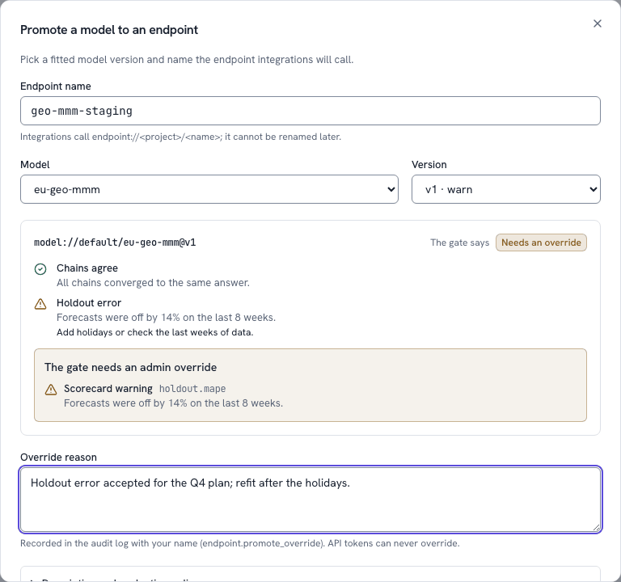
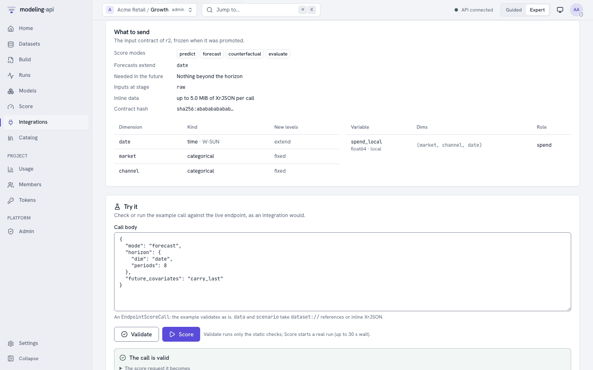
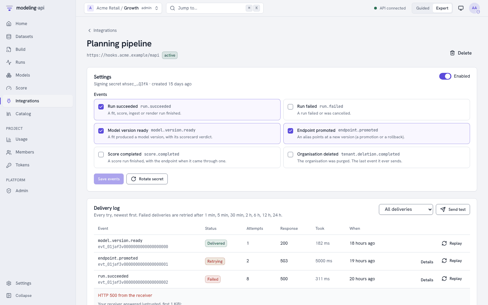
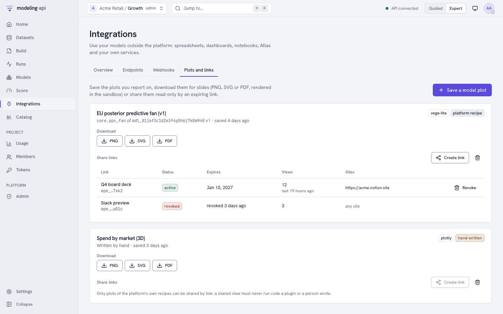
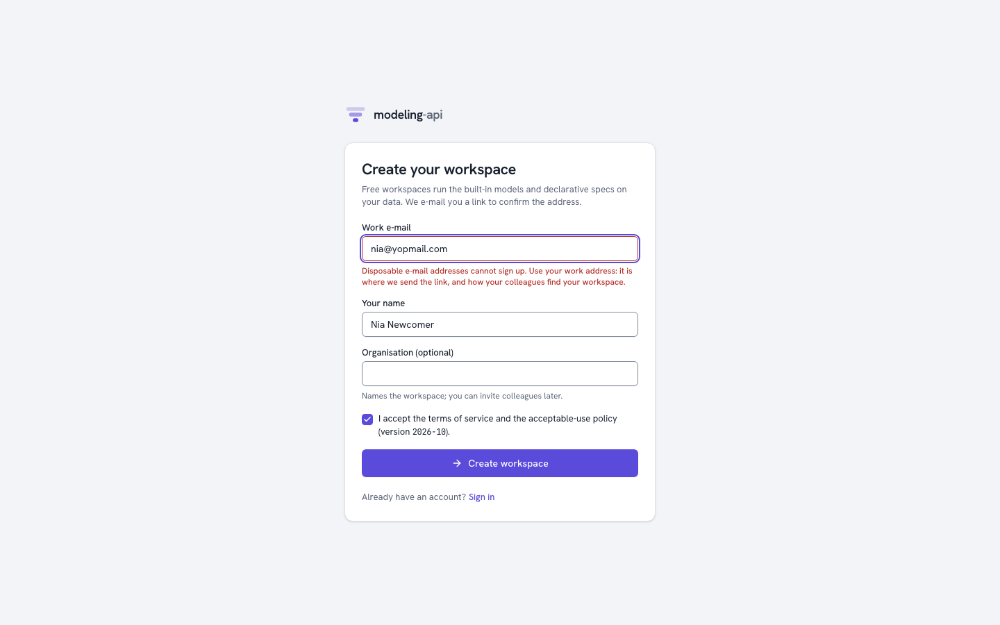
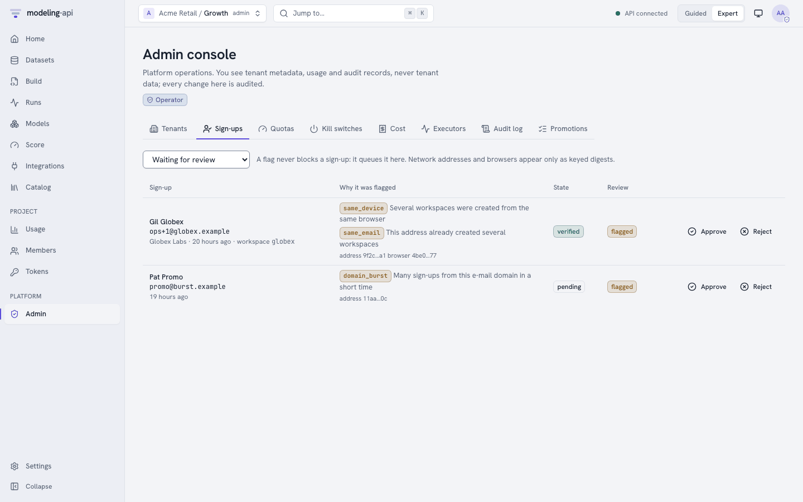

# The Integrations hub v0.4

**Integrations** in the web app's sidebar (++g++ then ++i++) is where a fitted model leaves
the platform: a spreadsheet scores it, a dashboard embeds its chart, your pipeline hears when
a fit is ready. Everything on these pages is one or two calls of the
[HTTP API](../reference/http-api.md#guided-and-integrations); the concepts behind them - the
promotion gate, signed webhooks, embed links for platform recipes only - are explained in
[Integrations](../concepts/integrations.md), and [Endpoints and webhooks](endpoints-and-webhooks.md)
does the same with `curl`.

The hub has four tabs: **Overview** (the Guided cards and the developer entry points),
**Endpoints**, **Webhooks** and **Plots and links**.

## Overview: connect in a few steps

{ .mapi-shot }

Three cards cover the common cases without reading any API documentation:

| Card | What you get | You need |
|---|---|---|
| **Google Sheets** | The Apps Script that scores an endpoint from a sheet (the result lands in `A1`), and the four steps to install it | An endpoint; a token from **Create a token** (it can only score that endpoint) |
| **BI dashboard** | A read-only, expiring embed link for Looker Studio, Power BI, Notion or Slack | A saved plot of a platform recipe |
| **Webhook** | A signed call to your URL when a model is ready or a run fails | The project admin role |

Below them, **For developers** links to the endpoints, to [scoped tokens](administration.md#api-tokens)
and to the server's own interactive API documentation (`/docs`) and OpenAPI 3.1 document
(`/openapi.json`).

## Endpoints and aliases

The **Endpoints** tab lists the project's endpoints: the alias, the model version it serves,
its revision, the gate it passed and when it was promoted. Click one to open its page.

### Promoting through the gate

**Promote a model** (project admins) asks for the endpoint's name, a model and a version.
The dialog shows the version's [sanity scorecard](../concepts/guided-mode.md#scorecard) and
the **expected gate**; **Promote** asks the server, which decides:

{ .mapi-shot }

| The gate says | The dialog | What to do |
|---|---|---|
| Passes | The endpoint page opens on the new revision | - |
| **Needs an override** (`409 OVERRIDE_REQUIRED`) | The reasons, each with its check (`holdout.mape`), and an **Override reason** field | A project admin signed in to the app writes why and clicks **Override and promote**; the override is audited as `endpoint.promote_override`. No API token can override |
| **Blocked** (`409 PROMOTION_BLOCKED`) | The reasons; no override | A failing scorecard, an interrupted fit, a `train_only` fit or a breaking input change: fix it and promote a new version |

The server also checks what the app cannot see - that the version was refitted on all data
after its holdout evaluation, and that its input contract still matches what callers send - so
an expected **Passes** can still come back blocked. **Description and evaluation policy**
sets the endpoint's [EvaluationPolicy](../concepts/integrations.md#promotion-gate): accept
exploration fits too, and block, warn about or allow input-contract changes. If someone else
promoted the endpoint while the dialog was open, the server refuses the stale revision and the
dialog says so.

### An endpoint's page

{ .mapi-shot }

- **Version and history**: the version served now (linked to its model page), who promoted
  it and how, the gate's reasons, and every promotion and rollback with its reason. **Roll back**
  returns to the previous revision's version, **Roll back here** to any earlier one; both ask
  for a reason, which is audited. The gate is not re-run on a rollback: that version passed it
  before. **Delete endpoint** needs the alias typed out; integrations calling it get `404`.
- **Schema and Try it**: the input contract frozen at promotion (score modes, the dim a
  forecast extends, dimensions and variables) and the example call. **Validate** runs the
  server's static checks (`POST …/validate`), **Score** a real score run (`POST …/score` with
  `Prefer: wait=30`, runner role) - edit the call first to try your own.
- **Snippets**: ready-to-run code for **Python**, **TypeScript**, **curl**, **R**, **Apps Script**
  and **Atlas**, generated by the server with the example call, each with a copy button and
  what to install first. **Notebook** is a cell for Jupyter or marimo. Snippets never contain a
  secret: they read the token from `MAPI_TOKEN`.

{ .mapi-shot }

{ .mapi-shot }

**Token for this endpoint** (and **Create a score:… token** on the Snippets tab) opens the
Tokens page's **New token** dialog prefilled for a `score:<alias>` token: it can read and score
that endpoint and nothing else, with a 120 requests-per-minute limit to start from.

## Webhooks

The **Webhooks** tab (project admins; others see why it is empty) lists every webhook with its
events, status and last delivery. **New webhook** asks for an https URL, a description and the
[events](../concepts/integrations.md#webhooks) to send. The platform refuses URLs on private
or internal addresses (`WEBHOOK_URL_BLOCKED`), and says so under the URL field.

The **signing secret is shown once**, right after creation: copy it into your receiver's
configuration (the dialog's **Done** stays disabled until you copy it or tick that you stored
it). The dialog also shows the few lines that verify a delivery's `Mapi-Signature`.

{ .mapi-shot }

A webhook's page has:

- **Settings**: enable or disable it, change its events, **Rotate secret** (the new secret is
  shown once; the old one keeps signing for 24 hours).
- **Delivery log**: every try, newest first - the event, its status (*Delivered*, *Retrying*,
  *Failed*, *Blocked*, *Pending*), the attempt number, your receiver's response code and the
  time it took. **Details** shows the error, the next retry and the first KiB of your
  receiver's answer (as untrusted text). **Replay** sends a delivery again; **Send test**
  replays the newest one, so you can check a receiver you just fixed.
- A webhook that kept failing (20 consecutive failed events, or a `410 Gone`) is **disabled
  automatically**: the page says why. Fix the receiver, then switch it back on; that resets
  the failure count.

## Plots and links

{ .mapi-shot }

The **Plots and links** tab keeps the plots you report on:

- **Save a model plot** picks a model, a version and one of its plots. The **Share** button in
  a model version's plot gallery opens the same dialog prefilled. A saved plot keeps pointing at
  that version, so a link to it never changes when the model is refitted.
- **Download** renders PNG, SVG or PDF in the sandbox (a `render` run, runner role; slow
  formats are followed until they finish) and checks the file's checksum before saving it.
  Plotly figures need kaleido and a Chrome in the runner image: when the server answers
  `MODE_NOT_SUPPORTED`, the Plotly download buttons are disabled with the server's reason.
- **Create link** makes a tokenised, read-only, expiring link - 7 to 365 days, 30 by default -
  optionally limited to the sites that may frame it (https origins). Only plots of the
  platform's own recipes can be shared; others say why the button is disabled. The link and
  its `<iframe>` code are **shown once**; the table below each plot lists its links with their
  status, expiry and view count, and **Revoke** ends one at once (viewers then see "This link
  has expired").

{ .mapi-shot }

See [Sharing plots](sharing-plots.md) for what the embed page does and does not load.

## Sign-up and e-mail verification

When the server allows self-service sign-up, the sign-in screen links to **Create a
workspace** (`/signup`), a page that works without a session:

{ .mapi-shot }

1. Enter a work e-mail, your name, optionally the organisation (it names the workspace) and
   accept the terms. Disposable e-mail addresses are refused at the e-mail field; a server
   with sign-up closed says so.
2. **Check your inbox**: the answer is the same whether or not the address already has an
   account. The link works once, for 24 hours; **Send the link again** replaces it. On a
   development server the page links straight to the mail in the outbox (`make outbox`).
3. The link opens `/verify-email`, which removes the token from the address bar and asks you
   to **Confirm and create my workspace**. That creates a `public`-tier workspace with a
   `default` project and makes you its admin; **Sign in** then goes through the usual
   identity-provider flow. An expired or reused link explains how to get a new one.

## Settings > Data

Organisation admins find a **Data** section at the bottom of **Settings**:

{ .mapi-shot }

- **Export your data** packs everything the organisation stored - workspace records
  (credentials redacted), datasets, model manifests, the audit log and the cost ledger, as you
  choose - into one archive. The page follows the export and offers **Download archive**; the
  link lasts 15 minutes, so reload the page for a fresh one. Exports work while the
  organisation is suspended.
- **Delete the organisation** needs the organisation id typed out. The organisation is
  suspended (read-only) at once and its runs are cancelled; for 7 days a banner on every page
  says when the purge starts, and **Cancel the deletion** restores it. Then every store is
  purged, with the progress shown per store. The audit log (pseudonymised) and the cost ledger
  (amounts only) are kept for their legal retention - see
  [Deleting and exporting data](data-deletion.md).

## Admin console additions

Platform operators get two more things in **Admin**:

- **Sign-ups**: the review queue of sign-ups a Sybil heuristic flagged (same network address,
  same browser, a repeated address, a burst from one domain), with the reasons in plain words.
  **Approve** clears the flag; **Reject** suspends the workspace the sign-up created. Both
  need a reason, which is audited.

  { .mapi-shot }

- **Trust** on each tenant row: its e-mail and identity verification and whether uploaded code
  is allowed, **Mark identity verified** (with the method and a reason) or withdraw it, and its
  deletion's status per store, with **Retry the purge** after a failure.

The **Promotions** tab explains that there is no promotion queue: the gate decides each
promotion at once, and overrides are in the audit log.
