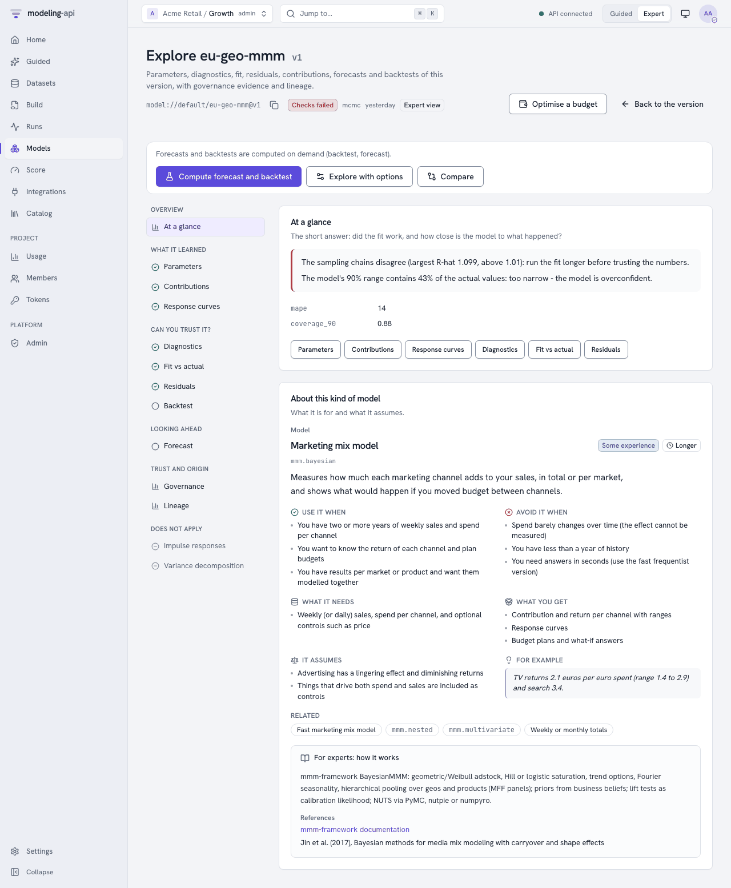
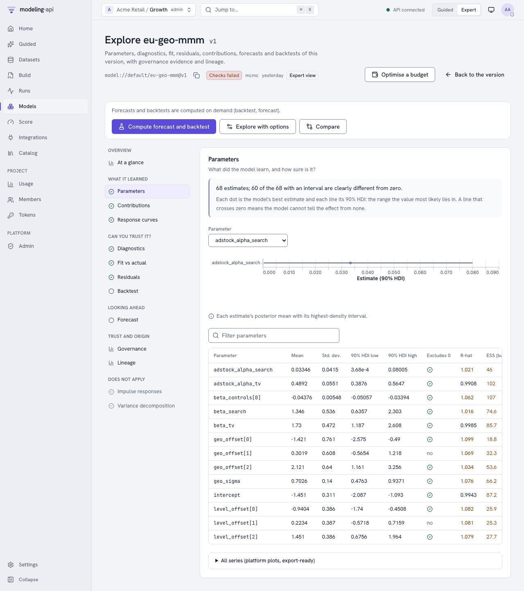
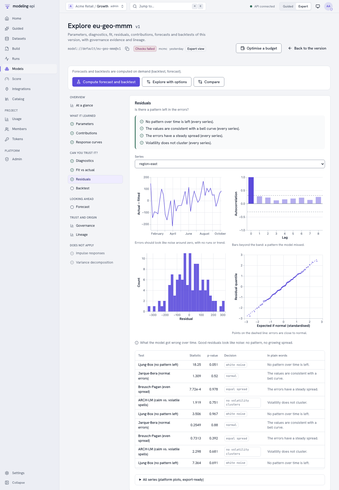
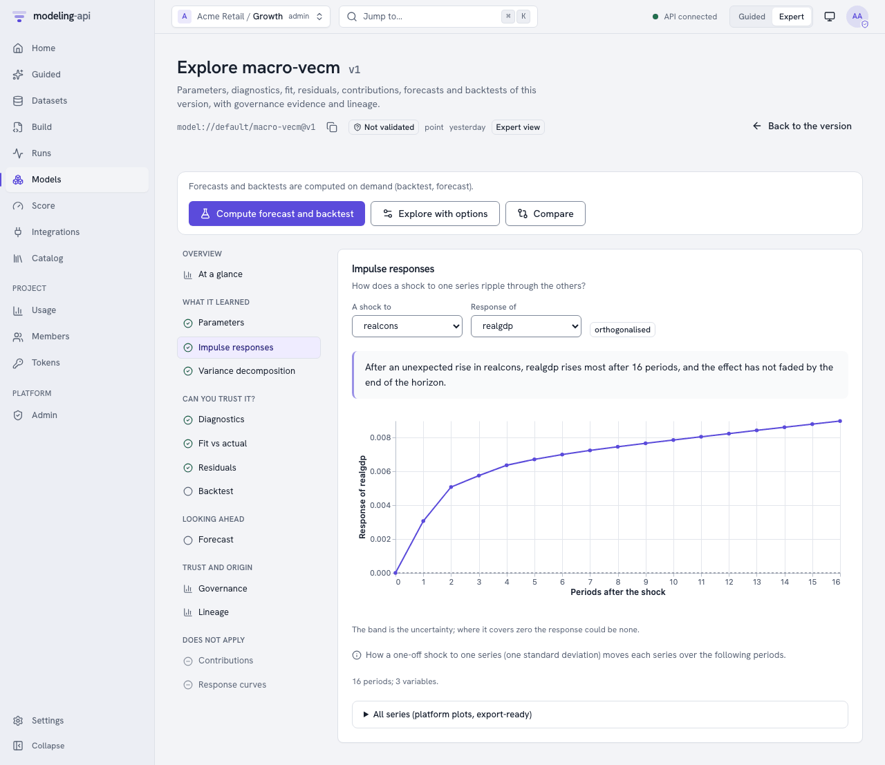
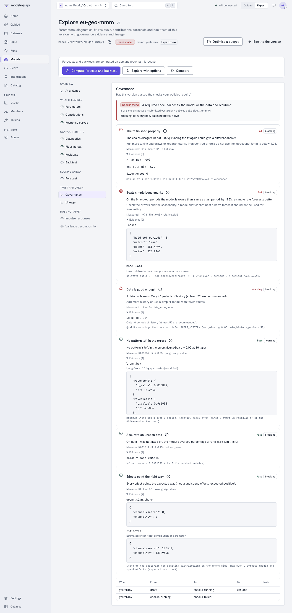
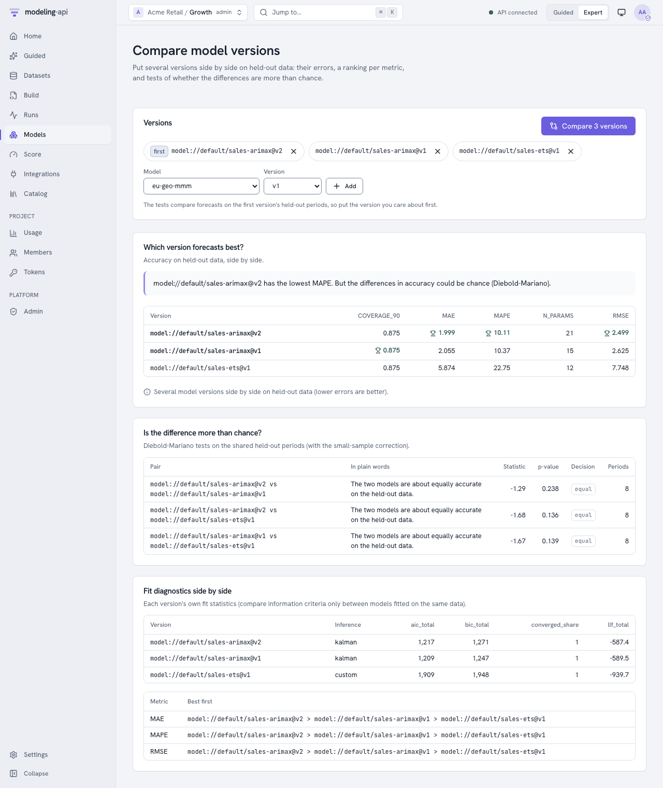
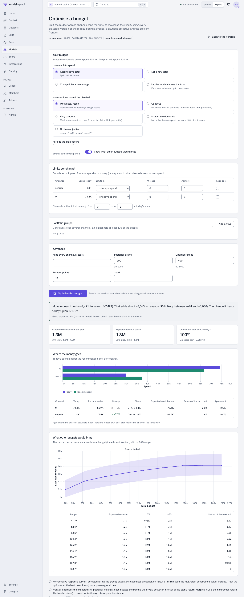

# Explore a model <span class="mapi-badge">v0.5</span>

The **Model Explorer** shows what a fitted model learned and how well it works. It does this
for all model families:

- Bayesian: posterior means with highest-density intervals, and R-hat.
- Frequentist: estimates with confidence intervals and p-values, and information criteria.
- Machine learning: coefficients or importances.

The sandbox calculates the views from the bundle and the data that the fit used. The views
come with Vega-Lite plots. The [web app](#in-the-web-app) shows each section with governance
evidence and lineage. It also compares versions and optimises budgets. The rest of this guide
uses the HTTP API that the web app calls.

## In the web app

The page of a model version has **Explore** and **Compare**. For marketing-mix models, it also
has **Optimise budget**. The Model Explorer (`/models/<model>/versions/<n>/explore`) puts its
sections into groups by the question that they answer:

| Group | Sections |
|---|---|
| Overview | *At a glance*: the plain readings of the diagnostics and the fit, the holdout metrics and the [About card](../concepts/about-and-choosing.md) of the model |
| What it learned | Parameters (a table that you can sort and filter, with intervals, p-values, R-hat and ESS, and a forest plot for each parameter), contributions, response curves, impulse responses, variance decomposition and fields (the outputs of the model on a 2-D grid) |
| Can you trust it? | Diagnostics (convergence, fit statistics for each series, the tests of the model), fit vs actual (with the coverage of the band in plain words), residuals (over time, ACF, histogram, QQ plot, Ljung-Box, Jarque-Bera, Breusch-Pagan and ARCH-LM), backtest |
| Looking ahead | Forecast (a fan for each series) |
| Trust and origin | Governance (the status badge of the latest validation, each check with its evidence, the status history) and lineage (dataset, spec revision, fit run and workflow run, and also plugin, image, seed and libraries) |

The explorer lists the sections that do not apply to the model last, with the reason. For
example, an MMM has no impulse responses. The explorer calculates forecasts and backtests only
when you ask:

- Click **Compute forecast and backtest**.
- Or click **Explore with options**. Then set the horizon, the interval and the backtest plan.
  The plan has these items: expanding window or rolling origin, horizons, folds, minimum
  training periods and gap.

As in the Data Explorer, Guided mode shows the plain reading first. Expert mode shows all the
numbers.

{ .mapi-shot }

{ .mapi-shot }

{ .mapi-shot }

{ .mapi-shot }

{ .mapi-shot }

The header shows the validation status of the version. It has a link to the validations of the
version, where you can request a new validation. Under *Governance evidence*, these links
show:

- **Open this validation** goes to the latest validation: its status path, the decisions of the
  reviewers and the evidence pack.
- **Policies** goes to the governance policies. See [Validate models with governance
  policies](governance.md#in-the-web-app).

If a workflow fitted the version, *Lineage* has a link to the monitor of the workflow run.

**Compare** (`/models/compare`) shows two to eleven versions side by side. To use it:

1. Select each model and version. The tests use the first version as the reference.
2. Click **Compare**.

The page shows these items:

- The holdout metrics, with a mark on the best value of each metric.
- The Diebold-Mariano tests in plain words. For example, "about equally accurate", or an
  advantage that is more than chance.
- The ranking for each metric.
- The fit statistics of each version.

Time-series forecasters (statsmodels and the other `ts` models) forecast the full held-out
period from one origin. Thus their errors make a single path, and no test of equal accuracy is
valid on it. For these models, the page shows the metrics and rankings. It tells you to
compare their backtests. You can also run a `compare.diebold_mariano` workflow node on
rolling-origin backtest errors.

{ .mapi-shot }

**Optimise budget** (`/models/<model>/versions/<n>/optimize`) is only for marketing-mix
models. It asks for these items:

- How much to spend: the current total, a new total, a change in percent, or the total that
  the model would select. The last option is only in Expert mode.
- How careful to be: the expected result, the 25th or 10th percentile, or the average of the
  worst 10%.
- Limits for each channel: multiples of the current spend, an amount of money, or no change.
- Portfolio groups and the frontier.

If the page cannot meet a bound, it tells you why before anything runs. The plan reads like
this: "Move money from tv (−7,491) to search (+7,491). That adds about +3,063 to revenue (90%
likely between +674 and +6,030)…". The plan also shows these items:

- The allocation for each channel (and market).
- The expected result now and with the plan.
- The probability that the plan is better than the current allocation.
- The return of the next unit for each channel.
- The efficient frontier.

The expected results show the number of digits that is necessary to make the two ends of each
range different. For example, "1.305M – 1.312M", not "1.3M – 1.3M". In Guided mode, the *What
if…* step goes to this page with **Optimise my budget**. The page gives the goal and the notes
of the optimiser in plain words, for example "Goal: the most likely revenue". The text of the
optimiser itself is under *For experts: how the plan was found*. The request and the result
are the request and result of
[`POST …:optimize`](../models/mmm-framework.md#budget-optimisation).

{ .mapi-shot }

## From Python and the command line

```python
--8<-- "client_v05_more.py:model-explorer"
```

```bash
mapi explore model model://growth/sales-arimax@v2 -s params -s residuals -s irf --horizon 12
mapi explore compare model://growth/sales-arimax@v2 model://growth/sales-ets@v1 --horizon 4
```

## Views written at fit

Each fit writes `params`, `diagnostics`, `fit`, `residuals`, `decomposition`,
`response_curves`, `irf`, `fevd` and `fields`. The fit lists the sections that do not apply to the model
as `skipped`, with the reason. Read the index and the views through the UI route of the model
version:

```bash
api "$API/v1/models/$MODEL_ID/versions/3/artifacts/ui/explore/index.json"
api "$API/v1/models/$MODEL_ID/versions/3/artifacts/ui/explore/residuals.json"
```

## Forecasts, backtests and more, on demand

```bash
api -X POST "$API/v1/models/$MODEL_ID/versions/3/explore" -d '{
  "sections": ["forecast", "backtest"],
  "horizon": 12,
  "backtest": {"kind": "expanding_window", "horizons": [1, 4, 12], "n_folds": 5,
               "min_train": 104}
}'
```

The answer (`202`) is an `Exploration`. Poll `GET /v1/explorations/{run_id}` to get the index
and the signed view links. If you send the same request again, the answer is `200` from the
last run.

## Compare model versions

```bash
api -X POST "$API/v1/models:compare" -d '{
  "models": ["model://growth/sales-arimax@v3", "model://growth/sales-ets@v1",
             "model://growth/sales-mmm@v2"]
}'
```

This call explores the first version with the other versions as `compare_with`. It writes the
`comparison` view, which has these items:

- The holdout metrics of each version, side by side.
- A ranking for each error metric. A lower value is better.
- Pairwise **Diebold-Mariano** tests on the held-out periods of the first version. The tests
  use the Harvey-Leybourne-Newbold small-sample correction and a Newey-West number of
  autocovariances. They answer the question "is the difference in accuracy more than chance?".

If a version forecasts the held-out periods from one origin (time-series forecasters), the
view does not include the tests. It gives a warning. For more sections, add
`"sections": ["comparison", "params"]`.

## The sections

| Section | What you see | Families |
|---|---|---|
| `params` | One row for each parameter cell: mean, sd, interval (`hdi_90` for Bayesian, `ci_90` for other models), p-value, R-hat, bulk ESS | all with parameters |
| `diagnostics` | R-hat max, ESS min, divergences, optimiser status, AIC/BIC, holdout metrics, the diagnostics of the plugin, warnings in plain words | all |
| `fit` | Actual against fitted with a 90% band, and the split line at the first held-out period | models over time |
| `residuals` | Residuals over time, their ACF, Ljung-Box, Jarque-Bera, Breusch-Pagan and ARCH-LM tests, a histogram and a normal QQ plot | models over time |
| `decomposition` | The contributions of the model over time (added over markets) and the share of each part | models with a `component` output (MMMs, linear models) |
| `response_curves` | Mean contribution for each channel at each spend level, with a 90% band | MMMs with a response grid |
| `irf` | Impulse responses (response × shock × horizon) with bands | VAR, VARMAX, VECM |
| `fevd` | Forecast-error variance decomposition | VAR, VARMAX, VECM |
| `fields` | Each output on a 2-D grid as an image: the mean, the sd, the mean÷sd, the 5% and 95% quantiles and some posterior draws for each frame, with arrows for a vector field. Play the draws to see some possible fields that agree with the data | models with an output that has a `grid` (maps, images, space-time fields) |
| `forecast` | A forecast fan over `horizon` periods after the history. The drivers stay at their last values | models that forecast |
| `backtest` | New fits on a rolling-origin or expanding-window plan: metrics for each fold and horizon, against "same as last period" and "same as last season" | models over time |
| `comparison` | More than one version side by side (above) | all |

The science models have many outputs on a grid. Some examples:

- `sci.heat_plate`: `field`, the temperature of each cell for each run.
- `sci.turing_pattern`: `pattern`, `settled` and `turing_space`.
- `sci.storm_localisation`: `render`, `patch_fit` and `frames_hat`.
- `sci.ibp_features`: `ink_hat` and `features`.
- `sci.graphical_model`: `pcor` and `edge_prob`.
- `sci.network_latent_space`: `tie_prob` and `tie`.
- `sci.circular_regression`: `density` and `overlap`.

The `fields` section calculates its statistics on a line. It does not use the circular rules
of an output that is an angle (`OutputDecl.circular`), as the score summaries do. At this
time, no circular output of a bundled model has a `grid`. The section does not show an output
that is not numeric, or an output that does not have the dims of its `grid`.

## For plugin authors: what the explorer reads

The explorer does not depend on the model. Plugins get these views if they follow some
conventions:

- **Predictions** come from the score path (`predict`, expected values). Thus each plugin gets
  `fit` and `residuals` automatically.
- **Parameters**: The explorer reads them from these sources, in this sequence:
    1. The `posterior` group (chain, draw).
    2. A `params` or `coefficients` group. This group is a *table* (variables `estimate`, and
       optionally `std_err`, `p_value`, `ci_lower`, `ci_upper` along one parameter dim). Or it
       has one variable for each parameter.
    3. `learned["params"]` as `{name: number}` or `{name: {estimate, std_err, p_value,
       ci_lower, ci_upper}}`.

    Confidence intervals without explicit bounds are `estimate ± z · std_err`.

- **Convergence**: Diagnostics with the code `RHAT`/`ESS_BULK`, `sample_stats.diverging`,
  `learned["converged"]` (a bool) or a `NOT_CONVERGED` diagnostic, and
  `learned["aic"|"bic"|"llf"]`.
- **Decomposition**: An output with a `component` dim (contributions).
- **Impulse responses**: A group or derived quantity `irf` with the variable `irf` over
  `(response, shock, horizon)` (optional `lower`/`upper`), and `fevd` over
  `(variable, horizon, shock)`.
- **Response curves**: The `response_curves` derived quantity that the what-if sliders use.

The governance checks use the same reads (see
[Validate models with governance policies](governance.md)).
