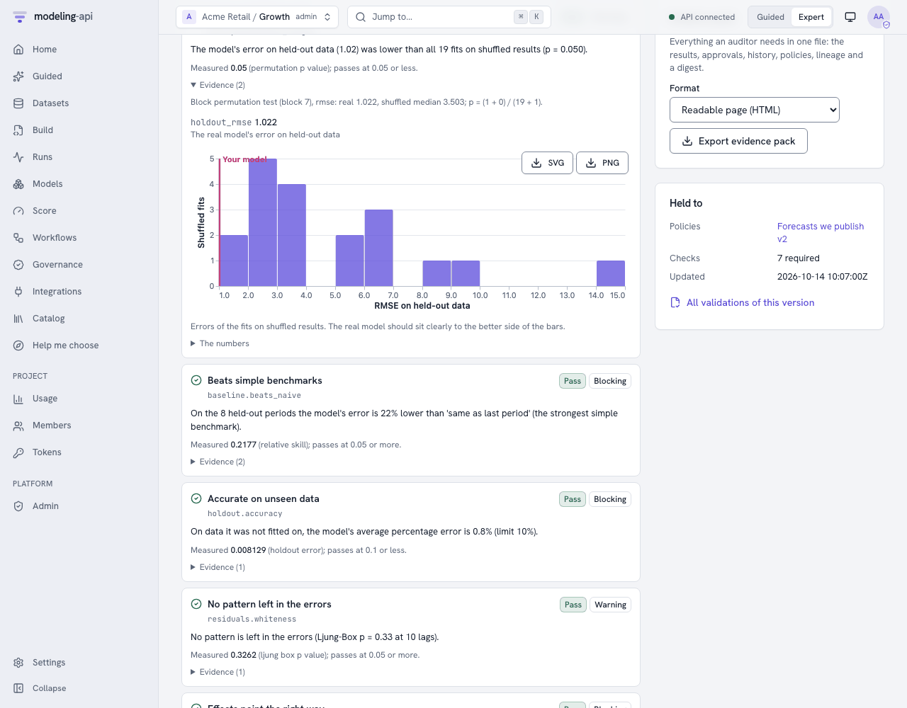

# Can you trust this model? <span class="mapi-badge">v0.5</span>

Any flexible model will find *something* in any data. Give a marketing-mix model ten channels
and two years of weekly sales and it will happily tell you what each channel returned - even if
the sales were random. The fit statistics will look fine. The charts will look convincing. The
only way to know whether the model learned something real is to **show it data where there is
nothing to learn, and check that it notices**.

That is what the platform's null tests do, and why a governance policy can require them before
anyone uses a model. The first half of this page explains them without formulas; the second
half gives the statistics. The how-to (policies, validations, approvals, evidence packs) is in
[Validate models with governance policies](governance.md).

## In plain words

### Shuffled results: does the model beat luck?

Take the column the model explains - weekly sales - and shuffle it, so that each week's sales
land on some other week. Now the relationship between spend and sales is destroyed, by
construction. Fit the same model to the shuffled data and measure how well it predicts weeks it
was not fitted on. Do that twenty or forty times.

If the model really learned how sales depend on the drivers, it predicts the real held-out weeks
**much better** than any of the shuffled versions predict theirs. If one shuffled fit in twenty
does as well as the real one, the model's apparent skill is the kind of skill you get from
noise. The check reports this as a *p-value*: the share of shuffled fits that did at least as
well (with a small correction so it is never exactly zero).

| What you see | What it means |
|---|---|
| "lower than all 39 fits on shuffled results (p = 0.025)" | The model's skill is very unlikely to be luck. |
| "1 of 20 fits on shuffled results did as well (p = 0.095)" | Borderline: real signal, but weak, or too few shuffles to tell. |
| "9 of 20 did as well (p = 0.48)" | The model is fitting noise. Do not use it to make decisions. |

Weeks are shuffled **in blocks** (a run of consecutive weeks moves together), so slow patterns
inside the data survive; only the link between drivers and result is broken. A model that wins
only because of a trend still has to beat shuffled data that keeps short-term structure.

{ .mapi-shot }

Persistence is the honest limit of this test. On a series that wanders (a random walk), a
model that differences it gets most of its skill from "next week is like this week", and
blocks of shuffled weeks keep much of that, so shuffled fits can forecast nearly as well. The
cookbook's ARIMAX on such a series beats naive by 25% on unseen weeks and still sees 2 of 20
shuffled fits tie it ([the output](workflow-cookbook.md#run-it-with-the-python-client)): the
test is right that most of the skill is persistence. To measure what the *drivers* add on
such series, require the fake-driver and shifted-driver tests below as well.

### Fake drivers: does the model credit anything it is given?

Add three drivers that are pure noise - copies of a real spend column scrambled in time, or
random numbers with the same average and spread - and fit the model again. A trustworthy model
gives them almost **nothing**: a few hundredths of a percent of sales, with a range that
comfortably includes zero.

If a channel made of random numbers gets 8% of sales, the model hands out credit too easily, and
the credit it gave your real channels is suspect too. The usual causes are too many drivers for
the amount of history, priors that are too loose, or drivers that move together.

### Shifted drivers: is it the timing, or just the season?

Move every driver six months away from when it actually happened and refit. Real advertising
effects should **vanish** - spend in March cannot drive sales in September. If the model still
finds most of the effect, it is picking up the season or the trend, and calling it advertising.

### The other checks, briefly

- **Beats naive**: on weeks it never saw, the model must be better than "same as last week" and
  "same as this week last year". A forecast that cannot beat that is not worth its complexity.
- **Nothing left in the errors**: what the model gets wrong should look like noise; a pattern in
  the mistakes means the model missed something predictable.
- **Stable over time**: refitted on different stretches of history, the key numbers should not
  swing wildly.
- **Signs make sense**: spend should not *reduce* sales; prices should not *raise* demand
  (unless you say so).
- **Assumptions do not decide the answer** (Bayesian models): widen and narrow the priors; the
  answer should barely move.
- **Finds known answers**: simulate data from the fitted model, refit, and check that the ranges
  contain the truth about 90% of the time.
- **The fit finished properly**, **the error on unseen data is below your limit**, and **the
  data is good enough** (no long gaps, no constant drivers, no negative spend).

### What the platform does with the results

A **policy** lists the checks a kind of model must pass, how strict each one is
(`blocking` stops validation, `warning` is shown to the reviewer, `info` is evidence only),
and whether a second person must approve. When you validate a model version, the checks run in
the sandbox, every result is stored with its evidence, and the version becomes `validated`,
`awaiting_approval` or `checks_failed`. Endpoints can be told to serve only validated
versions. Everything is in the evidence pack an auditor can read without access to the platform.

```bash
mapi validate model model://growth/geo-mmm@v7     # runs the checks, shows every result
mapi approve "$VALIDATION" --comment "Null tests convincing"   # a second person
mapi validations pack "$VALIDATION" --out evidence.html
```

## For statisticians

Notation: `y` the target over `n` periods, `ŷ` the model's predictions, `H` the held-out periods
of the model's data split, `L` the check's loss (RMSE by default). Every refit uses the model's
own spec and pipeline through the SDK harness (the same code path as a fit), under a refit
budget (`RefitBudget`: at most `max_refits` refits; Bayesian refits are capped at 200 draws and
200 tuning steps on 2 chains).

### `null.permutation_target` - a block permutation test

H0: the drivers carry no information about `y` beyond what the model would find in exchangeable
noise. Let `T0` be the held-out loss of the real fit and `T_b` the same statistic after refitting
on `y` with blocks of `ℓ` consecutive periods permuted (`ℓ = max(1, n // 20)` by default; the
`block` parameter changes it), `b = 1..B`. The Monte-Carlo p-value is

```text
p = (1 + #{b : T_b <= T0}) / (B + 1)
```

which is exact - valid at every `B` - under exchangeability of the blocks. Two consequences
practitioners miss:

- **Resolution.** The smallest attainable p is `1 / (B + 1)`: with the default `B = 20` it is
  0.048, so a 5% test is barely possible. Use `B >= 39` for a 2.5% resolution (the policy
  parameter is `n_permutations`).
- **Block length trades validity for power.** Unit blocks break the autocorrelation of `y` and
  make the null too easy to reject for a model with AR terms (any autoregressive model beats an
  i.i.d. shuffle); long blocks keep it but leave few distinct permutations. The default keeps
  about 20 blocks.

Thresholds are on p: pass ≤ 0.05, warn ≤ 0.10, fail above.

### `null.noise_regressors` - placebo regressors measured by ablation

`K` placebo drivers (`n_noise`, default 3) are added - a real driver block-permuted in time
(`kind: shuffled_driver`, which keeps its distribution and short-run autocorrelation) or
Gaussian noise with its mean and variance - as new channels of a marketing-mix model, or new
variables of other models. After the refit each placebo's **effect share** is measured through
the score path, not read from a coefficient:

```text
s_k = Σ_t |ŷ_t(full) - ŷ_t(placebo k switched off)|  /  Σ_t |ŷ_t(full)|
```

so it works for non-linear models (saturation, adstock, trees) alike. The check reports
`max_k s_k` (pass ≤ 2%, warn ≤ 5%). For Bayesian models the 90% interval of each placebo's
total effect across posterior draws must cover zero; for frequentist models a placebo
coefficient with p < 0.05 is flagged; either turns a nominal pass into a warning. Under the null
a calibrated model flags a placebo about 5% of the time *per placebo*: with `K = 3` a single
flag is expected about once in seven runs, which is why a flag warns rather than fails unless
the share itself is large. Models whose in-sample predictions follow the stored history (the
statsmodels plugins) use `|β_k| · Σ_t |z_k,t − z_k,t(off)|` instead.

### `null.placebo_time_shift`

Each driver is circularly shifted by every `δ` in `shifts` (default ±26 periods) and the model
refitted; the statistic is the placebo effect as a share of the real effect,
`max_δ Σ|Δ_δ ŷ| / Σ|Δ ŷ|` (pass ≤ 0.25, warn ≤ 0.5). It targets confounding by seasonality and
trend: a half-year shift deliberately misaligns annual seasons, so an effect that survives it is
not the driver's.

### `baseline.beats_naive` - out-of-sample skill

On `H`, with the training-only fit, `skill = 1 − MAE(model) / min_j MAE(benchmark_j)` over naive
(last value), seasonal naive (same period last season), mean and drift forecasts made from the
training history; MASE is reported as evidence. Pass ≥ 0.05, warn ≥ 0. For a formal test of
the difference on backtest folds, use the `compare.diebold_mariano` workflow node:

```text
d_t  = L(e1_t) - L(e2_t)                       (squared or absolute loss)
DM   = mean(d) / sqrt(lrv(d) / n)              lrv: autocovariances up to lag h - 1
HLN  = DM * sqrt((n + 1 - 2h + h(h - 1)/n) / n)
p    = 2 * P(T_{n-1} > |HLN|)
```

It needs more than `h` paired errors; with too few folds it says so instead of returning a
number.

### `residuals.whiteness`

Ljung-Box `Q = n(n + 2) Σ_{k=1..m} ρ̂_k² / (n − k)` on the in-sample residuals of every series,
with the start-up residuals of differencing removed and the degrees of freedom reduced by the
ARMA orders (`m − p − q`); the smallest p-value across series counts (pass ≥ 0.05, warn ≥ 0.01).
Mind the multiplicity: with many series some rejections are expected, so a panel-wide policy may
prefer `severity: warning`.

### `stability.rolling_params`

The model is refitted on rolling windows of history (`window`, default about half the sample);
for each key estimate the coefficient of variation across windows is reported, scaled by the
estimate's own standard error when the estimate is near zero (otherwise a coefficient that
wobbles around zero would look unstable by construction). Pass ≤ 25%, warn ≤ 50%.

### `sensitivity.prior` and `recovery.simulated`

Prior sensitivity multiplies every prior scale found under a `prior…` settings key by each of
`scales` and reports the largest relative move of a key posterior mean (pass ≤ 20%). Recovery is
a parametric-bootstrap version of simulation-based calibration: `y* = E[y] + ε*` with
block-bootstrapped residuals, `S` refits, and the coverage of the 90% intervals for the fitted
values (target 90%, pass within 10 points). It is skipped for autoregressive models, where
resampled residuals do not reproduce the model's own dynamics.

### Interpreting a set of results

A policy is a multiple-testing procedure: with a dozen checks at their own thresholds, a sound
model will warn on something now and then. That is why severities exist. Make the checks that
protect the decision `blocking` (for a marketing-mix model the null tests and the signs, for a
forecast the naive benchmark and holdout accuracy) and leave diagnostics as `warning` or `info`
for the reviewer. Each `CheckResult` carries `value`, `threshold`, `message_plain`, an expert
message, a `suggested_action` and the evidence (the real score next to every shuffled score,
each placebo's share and interval), so the reviewer can see *how* close a call was.

## Try it

=== "CLI"

    ```bash
    --8<-- "cli_v05.sh:governance"
    ```

=== "Python"

    ```python
    --8<-- "client_v05_more.py:policies"
    ```

    ```python
    --8<-- "client_v05_more.py:validate"
    ```

=== "Policy file"

    ```yaml
    --8<-- "forecast-policy.yaml"
    ```

A workflow can run the same checks as a node (`governance.policy` with `submit: true`) and
record the validation itself - see the [cookbook](workflow-cookbook.md#readiness-to-arimax).
