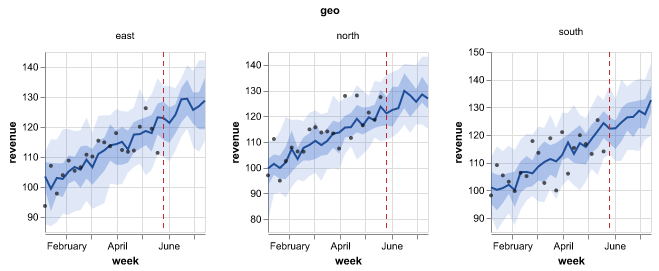
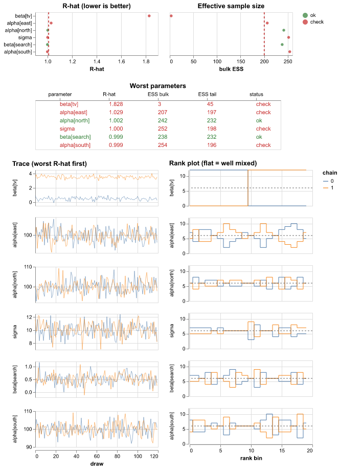
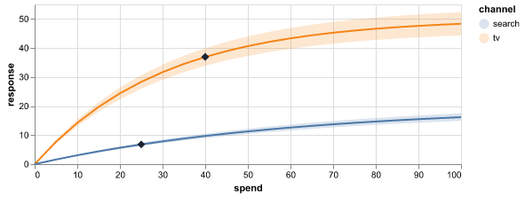
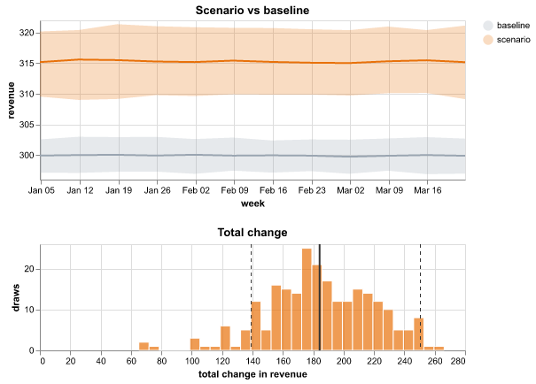
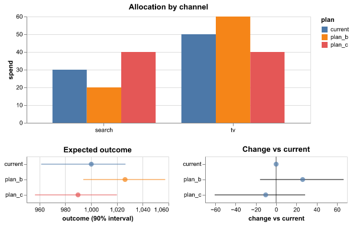

# Plots: recipes, templates and safe sharing

Each model that you fit gets a set of standard plots at no cost. The set includes a data
overview, convergence, posterior predictive checks, a fan of the fit and forecast, decomposition,
scenario comparisons and more. Plots are **Vega-Lite** (or **Plotly** for 3D, maps and
animation). A small envelope, the `PlotSpec`, contains each plot. The data goes next to the spec
as named Arrow tables, never as a URL. Each plot goes through a sanitizer before a person sees it.

```bash
uv add "mapi-plots[recipes]"   # recipes + Altair/Plotly helpers (runner images, notebooks)
uv add mapi-plots              # sanitizer and templates only (JSON in, JSON out)
```

<figure markdown>
  
  <figcaption>`core.ppc_fan`: the model estimate, the 50% and 90% bands, the actual values and the end of the training data. The plot shows one panel for each market.</figcaption>
</figure>

## Render a recipe in a notebook

A recipe is a function. It changes a fitted bundle or a score output into a `PlotSpec`:

```python
--8<-- "plots.py:recipe"
```

A recipe accepts different inputs:

- An `xr.DataTree` (a bundle or a score output)
- An `xr.Dataset`
- A plain `{"group": Dataset}` mapping

A recipe finds its groups at the root, under `model/` (for bundles) or at other positions in the
tree. The recipe does a check of its options. If an option is unknown or a group is missing, the
recipe raises a typed `RecipeDataError` (`SCHEMA_INVALID`). The error tells what the recipe
expected.

Each plot contains these items:

- **`persona`**: `guided` (analysts), `expert` (data scientists) or `both`.
- **`caption_plain`**: a description of the chart in plain language, with the actual numbers.
  For example: "The scenario changes total revenue by 184 (90% interval 139 to 251) compared
  with the baseline. Probability of an increase: 100%."
- **`provenance`**: the recipe and its version, the bundle id and a timestamp.

!!! tip "Try each recipe without a model"
    `mapi_plots.examples.example_inputs()` returns synthetic bundle trees and score trees for
    each recipe. It makes them with xarray only:

    ```python
    --8<-- "plots.py:all"
    ```

## The standard catalog

| Recipe | What it shows | Reads |
|---|---|---|
| `core.data_overview` | Each variable over time for each group, a heatmap of missing values, the group sizes | raw data / `observed_data` |
| `core.prior_predictive` | The datasets that the model makes before it sees data, compared with your data. Also a prior fan. | `prior_predictive`, `observed_data` |
| `core.convergence` | R-hat and ESS for each parameter, a table of the worst parameters, trace plots and rank plots, divergences | `posterior`, `sample_stats` |
| `core.posterior_forest` | The median, the 50% HDI and the 94% HDI for each parameter. One panel for each variable. | `posterior` |
| `core.ppc` | Predictive densities compared with observed values, a PIT histogram, interval coverage | `posterior_predictive`, `observed_data` |
| `core.ppc_fan` | A fan of the fit and the forecast, with the line between the training data and the forecast | draws or `summary`, `observed` |
| `core.fit_vs_actual` | Predicted values against actual values, with R² and MAPE | predictions + observed |
| `core.residuals_over_time` | Actual values minus predicted values over time | predictions + observed |
| `core.decomposition` | Stacked contributions over time, and the total share of each component. A part that the model marks as not additive (a trend slope) is not in the stack. | `contributions`, `decomposition` or `components` |
| `core.model_comparison` | The elpd of each model and the difference to the best model (PSIS-LOO table or WAIC) | `comparison`, or one child for each model with `log_likelihood` |
| `core.counterfactual` | The scenario compared with the baseline over time, and the distribution of the total change | `draws`/`summary`, `baseline/…`, `delta/…` |
| `core.decision_distribution` | The distribution of a decision objective for each option, and P(best) | `decision`/`objective` |
| `core.pair` | A grid of the draws of each pair of parameters, a histogram of each parameter, divergent transitions in red | `posterior`, `sample_stats` |
| `core.ridge` | One density curve for each level of a dim (such as each group), sorted by the mean, with HDI bars | draws in `posterior`, `predictions` or `posterior_predictive` |
| `core.rank_matrix` | The probability of each rank for each item, and the probability that one item is above another | draws in `posterior`, `predictions` or `posterior_predictive` |
| `core.calibration` | The PIT-ECDF difference with a simultaneous band, or a reliability diagram for 0/1 targets. For 0/1 targets, one predicted probability for each row is sufficient. | draws or point probabilities, `observed_data` |
| `core.state_sequence` | The observed series above the stacked probability of each hidden state over time | `hidden_states`, `regimes`, a score `summary`, state draws; `observed_data` |
| `core.roc_pr` | The ROC curve and the precision-recall curve of a 0/1 target, with the AUC and the average precision | draws or point probabilities, `observed_data` |
| `core.confusion` | The 2 × 2 table of actual and predicted classes at one threshold, with accuracy, precision, recall, specificity and F1 | draws or point probabilities, `observed_data` |
| `core.loss_curve` | The loss of each step of a fit (for example ADVI), raw and smoothed | `fit_history` or `metrics_history` |
| `core.loo_pit` | The LOO-PIT check of calibration and the Pareto k of each observation | `log_likelihood`, `posterior_predictive`, `observed_data` |

The **marketing-mix pack** (`mmm.*`) adds these plots:

- Response curves that mark the current spend
- The marginal cost (or the marginal ROI) for each channel
- A comparison of budget plans
- A channel decomposition
- Your beliefs and the priors (`mmm.prior_beliefs`): the range that you gave for each
  channel, next to the values that the model allows before it sees your sales

The **tabular pack** (`ml.*`) adds `ml.feature_importance`. This plot shows ranked tree
importances, or signed coefficients for linear estimators. It reads them from the groups that
the scikit-learn plugin and the xgboost plugin keep in their bundles.

The **science pack** (`sci.*`) draws gridded fields and images (`sci.field_map`,
`sci.image_residuals`, `sci.ppc_image_grid`, `sci.power_spectrum`), areas on a map
(`sci.area_map`), trees (`sci.phylogeny`), angles (`sci.rose`), colours (`sci.swatches`),
points with error ellipses (`sci.point_pattern`) and profiles and ensembles of curves. The
**network pack** (`net.*`) adds `net.graph`, a node-link drawing and an adjacency matrix of an
edge variable. The [plot reference](../reference/plots.md) lists the settings of each recipe.

<div class="grid" markdown>









</div>

### Plots for classifiers, training and states

These plots read the outputs of more model types:

- **0/1 targets.** `core.calibration`, `core.roc_pr` and `core.confusion` accept draws or one
  probability for each row. Thus they apply to a Bayesian model and to a scikit-learn classifier.
  The larger of the two target values is the positive class. To change it, set `positive`.
- **Fits in steps.** An ADVI fit keeps its loss in the `fit_history` group. The fit run adds
  `core.loss_curve` to the plots of that fit. If the loss still goes down at the end, the caption
  tells you to use more steps.
- **Hidden states.** `core.state_sequence` reads the `hidden_states` group of the HMM and the
  `regimes` group of the Markov switching model. If the data has more than one series (for
  example one series for each animal), the plot shows the first series. The caption names it.
  To show a different series, set `select`.
- **Pareto k.** `core.loo_pit` shows which observations make the LOO estimate unreliable. It is
  not a default plot. Add it in the plot builder or in the `plots` list of a model.

Recipes obey the **representation** of each output. If a dim must go, a recipe adds the joint
draws. A recipe never adds quantiles or intervals. If a summary has an extra dim, the recipe
tells you to request an aggregated output. The recipe shows summed means without a band.
Predicted-vs-actual plots and residual plots never need a total. Thus they compare these
summaries cell by cell (one dot or line for each `store × sku`, with the color of the facet dim).

## Find a recipe in the web app

The **Plots** tab of the **Catalog** shows a card for each recipe, with an example plot made
from synthetic data. The buttons above the cards filter the recipes by pack:

- **All plots**
- **All models** (`core.*`)
- **Marketing mix** (`mmm.*`)
- **Machine learning** (`ml.*`)
- **Science** (`sci.*`)
- **Networks** (`net.*`)

A pack shows only when the catalog has a recipe of that pack. Type words in the search field to
find a recipe by its id, title or About card. Click a card to see the About card and a larger
example.

## Plots in a workflow

A workflow can draw a recipe with the node `plot.render`. Set `recipe` to the id (for example
`sci.field_map`) and, if necessary, `settings` and `source` (`auto`, `data`, `model` or
`predictions`, default `auto`). `model.forecast` and `evaluate.residuals` also give `plot`
outputs. A `report.summary` can show the plots in its `plots` input. The server puts each plot
through the sanitizer. A plot that is not safe fails its node with `PLOT_UNSAFE`. See
[Score a model and draw plots](workflows.md#score-a-model-and-draw-plots).

The plot sandbox applies the theme to polar plots (`barpolar` and `scatterpolar`), for example
`sci.rose`.

## Bring your own chart

Make the chart with Altair or Plotly as usual. Then put it in an envelope:

```python
--8<-- "plots.py:altair"
```

- `from_altair` moves the inline data of Altair (and all `data.values`) into named Arrow
  datasets. It also writes the references again. The function fills named data
  (`alt.Data(name="pts")`) from `datasets={"pts": frame}`.
- `from_plotly` decodes plotly.py 6 typed arrays (`{"dtype": "f8", "bdata": ...}`) into Arrow
  datasets, one for each trace. It binds them with `{"$ref": "trace0.y"}`. The function removes
  the default plotly.py template, because the renderer applies the theme to plots. To keep the
  template, set `keep_template=True`.

Both functions run the sanitizer. If the chart breaks a rule, they raise a `SanitizeError`.
`from_plotly` also removes HTML from the strings that it moves into datasets (see below).

**Colors and dark mode.** An explicit mark color has priority over all themes. Thus the platform
recipes use only colors from `mapi_plots.palette` (for example `OBSERVED`, `ESTIMATE`, `BAND`,
`ALERT`). In dark mode, the plot sandbox replaces each palette color with its dark variant. Each
stroke, dot and text color keeps a contrast of 3:1 or more on the two card backgrounds. To get
the same behavior in your own charts, use the palette. The plot shows all other colors as
written, in the two themes.

## Role- and dim-bound templates

A template binds channels to **roles and dims**, not to the variable names of one model. Thus a
plot of "the target over time, one line for each geo" applies to all models of a family:

```python
--8<-- "plots.py:template"
```

In a template spec, `{"$bind": "y"}` becomes a Vega-Lite field definition. The bound name
replaces `"{{y}}"` (also `{{y.field}}`, `{{y.type}}`, `{{y.title}}`). The kinds of binding are
`dim:`, `role:`, `var:`, `coord:` and `stat:` (a summary statistic, for example
`stat:hdi_90_lower`). The API runs the half that uses only JSON,
`mapi_plots.templates.apply_template`. It does a check that a saved template applies to a model
before the app renders a plot.

## What the sanitizer allows

Plots run in an isolated iframe on a different origin. But the server does a check of each plot
first:

| Rejected | Why |
|---|---|
| `url` data (in all positions, also lookups and topojson) | Data must have a name as its reference. The plot cannot fetch data. |
| `href` encodings and mark properties | The plot cannot go to other pages. |
| `image` marks, `url` channels, `layout.images` / `image` traces with sources that are not `data:` | The plot cannot fetch external data (only base64 PNG/JPEG/GIF/WebP). |
| Tile-map traces and subplots (`scattermap`, `choroplethmap`, `densitymap`, `layout.map`) | The tiles come from third-party servers. Use `scattergeo`/`choropleth`. |
| `__proto__`, `constructor`, `prototype` keys or field paths | Prototype pollution |
| `javascript:`, `data:text/html`, SVG data URIs, CSS `url()` in a string | Vectors for scripts and fetches |
| Vega expressions that are not in a small allow-list of functions, method calls, `window`/`document`/`fetch`, computed member names | Escapes from the expression sandbox |
| Custom format types, Plotly network options (`topojsonURL`, `showLink`, ...) | Hooks for code and the network |
| All items that do not agree with the pinned Vega-Lite v6.4.1 / plotly.js 4.1.1 schemas | Unknown keys are where exploits hide. |

Plotly text keeps only `<b>`, `<i>`, `<br>`, `<sub>` and `<sup>` (and `<extra>` in hover
templates). The sanitizer removes all other tags and reports each removal as a change. The server
never decodes Arrow. Thus the sandbox removes tags from the text that `from_plotly` moves into a
dataset (`text`, `hovertext`, category labels), and scans it, during conversion. The plot iframe
must also treat dataset strings as not trusted. It must remove the tags again before it gives the
strings to plotly.js.

Vega shows dataset strings as text, and the tooltip handler of the iframe escapes them. The
sanitizer does a check of the method `args` of Plotly buttons and sliders. It checks the
`{attr: value}` form and the positional `[attr, value]` form. It rejects `usermeta.embedOptions`
in Vega-Lite specs. Specs have limits on size, depth, node count and string length. For the full
list of rules and error codes, see the [plots reference](../reference/plots.md).

```python
--8<-- "plots.py:sanitize"
```
