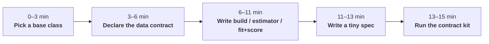

# Port a model in 15 minutes

You have a model that works in a notebook. This guide changes it into a plugin. The platform can
fit the plugin, score it on new data, forecast with it, keep its versions and plot it. The
contract kit proves that the plugin works. You write the statistics. The platform writes all the
other code.



## What you write, what you get

| | You write | The platform does |
|---|---|---|
| **`PyMCModel`** | `build(ds, settings, ctx) -> pm.Model` | Engines (nutpie, PyMC with segments that can continue, MAP, ADVI), convergence diagnostics, scores that build the model again and predict, new levels from the hyperprior, counterfactuals with common random numbers, fast scores |
| **`SklearnModel`** | `estimator(settings)` | It stacks labelled dims into rows and features. Also coordinate features, safe persistence (skops / xgboost JSON), quantile / bootstrap / conformal uncertainty, pooled new levels, contributions |
| **`CustomModel`** | `fit(...)` and `score(...)` | Binding, preprocessing, splits, context tails, the canonical form of coordinates, inverse transforms, summaries, bundles |

The three base classes get these items at no cost:

- Validated settings with JSON Schemas
- Static validation of the spec
- An evaluation, then a new fit
- CoordPlan checks
- Summaries that obey the representation
- Plots and bundles

## 1. Pick a base class (0–3 min)

- If your model is a **PyMC** model, use `mapi_pymc.PyMCModel`.
- If your model is an **sklearn or xgboost estimator** on a design matrix, use
  `mapi_sklearn.SklearnModel` (or the quantile, bootstrap, conformal or classifier variants).
- For all other models (statsmodels, JAX, a Kalman filter, closed-form mathematics), use
  `mapi_sdk.CustomModel`.

## 2. Declare the data contract (3–6 min)

Write the dims and the variables that your model needs, in **canonical names**. For each dim,
write what can occur to it at score time. This is the `schema_template` of the model. In the
spec, users bind the names of their own dataset to it.

!!! tip "Three questions for each dim"
    Can a score request bring a **new level** (a new county, store or market)? If yes, the dim
    is `new_levels`, with a strategy. Does the dim **grow** at forecast time (time,
    observations)? If yes, the dim is `extend`. If not, the dim is `fixed`.

## 3. Write the model (6–11 min)

=== "PyMC"

    ```python
    --8<-- "plugin_pymc.py:model"
    ```

    The `ctx` helpers make the scores work. You do not have to think about them:

    | Helper | Why you use it |
    |---|---|
    | `ctx.coords()` | The coords of the model. At score time, it includes new levels. |
    | `ctx.data(name)` | A `pm.Data` over the training values at fit time and over the score values at score time (the platform builds the model again) |
    | `ctx.observed(name)` | The target at fit time. A placeholder at score time (never imputed). |
    | `ctx.hier_effect(name, dim)` | A partially pooled effect. Its **new levels** come from the hyperprior, for each posterior draw. |
    | `ctx.position(dim)` | 0, 1, 2, … along an `extend` dim. The count continues into the forecast horizon. |

    `expected` names the `Deterministic` that is the expected value of each output. Thus
    `output.kind: expected` returns it without observation noise.

=== "scikit-learn / xgboost"

    ```python
    --8<-- "plugin_sklearn.py:model"
    ```

    `estimator()` returns an estimator instance from the **allow-list** (or a `{kind, params}`
    mapping). The platform rejects subclasses and parameters that are not in the params model of
    the estimator. Thus the platform can always load the bundle safely. Rows, columns and
    coordinate features are settings, not code. See [Tabular models](sklearn.md).

=== "Custom"

    ```python
    --8<-- "plugin_custom.py:model"
    ```

    The rules for `score`:

    - The dataset comes in the **canonical** form. It has the fit order. New levels come at
      the end, with the flag `<dim>__is_new` (`new_level_mask(ds, dim)`). Thus parameters that
      use the position as an index stay aligned.
    - Return an `xr.DataTree` with a `predictions` group in the representation that you
      declared.
    - Never look at the targets in the payload. The `evaluate` mode sends them for the metrics,
      not for you.

    `FitOutput.groups` uses the ArviZ group names (`posterior`, `sample_stats`, …). `learned`
    contains small JSON. `native` contains bytes in a **safe** format only (skops, xgboost JSON,
    safetensors). The platform rejects pickle.

### What the notebook models of science needed

The 15 `sci.*` models came from notebooks in the same way. Some of them needed more than the
three steps above. If your model is similar, see these sections:

| Your model | What to use | See |
|---|---|---|
| Its rules join two or more settings | A pydantic `model_validator` on the settings. The SDK refuses bad settings before it uses the data. | [Settings rules that need no data](plugins.md#settings-rules-that-need-no-data) |
| An output is an image, a map or a vector field | `grid` in the output declaration | [Outputs that are images or maps](plugins.md#outputs-that-are-images-or-maps) |
| An output is a direction or a time of day | `circular: true`, and a `period` attribute on the scored array | [Outputs that are angles](plugins.md#outputs-that-are-angles) |
| It makes new data from the posterior | The `simulate` mode, and real predictive draws for `kind: predictive` | [Score modes](plugins.md#score-modes) |
| You compare variants by `elpd_loo` | A `log_likelihood` group, or `loo_valid=False` with a reason | [Models that give `elpd_loo`](plugins.md#models-that-give-elpd_loo) |
| NUTS gets stuck at the default start | `EnginePlan.initvals` and `jitter=False` | [Start every chain at one point](pymc.md#start-every-chain-at-one-point) |
| It has its own sampler (for example Gibbs) | A `CustomModel` with `inference="mcmc"` and a `diagnostics` hook | [A model with its own sampler](plugins.md#a-model-with-its-own-sampler) |
| Some NaN of an input are part of the design | `structural_missing` | [A model](plugins.md#a-model) |
| Users must upload the data of a case study | An export case in `mapi_plugin_science.export.EXPORTS` | [Data for a case study](plugins.md#data-for-a-case-study-mapi-plugin-science) |

## 4. Write a tiny spec (11–13 min)

The contract kit fits this spec. Keep it small and fast: use few draws and few trees.

=== "PyMC"

    ```python
    --8<-- "plugin_pymc.py:check"
    ```

=== "Custom (with a step)"

    ```python
    --8<-- "plugin_custom.py:check_model"
    ```

## 5. Run the contract kit (13–15 min)

`check_model` fits your fixture. Then it tries to break your plugin in the same ways that real
users will:

```text
contract kit: model acme.geo_baseline@1.0.0
  [PASS] manifest: acme.geo_baseline@1.0.0 (point)
  [PASS] fit: bundle ef4100375dbb, metrics ['mape', 'rmse']
  [PASS] bundle_roundtrip_no_pickle: scores match after write/read
  [PASS] shuffled_scoring: shuffled ['geo']
  [PASS] subset_scoring: subset of 'geo'
  [PASS] new_level_policies: geo: new level scored (pooled)
  [PASS] extend_typed_errors: raised NON_CONTIGUOUS_EXTENSION; raised COORD_NOT_ALLOWED
  [PASS] unsupported_mode: raised MODE_NOT_SUPPORTED
  [PASS] context_window_equivalence: holdout via stored context == in-sample full series
  [PASS] evaluate_path_equals_score_path: metrics ['rmse', 'mape'] reproduced through the score path
  [PASS] output_space_and_units: y_hat in raw (None)
  [PASS] representation_aggregation: point aggregation over 'geo' allowed
  [SKIP] additive_contributions: contribution_scale is not additive
  [PASS] seed_determinism: same seed, same fit and scores
```

| Check | What it proves |
|---|---|
| `bundle_roundtrip_no_pickle` | The scores are the same after the kit writes and reads the bundle. The bundle contains no pickle. |
| `shuffled_scoring`, `subset_scoring` | Labels in a different sequence and subsets give the same answers for the same cells. |
| `new_level_policies` | Each strategy that your dims declare works (or raises `UNSEEN_LEVELS` when it must). |
| `extend_typed_errors` | Gaps and time labels out of range raise typed errors. |
| `unsupported_mode` | The model refuses modes that it does not declare. |
| `context_window_equivalence` | A forecast score of the last training periods is equal to the in-sample result. |
| `evaluate_path_equals_score_path` | The normal score path makes the same holdout metrics again. |
| `output_space_and_units` | The outputs are inverted. They have labels for the units and the output space. |
| `representation_aggregation` | The representation controls which aggregations the model allows or refuses. |
| `additive_contributions` | The sum of the contributions that are declared additive is equal to the prediction. |
| `seed_determinism` | If the plugin claims it, the same seed gives the same fit and scores. |

If a check fails, the kit raises `ContractViolation` with the report. To get the report as a
return value, pass `raise_on_failure=False`.

### In your test suite

`mapi-sdk` installs a pytest plugin. Thus the kit is available as fixtures in all projects:

```python
--8<-- "test_my_plugin.py:pytest"
```

## Bonus: a preprocessing step

Steps use the same pattern. A step has settings, an optional state, `fit` / `transform` /
`inverse`, and a static `effect_template`. The `effect_template` tells the control plane how the
schema changes.

```python
--8<-- "plugin_custom.py:step"
```

```python
--8<-- "plugin_custom.py:check_step"
```

The step kit does a check of these items:

- The exported catalog entry
- A deterministic and pure fit
- That `transform` never learns
- The bundle round trip of the state
- That the declared schema effect agrees with the real output
- That the step accepts a missing target
- The inverse round trip
- The equivalence of the context window for steps that look back
- Each policy for unseen levels

For more information, see [Write a step or model plugin](plugins.md).

## Ship it

Register your plugins through entry points in the `pyproject.toml` of your package. The value can
be a class, a tuple of classes or a function that returns them:

```toml
[project.entry-points."mapi.models"]
acme = "acme_models.plugins:PLUGINS"      # PLUGINS = (Radon, GeoBaseline)

[project.entry-points."mapi.steps"]
acme = "acme_models.steps:STEPS"          # STEPS = (ScaleStep,)
```

`mapi_sdk.default_registry()` then finds them. The runner images of the platform also find them.

!!! success "Checklist"
    - [x] `schema_template` in canonical names, with correct dim policies
    - [x] `capabilities`: representation, score modes, contribution scale
    - [x] `outputs` with `units_of`, so that the results come back in the units of the user
    - [x] `grid` on outputs that are images or maps, and `circular: true` (with a `period`
      attribute) on outputs that are angles
    - [x] `score_modes` that list only the modes that `score` can do
    - [x] rules that join settings in a `model_validator`, not in `fit`
    - [x] a `log_likelihood` group if users compare variants by `elpd_loo`, or
      `loo_valid=False` with a reason
    - [x] settings as a `ModelSettings` subclass with defaults and descriptions (they become
      the form in the UI)
    - [x] a tiny spec, and `check_model` passes in CI
    - [x] no pickle: native artifacts as skops, xgboost JSON or safetensors

For the full guides with examples, see [PyMC](pymc.md), [scikit-learn and xgboost](sklearn.md)
and [steps and custom models](plugins.md).
