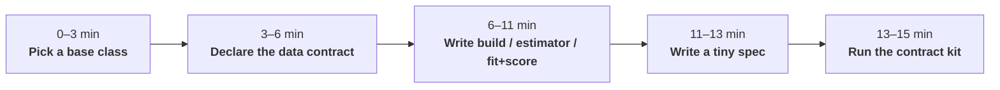

# Port a model in 15 minutes

You have a model that works in a notebook. This guide turns it into a plugin that the platform
can fit, score on new data, forecast, version and plot, and proves it with the contract kit.
You write the statistics; the platform writes everything around them.



## What you write, what you get

| | You write | The platform does |
|---|---|---|
| **`PyMCModel`** | `build(ds, settings, ctx) -> pm.Model` | Engines (nutpie, PyMC with resumable segments, MAP, ADVI), convergence diagnostics, rebuild-and-predict scoring, new levels from the hyperprior, common-random-number counterfactuals, fast scoring |
| **`SklearnModel`** | `estimator(settings)` | Stacking labelled dims into rows and features, coordinate features, safe persistence (skops / xgboost JSON), quantile / bootstrap / conformal uncertainty, pooled new levels, contributions |
| **`CustomModel`** | `fit(...)` and `score(...)` | Binding, preprocessing, splits, context tails, coordinate canonicalisation, inverse transforms, summaries, bundles |

All three get, for free: validated settings with JSON Schemas, static spec validation,
evaluate-then-refit, CoordPlan checks, representation-aware summaries, plots and bundles.

## 1. Pick a base class (0–3 min)

- Your model is a **PyMC** model → `mapi_pymc.PyMCModel`.
- Your model is an **sklearn or xgboost estimator** on a design matrix → `mapi_sklearn.SklearnModel`
  (or the quantile, bootstrap, conformal or classifier variants).
- Anything else (statsmodels, JAX, a Kalman filter, closed-form maths) → `mapi_sdk.CustomModel`.

## 2. Declare the data contract (3–6 min)

Write down, in **canonical names**, the dims and variables your model needs and what may
happen to each dim at score time. This is the model's `schema_template`. Users bind their own
dataset names onto it in the spec.

!!! tip "Three questions per dim"
    Can a score request bring a **new level** (a new county, store, market)? Then `new_levels`,
    with a strategy. Does it **grow** at forecast time (time, observations)? Then `extend`.
    Otherwise `fixed`.

## 3. Write the model (6–11 min)

=== "PyMC"

    ```python
    --8<-- "plugin_pymc.py:model"
    ```

    The `ctx` helpers are what make scoring work without you thinking about it:

    | Helper | Why you use it |
    |---|---|
    | `ctx.coords()` | The model's coords; at score time includes new levels |
    | `ctx.data(name)` | A `pm.Data` over the training values at fit and the score values at score time (the model is rebuilt) |
    | `ctx.observed(name)` | The target at fit; a placeholder at score time (never imputed) |
    | `ctx.hier_effect(name, dim)` | A partially pooled effect whose **new levels** are drawn from the hyperprior per posterior draw |
    | `ctx.position(dim)` | 0, 1, 2, … along an `extend` dim, continued into the forecast horizon |

    `expected` names the `Deterministic` that is the expected value of each output, so
    `output.kind: expected` returns it without observation noise.

=== "scikit-learn / xgboost"

    ```python
    --8<-- "plugin_sklearn.py:model"
    ```

    `estimator()` returns an **allow-listed** estimator instance (or a `{kind, params}`
    mapping). Subclasses and parameters outside the estimator's params model are rejected, so the
    bundle can always be loaded safely. Rows, columns and coordinate features are settings,
    not code: see [Tabular models](sklearn.md).

=== "Custom"

    ```python
    --8<-- "plugin_custom.py:model"
    ```

    The rules for `score`:

    - the dataset arrives **canonicalised**: fit order, new levels appended and flagged by
      `<dim>__is_new` (`new_level_mask(ds, dim)`), so position-indexed parameters line up;
    - return an `xr.DataTree` with a `predictions` group in your declared representation;
    - never look at targets in the payload (`evaluate` mode passes them for metrics, not for
      you).

    `FitOutput.groups` uses ArviZ group names (`posterior`, `sample_stats`, …), `learned` holds
    small JSON, and `native` holds bytes in a **safe** format only (skops, xgboost JSON,
    safetensors). Pickle is rejected.

## 4. Write a tiny spec (11–13 min)

The spec the contract kit fits. Keep it small and fast: few draws, few trees.

=== "PyMC"

    ```python
    --8<-- "plugin_pymc.py:check"
    ```

=== "Custom (with a step)"

    ```python
    --8<-- "plugin_custom.py:check_model"
    ```

## 5. Run the contract kit (13–15 min)

`check_model` fits your fixture and then tries to break your plugin the way real users will:

```text
contract kit: model acme.geo_baseline@1.0.0
  [PASS] manifest: acme.geo_baseline@1.0.0 (point)
  [PASS] fit: bundle ef4100375dbb, metrics ['mape', 'rmse']
  [PASS] bundle_roundtrip_no_pickle: scores match after write/read
  [PASS] shuffled_scoring: shuffled ['geo']
  [PASS] subset_scoring: subset of 'geo'
  [PASS] new_level_policies: geo: new level scored (pooled)
  [PASS] extend_typed_errors: raised NON_CONTIGUOUS_EXTENSION; raised COORD_NOT_ALLOWED
  [PASS] unsupported_mode: raised MODE_NOT_SUPPORTED
  [PASS] context_window_equivalence: holdout via stored context == in-sample full series
  [PASS] evaluate_path_equals_score_path: metrics ['rmse', 'mape'] reproduced through the score path
  [PASS] output_space_and_units: y_hat in raw (None)
  [PASS] representation_aggregation: point aggregation over 'geo' allowed
  [SKIP] additive_contributions: contribution_scale is not additive
  [PASS] seed_determinism: same seed, same fit and scores
```

| Check | What it proves |
|---|---|
| `bundle_roundtrip_no_pickle` | Scores are identical after writing and reading the bundle, and nothing in it is pickle |
| `shuffled_scoring`, `subset_scoring` | Reordered labels and subsets give the same answers for the same cells |
| `new_level_policies` | Every strategy your dims declare works (or raises `UNSEEN_LEVELS` when it should) |
| `extend_typed_errors` | Gaps and out-of-range time labels raise typed errors |
| `unsupported_mode` | Undeclared modes are refused |
| `context_window_equivalence` | Scoring the last training periods as a forecast equals the in-sample result |
| `evaluate_path_equals_score_path` | The holdout metrics are reproduced through the normal score path |
| `output_space_and_units` | Outputs are inverted and labelled with units and output space |
| `representation_aggregation` | Aggregations are allowed or refused according to the representation |
| `additive_contributions` | Declared-additive contributions sum to the prediction |
| `seed_determinism` | The same seed gives the same fit and scores, when the plugin claims it |

A failed check raises `ContractViolation` with the report (pass `raise_on_failure=False` to
get the report instead).

### In your test suite

`mapi-sdk` installs a pytest plugin, so the kit is available as fixtures in any project:

```python
--8<-- "test_my_plugin.py:pytest"
```

## Bonus: a preprocessing step

Steps follow the same pattern: settings, an optional state, `fit` / `transform` / `inverse`,
and a static `effect_template` that tells the control plane how the schema changes.

```python
--8<-- "plugin_custom.py:step"
```

```python
--8<-- "plugin_custom.py:check_step"
```

The step kit checks the exported catalog entry, deterministic and pure fitting, that
`transform` never learns, the state's bundle round trip, that the declared schema effect matches
the real output, that a missing target is tolerated, the inverse round trip, context-window
equivalence for look-back steps, and every unseen-level policy. More in
[Write a step or model plugin](plugins.md).

## Ship it

Register your plugins through entry points in your package's `pyproject.toml`; the value may
be a class, a tuple of classes or a function that returns them:

```toml
[project.entry-points."mapi.models"]
acme = "acme_models.plugins:PLUGINS"      # PLUGINS = (Radon, GeoBaseline)

[project.entry-points."mapi.steps"]
acme = "acme_models.steps:STEPS"          # STEPS = (ScaleStep,)
```

`mapi_sdk.default_registry()` then finds them, and so will the platform's runner images.

!!! success "Checklist"
    - [x] `schema_template` in canonical names, with honest dim policies
    - [x] `capabilities`: representation, score modes, contribution scale
    - [x] `outputs` with `units_of`, so results come back in the user's units
    - [x] settings as a `ModelSettings` subclass with defaults and descriptions (they become
      the form in the UI)
    - [x] a tiny spec and `check_model` passing in CI
    - [x] no pickle: native artifacts as skops, xgboost JSON or safetensors

See the full worked guides: [PyMC](pymc.md), [scikit-learn and xgboost](sklearn.md),
[steps and custom models](plugins.md).
