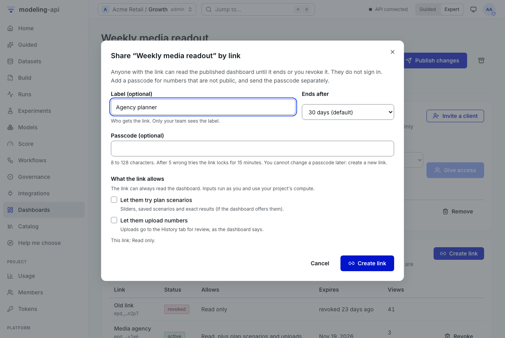
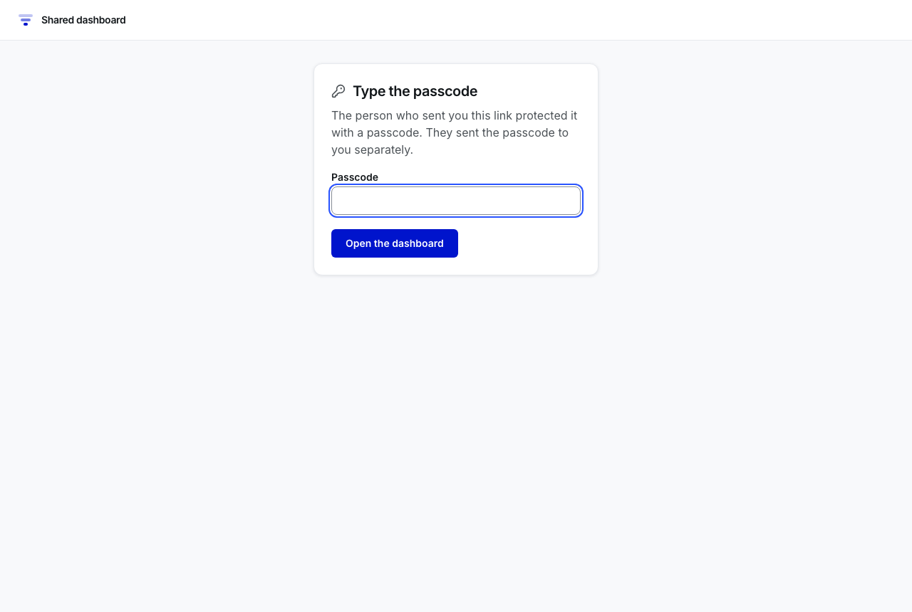
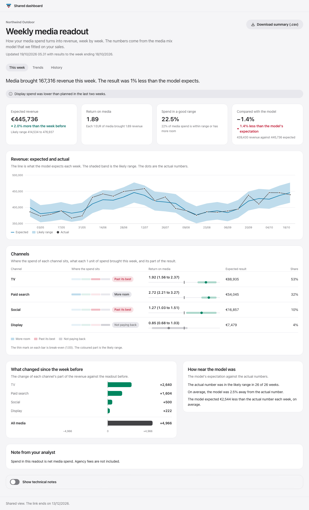
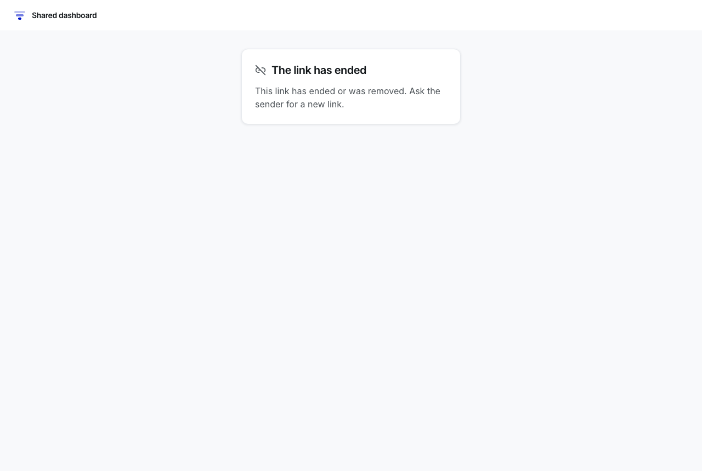

# Share dashboards securely <span class="mapi-badge">v0.16</span>

A **share link** lets a person without an account read one published dashboard. This page
tells how to make a link, and how the platform protects it. For client users who sign in,
give access on the **Access** tab in place of a link
([Build a client dashboard](client-dashboards.md#5-give-access)).

Use a share link when:

- the readers do not need an account, for example a board pack or an agency,
- the link can end on a known date,
- you can revoke it when the work ends.

Use a client user when the persons come back often, when you must know who looked, or when
they upload numbers for each period.

## Make a link

1. Open the dashboard and select the **Access** tab.
2. In **Share links**, select **Create link**.
3. Type a **Label**, for example "Board pack". Only your team sees the label.
4. Select **Ends after**: 7, 30 (the default), 90, 180 or 365 days.
5. Optional: type a **Passcode** of 8 to 128 characters.
6. Optional: select what the link allows. New links are read-only:
    - **Let them try plan scenarios**: the what-if sliders.
    - **Let them upload numbers**: the **Update numbers** tab.
7. Select **Create link**.
8. Copy the link, then select **I have copied the link** and **Done**.



The app shows the link **one time only**. The server keeps only a keyed hash of the token. If
you lose the link, revoke it and make a new link.

A link can allow only the inputs that the published dashboard offers. A link that allows
inputs spends the compute of the run-as owner. Thus, to make it, you need the `runner` role.

!!! tip "Send the passcode separately"
    Send the link in one message and the passcode in a different message, or tell it on a
    call. You cannot change the passcode of a link. To change it, revoke the link and make a
    new link.

## What the reader sees

The reader opens `https://<your app>/s#mpd_…`. If the link has a passcode, the page asks for
it.



Then the page shows the published dashboard, with the tabs that the link allows, and the
footer "Shared view. The link ends on DD/MM/YYYY." The reader sees the published readouts and
the scenarios and uploads that were made with the same link. Uploads from a link wait for
your review (unless the dashboard publishes uploads automatically).



If the link was revoked or has ended, the page says: "This link has ended or was removed.
Ask the sender for a new link."



## Revoke a link

1. In **Share links**, select **Revoke** on the row of the link.
2. Select **Revoke link**.

The next request with the link fails, also from a page that is open. **Archive** of the
dashboard revokes all its links. Deletion of the tenant also revokes them.

The table shows each link: its label, the last 4 characters of the token (`mpd_…x7k2`), its
status (`active`, `expired` or `revoked`), what it allows, whether it has a passcode, its
expiry and the number of views.

## How the platform protects a link

| Risk | Protection |
|---|---|
| A guessed token | The token is `mpd_` + 40 random Crockford base32 characters (200 bits). Each client address can make 120 requests in each minute, valid or not (`MAPI_SHARE_IP_RATE_PER_MINUTE`). The server counts the request before it looks at the token |
| The token in logs or in the `Referer` header | The token is in the URL fragment (`#…`). Browsers do not send the fragment to a server. The page removes the token from the address bar at once, and sends it one time, in a POST body. Share pages and answers set `Referrer-Policy: no-referrer` |
| A stolen session | The session (`mps_…`) is signed by the server and lives 30 minutes (`MAPI_SHARE_SESSION_TTL_S`). The page keeps it in memory only, never in storage or a cookie. The page gets a new session while the link is valid |
| A revoked or expired link that stays open | Each request looks up the link again. Revocation, expiry and a suspended tenant stop the next request (`410 LINK_EXPIRED`) |
| Passcode guesses | A passcode has 8 to 128 characters. The server keeps an scrypt hash of it. After 5 wrong passcodes (`MAPI_SHARE_PASSCODE_MAX_FAILURES`), the link locks for 15 minutes (`MAPI_SHARE_LOCKOUT_S`, `429 SHARE_LOCKED`). Each failure is audited |
| The link used with your account | Share routes ignore `Cookie` and `Authorization`, and allow only the origin of the web app, with no credentials. A share session never gives access to other routes |
| Spend on your compute | New links are read-only. Exact results are limited to 6 each hour for each link (`MAPI_SHARE_RUN_RATE_PER_HOUR`) and to the daily limit of the dashboard. Requests are limited to 120 each minute for each link |
| Cached pages | Share answers set `Cache-Control: private, no-store` |
| The dashboard in a frame on a different site | The app sends `frame-ancestors 'none'`. You cannot embed a dashboard |

The audit log records each link that is made or revoked (`dashboard.share_create`,
`dashboard.share_revoke`) and each wrong passcode (`dashboard.share_unlock_failed`).

## Chat and MCP on a link

The chat of a dashboard is off for share links, also when it is on for team members and
clients. If you turn it on for links, all persons who use the same link share one daily
limit, and the assistant can show the cases and scored files that were made with the link
([Share links and privacy](ask-about-your-dashboard.md#share-links-and-privacy)). A person
with the link and its passcode can also connect a chat tool
([Connect a chat tool with MCP](connect-a-chat-tool-with-mcp.md#with-a-share-link)). A
revoked link stops both at the next request.

## With the API

```bash
# make a read-only link for 30 days (the answer has the token, one time only)
curl -s -X POST "$MAPI_URL/v1/dashboards/$DASHBOARD/shares" \
  -H "Authorization: Bearer $MAPI_TOKEN" -H "X-Mapi-Project: growth" \
  -H "Content-Type: application/json" \
  -d '{"label": "Board pack", "expires_in_days": 30}'

# a reader: exchange the token for a session, then read
SESSION=$(curl -s -X POST "$MAPI_URL/v1/share-sessions" -H "Content-Type: application/json" \
  -d '{"token": "'"$TOKEN"'"}' | jq -r .session)
curl -s "$MAPI_URL/v1/shared/readouts" -H "X-Mapi-Share: $SESSION"

# revoke it
curl -s -X POST "$MAPI_URL/v1/dashboards/$DASHBOARD/shares/$SHARE:revoke" \
  -H "Authorization: Bearer $MAPI_TOKEN" -H "X-Mapi-Project: growth"
```

The Python client opens a link with `api.dashboards.open_share(link, passcode=...)`
([The Python client](python-client.md#client-dashboards)). The settings are in the
[Configuration reference](../operations/configuration.md).
