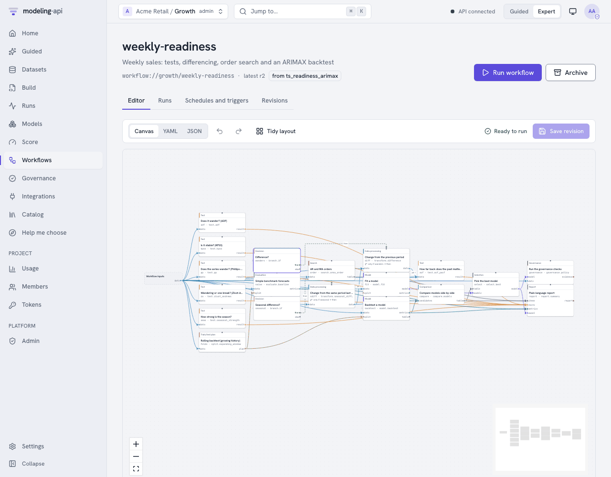
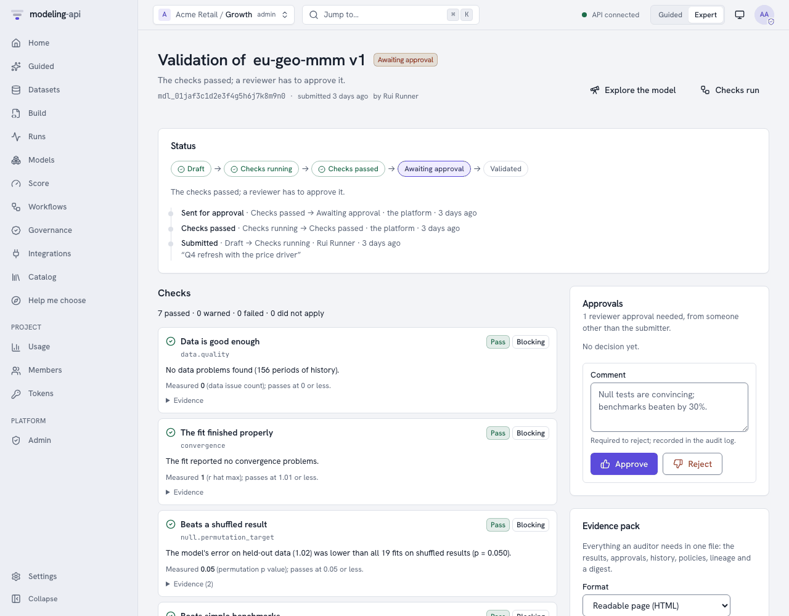

# The Expert web app v0.3

The web app is the Expert-mode front end of the platform. In the app, data scientists upload
data, write and validate specs, fit them, inspect the fitted models and score them. The app
uses the same `/v1` [HTTP API](http-api.md) as the CLI and the Python client. The app has no
special permissions. Each button is one or two API calls.

This page shows each page in the sequence of the navigation. The screenshots come from the
[quickstart](../getting-started/quickstart.md) stack. `make dev` serves the app at
<http://127.0.0.1:5173>.

!!! note "Guided mode"
    The **Guided / Expert** switch in the header changes all of the app to the task flow for
    analysts. [Your first analysis in Guided mode](guided-tutorial.md) describes this flow.
    The two modes edit the same `ModelSpec`.

## The shell

| Element | What it does |
|---|---|
| Project switcher | Shows the tenant and the project for all the actions on the page, and your role there. You can switch to a different project, make a project (tenant admins) or open its members. See [Authentication](authentication.md#browser-sign-in). |
| Sidebar | Home, Guided, Datasets, Build, Runs, Experiments (v0.14), Models, Score, Workflows, Governance, Integrations, Catalog and Help me choose. In Guided mode, Guided, **Help me choose** and **Recipes** (the workflow gallery as ready-made recipes) come first, and Home does not show. A project that is locked to Guided mode shows those three items and Integrations. Under **Project**: Usage, Members and Tokens. Under **Platform**: Admin (operators only). Settings is at the bottom. **Collapse** (++cmd+b++) makes the sidebar narrow, with only icons. |
| **Jump to…** (++cmd+k++ or ++slash++) | A command palette. Go to a page, start a new spec, change the theme, or paste an id (`run_…`, `mdl_…`, `ds_…`, `spc_…`) to open it. |
| **API connected** | Polls `GET /readyz`. It is green when PostgreSQL, the object store and the catalog are ready. Otherwise, it is amber (*API degraded*) or red (*API unreachable*). It links to **Settings**, which shows each check. |
| **Guided / Expert** | The persona switch. This browser remembers it for each user. Until you make a selection, a self-service (`public` tier) workspace starts in Guided mode. All other workspaces (and platform operators) start in Expert mode. In Guided mode, `/` opens the Guided start page. If a project is locked to Guided mode, members below admin do not see the switch. |
| Display icon | Light, dark or system theme. |
| ++question++ | The keyboard shortcuts. Single keys work when no text field has focus: ++g++ then ++h++ Home, ++g++ Guided, ++d++ Datasets, ++b++ Build, ++r++ Runs, ++e++ Experiments, ++m++ Models, ++s++ Score, ++w++ Workflows, ++v++ Governance, ++i++ Integrations, ++c++ Catalog, ++o++ Help me choose, ++comma++ Settings. |

The app always shows text from a run or a plugin as plain text. This text includes log lines,
tracebacks, warning messages and plot captions. The app removes ANSI escapes, control
characters and bidi characters from it. The label **untrusted output** shows next to this
text.

## Home

{ .mapi-shot }

The landing page tells you if work is in progress and if something needs your attention:

- **Running** (the heading shows *Nothing running* when no run is active): the active runs
  with their live progress bars.
- **Needs attention**: the failed, stalled or partial runs in the latest 50. Each one links
  to its run page.
- **Recently finished**: the latest runs of all types, with their state and input.
- **Models**: the registered models with their latest version.
- **Start something**: write a spec from the geo MMM template, upload a dataset or look at the
  catalog. **Upload data** and **New spec** in the header do the same.

## Datasets

{ .mapi-shot }

A *dataset* is a named collection of immutable *versions*.

1. Click **New dataset**.
2. Type a name (lowercase letters, digits, `_` and `-`).
3. If necessary, type a description.

The app then opens the upload panel.

**Upload a file.** Select a file:

- A **zarr zip** (`.zarr.zip`) or **netCDF** (`.nc`) file describes itself. The app uses its
  dims and coordinates without changes. If the file has a `mapi_schema` attribute (roles,
  policies, units), the app also uses it without changes.
- Your browser shows a preview of a **CSV** file. The server never parses the file. Map each
  column:
    - A **dim**: give its kind (`time`, `categorical`, …), its **score-time policy**
      (`fixed`, `extend`, `new_levels`) and its frequency.
    - A **variable**: give its role (`target`, `spend`, `covariate`, …), its units and its
      missing-value rule.

    You map Parquet files in the same way, but without the local preview.

- A **zip of images** with a manifest table (`.zip`) v0.14 is
  an *image folder*. The format select shows **image folder (zip)**. Type the name of the
  manifest and its columns. The ingest makes one array of 8-bit pixels. Refer to
  [Image data](image-data.md#upload-the-zip). A zip of images must be the only file of the
  version.
- A **NetCDF-4** or **HDF5** file with groups (`.nc`, `.h5`, `.hdf5`, `.he5`) becomes a
  [tree dataset](tree-data.md): one node for each group. A raw HDF5 file has no dim names.
  The app inspects the file first and shows its arrays (path, shape, dtype and dim hints).
  Then you map each array to a variable with its dims, role, units, missing-value rule and
  coords.

**Several files in one version** v0.8. You can select more
than one file. For each file, give the node of the tree where it goes and how it joins the
other files of that node: alone, stacked along a new dim (one label for each file), or merged
on shared coords. A label is a number (`2024`) or text (`NL`); a label with a leading zero
(`007`) stays text. The app checks the node paths, the combine rules and the HDF5 mapping
before it uploads, and shows every problem at once, next to the field it is about (a screen
reader announces it). The **Nodes** tree also works with the keyboard: the arrow keys, Home
and End. For NetCDF and Zarr files, **Preview
structure** inspects the file and shows its groups and arrays.

The version page of a tree dataset has a **Nodes** tab: the tree of nodes, with the schema and
the coords of each node, and the preview of the default node. **Explore this node** opens the
Data Explorer, which has a node picker. In the spec editor, the completions and the **Insert**
panel offer the nodes of the dataset for `data.nodes` and their variables for `vars`. Refer to
[Tree datasets, HDF5 and multi-file versions](tree-data.md).

**Upload and ingest** sends the file directly to object storage through a signed PUT URL. The
API never sees the bytes. Then the app starts an *ingest* run in the sandbox. The page
refreshes until the version is `ready`. If the ingest finds issues, the page shows them in
plain language ("3 markets are missing 2 weeks in March").

{ .mapi-shot }

A version page has five tabs:

| Tab | Shows |
|---|---|
| **Schema** | Dims with kind, score-time policy, frequency and new-level strategy. Variables with dims, dtype, role, units and missing-value rule. |
| **Coordinates** | The coordinate range and values of each dim. You can search them when there are many. |
| **Missingness** | A heatmap of missing values for each variable along the time dim. The plot sandbox renders it. |
| **Preview** | The first rows, as the ingest run wrote them (`preview.json`) |
| **About** | The content hash, the size, the ingest run, the date of creation and the version message |

**Folder of images** v0.15. Upload a folder of images as an
[image collection](image-data.md#large-image-sets-collections):

1. Select **Folder of images**, then select the folder.
2. If you have a manifest table, select it too.
3. Select how to get the labels: **Label from folder** or a label column. If necessary,
   select the split column and the id column.
4. If necessary, set the size (height × width), the resize, the mode and the base version
   (**latest** or **none**).
5. Click **Upload**.

The app shows the progress: the images that it hashed, the check for missing images, each
part with its bytes, and the version. A part that fails is sent again up to three times. If
you reload the page, select the same folder again. The app skips the parts that the server
has.

The version page of a collection shows the badge **Image collection** and the counts: the
images (new and reused), the first 10 classes, the splits, the packs, the total size, the
range of image sizes and the base version.

`dataset://default/eu_media_daily@v1` (the copy button next to the title) is the reference
that specs and score requests use. When you submit a run, `@latest` resolves to the newest
ready version. The run records the version that it got.

## Build

**Build** shows a list of the specs with their latest revision. It also shows if each
revision is valid. **New spec** opens the editor on the geo MMM template.

{ .mapi-shot }

**The editor** is Monaco with YAML support. It uses the `modelspec.json` schema of the server.
Thus, it completes keys and shows the documentation of a field when you hover over it. When
you type (and when you push ++cmd+enter++), the app sends the spec to
`POST /v1/specs:validate`. The server then does these steps:

1. It resolves each `dataset://` reference, step and model plugin.
2. It checks the settings against the sanitized JSON Schema of the plugin.
3. It propagates the data schema through the pipeline. For this, it uses the exported schema
   effect of each step.

Problems show as squiggles at the exact YAML path and in the **Issues** tab. Each problem has
its error code (`LEAKAGE_RISK`, `SCHEMA_INVALID`, …). The badge below the title shows `valid`
or the number of errors.

**The right-hand panel:**

| Tab | Shows |
|---|---|
| **Pipeline** | The raw data after binding, then one card for each step. Each card shows the plugin and version, and the kind of step (`reshape`, `value`, `feature`). It also shows if the step learns state and is invertible, and the dims that it adds or changes. It also shows the context tail that it keeps for scoring, and **Schema after this step**. The **Train / holdout split** marker is at the position that `data.split.after_step` sets. |
| **Issues** | Each validation issue with its code, JSON pointer and message |
| **Revisions** | Each saved revision, with its message. Select two revisions to see a diff. |

**The buttons:**

- **Save revision** (++cmd+s++) stores the text as a new immutable revision (`r1`, `r2`, …)
  with the optional message. You can also save revisions that are not valid. Thus, you never
  lose work in progress. You cannot fit a revision that is not valid.
- **Dry-run** starts a `validate` run of the saved revision in the sandbox. It checks the real
  data against the spec, one array at a time. It fits the *pipeline* on the data (not the
  model). It records the schema at each stage. Use it when the effect of a step is dynamic.
  Also use it when the static check passes and you want to know if the data really fits.
- **Fit** submits a fit run of the saved revision and opens its run page.

## Runs

{ .mapi-shot }

Each ingest, describe, dry-run, fit and score is a run. You can filter the list by state and
by type. The list updates live. From v0.11, the **Name** column shows the name of the run (or
its short id) and a maximum of three of its tags.

From v0.14, the runs table has these controls:

- An **Experiment** select, a name search, and a **filter bar** for filters such as
  `metric.rmse < 3`.
- **Columns**: add metrics, params and tags as columns. Click the header of a column to sort
  by it.
- **Views**: save the search as a view, and apply, rename or delete views.
- Check boxes: select 2 to 10 runs and click **Compare**, or click **Add to experiment**.

The page **Experiments** (after **Runs** in the menu) lists the experiments. The page of an
experiment has its description, its runs and its saved views. See
[Compare runs and use experiments](run-comparison.md).

### Run detail

{ .mapi-shot }

The run page subscribes to the server-sent event stream of the run (`Live` next to the state).
After a disconnect, it continues from the point where it stopped.

From v0.11, the run page has tabs. The URL keeps the tab (`?tab=metrics`).

| Tab | What it shows |
|---|---|
| **Overview** | Progress, details, events and plots (the items below) |
| **Metrics** | A chart for each metric key. See [Metrics tab](#metrics-tab). |
| **Params** | The tags and the params of the run. Type in the filter to find a param. |
| **Media** | v0.14. The images and tables that the run logged. See [Media tab](#media-tab). |
| **Logs** | All the log lines, with a level filter |
| **Notes** | The name, the tags and the note. You can change them. |

The **Overview** tab has these cards:

- **Progress**: the current phase (*Starting the sandbox*, *Loading inputs*, *Fitting*,
  *Rendering plots*, *Uploading outputs*, …), the latest message from the runner and a
  progress bar. For a PyMC fit, the message shows the chain, draw and divergence counts.
  From v0.11, a PyMC or `mmm.bayesian` fit also shows one lane for each chain, with its
  draws, divergences and step size.
  *No progress reported recently* shows when a run is quiet for longer than expected. The
  app then marks the run as `stalled`. This is a warning, not a failure. The status from the
  executor tells if the run is alive.
- **Logs** (the **Logs** tab from v0.11): the stdout and stderr that the supervisor captured
  from the worker, and the structured lines that the model wrote (stream **user**). The logs
  have a size limit, and the app removes unsafe characters. Use the **All / stdout / stderr /
  system / user** filters, a text filter and **Follow**. The level filter (**All**, **Info and
  above**, **Warnings**, **Errors**) hides the lines with a lower level. A user line shows its
  level and its fields as `key=value` chips.
- **Details**: the timestamps, and the spec revision, model version or dataset of the run. It
  also shows the spec hash, the run that it retried and its cost (`Not metered locally`).
- **Events**: each persisted event, with diagnostics and metrics. On a laptop, this includes
  the `DEV_MODE_ISOLATION` warning.
- **Plots** (v0.10): the plots of a finished run, under **Progress**. A fit shows the plots of
  its model version. A score, evaluate or other run shows the plots that it rendered. A
  partial run, and a failed or cancelled run with an earlier partial attempt, also show their
  plots. Some plots of a run keep their data in a file of the run. The page cannot open this
  file, so the plot shows the note "The data of this plot is in a file of the run. Open the
  model version to see the plot." The card does not show when the run has no plots.

#### Metrics tab { #metrics-tab }

The **Metrics** tab shows the metrics that the run logged (see
[Track metrics, params and tags](tracking.md)). The charts update while the run is active.

- The **Values** table shows the metrics that have no steps, for example `rmse`.
- Each key with steps has a card with a chart, the latest value, the minimum and the maximum.
- **Colour by** gives each value of a label its own colour. The default is `chain` when the
  series have that label.
- **Show** filters the values of each other label.
- The log-scale switch changes the y axis.

If the run did not log metrics, the tab tells you so.

A network of `mapi-jax` (v0.15) logs `loss` and `accuracy` with the label `split`. Select
**Colour by: split** to compare the training and the validation curves. The **Media** tab
shows `val_predictions` and `confusion` at each evaluation. See
[Deep learning](deep-learning.md#read-the-training).

#### Media tab v0.14 { #media-tab }

The **Media** tab shows the images and the tables that the run logged (see
[Log images, figures and tables](tracking.md#log-images-figures-and-tables)).

- Each media key has a card. A slider selects the step. The default is the last step.
- When the key has labels, a select shows one value of a label.
- The card shows the caption as text, the size and the start of the SHA-256.
- A table shows its first 200 rows. A note gives the number of the other rows.
- The tab updates while the run is active.

If the run did not log media, the tab shows "The run did not log images or tables."

#### Notes tab

Type a name, add or remove tags and type a note. Then click **Save**. The app sends only the
fields that you changed. You need the runner role. Without it, the tab is read-only. Tag keys
that start with `mapi.` are for the platform only. From v0.14, the **Experiment** select moves
the run to an experiment.

**Actions:**

- **Cancel**: stops an active run. Fits with checkpoints stop as `partial`.
- **Resume**: a `partial` run continues from its checkpoints as a new attempt.
- **Retry**: makes a new run from a failed run. After `RESOURCE_EXHAUSTED`, the dialog
  recommends the next resource class. From v0.15 the class select also has **GPU** ("One
  NVIDIA L4 GPU. Only for models that use a GPU."). The dialog never recommends it.

A fit that succeeded links to its model version: **Inspect model://default/eu-geo-mmm@v1**.

## Models

**Models** shows a list of all the models (one for each spec name). The model page shows a
list of its versions. After each fit that succeeds, the platform verifies the outputs of the
run and signs the bundle manifest. Then it registers a new version. The version page has six
tabs and a **Score** button.

### Overview

{ .mapi-shot }

The **Scorecard** collects the diagnostics into pass, warn and fail items. Each item has a
plain-language message, the metric and its threshold, and a suggested action. **Metrics**
are the holdout metrics that the spec asked for (`evaluate.metrics`). The platform calculates
them before the refit. It scores the holdout through the normal score path. **Capabilities**
come from the plugin. They are the score modes, the representation (`draws`, `quantiles`,
`interval`, `point`, `moments`) and how contributions combine. They also tell which
preprocessing the model owns, and if results are deterministic for a seed.

### Diagnostics

{ .mapi-shot }

The table has one row for each check and variable. You can sort and filter the rows. The
checks are R-hat, bulk and tail ESS, divergences and Pareto k. A row can also show "LOO
invalid" with the reason from the plugin.

### Plots

{ .mapi-shot }

This tab shows the plot recipes that the spec lists in `outputs.plots`. The app renders them
from the precomputed plot data in the bundle. Each card tells the recipe that made it
(`core.ppc_fan@1.0.0`) and the library (`vega-lite` or `plotly`). Each card also has a
plain-language caption.

All plots, also the first-party plots, render in an `<iframe sandbox="allow-scripts">`. This
iframe comes from the own origin of the plot sandbox (port 5174 locally). The sanitizer of
the server checked the specs when the run finished. It checks them again on each read. Before
a chart library runs, the sandbox refuses URL data, links, external images and tile maps. The
two windows communicate only through a small, validated `postMessage` protocol. See
[Web app and plot sandbox](../reference/web-app.md#security).

### Data tree

{ .mapi-shot }

This tab is a browser for the `ui/tree_index.json` file of the bundle. It shows each group of
the fitted bundle with its variables, dims, shapes, units and attributes. The groups are
`binding`, `fit_coords` for each stage, `model/posterior`, `sample_stats`, `log_likelihood`,
`preprocess/<step>/{arrays,context}` and `derived/…`. The tab reads only the index. The
arrays stay in the bundle. You can download the bundle from **Provenance** or with the
client.

### Preprocessing

This tab shows a heatmap of the learned state of each step (for example
`scale(geo, channel)`). The data comes from the `ui/preprocess.json` view of the bundle. The
tab shows each step in sequence with its resolved plugin, and if it is stateful. It also
shows its learned JSON and its numeric state arrays. For larger arrays, the list tells that
they are omitted. You can also see the full state under `preprocess/` in **Data tree**.

### Provenance

{ .mapi-shot }

- **Signature**: the signature of the bundle manifest (EC P-256 locally, in place of Cloud
  KMS), its status, and the spec, data and catalog hashes that it binds. Before the server
  gives a download link, it checks the signature, the tenant and each object generation.
- **Lineage**: the fit run and attempt, the plugin and version, and the engine and seed. It
  also shows the executor and resource class, and the dataset and side-table versions. It
  also shows the evaluation bundle that the model was fitted again from, and the library
  versions in the runner.
- **Bundle objects**: each stored object with its size, CRC32C and generation. You can open
  or download each object through a short-lived signed URL. The app compares the download
  with that CRC32C.

## Score

{ .mapi-shot }

Select a model and a version, or come to this page from a model page. The app makes the page
from the inputs of the version (`GET /v1/models/{id}/versions/{v}/inputs`). Thus, the page shows
only the options that the model can do. The server checks the request statically before a run
starts.

**What this model needs** shows these items:

- The variable that the model predicts.
- The inputs that the model reads. A label shows the inputs that the model needs on future
  periods, for example planned spend.
- The data that the model was fitted on: the fitted date range and each level of the other
  dims.

The names are the canonical names of the spec (its `data.bind`).

Then do the steps of the form:

| Step | Meaning |
|---|---|
| **What do you want to do?** | Select a mode. The page shows only the modes that the plugin declares: **Forecast**, **Predict**, **What if** (counterfactual), **Simulate**, **Evaluate** and, for state-space models, **Update with new data** (filter). |
| **How far ahead?** | For a forecast: type the number of periods after the fitted end. The model uses its own time dim. |
| **Values to score** | Select one: **Type values**, **Use a dataset** or **No new data**. The grid of **Type values** starts with the periods to score and each fitted level. You can paste rows from a spreadsheet. You can also use **Fill blanks** to put one value in all the empty cells of a column. The app sends typed values inline (`ScoreCall.inline`, a maximum of 5 MB). The server checks them against the inputs of the model. You do not upload a file. For **Use a dataset**, **Upload** makes a dataset. Evaluate and filter need a dataset. **No new data** shows only for a forecast, which continues from the end of the fit, or when you give a **Scenario dataset** under **Advanced**. For predict, simulate and what if without a scenario dataset, the server refuses a request without data. The page then does not show the option, and a note tells you why. If the model cannot forecast, the note tells you that the model always needs values to score. |
| **Future values … not given** | For a forecast: select the value that empty future inputs get. The options are the last value, the value of the same period one year before, zero, or none. If you select none, you must give each value. |
| **Changes** | Change a variable on some levels before the model scores, for example multiply `spend` by `1.2` where `channel=tv`. **What if** compares the result with the changes and without them. |

**Advanced** contains the other fields:

| Field | Meaning |
|---|---|
| **Inputs enter at stage** | The position where the data of a dataset goes into the pipeline. This can be `raw` (the units of the dataset), or a later stage, for example `weekly`, to send weekly EUR spend directly. The pipeline skips the steps before the stage and their side tables. Typed values go into the pipeline at `raw`. |
| **Scenario dataset** | A changed copy of the input data. **What if** compares it with the input. |
| **Side tables** | Tables with `score_policy: supplied` (here `fx`) use the version from the fit by default. They must cover the scored dates. The platform uses `pinned` tables again from the fit. |
| **Quantity** | **Expected** (the mean response) or **Predictive** (with observation noise) |
| **Units**, **Names** | Original units (inverted back through the pipeline) or model space. The names of your dataset or the canonical names of the plugin. |
| **Summaries**, **Draws** | The summaries to return (`mean`, `median`, `sd`, `hdi_50`, `hdi_90`, quantiles), and the number of joint draws. 0 returns only summaries. Counterfactual deltas need draws to show their uncertainty. |
| **Variables**, **Seed** | Limit the outputs. Set the seed to get draws that you can reproduce. |

A checklist above the button shows the data that the app will send. It also shows the data
that is missing. The button shows the name of the mode, for example **Forecast** or **Predict**.

The button sends `POST /v1/models/{id}/versions/{v}:score` with `Prefer: wait=30` and an
idempotency key. Then the page follows the run.

You can send actuals with a forecast if the model can use them. The grid then has a column for
the target. The run also returns predictions on the periods of the actuals. These predictions
are one-step-ahead: each one is the value that the model expected before it saw the actual.
**Predictions against your actuals** shows these items:

- The number of actuals that the app compared.
- The typical error and the percentage error.
- The percentage of actuals that are in the band.
- A chart for each series. The actuals show as diamonds. After the last actual, the forecast
  shows as a dashed line.
- A table with the error for each period.

The run returns the actuals that it used in `ScoreSummary.actuals`.

{ .mapi-shot }

**Results** shows these items:

- The plots of the run: a forecast fan for each market, or the scenario against the baseline
  for a counterfactual. The runner picks the plots from the shape of the outputs. A grid
  output, for example the intensity of `sci.lgcp_grid`, gets a map, and not a fan of the sum
  over the grid.
- A view of one output at a time. Select the output. The view follows its shape:
    - a grid: a map with a slider over the frame dim (for example `quarter`), the mean, the
      bands and the draws. This map comes from `ui/fields.json`, and replaces the
      `sci.field_map` and `sci.vector_field` plots in the list above;
    - a map of areas (v0.10): the `sci.area_map` plot of an areal output, for example the
      cases of `sci.areal_bym2`;
    - a classification (v0.10): the `core.roc_pr`, `core.confusion` and `core.calibration`
      plots of an evaluate run with a 0/1 target. If the run did not make a plot, the view
      shows "The run did not make this plot.";
    - a time series: a line with the band;
    - an output with categorical dims: the mean and the band for each level;
    - a scalar: tiles with the mean and the band.
- The outputs with their sizes and signed links. `score.zarr.zip` is the full `xr.DataTree`.
  `ui/summary.arrow` is the summary table.
- The summary as a table, with one row for each coordinate and one column for each statistic.
  A dim with numeric labels stays a key column, for example the grid positions `y_cm` and
  `x_cm` of `sci.heat_plate`. Thus a grid output keeps one row for each cell. The summary
  table names its dims in the schema metadata `mapi.dims`.
- A quick chart. You can plot it again by a different column. If the table has more dims
  than the x axis and the colour, for example a grid with `row` and `col`, select one cell in
  **Cell** (v0.10). The chart then shows one line for that cell, not one line through all the
  cells.

The view of one output starts with a grid, then a map of areas, then a classification, then a
time series. The summary table of an output names the plots that draw it (`plots`). The page
does not show these plots two times: they are only in the view of the output.

If the model did not see a market before (for example FR above), the platform draws it from
the fitted hierarchy. Thus, its band is wider. The `issues` of the result tell this.

## Workflows and governance v0.5

**Workflows** builds, runs, schedules and monitors workflows. It has a template gallery, a
visual editor and a live run monitor. The editor has a node palette, typed ports and a YAML
view. See [In the web app](workflows.md#in-the-web-app). **Governance** edits policies,
follows validations and holds the queue of the reviewers. See
[In the web app](governance.md#in-the-web-app).

Since v0.9, the run monitor draws the plots of a workflow run. These are the `plot` outputs of
nodes (`plot.render`, `model.forecast` and `evaluate.residuals`) and the `plot` sections of a
`report.summary`. Each plot of a node shows with its caption. If the data of a plot is in a
file, the app tells you to click **Download**. The HTML report does not show plot sections.

{ .mapi-shot }

{ .mapi-shot }

The screens link to each other:

- A finished workflow run links each model that it fitted to the **Model Explorer**. It also
  links each model to the validations of the version. These links are in the run summary, in
  the runs of the fit step and in its outputs. The run page of a workflow run opens its
  monitor. The lineage of a model links back to the workflow run that fitted it.
- The header of the **Model Explorer** shows the validation status of the version. This is a
  link to the validations of the version. Under *Governance evidence*, the Model Explorer
  links to the latest validation and the policies. A validation links back to the Model
  Explorer and to the run that calculated its checks.
- The **Data Explorer** for data over time offers the readiness workflow, with that data
  already bound. In Guided mode, this is the *Run this recipe* page. In Expert mode, this is
  the template wizard.
- **Start with this** on an About card or on a Help me choose result opens a workflow
  template. In Guided mode, it opens as a recipe. In Expert mode, it opens in the template
  wizard. For a governance check, it opens the check in the check catalog. In Guided mode, a
  model opens the guided template that uses it. If a model has no guided template, the app
  shows **Set up in Expert mode** (a deliberate switch). The app does not open the spec
  editor.

## Catalog

{ .mapi-shot }

The catalog shows the contents of the runner image. Its sandboxed *describe* run exports
these contents, and its digest identifies them:

- **Models**: inference, representation, score modes and base image. From v0.15, a model
  that can use a GPU (`resources.gpu`) has the badge **GPU**.
- **Steps**: kind, if it learns state, invertibility and summary.
- **Plots**: a card for each plot recipe, with an example plot made from synthetic data, its
  pack, its title, a summary and the bundle groups that it needs. The buttons above the cards
  filter the recipes by pack: **All plots**, **All models** (`core`), **Marketing mix**
  (`mmm`), **Machine learning** (`ml`), **Science** (`sci`) and **Networks** (`net`). A pack
  shows only when the catalog has a recipe of that pack. A pack without a name in this list,
  for example the causal pack (`causal`, v0.13), shows its prefix as the label. You can also
  type words in the search field.

Click a row of **Models** or **Steps** to see its full entry. Click a plot card to see its
About card, a larger interactive example and its technical details. Specs can use only the
items in this list. The [generated catalogs](../reference/generated/models-catalog.md) have
the same data.

Since v0.5, the catalog opens on **Browse**. It shows each item that a user can select, with
its plain-language About card. **Help me choose** is one click away (see [About cards and
choosing](../concepts/about-and-choosing.md#in-the-web-app)).

## Explorers and budget plans v0.5

- **Explore this version** on a dataset version opens the
  [Data Explorer](data-explorer.md#in-the-web-app). The sections that the explorer shows
  first agree with the structure of the data. For time series, it shows the time plots and
  the time patterns. For [scientific data](data-explorer.md#scientific-data), it shows
  images and fields, profiles and spectra, maps, networks, trees, roses of directions and
  times of day, and points. For a dataset of images, it also shows the **Image gallery** (v0.14).
  The sections that do not apply to the data go in the closed list **Not for this data**.
- **Explore** on a model version opens the [Model Explorer](model-explorer.md#in-the-web-app).
  It shows parameters, diagnostics, fit, residuals, contributions, response curves,
  IRF/FEVD, forecasts, backtests, governance evidence and lineage.
- **Compare** shows some versions side by side with Diebold-Mariano tests.
- **Optimise budget** makes a plan for a marketing budget.

## Settings

{ .mapi-shot }

This browser stores **Appearance** and **Mode**. Project admins also see **Lock … to Guided
mode** under Mode v0.4. This is the persona lock of the
project. The server stores and audits it (see
[Guided mode](../concepts/guided-mode.md#the-persona-lock)). **Connection** shows the API and
the plot sandbox that the app was built for (`VITE_API_BASE`, `VITE_PLOTS_ORIGIN`). It also
shows the server and contract versions, and the latency of each readiness check.

Organisation admins also see **Data** v0.4. Here, they can do
a GDPR export of all the data that the organisation stored. They can also delete the
organisation. The deletion has a 7-day grace period, and they can cancel it in that period.
See [Settings > Data](integrations-hub.md#settings-data).

## Integrations v0.4

{ .mapi-shot }

This is where a model goes out of the platform. It has Guided cards for Google Sheets, a BI
dashboard and a webhook. It also has these Expert pages:

- Endpoints and aliases that you promote through the scorecard gate. These pages have the
  history, rollback, the input contract, **Try it** and snippets in six languages.
- Webhooks with their delivery logs and replays.
- Saved plots with PNG/SVG/PDF downloads and embed links that expire.

The **Share** button of a plot gallery also starts here. [The Integrations
hub](integrations-hub.md) describes each page.

If the server permits self-service sign-up, the sign-in screen links to the public
**sign-up** page. See [Sign-up and e-mail
verification](integrations-hub.md#sign-up-and-e-mail-verification).

## Guided

{ .mapi-shot }

This is the task flow for analysts:

1. Select a template.
2. Answer questions about the data.
3. Tell what you believe.
4. Fit the model.
5. Read the report and the sanity scorecard.
6. Try what-if scenarios.
7. Share the result.

Each step has its own URL and **View as YAML**. For a full example, see
[Your first analysis in Guided mode](guided-tutorial.md).

## Usage, Members, Tokens and Admin v0.3 { #team-pages }

These pages help you operate the platform for many persons and organisations. The
[Administration guide](administration.md) describes them, with screenshots:

| Page | Who sees it | What it is for |
|---|---|---|
| **Usage** | All members of the project. **Organisation** needs a tenant-wide admin. | [Cost and quota use](administration.md#cost-and-usage) for a UTC day or month |
| **Members** | All members. Changes need an admin. | [Who has which role](administration.md#projects-and-members), invitations |
| **Tokens** | All members (their own tokens). Admins see the tokens of all members. | [API tokens](administration.md#api-tokens): create, list, revoke. `?preset=score:<alias>` opens a token for one endpoint. |
| **Admin** | Platform operators | [Tenants](administration.md#tenants), [quotas](administration.md#quotas), [kill switches](administration.md#kill-switches), [executors](administration.md#executors) and the [audit log](administration.md#audit-log). v0.4 adds the [sign-up review queue and tenant trust](integrations-hub.md#admin-console-additions). |

## Where next

- [Track metrics, params and tags](tracking.md): what the **Metrics**, **Params**, **Media**,
  **Logs** and **Notes** tabs of a run show.
- [Compare runs and use experiments](run-comparison.md): the runs table, saved views, the
  compare page and the **Experiments** page.
- [Image data](image-data.md) and [Deep learning](deep-learning.md): upload images, look at
  them in the gallery and train a network.
- [Measure the effect of a change](causal.md): the causal models and their plots.
- [Your first model in the web app](first-model-in-the-ui.md): the E33 demo, step by step in
  the app, from upload to counterfactual.
- [Web app and plot sandbox](../reference/web-app.md): build variables, the API client and
  the security headers.
- [Security model](../concepts/security.md): the risks that the sandbox and the plot iframe
  prevent, locally and in production.
