# The Expert web app v0.3

The web app is the Expert-mode front end of the platform: data scientists upload data, write
and validate specs, fit them, inspect the fitted models and score them, all against the same
`/v1` [HTTP API](http-api.md) that the CLI and the Python client use. Nothing the app does is
privileged: every button is one or two API calls.

This page walks through every page in navigation order. The screenshots come from the
[quickstart](../getting-started/quickstart.md) stack; `make dev` serves the app at
<http://127.0.0.1:5173>.

!!! note "Guided mode"
    The **Guided / Expert** switch in the header changes the whole app to the task flow for
    analysts described in [Your first analysis in Guided mode](guided-tutorial.md). Both modes
    edit the same `ModelSpec`.

## The shell

| Element | What it does |
|---|---|
| Project switcher | The tenant and project everything on the page acts in, with your role there; switch, create a project (tenant admins) or open its members. See [Authentication](authentication.md#browser-sign-in). |
| Sidebar | Home, Guided, Datasets, Build, Runs, Models, Score, Workflows, Governance, Integrations, Catalog and Help me choose. In Guided mode, Guided, **Help me choose** and **Recipes** (the workflow gallery as ready-made recipes) come first and Home is left out; a Guided-locked project shows those three and Integrations. Under **Project**, Usage, Members and Tokens; under **Platform**, Admin (operators only); Settings at the bottom. **Collapse** (++cmd+b++) narrows it to icons. |
| **Jump to…** (++cmd+k++ or ++slash++) | A command palette: go to any page, start a new spec, switch the theme, or paste an id (`run_…`, `mdl_…`, `ds_…`, `spc_…`) to open it. |
| **API connected** | Polls `GET /readyz`: green when PostgreSQL, the object store and the catalog are ready, amber (*API degraded*) or red (*API unreachable*) otherwise. It links to **Settings**, which shows each check. |
| **Guided / Expert** | The persona switch, remembered per user on this browser. Until you choose, a self-service (`public` tier) workspace starts in Guided mode and any other one (or a platform operator) in Expert; in Guided mode `/` opens the Guided start page. Hidden for members below admin of a project locked to Guided mode. |
| Display icon | Light, dark or system theme. |
| ++question++ | The keyboard shortcuts. Single keys work when no text field has focus: ++g++ then ++h++ Home, ++g++ Guided, ++d++ Datasets, ++b++ Build, ++r++ Runs, ++m++ Models, ++s++ Score, ++w++ Workflows, ++v++ Governance, ++i++ Integrations, ++c++ Catalog, ++o++ Help me choose, ++comma++ Settings. |

Text that came from a run or a plugin (log lines, tracebacks, warning messages, plot
captions) is always rendered as plain text, with ANSI escapes and control and bidi
characters removed. It is labelled **untrusted output** where it appears.

## Home

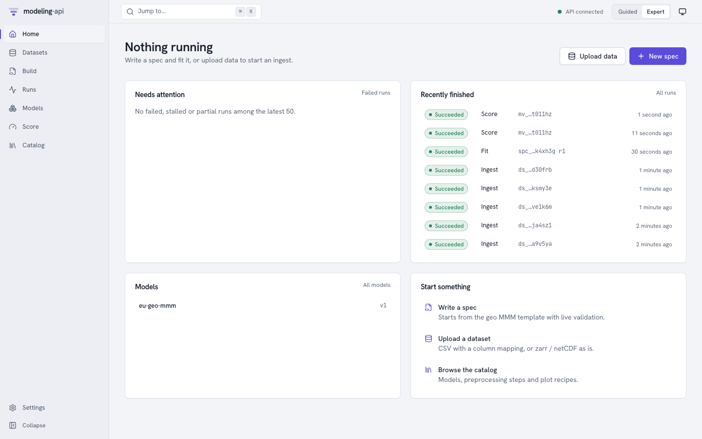{ .mapi-shot }

The landing page answers "is anything happening, and does anything need me?":

- **Running** (the heading says *Nothing running* when idle): active runs with their live
  progress bars;
- **Needs attention**: failed, stalled or partial runs among the latest 50, each linking to
  its run page;
- **Recently finished**: the latest runs of every kind with their state and input;
- **Models**: registered models with their latest version;
- **Start something**: write a spec from the geo MMM template, upload a dataset, browse the
  catalog. **Upload data** and **New spec** do the same from the header.

## Datasets

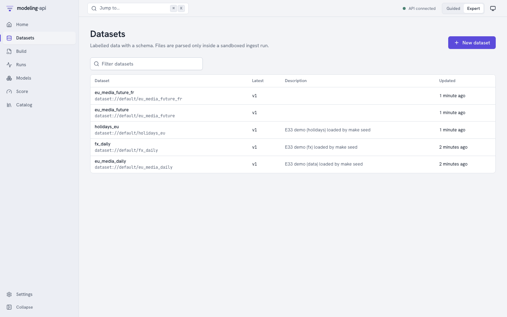{ .mapi-shot }

A *dataset* is a named collection of immutable *versions*. **New dataset** asks for a name
(lowercase letters, digits, `_` and `-`) and an optional description, then opens the upload panel.

**Uploading.** Pick a file:

- a **zarr zip** (`.zarr.zip`) or **netCDF** (`.nc`) file is self-describing: its dims,
  coordinates and, if present, its `mapi_schema` attribute (roles, policies, units) are used
  as they are;
- a **CSV** file is previewed *in your browser* (it is never parsed by the server) and you
  map each column: a **dim** with its kind (`time`, `categorical`, …), its **score-time
  policy** (`fixed`, `extend`, `new_levels`) and frequency, or a **variable** with its role
  (`target`, `spend`, `covariate`, …), units and missing-value rule. Parquet files are mapped
  the same way, without the local preview.

**Upload and ingest** sends the file straight to object storage through a signed PUT URL (the
API never sees the bytes), then starts a sandboxed *ingest* run. The page refreshes until the
version is `ready`, or shows the ingest's issues in plain language ("3 markets are missing
2 weeks in March").

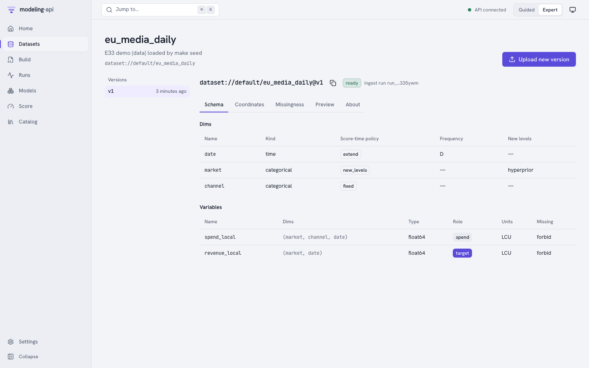{ .mapi-shot }

A version page has five tabs:

| Tab | Shows |
|---|---|
| **Schema** | Dims with kind, score-time policy, frequency and new-level strategy; variables with dims, dtype, role, units and missing-value rule |
| **Coordinates** | Each dim's coordinate range and values, searchable when there are many |
| **Missingness** | A heatmap of missing values per variable along the time dim, rendered in the plot sandbox |
| **Preview** | The first rows, as the ingest run wrote them (`preview.json`) |
| **About** | The content hash, size, the ingest run, when it was created and the version message |

`dataset://default/eu_media_daily@v1` (the copy button next to the title) is the reference
that specs and score requests use. `@latest` resolves to the newest ready version when a run
is submitted, and the run records which one it got.

## Build

**Build** lists the specs with their latest revision and whether it is valid. **New spec**
opens the editor on the geo MMM template.

{ .mapi-shot }

**The editor** is Monaco with YAML support bound to the server's `modelspec.json` schema,
so it completes keys and documents fields on hover. As you type (and on ++cmd+enter++) the
spec is sent to `POST /v1/specs:validate`: the server resolves every `dataset://` reference,
step and model plugin, checks the settings against the plugin's sanitized JSON Schema, and
propagates the data schema through the pipeline using each step's exported schema effect.
Problems appear as squiggles at the exact YAML path and in the **Issues** tab, with their
error code (`LEAKAGE_RISK`, `SCHEMA_INVALID`, …). The badge under the title says `valid` or
how many errors there are.

**The right-hand panel:**

| Tab | Shows |
|---|---|
| **Pipeline** | The raw data after binding, then one card per step: its plugin and version, what kind of step it is (`reshape`, `value`, `feature`), whether it learns state and is invertible, the dims it adds or changes, the context tail it keeps for scoring, and **Schema after this step**. The **Train / holdout split** marker sits where `data.split.after_step` puts it. |
| **Issues** | Every validation issue with its code, JSON pointer and message |
| **Revisions** | Every saved revision, with its message; pick two to see a diff |

**The buttons:**

- **Save revision** (++cmd+s++) stores the text as a new immutable revision (`r1`, `r2`, …)
  with the optional message. Invalid revisions can be saved too, so work in progress is
  never lost; they cannot be fitted.
- **Dry-run** starts a sandboxed `validate` run of the saved revision: it checks the real data
  array by array against the spec, fits the *pipeline* on it (not the model) and records the
  schema at every stage. Use it when a step's effect is dynamic, or when the static check
  passes and you want to know the data really fits.
- **Fit** submits a fit run of the saved revision and opens its run page.

## Runs

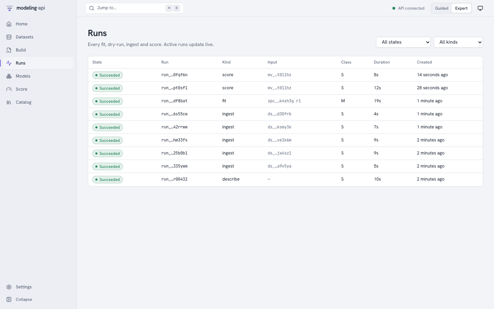{ .mapi-shot }

Every ingest, describe, dry-run, fit and score is a run. The list filters by state and kind
and updates live.

### Run detail

{ .mapi-shot }

The run page subscribes to the run's server-sent event stream (`Live` next to the state) and
resumes where it stopped after a disconnect.

- **Progress**: the current phase (*Starting the sandbox*, *Loading inputs*, *Fitting*,
  *Rendering plots*, *Uploading outputs*, …), the latest message from the runner (for a
  PyMC fit, the chain, draw and divergence counts) and a progress bar. *No progress reported
  recently* appears when a run goes quiet for longer than expected; the run is marked
  `stalled`, which is a warning, not a failure: the executor's own status decides whether
  the run is alive.
- **Logs**: the stdout and stderr the supervisor captured from the worker (capped and
  stripped), with **All / stdout / stderr / system** filters, a text filter and **Follow**.
- **Details**: timestamps, the spec revision, model version or dataset it ran on, the spec
  hash, the run it retried, and its cost (`Not metered locally`).
- **Events**: every persisted event, including the `DEV_MODE_ISOLATION` warning on a laptop,
  diagnostics and metrics.

**Actions:** **Cancel** (any active run; checkpointed fits stop as `partial`), **Resume** (a
`partial` run continues from its checkpoints as a new attempt) and **Retry** (a new run from
a failed one; after `RESOURCE_EXHAUSTED` the dialog suggests the next resource class). A
succeeded fit links to its model version: **Inspect model://default/eu-geo-mmm@v1**.

## Models

**Models** lists every model (one per spec name) and the model page lists its versions. Each
successful fit registers a new version after the platform has verified the run's outputs
and signed the bundle manifest. The version page has six tabs and a **Score** button.

### Overview

{ .mapi-shot }

The **Scorecard** rolls the diagnostics up into pass, warn and fail items, each with a
plain-language message, the metric and its threshold, and a suggested action. **Metrics** are
the holdout metrics the spec asked for (`evaluate.metrics`), computed by scoring the holdout
through the normal scoring path before the refit. **Capabilities** are the plugin's: score
modes, representation (`draws`, `quantiles`, `interval`, `point`, `moments`), how
contributions combine, what preprocessing the model owns, and whether results are
deterministic for a seed.

### Diagnostics

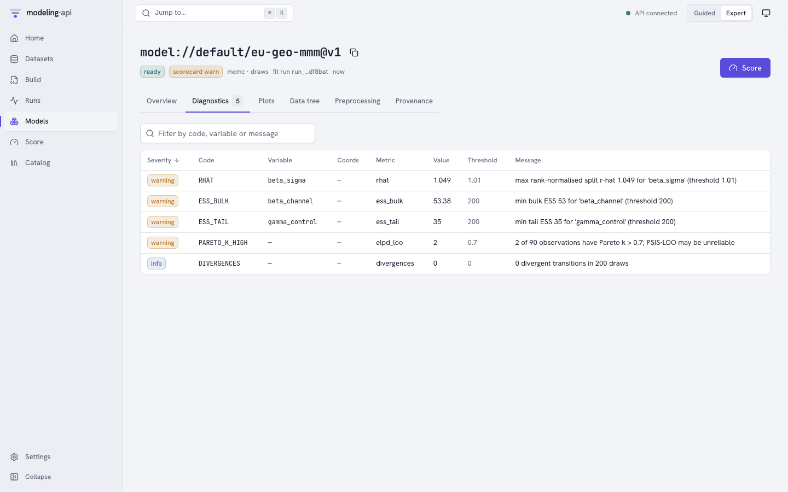{ .mapi-shot }

One row per check and variable, sortable and filterable: R-hat, bulk and tail ESS,
divergences, Pareto k, or "LOO invalid" with the plugin's reason.

### Plots

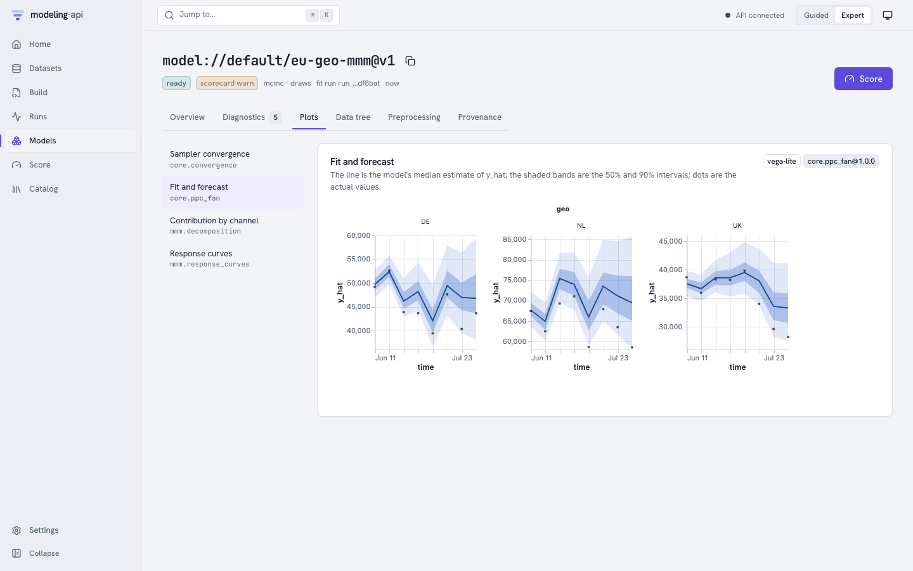{ .mapi-shot }

The plot recipes the spec listed in `outputs.plots`, rendered from the bundle's precomputed
plot data. Each card says which recipe made it (`core.ppc_fan@1.0.0`) and in which library
(`vega-lite` or `plotly`), with a plain-language caption.

Every plot, first-party included, renders inside an `<iframe sandbox="allow-scripts">` served
from the plot sandbox's own origin (port 5174 locally). The specs were checked by the server's
sanitizer when the run finished and again on every read, and the sandbox refuses URL data,
links, external images and tile maps before any charting library runs. The two windows talk
only through a small, validated `postMessage` protocol. See
[Web app and plot sandbox](../reference/web-app.md#security).

### Data tree

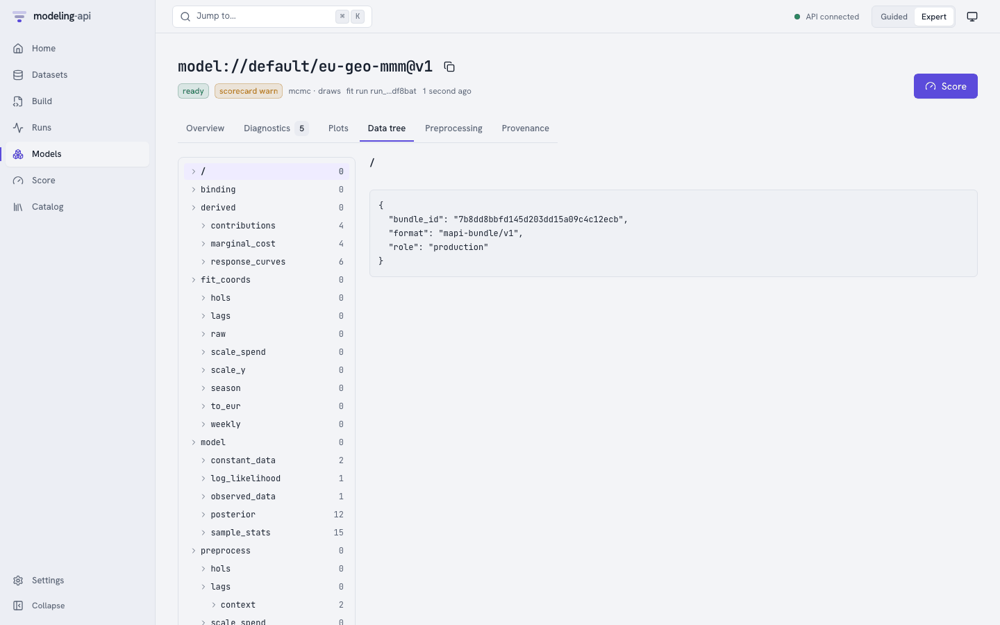{ .mapi-shot }

A browser over the bundle's `ui/tree_index.json`: every group of the fitted bundle
(`binding`, `fit_coords` per stage, `model/posterior`, `sample_stats`, `log_likelihood`,
`preprocess/<step>/{arrays,context}`, `derived/…`) with its variables, dims, shapes, units
and attributes. It reads the index only; the arrays stay in the bundle, which you can
download from **Provenance** or with the client.

### Preprocessing

A heatmap of each step's learned state (for example `scale(geo, channel)`), read from the
bundle's `ui/preprocess.json` view: every step in order with its resolved plugin, whether it
is stateful, its learned JSON and its numeric state arrays (larger arrays are listed as
omitted). The full state is also browsable under `preprocess/` in **Data tree**.

### Provenance

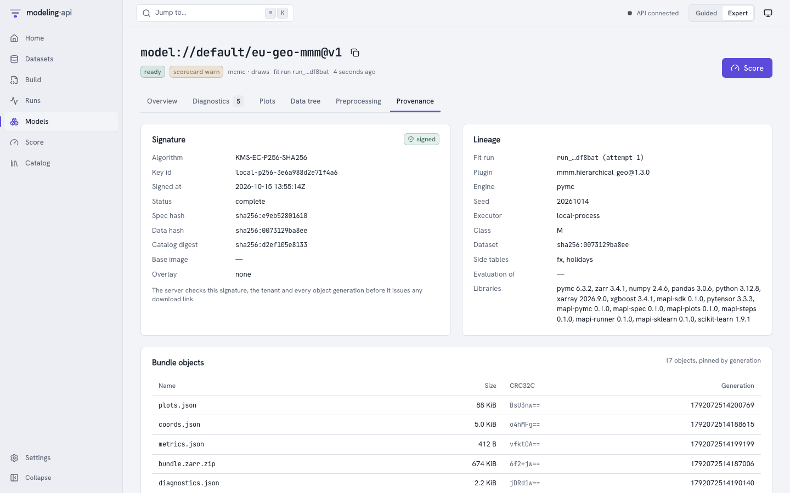{ .mapi-shot }

- **Signature**: the bundle manifest's signature (EC P-256 locally, standing in for Cloud KMS),
  the spec, data and catalog hashes it binds, and its status. The server checks it, the tenant
  and every object generation before it hands out any download link.
- **Lineage**: the fit run and attempt, plugin and version, engine and seed, executor and
  resource class, dataset and side-table versions, the evaluation bundle it was refitted
  from, and the library versions in the runner.
- **Bundle objects**: every stored object with its size, CRC32C and generation; each can be
  opened or downloaded through a short-lived signed URL, and the download is checked against
  that CRC32C.

## Score

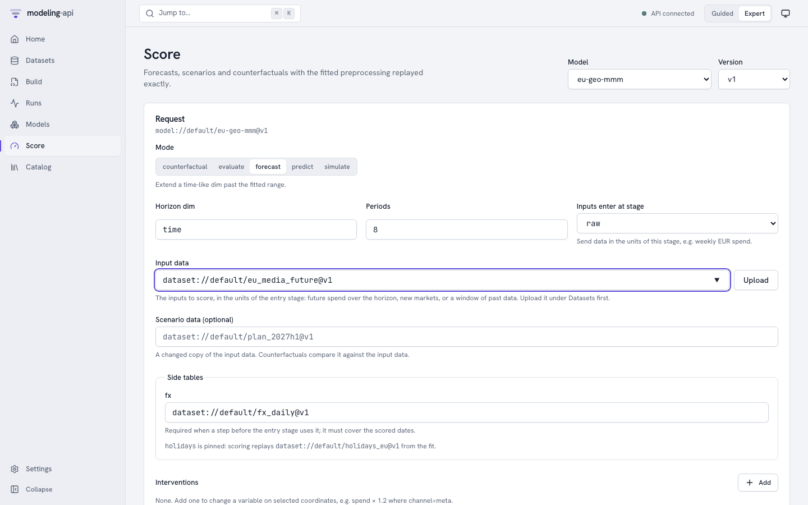{ .mapi-shot }

Pick a model and version (or arrive from a model page). The form is built from the model's
capabilities, so it only offers what the model can do, and the server checks the request
statically before any run starts.

| Field | Meaning |
|---|---|
| **Mode** | `predict`, `forecast`, `counterfactual`, `simulate`, `evaluate` (and `filter` for state-space models), as the plugin declares |
| **Horizon dim**, **Periods** | For `forecast`: how far to extend the time-like dim past the fitted range |
| **Inputs enter at stage** | Where the request's data enters the pipeline: `raw` (the dataset's own units), or a later stage such as `weekly`, to send weekly EUR spend directly. Steps before the stage are skipped, and so are their side tables. |
| **Input data** | A `dataset://` reference (**Upload** creates one): future spend for a forecast, a new market, or a window of past data for a counterfactual |
| **Scenario data** | A changed copy of the input data; counterfactuals compare it with the input |
| **Side tables** | Tables with `score_policy: supplied` (here `fx`) default to the version the fit used and must cover the scored dates; `pinned` tables are replayed from the fit |
| **Interventions** | Change a variable on selected coordinates: `spend_local` where `channel=tv`, multiply by `1.2` |
| **Quantity** | **Expected** (the mean response) or **Predictive** (with observation noise) |
| **Units**, **Names** | Original units (inverted back through the pipeline) or model space; your dataset's names or the plugin's canonical names |
| **Summaries**, **Draws** | Which summaries to return (`mean`, `median`, `sd`, `hdi_50`, `hdi_90`, quantiles), and how many joint draws (0 returns summaries only; counterfactual deltas need draws to show their uncertainty) |
| **Variables**, **Seed** | Restrict the outputs; fix the seed for reproducible draws |

**Score** sends `POST /v1/models/{id}/versions/{v}:score` with `Prefer: wait=30` and an
idempotency key, then follows the run.

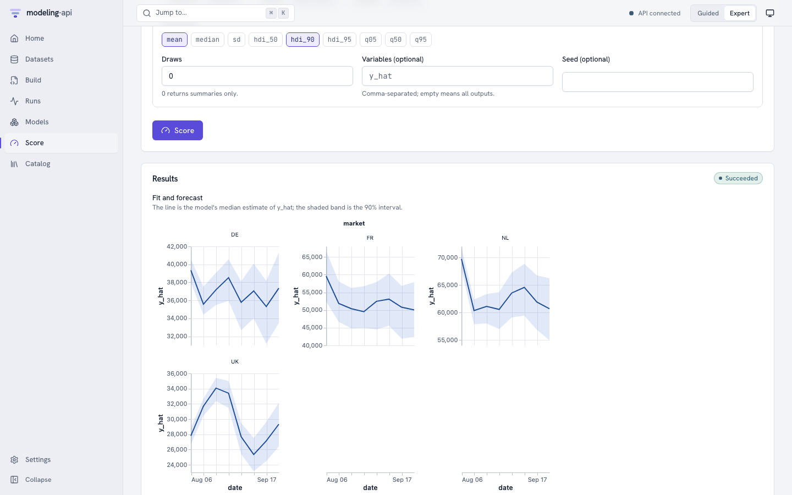{ .mapi-shot }

**Results** shows the run's own plots (a forecast fan per market, or the scenario against the
baseline for a counterfactual), the outputs with their sizes and signed links
(`score.zarr.zip` is the full `xr.DataTree`, `ui/summary.arrow` the summary table), the
summary as a table with one row per coordinate and one column per statistic, and a quick
chart you can re-plot by any column. A market the model has not seen, like FR above, is drawn
from the fitted hierarchy, so its band is wider; the result's `issues` say so.

## Workflows and governance v0.5

**Workflows** builds, runs, schedules and watches workflows: a template gallery, a visual
editor with a node palette, typed ports and a YAML view, and a live run monitor. See
[In the web app](workflows.md#in-the-web-app). **Governance** edits policies, follows
validations and holds the reviewers' queue; see [In the web app](governance.md#in-the-web-app).

The screens lead into each other:

- A finished workflow run links each model it fitted to the **Model Explorer** and to the
  version's validations (in the run summary, the fit step's runs and its outputs); the run
  page of a workflow run opens its monitor, and a model's lineage leads back to the workflow
  run that fitted it.
- The **Model Explorer** shows the version's validation status in its header (a link to the
  version's validations) and, under *Governance evidence*, links to the latest validation and
  the policies. A validation links back to the Model Explorer and to the run that computed
  its checks.
- The **Data Explorer** of data over time offers the readiness workflow with that data
  already bound: the *Run this recipe* page in Guided mode, the template wizard in Expert mode.
- **Start with this** on an About card or a Help me choose result opens a workflow template
  as a recipe (Guided) or in the template wizard (Expert), and a governance check in the
  check catalog.

## Catalog

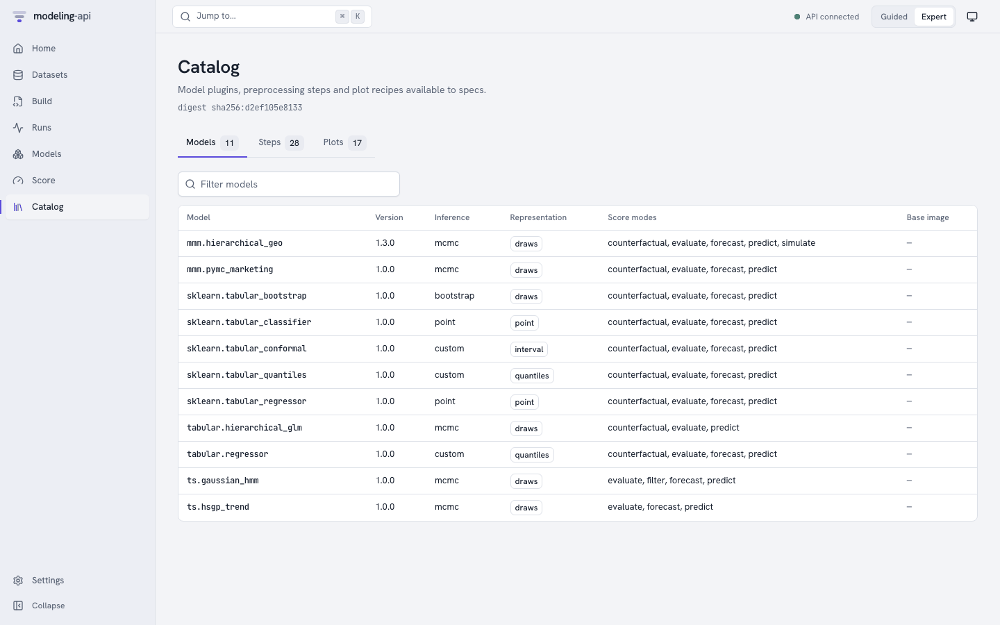{ .mapi-shot }

What the runner image provides, as exported by its sandboxed *describe* run and identified by
its digest: **Models** (inference, representation, score modes, base image), **Steps** (kind,
whether it learns state, invertibility, summary) and **Plots** (recipe, title, audience and
the bundle groups it needs). Click a row for its full entry. Specs can only use what is listed here. The same data is in
the [generated catalogs](../reference/generated/models-catalog.md).

Since v0.5 the catalog opens on **Browse**: every item a user can pick by its plain-language
About card, with **Help me choose** one click away (see [About cards and
choosing](../concepts/about-and-choosing.md#in-the-web-app)).

## Explorers and budget plans v0.5

- **Explore this version** on a dataset version opens the
  [Data Explorer](data-explorer.md#in-the-web-app).
- **Explore** on a model version opens the [Model Explorer](model-explorer.md#in-the-web-app)
  (parameters, diagnostics, fit, residuals, contributions, response curves, IRF/FEVD,
  forecasts, backtests, governance evidence and lineage); **Compare** puts several versions
  side by side with Diebold-Mariano tests; **Optimise budget** plans a marketing budget.

## Settings

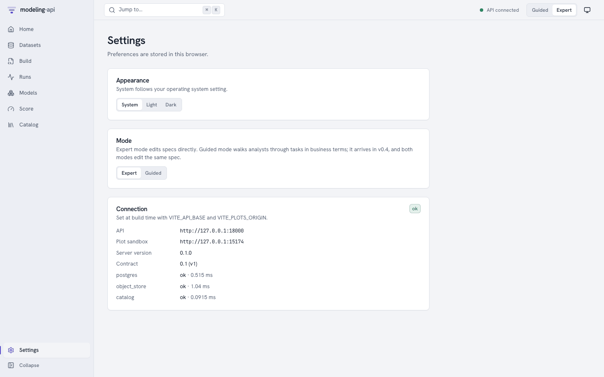{ .mapi-shot }

**Appearance** and **Mode** are stored in this browser. Project admins also find **Lock
… to Guided mode** under Mode v0.4: the project's persona lock
(stored on the server and audited; see [Guided mode](../concepts/guided-mode.md#the-persona-lock)).
**Connection** shows the API and plot
sandbox the app was built for (`VITE_API_BASE`, `VITE_PLOTS_ORIGIN`), the server and contract
versions, and the latency of each readiness check.

Organisation admins also get **Data** v0.4: a GDPR export of
everything the organisation stored, and deleting the organisation with a 7-day grace period in
which it can be cancelled. See [Settings > Data](integrations-hub.md#settings-data).

## Integrations v0.4

{ .mapi-shot }

Where a model leaves the platform: Guided cards for Google Sheets, a BI dashboard and a webhook,
and the Expert pages - endpoints and aliases promoted through the scorecard gate (with history,
rollback, the input contract, **Try it** and snippets in six languages), webhooks with their
delivery logs and replays, and saved plots with PNG/SVG/PDF downloads and expiring embed links.
A plot gallery's **Share** button starts there too. Every page is described in
[The Integrations hub](integrations-hub.md).

The sign-in screen links to the public **sign-up** page when the server allows self-service
sign-up; see [Sign-up and e-mail verification](integrations-hub.md#sign-up-and-e-mail-verification).

## Guided

{ .mapi-shot }

The task flow for analysts: choose a template, answer questions about the data, state what
you believe, fit, read the report and the sanity scorecard, try what-if scenarios and share
the result. Every step has its own URL and **View as YAML**. The walkthrough is
[Your first analysis in Guided mode](guided-tutorial.md).

## Usage, Members, Tokens and Admin v0.3 { #team-pages }

The pages for running the platform for several people and organisations are described, with
screenshots, in the [Administration guide](administration.md):

| Page | Who sees it | What it is for |
|---|---|---|
| **Usage** | Everyone in the project; **Organisation** needs a tenant-wide admin | [Cost and quota use](administration.md#cost-and-usage) for a UTC day or month |
| **Members** | Everyone; changes need an admin | [Who has which role](administration.md#projects-and-members), invitations |
| **Tokens** | Everyone (their own); admins see everyone's | [API tokens](administration.md#api-tokens): create, list, revoke; `?preset=score:<alias>` opens a token for one endpoint |
| **Admin** | Platform operators | [Tenants](administration.md#tenants), [quotas](administration.md#quotas), [kill switches](administration.md#kill-switches), [executors](administration.md#executors) and the [audit log](administration.md#audit-log); v0.4 adds the [sign-up review queue and tenant trust](integrations-hub.md#admin-console-additions) |

## Where next

- [Your first model in the web app](first-model-in-the-ui.md): the E33 demo clicked through
  from upload to counterfactual.
- [Web app and plot sandbox](../reference/web-app.md): build variables, the API client and
  the security headers.
- [Security model](../concepts/security.md): what the sandbox and the plot iframe protect
  against, locally and in production.
