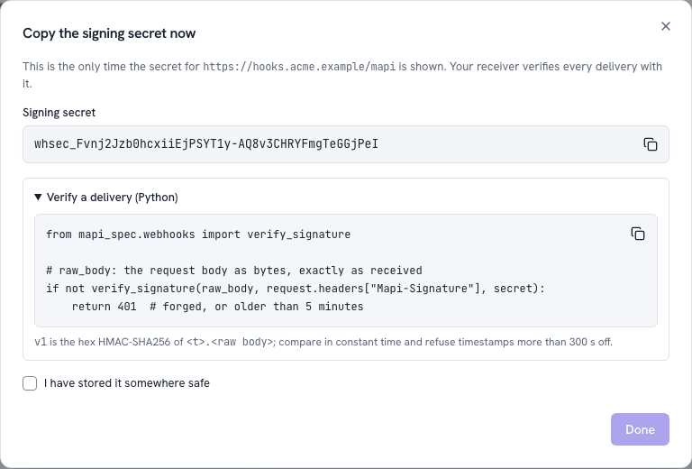

# Receive webhooks <span class="mapi-badge">v0.4</span>

A [webhook](endpoints-and-webhooks.md) sends a small JSON envelope to your URL with `POST`. It
does this when a run finishes, a model version is ready, an endpoint is promoted or a score is
complete. In this tutorial, you create a webhook. You write a receiver that makes sure that each
delivery came from the platform. Then you see how it reacts to a new model, first on your
laptop. All persons can send a request to your URL. Thus the check is necessary.
`mapi_client.webhooks.verify` does the check in one call.

## 1. Create the webhook

You must have the project **admin** role (or a token with the `webhooks:manage` scope).

=== "Web app"

    1. Go to **Integrations → Overview → Webhook → Set up a webhook** (or the **Webhooks** tab
       → **New webhook**).
    2. Type an `https` URL and a description.
    3. Select the events.
    4. Copy the signing secret. The app shows the **signing secret only one time**.

    **Done** stays disabled until you copy the secret or select the box that tells that you
    stored it.

    { .mapi-shot style="max-width: 640px" }

=== "CLI"

    ```bash
    mapi webhooks create https://hooks.acme.example/mapi \
      -e model.version.ready -e run.failed --description "Planning pipeline"
    ```

=== "Python"

    ```python
    --8<-- "client_integrations.py:webhook"
    ```

Keep the secret in a place where your receiver can read it. For example, keep it as
`MAPI_WEBHOOK_SECRET` in your secret manager. The platform refuses URLs on private, loopback or
link-local addresses (`WEBHOOK_URL_BLOCKED`). It also refuses ports other than 443 and 8443.
[Step 4](#4-try-it-on-your-laptop) shows how a development stack can send to a receiver on your
computer.

## 2. What a delivery looks like

```http
POST /mapi/webhook HTTP/1.1
Content-Type: application/json
Mapi-Signature: t=1792000000,v1=5257a869e7ecebeda32affa62cdca3fa51cad7e77a0e56ff536d0ce8e108d8bd
Mapi-Event-Id: evt_01jaf3k1m2n3p4q5r6s7t8v9w0
Mapi-Event-Type: endpoint.promoted
Mapi-Webhook-Id: whk_01jaf3h1j2k3m4n5p6q7r8s9t0
Mapi-Delivery-Id: whd_01jaf3m1n2p3q4r5s6t7v8w9x0

{"api_version": "v1", "created": "2026-10-15T09:30:00Z", "data": {"alias": "geo-mmm-prod", ...},
 "id": "evt_01jaf3k1m2n3p4q5r6s7t8v9w0", "project": "growth", "tenant": "acme",
 "type": "endpoint.promoted"}
```

`v1` is the hex HMAC-SHA256 of the timestamp `t`, a dot and the **raw body**. The signing secret
of the webhook is the key. During the rotation of a secret, the header contains one `v1` for
each active secret. Thus receivers that know one of the two secrets continue to work during the
24 hours of the rotation.

| Event | `data` |
|---|---|
| `run.succeeded`, `run.failed` | `run_id`, `kind`, `state`. If the run failed, also `failure_class` and `code`. `model_version_id` for a fit. |
| `model.version.ready` | `model_id`, `model_version_id`, `ref`, `scorecard_overall` (`pass`, `warn` or `fail`) |
| `endpoint.promoted` | `alias`, `ref`, `revision`, `model_version_id`, `overridden` |
| `score.completed` | `run_id`, `endpoint` (if it was an endpoint call), `model_version_id`, the names of the `outputs` |
| `tenant.deletion.completed` | `deletion_id`, `requested_at`, `completed_at` |

The envelope contains only ids and states. It never contains data values, signed URLs or
secrets. To get other information, use the API.

## 3. Write the receiver

`verify(headers, body, secret)` does these steps:

1. It finds `Mapi-Signature` in all types of headers object. The names are not case-sensitive.
2. It calculates the HMAC over the raw body again. It compares the HMAC with each `v1` in
   **constant time**. `secret` can be a list: the old secret and the new secret during a
   rotation.
3. It refuses a timestamp that is more than **300 seconds** from your clock. This limits replays
   of a captured delivery. To change the limit, use `tolerance=`.
4. It parses the body as a `WebhookEnvelope`. It does a check that `Mapi-Event-Id` names the
   same event.

If a step fails, `verify` raises `MapiError` with the code `WEBHOOK_SIGNATURE_INVALID`. Answer
it with `401`. `is_valid(...)` does the same check and returns a boolean. The function refuses
bodies that are larger than 256 KiB before it parses them.

!!! warning "Use the raw body"
    Verify the bytes exactly as they came in. Your framework can parse a body and serialise it
    again (`json.dumps(await request.json())`). The spaces or the sequence of keys then
    change, and the body never agrees with its signature.

=== "FastAPI"

    ```python
    --8<-- "webhook_receiver.py:fastapi"
    ```

=== "Flask"

    ```python
    --8<-- "webhook_receiver_flask.py:flask"
    ```

The test suite runs the two receivers (`docs/snippets/webhook_receiver.py` and
`webhook_receiver_flask.py`). It sends deliveries with exactly the same signature as the
platform. Then it sends a replay, a body that was changed and an old timestamp.

## 4. Try it on your laptop

A `make dev` stack trusts a receiver on your own computer. The `dev` profile writes a temporary
CA and a certificate for `127.0.0.1` and `localhost` to `.local/dev/webhook-tls/`. It trusts
that CA and puts the two hosts on the allow-list
([configuration](../operations/configuration.md)). The workspace of the repository has FastAPI
and uvicorn.

1. Save the FastAPI receiver as `receiver.py`.
2. Create a webhook for it from the repository.
3. Export the secret that the command shows.
4. Serve the receiver with that certificate:

```bash
uv run mapi webhooks create https://localhost:8443/mapi/webhook \
  -e endpoint.promoted -e run.failed               # prints the secret once
export MAPI_WEBHOOK_SECRET=whsec_…                 # that secret
uv run uvicorn receiver:app --port 8443 \
  --ssl-certfile .local/dev/webhook-tls/cert.pem --ssl-keyfile .local/dev/webhook-tls/key.pem
```

Promote a fitted model to an endpoint. The [Quickstart](../getting-started/quickstart.md) fits
a model. Promote it in the [Integrations hub](integrations-hub.md#promoting-through-the-gate).
The receiver then prints `now serving endpoint://<project>/<alias> revision 1`.

In the web app, the **Delivery log** of the webhook shows the try, with the response code and
the time of your receiver. **Send test** sends the newest delivery again. Thus you can do a
check of a receiver that you changed. `mapi webhooks replay <webhook_id> <delivery_id>` does
the same. The M3 end-to-end suite gets each event type in this way.

You can also send a delivery with a correct signature to your receiver yourself, without a
stack. `mapi_spec.webhooks.signature_header(body, [secret])` makes the header exactly as the
platform does.

## Good receivers

- **Answer fast** with a `2xx`. Then do the work in the background. After 5 seconds, the
  platform stops the delivery and tries it again (after 1 min, 5 min, 30 min, 2 h, 6 h, 12 h
  and 24 h).
- **Expect duplicates.** Retries and replays send the same event again. Keep the `event.id`s
  that you processed.
- **Answer `410 Gone`** to stop deliveries permanently. The platform disables the webhook
  immediately. After 20 failed events in a sequence, the platform also disables it.
  `mapi webhooks ls` shows the reason. To enable it again, use
  `api.webhooks.update(id, active=True)`.
- **Keep the secret secret.** The app shows it one time. Keep it in your secret manager. To
  rotate it, use `mapi webhooks rotate <id>`. Give the two secrets to the receiver until the old
  secret expires.
- **Serve HTTPS on port 443 or 8443** under a public host name in production. The platform does
  not send deliveries to private, loopback or link-local addresses (see
  [SSRF protection](../concepts/integrations.md#ssrf-protection)).

## Next

- When you get `endpoint.promoted`, refresh a [Google Sheet](../tutorials/google-sheets.md) or
  a cache.
- Connect a pipeline. When you get `model.version.ready` with `scorecard_overall: pass`,
  promote the model version with a token that has the scope `endpoints:promote`
  ([Endpoints and webhooks](endpoints-and-webhooks.md)).
