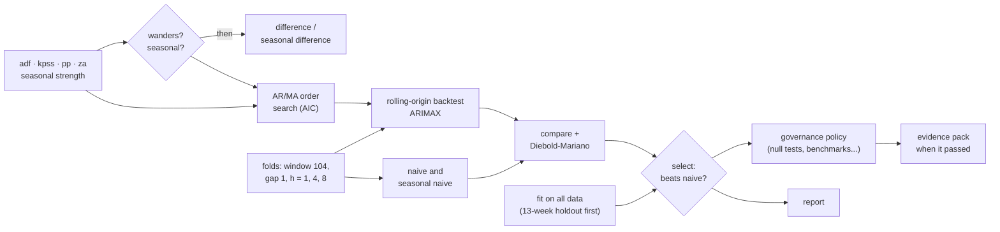

# Workflow cookbook <span class="mapi-badge">v0.5</span>

Three complete analyses, each a single YAML document you can save, run, schedule and hand to
a colleague. Every document on this page is validated against the node catalog and run end to
end by the documentation's tests, so what you copy works. For the format itself see
[Workflows](../concepts/workflows.md); for every node, the [node reference](../reference/workflow-nodes.md);
for short fragments (one pattern each), the [workflows guide](workflows.md#cookbook).

| Recipe | The question it answers |
|---|---|
| [Is my weekly KPI ready to forecast?](#readiness-to-arimax) | Does the series need differencing, which ARIMA orders, does ARIMAX beat a naive forecast on honest backtests, and may we use it? |
| [Do these series move together?](#varvecm-cointegration) | Are several series tied in the long run (VECM) or only in their changes (VAR), and does one help predict another? |
| [Which forecasting model?](#forecast-bake-off) | Which of SARIMAX, ARIMA, ETS and Theta forecasts best on the same folds - and is the winner's edge more than luck? |

## Readiness to ARIMAX

**In plain words.** Before trusting a forecast you want to know four things: whether the
series "wanders" (and must be modelled in changes rather than levels), how much of the past
matters, whether the model forecasts better than the obvious "next week is like this week",
and whether it learned something real rather than noise. This workflow answers each with the
standard statistical tool, writes down every decision with the numbers behind it, keeps the
model only if it beats the benchmarks, and records the governance evidence.

**For the statistician.** ADF, KPSS, Phillips-Perron and Zivot-Andrews (one endogenous break)
decide `d` by a conservative rule - difference unless the evidence for stationarity is
clear on both sides; seasonal strength (STL) decides `D`. The ARMA orders come from an
information-criterion grid over `p ≤ max_p`, `q ≤ max_q` fitted as ARIMA(p, d, q) on the
levels (so `d` is estimated, not imposed on already-differenced data); ACF/PACF are reported
for the reader. The backtest is a rolling origin with a fixed training window, a gap and
several horizons; ARIMAX and the naive and seasonal-naive benchmarks are scored on the same
folds; a Diebold-Mariano test with the Harvey-Leybourne-Newbold correction says whether the
difference in squared errors at horizon 1 is significant. `select.best` keeps the model only if
its MAE beats every benchmark in `must_beat`.



### The document

```yaml
--8<-- "cookbook_readiness_arimax.yaml"
```

Three details worth copying into your own workflows:

- **Alternatives keep the graph honest.** `diff` reads `[sdiff.data, inputs.data]`: the
  seasonally differenced series if that node ran, else the raw one. `acf` looks at the most
  processed series that exists. Nothing is computed twice and nothing breaks when a branch is
  not taken - skipped nodes are *skipped*, not failed.
- **Decisions travel as values.** `$expr: "[nodes.order.best_p, if(nodes.wanders.value, 1, 0), nodes.order.best_q]"`
  turns the search result and the branch decision into the model's `order`. The expression
  language is parsed, never `eval`-ed, and the run records every value it read.
- **The fit has its own holdout.** `split.holdout` keeps the last 13 weeks out of the first
  fit (`mode: evaluate_then_refit`), so the governance checks that need unseen data - the
  null tests, the naive benchmark, holdout accuracy - have it. The model is then refitted on
  everything.

### Run it with the CLI

```bash
--8<-- "cli_v05.sh:workflow"
```

`mapi workflows init` writes the gallery's `ts_readiness_arimax` template (the same analysis
with an expanding-window backtest) under your name and project; save the document above as
`weekly-readiness.yaml` instead to get the rolling origin and the evidence pack. `--watch`
shows every node's status as the run goes (redrawn in place on a terminal, one line per change
in a log) and the summary at the end. This is a real run on a local stack, the second on this
data: the unit-root tests, the holdout split and the fit had not changed since the first run,
so they were **reused from its cache** rather than recomputed (shortened):

```text
started workflow run run_01m53hawnnyn7cyeptj70cxkk0 of workflow://growth/weekly-readiness
following workflow run run_01m53hawnnyn7cyeptj70cxkk0 (23 nodes)
  run started
  adf cached
  kpss cached
  pp cached
  za cached
  seas cached
  folds queued
  holdout cached
  wanders took the then arm
  seasonal took the else arm
  sdiff skipped: branch 'seasonal' took the else path
  …
  backtest succeeded
  compare succeeded
  select succeeded
  dm succeeded
  governance succeeded
  trusted took the then arm
  pack succeeded
  run succeeded

 node       ┃ kind       ┃ status      ┃ took  ┃ found
━━━━━━━━━━━━╇━━━━━━━━━━━━╇━━━━━━━━━━━━━╇━━━━━━━╇━━━━━━━━━━━━━━━━━━━━━━━━━━━━━━━━━━━━━━━━━━━━━━━━━━━━━━
 adf        │ test       │ ✓ cached    │ 0.0s  │ The series wanders: consider differencing it. (cached
            │            │             │       │ from run_01m53h6m9np4gtfzvrkwrr4bh9)
 za         │ test       │ ✓ cached    │ 0.0s  │ The series wanders even allowing for one break:
            │            │             │       │ consider differencing it. (cached from …)
 seas       │ test       │ ✓ cached    │ 0.0s  │ No clear repeating pattern was found. (cached from …)
 wanders    │ branch     │ ✓ succeeded │ 0.0s  │ took the then arm
 order      │ search     │ ✓ succeeded │ 22.9s │ {"best_p": 1, "best_q": 1}
 sdiff      │ transform  │ – skipped   │ 0.0s  │ branch 'seasonal' took the else path
 dm         │ compare    │ ✓ succeeded │ 18.7s │ The difference between backtest and naive at
            │            │             │       │ horizon 1 may be luck.
 acf        │ test       │ ✓ succeeded │ 13.4s │ No past period is related to the present beyond
            │            │             │       │ chance.
 select     │ select     │ ✓ succeeded │ 0.0s  │ backtest has the best average error (1.78) and beats
            │            │             │       │ every benchmark (the strongest, naiv…
 governance │ governance │ ✓ succeeded │ 48.5s │ Every blocking check passed (7 check(s) ran);
            │            │             │       │ warnings on null.permutation_target, stabil…
 …
Decisions
 branch   ┃ arm  ┃ condition                                   ┃ read
━━━━━━━━━━╇━━━━━━╇━━━━━━━━━━━━━━━━━━━━━━━━━━━━━━━━━━━━━━━━━━━━━╇━━━━━━━━━━━━━━━━━━━━━━━━━━━━━━━━━
 wanders  │ then │ (not nodes.adf.reject or nodes.kpss.reject) │ {"nodes.pp.reject": false,
          │      │ and not (nodes.pp.reject and                │ "nodes.za.reject": false,
          │      │ nodes.za.reject)                            │ "nodes.adf.reject": false,
          │      │                                             │ "nodes.kpss.reject": true}
 seasonal │ else │ nodes.seas.seasonal                         │ {"nodes.seas.seasonal": false}
 trusted  │ then │ nodes.governance.passed                     │ {"nodes.governance.passed": true}
Outputs
 output   ┃ type          ┃ where
━━━━━━━━━━╇━━━━━━━━━━━━━━━╇━━━━━━━━━━━━━━━━━━━━━━━━━━━━━━━━━━━━━━━━━━━
 model    │ model_version │ model://growth/wf-weekly-readiness-fit@v1
 …
```

The whole run took 1.6 minutes on a laptop; the live board goes to standard error and the
summary to standard output, so `mapi workflows run … --watch > summary.txt` keeps only the
summary.

Then inspect, download and automate:

```bash
--8<-- "cli_v05.sh:inspect"
```

```bash
--8<-- "cli_v05.sh:automate"
```

### Run it with the Python client

Validate the file on the server (nothing is saved), then create it or save a new revision,
run it and follow the live events:

```python
--8<-- "client_v05.py:validate"
```

```python
--8<-- "client_v05.py:run"
```

Read what it found - every test's verdict, every branch with the values it read, the chosen
orders, the Diebold-Mariano verdict and why the model was (or was not) selected:

```python
--8<-- "client_v05.py:inspect"
```

The governance node measured the selected model against the policy in force and, with
`submit: true`, recorded a validation of that model version:

```python
--8<-- "client_v05.py:governance"
```

What it printed on a live local stack (the walkthrough's first run on this data):

```text
passed
validated
data.quality                 pass    No data problems found (156 periods of history).
convergence                  pass    The fit reported no convergence problems.
baseline.beats_naive         pass    On the 13 held-out periods the model's error is 25% lower than 'same as last period' (the strongest simple benchmark).
holdout.accuracy             pass    On data it was not fitted on, the model's average percentage error is 1.8% (limit 15%).
residuals.whiteness          pass    No pattern is left in the errors (Ljung-Box p = 0.39 at 10 lags).
null.permutation_target      pass    The model did better on held-out data (skill 0.236) than all 20 fits with the drivers price shuffled in blocks of 7 (the result untouched) (p = 0.048).
stability.rolling_params     fail    ar.L1 changes a lot across windows of history (variation 1205%): the relationship may not be stable over time.
```

Read it like a reviewer would: the model beats naive by 25% on unseen weeks, leaves no
pattern in its errors, and forecasts better than every fit with the price driver shuffled in
time, but the AR coefficient is not stable across windows. That check *failed* and the version
is still `validated`, because a check's status and its severity are different things: the
default forecasting policy holds stability at *information*, so it does not block; it is on
the record for the reviewer and in the evidence pack. A stricter policy (see
[governance](governance.md)) makes it blocking, and this model would then need more history
or a simpler specification. That is the point: the evidence is written down, and the decision
is explicit.

!!! note "What the shuffle test measures on a random walk"
    The model has a driver, so the test shuffles the driver in blocks and leaves the result
    untouched, and it scores each fit by its skill against the null forecast on the held-out
    weeks. Persistence ("next week is like this week") helps the shuffled fits exactly as much
    as the real one, so the test measures what the driver adds beyond it. A model without
    drivers is tested on shuffled changes of the series instead
    ([null tests explained](null-tests.md)).

Finally, keep it current:

```python
--8<-- "client_v05.py:automate"
```

## VAR/VECM cointegration

**In plain words.** Some series wander but stay tied together - prices of close substitutes,
sales and distribution, income and consumption. If they are tied, a model that knows the tie
(an error-correction model) forecasts better and tells you how fast a gap closes. If they are
not, model their changes instead. Either way, ask whether one series helps predict another.

**For the statistician.** The Johansen trace test (at 5%) on the levels decides the branch.
Tied: `search.coint_rank` chooses the rank and a VECM with `k_ar_diff: 1` is fitted on the
levels. Not tied: the series are differenced, the VAR lag order is chosen by AIC up to
`maxlags`, and a VAR is fitted on the changes. Granger causality is tested on the changes when
they were taken (the first alternative), else on the levels. The forecast node takes whichever
model exists, with the matching data.

```yaml
--8<-- "cookbook_var_vecm.yaml"
```

The data holds the series along one dimension, one value per series and period
(`value(series, quarter)`), the layout of `ts.var` and `ts.vecm`; ingest a wide sheet with
the `wide` mapping. Run it like the first recipe, with the two parameters it requires:

```bash
mapi workflows apply macro-system.yaml
mapi workflows run macro-system -i data=dataset://growth/us_macro@latest \
  -p target=realcons -p driver=realgdp --watch
```

```python
run = api.workflows.run(
    wf.id,
    inputs={"data": "dataset://growth/us_macro@latest"},
    params={"target": "realcons", "driver": "realgdp", "maxlags": 4},
    wait=True,
)
nodes = {n.node_id: n for n in run.nodes}
print(nodes["johansen"].result["verdict_plain"])  # "The series share at least one long-run relationship."
print(nodes["granger"].result["verdict_plain"])   # "Past values of the driver help predict the result."
print([n.node_id for n in run.nodes if n.status.value == "skipped"])  # the branch not taken
```

Run on a laptop against three simulated weekly series, two of which share a stochastic trend
(`target=a`, `driver=b`), it printed the two verdicts above and `['diff', 'lags', 'var']`:
the Johansen trace statistic (69.1) put the rank at 1, the VECM branch ran, and Granger found
that `b` helps predict `a` (p = 0.0015). See [Macro and VAR analysis](../use-cases.md#macro-and-var-analysis).

The fitted model's impulse responses, variance decomposition, Granger table and Johansen
table are in the [Model Explorer](model-explorer.md) (`mapi explore model … -s irf -s fevd`).

## Forecast bake-off

**In plain words.** When you do not know which forecasting method suits your data, let them
compete fairly: same history, same cut-off points, same horizons, and the same naive
benchmarks. Keep the winner only if it clearly beats doing nothing clever.

**For the statistician.** An expanding window with `n_folds` origins every 4 periods, scored at
each horizon; SARIMAX(1,1,1)(0,1,0)₅₂, ARIMA(0,1,1), damped-trend ETS and Theta against
naive, seasonal-naive and drift. MASE ranks them (scale-free, so series of different size
compare); two Diebold-Mariano tests (absolute loss, horizon 1) check the leaders against the
benchmark; `select.best` requires a 5% MASE improvement over every benchmark, and the branch
refits the winner only then.

```yaml
--8<-- "cookbook_forecast_bakeoff.yaml"
```

```bash
mapi workflows apply forecast-bakeoff.yaml
mapi workflows run forecast-bakeoff -i data=dataset://growth/weekly_sales@latest \
  -p 'horizons=[1,4]' -p n_folds=6 --watch
mapi workflows node "$RUN" compare      # the league table
mapi workflows node "$RUN" best         # who won, and whether they beat naive by 5%
```

A typical outcome on a short, noisy series is the honest one: *"ets is the best model (0.0456)
but does not beat naive.drift by the required 5%: no model is selected."* The `refit` node is
skipped, the report says why, and nobody ships a model that only looks clever.

## Make your own

1. Start from the closest recipe (`mapi workflows init <template>` or copy a document above).
2. Find nodes with `mapi workflows nodes-catalog --kind test` (or `--about test.kpss` for one
   node's About card, ports and parameters).
3. Validate as you go: `mapi workflows validate my.yaml` points at every problem with a JSON
   pointer before anything runs.
4. Save it (`apply`), run it with `--watch`, and read the summary.
5. Automate it with a schedule or a dataset trigger, and gate it on governance.
